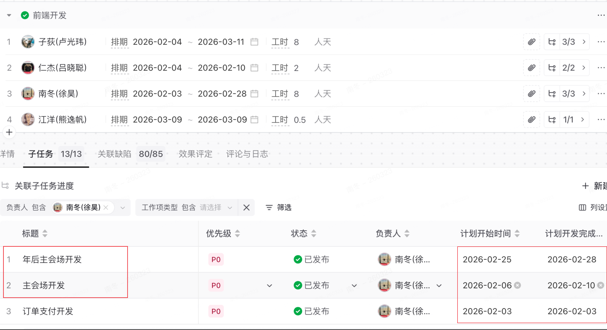
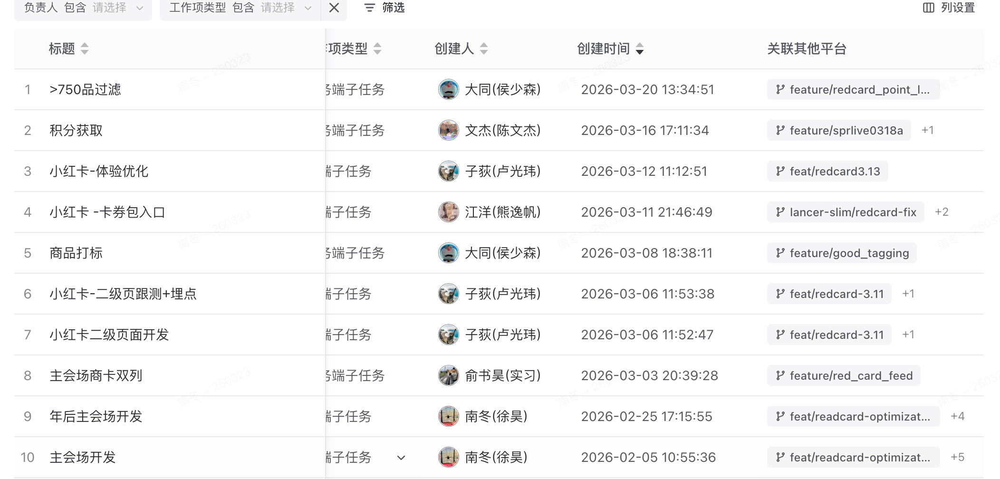
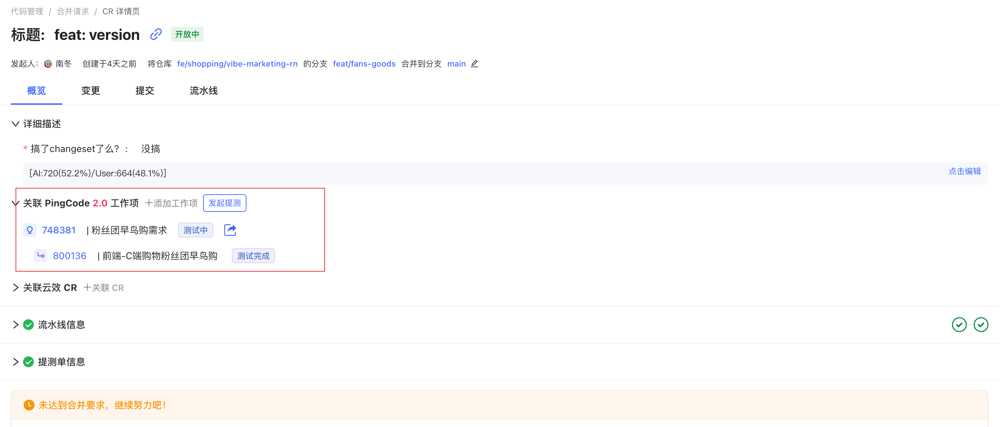
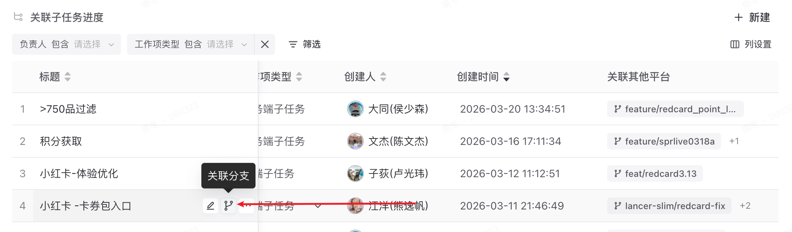
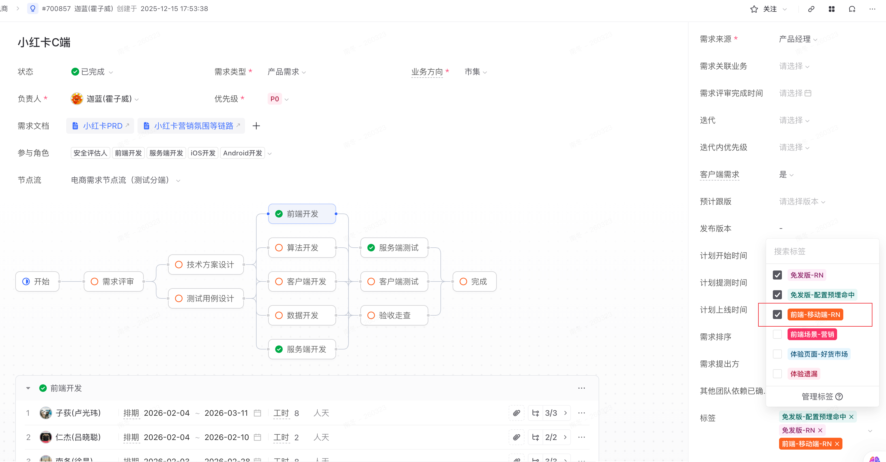

<redoc-highlight>
SDU 统计要求：需要我们将云效的代码分支和子任务进行关联。
</redoc-highlight>

### 一、所有任务必须落 Pingcode

### 二、重要：排期要填写节点以及子任务时间

子任务的时间统计为 结束时间-开始时间，长期节假日需要拆两个子任务，比如年前和年后。因为时间段是做差来算工时，如果追求极致，可以将周末也拆解出来。

 

### 三、重要：子任务需要关联研发分支，不关联SDU 为 0

<redoc-columns>
<redoc-column ratio="0.333333">
关联后效果：

</redoc-column>
<redoc-column ratio="0.333333">
关联方式 1：通过 mr 关联 pingcode

</redoc-column>
<redoc-column ratio="0.333333">
关联 方式 2：pingcode 手动关联

</redoc-column>
</redoc-columns>

### 四、需求要打标； RN打【前端-移动端-RN】PC 打【前端-PC端-WEB】查询可以通过看板 [需求打标明细](https://redbi.devops.xiaohongshu.com/dashboard/list?projectId=1007&dashboardId=36744&pageId=page_yeW0PjBhuZ)

 

 

### 五、任务完成及时更新子任务状态，养成通过 pingcode 管理工作内容的习惯。

 

 