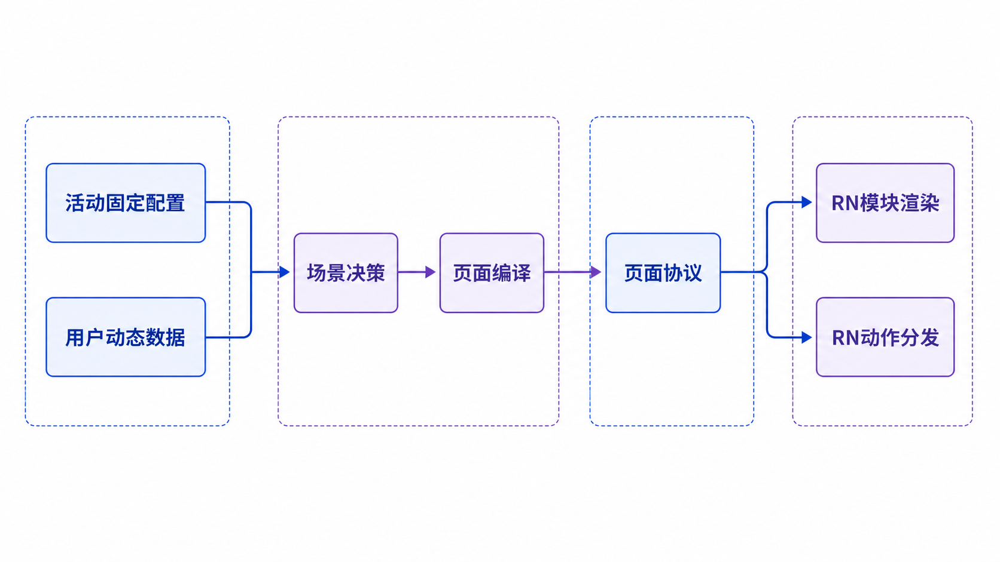

## 文档信息

| 项目 | 内容 |
| --- | --- |
| 文档状态 | 待前后端技术评审 |
| 评审范围 | 页面协议、配置模型、接口边界、RN Renderer、服务端编译、预览与发布 |
| 目标活动 | 夜人节；方案同时覆盖后续抽奖、积分兑换、免费兑换活动 |
| 本次代码状态 | RN POC 已完成；后端、IDL、Edith、Apollo 尚未修改 |
| 更新时间 | 2026-08-06 |

## 1. 评审目标

本次评审需要确认一套可长期复用的活动页面协议，使新活动在已有 RN 组件能够表达的范围内，不再需要修改 RN 代码，只通过配置完成活动创建、内容调整、场景编排、按钮组合和预览发布。

## 4. 核心模型

```plaintext
Activity Config（活动固定数据）
                 +
Activity Runtime（用户动态数据）
                 ↓
Scene Resolver（服务端状态决策）
                 ↓
Page Compiler（校验、合并、权限计算）
                 ↓
Page Document（接口最终返回）
                 ↓
RN Module Registry + Action Dispatcher
```

### 4.4 总体架构图



### 4.1 Activity Config

Config 只描述活动不随用户变化的事实：

- 活动类型和固定时间。

- 固定奖品、填写人数、填写协议和履约模板。

- 页面主题和固定内容。

- 模块定义、Scene 模块组合和固定展示差异。

- 按钮组布局、固定文案、语义样式和 Action 类型。

### 4.2 Activity Runtime

Runtime 只描述当前用户、当前时刻的动态事实：

- 报名状态和报名时间。

- 抽奖状态、中奖结果和开奖时间。

- 实名填写状态、截止时间和已填写人员。

- 积分余额、兑换状态、库存可用性。

- 门票生成状态和动态票务标识。

### 4.3 Page Document

Page Document 是服务端结合 Config 与 Runtime 后的编译产物：

- 已确定唯一 sceneCode。

- modules 已按最终顺序排列。

- 结果卡已注入动态展示数据。

- footer 已完成按钮权限和禁用原因计算。

- RN 接到结果后直接渲染，不再重复业务判断。

## 5. 字段归属原则

| 数据示例 | 归属 | 原因 |
| --- | --- | --- |
| 活动标题、KV、主题色 | Config | 与活动固定绑定 |
| 活动时间、地点、门票类型文案 | Config | 活动固定展示内容 |
| “夜人节七日通票2张” | Config | 奖品固定展示文案 |
| 阵容、活动亮点、相关笔记 | Config | 活动固定内容，可由配置后台维护 |
| 填写人数和协议地址 | Config | 活动履约固定要求 |
| 用户是否报名、是否中奖 | Runtime | 用户维度动态数据 |
| 已填写人员和证件脱敏值 | Runtime | 用户维度敏感动态数据 |
| 当前积分余额、库存 | Runtime | 实时业务数据 |
| 当前 Scene | Page Compiler | Config 与 Runtime 的决策结果 |
| 按钮是否可点击、禁用原因 | Page Compiler | 需要服务端权限和状态判断 |
| 按钮宽度、圆角、字重 | RN 组件 | 视觉实现，不应由运营配置 |
| Android 字重增加 100 | RN 组件 | 平台适配逻辑 |

## 6. 活动 Config 协议

### 6.1 顶层结构

```typescript
type ActivityConfig = {
  schemaVersion: '1.0'
  activityId: string
  activityType: 'LOTTERY' | 'POINTS_EXCHANGE' | 'FREE_EXCHANGE'
  business: ActivityBusinessConfig
  page: {
    theme: ActivityTheme
    modules: ConfigPageModule[]
    actionGroups: Record<string, ActionGroup>
    scenes: Record<string, ActivitySceneConfig>
  }
}
```

### 6.2 Theme

首版只允许配置设计系统认可的主题能力：

```typescript
type ActivityTheme = {
  primaryColor: string
  secondaryColor: string
  pageBackground: {
    type: 'LINEAR_GRADIENT'
    colors: [string, string]
  }
}
```

按钮尺寸、卡片尺寸、圆角、字体、阴影和平台差异不开放配置。

### 6.3 Module

```typescript
type ImageResource = {
  url: string
  width: number
  height: number
}

// Config、Mock 与详情接口统一使用同一组件模块结构
type PageModule = {
  id: string
  type: PageModuleType
  version: number
  slot: 'HERO' | 'RESULT' | 'CONTENT' | 'FLOATING'
  propsJson: string
}

type ConfigPageModule = PageModule
```

Config、Mock 与 Page Document 的页面组件参数统一使用 propsJson，不再存在结构化 module.props。配置本体是纯 JSON；其中 propsJson 的字段值是已经序列化好的 JSON 字符串。配置后台按 type@version 对应的 JSON Schema 提供结构化表单和发布校验；RN 在组件注册表统一执行 JSON.parse 和 Schema 校验，再把强类型 Props 交给现有生产组件。Theme、Runtime、Schedule、Scene、Action 和报名交互等页面公共协议继续使用强类型字段。

首版注册表：

| 注册键 | 用途 |
| --- | --- |
| HERO@1 | 活动 KV |
| BASIC_INFO@1 | 标题、时间、地点、门票类型和简介 |
| RESULT_CARD@1 | 待开奖、未中奖、中奖、填写完成、门票生成等结果态 |
| LINEUP@1 | 艺人阵容和日期时间轴 |
| HIGHLIGHT_CAROUSEL@1 | 活动亮点切图列表 |
| NOTE_CAROUSEL@1 | 相关笔记列表 |
| RULE_LIST@1 | 报名或兑换规则 |

### 6.4 报名策略与场次

报名是否需要先选择场次属于业务交互策略，不属于页面组件 Props，也不按 activityId 在 RN 中写分支。

```typescript
type ActivitySessionConfig = {
  sessionId: string       // 稳定业务标识，报名请求和报名记录均使用它
  date: string            // 展示日期，不作为业务主键
  title: string           // 弹层选项标题
  subtitle?: string       // 固定说明；实时余量不能写在 Config
  tag?: string            // 可选固定标签
  rewardRef: string       // 关联奖品或票务模板
}

type ParticipationConfig =
  | { joinMode: 'DIRECT' }
  | {
      joinMode: 'SELECT_SESSION'
      sessionSelection: {
        title: string
        sessionIds: string[]
        allowAnySession: boolean
        anySessionOption?: {
          title: string
          subtitle?: string
          tag?: string
        }
        agreement: {
          text: string
          linkText: string
          url: string
        }
      }
    }
```

直接报名配置：

```typescript
participation: {
  joinMode: 'DIRECT',
}
```

选择场次配置：

```typescript
participation: {
  joinMode: 'SELECT_SESSION',
  sessionSelection: {
    title: '选择参与日期',
    sessionIds: ['night_20260814', 'night_20260815'],
    allowAnySession: true,
    anySessionOption: {
      title: '任意一天都可以',
      subtitle: '多个奖池同时参与',
      tag: '更高概率',
    },
    agreement: {
      text: '同意',
      linkText: '《小红卡活动抽奖服务协议》',
      url: 'https://example.com/agreement',
    },
  },
},
sessions: [
  {
    sessionId: 'night_20260814',
    date: '2026-08-14',
    title: '8月14日 (DAY 1)',
    rewardRef: 'ticket_day_1',
  },
  {
    sessionId: 'night_20260815',
    date: '2026-08-15',
    title: '8月15日 (DAY 2)',
    rewardRef: 'ticket_day_2',
  },
]
```

场次库存、售罄、是否可选和禁用原因来自 Runtime。Page Compiler 合并固定场次与动态可用性后输出最终 page.interactions.join；报名写接口收到 sessionId 后必须再次校验，成功后将实际场次作为用户报名事实持久化。

### 6.5 Scene

```typescript
type ActivitySceneConfig = {
  moduleIds: string[]
  modulePropsOverridesJson?: Record<string, string>
  footerActionGroup: string | null
}
```

Scene 只描述页面组合，不承担用户状态判断。具体用户进入哪个 Scene 由服务端 Scene Resolver 决定。

抽奖首版 Scene：

- LOTTERY_NOT_STARTED

- LOTTERY_JOINABLE

- LOTTERY_JOINED_WAIT_DRAW

- LOTTERY_DRAWING

- LOTTERY_NOT_WON

- LOTTERY_WON_NEED_ENTRY

- LOTTERY_WON_ENTRY_COMPLETED

- LOTTERY_TICKET_READY

- LOTTERY_MISSED

- ACTIVITY_ENDED

积分兑换和免费兑换使用独立 Scene 命名空间，复用 Page Document 和 Renderer，不复用抽奖状态机。

### 6.5 ActionGroup

```typescript
type ActionGroup = {
  layout: 'SINGLE' | 'DUAL_EQUAL' | 'DUAL_PRIMARY_SECONDARY' | 'VERTICAL'
  actions: ConfigAction[]
}

type ConfigAction = {
  id: string
  text: string
  style: 'PRIMARY' | 'SECONDARY' | 'OUTLINE' | 'GHOST'
  behavior: ActionBehavior
}
```

动作白名单：

| 动作 | 用途 | 执行约束 |
| --- | --- | --- |
| SERVER_COMMAND | 报名抽奖、积分兑换、免费领取 | command 必须在客户端和服务端白名单中 |
| OPEN_SCREEN | 打开实名填写等 RN 页面 | screen 必须注册，参数使用强类型协议 |
| OPEN_LINK | 打开 Deeplink、H5 或小程序 | URL Scheme 和域名必须通过白名单校验 |
| COPY_TEXT | 复制同行人链接并 Toast | 仅允许服务端返回的安全文本 |

### 6.6 按钮动作闭环图

<redoc-text-draw remoteTemplate="graph TD;A[1 用户点击按钮]-->B[2 ActionDispatcher接收动作];B-->C[3 校验按钮状态与动作白名单];C-->D[4 执行SERVERCOMMAND];C-->E[4 打开RN页面];C-->F[4 打开安全链接];C-->G[4 复制文本并Toast];D-->H[5 服务端写操作];H-->I[6 重新查询V2详情];I-->J[7 返回新Scene];J-->K[8 RN原子替换页面协议];" theme="light"/>

## 7. V2 详情接口

### 7.1 接口建议

新增 query_activity_page_v2。旧接口不改，旧页面不迁移。

生产请求：

```typescript
type QueryActivityPageV2Request = {
  activityId: string
}
```

预览请求允许额外携带：

```typescript
type PreviewContext = {
  previewToken: string
  configVersion: number
  sceneCode?: string
}
```

生产请求不能由客户端指定 Scene，避免绕过业务状态判断。

### 7.2 返回结构

```typescript
type PageModule = {
  id: string
  type: PageModuleType
  version: number
  slot: 'HERO' | 'RESULT' | 'CONTENT' | 'FLOATING'
  propsJson: string
}

type JoinInteraction =
  | { mode: 'DIRECT'; command: 'LOTTERY_JOIN' }
  | {
      mode: 'SELECT_SESSION'
      command: 'LOTTERY_JOIN'
      title: string
      agreement: Agreement
      options: JoinSessionOption[]
    }

type ActivityPageResponse = {
  response: {
    success: boolean
    code: number
    msg: string
  }
  data?: PageDocument
}

type PageDocument = {
  activityId: string
  activityType: 'LOTTERY' | 'POINTS_EXCHANGE' | 'FREE_EXCHANGE'
  protocolVersion: '1.0'
  configVersion: number
  sceneCode: string
  serverTime: number
  refreshAfterMs?: number
  schedule: ActivitySchedule
  page: {
    theme: ActivityTheme
    modules: PageModule[]
    footer: RenderActionGroup | null
    interactions: {
      join: JoinInteraction
    }
  }
  runtime: ActivityRuntime
}
```

| 字段 | 来源 | 说明 |
| --- | --- | --- |
| activityId | Config | 活动唯一标识 |
| activityType | Config | 抽奖、积分兑换或免费兑换 |
| protocolVersion | 协议层 | RN 选择页面协议解析器 |
| configVersion | 配置存储 | 缓存、预览、灰度和回滚依据 |
| sceneCode | Scene Resolver | 当前用户唯一页面场景 |
| serverTime | 服务端 | 所有倒计时和时间判断的基准 |
| refreshAfterMs | Page Compiler | 开奖中等瞬态 Scene 的刷新建议 |
| schedule | Config / Page Document | 活动、报名和开奖的 13 位毫秒时间戳，Compiler 原样透传 |
| page.theme | Config | 当前活动主题 |
| page.modules | Page Compiler | 已排序模块；组件私有字段位于 propsJson |
| page.footer | Page Compiler | 已计算权限的最终按钮组，可为空 |
| page.interactions.join | Config + Runtime | 直接报名或选择场次的最终强类型交互协议 |
| runtime | 领域查询 | 报名、中奖、实名、积分和票务动态数据 |

### 7.3 为什么不能直接返回原始 Config

- 原始 Config 不知道当前用户的 Scene。

- 原始 Config 中的按钮还没有完成权限计算。

- 客户端自行合并 Runtime 会产生多端规则不一致。

- Apollo 或数据库结构会泄漏为客户端长期契约。

- 配置升级和回滚会被客户端实现绑死。

## 8. 服务端处理时序

```plaintext
RN 请求 activityId
      ↓
读取已发布 Config Version
      ↓
并行查询报名、抽奖、实名、积分、库存、票务 Runtime
      ↓
Scene Resolver 计算 sceneCode
      ↓
Page Compiler 校验模块和 Action，注入动态字段
      ↓
返回 Page Document
      ↓
RN 渲染并执行白名单 Action
      ↓
写操作成功后重新查询 Page Document
```

### 8.1 详情查询时序图

<redoc-text-draw remoteTemplate="graph TD;A[1 RN查询活动ID]-->B[2 Edith转发用户上下文];B-->C[3 RedVIP读取已发布Config];C-->D[4 RedVIP查询用户动态数据];D-->E[5 Config与Runtime返回RedVIP];E-->F[6 SceneResolver计算场景];F-->G[7 PageCompiler生成PageDocument];G-->H[8 RedVIP返回Edith];H-->I[9 Edith返回RN];I-->J[10 RN按模块与按钮渲染];" theme="light"/>

## 9. 前后端职责

### 9.1 RN 前端

- 维护页面协议 TypeScript 类型和 Module Registry。

- 实现通用 Module Renderer、Footer Renderer 和 Action Dispatcher。

- 校验 protocolVersion 和 type@version，异常时进入可观测错误态。

- 处理页面级加载、刷新、错误、返回和安全区。

- 写操作成功后刷新详情，不维护业务状态机副本。

- 维护组件级视觉实现，包括尺寸、字重、圆角和平台差异。

- 提供 Development Scene 调试器，但生产包不可开启 Mock 或 Scene override。

### 9.2 RedVIP 服务

- 读取已发布 Config，并按 activityId 和版本管理缓存。

- 聚合各领域 Runtime，不把动态数据写入配置。

- 实现不同活动类型的 Scene Resolver。

- 实现 Page Compiler 和发布前校验器。

- 计算按钮权限、禁用原因和刷新间隔。

- 对 Action command、URL 和页面跳转参数做白名单治理。

- 输出监控、配置版本、Scene 和编译错误日志。

### 9.3 IDL

- 新增独立 V2 请求、Page Document、Module、Action、Runtime 类型。

- 不修改旧活动接口字段语义。

- 对页面公共协议和可枚举字段使用 enum/struct；只有 PageModule.propsJson 使用 JSON 字符串承载组件私有 Props，并由 type@version 注册表和 JSON Schema 约束。

- activityDescModule 一类新增展示模块可以使用 map&lt;string, struct&gt; 或等价受控映射承载，但现有模块结构不改。

### 9.4 Edith

- 新增 V2 详情接口并透传标准 Page Document。

- 保留统一错误码、登录态和超时处理。

- 不直接向 RN 暴露 Apollo 原始 JSON。

<br/>

## 附录 A：当前 RN POC

代码目录：packages/red-card-activity-v2

| 文件 | 职责 |
| --- | --- |
| src/protocol/types.ts | 页面、模块、报名交互、Action、Config 和 Runtime 类型 |
| src/mock/nightFestivalConfig.json | 夜人节纯 JSON Config；与配置后台/Apollo 存储形态一致 |
| src/mock/nightFestivalConfig.ts | 导入 JSON，导出类型化 Config、版本号和 Scene 列表 |
| src/mock/runtime.ts | 各 Scene 用户动态数据 Mock |
| src/compiler/compileActivityPage.ts | 解析、校验并合并 propsJson 与 modulePropsOverridesJson，编译 Page Document |
| src/renderer/moduleRegistry.ts | 按 type@version 集中解析、校验 propsJson |
| src/renderer/ActivityPageRenderer.tsx | 将强类型模块 Props 和报名交互适配到生产组件 |
| src/components/SceneDebugger.tsx | Development Scene 切换器 |
| src/apis/activityPage.ts | Mock API 边界，未来替换为 V2 Edith 请求 |
| src/main.tsx | 页面加载、Action 分发和调试入口 |

调试 Deeplink：

```plaintext
xhsdiscover://rn/vibe-marketing-rn/red-card-activity-v2?activityId=NIGHT_FESTIVAL_2026&sceneCode=LOTTERY_WON_ENTRY_COMPLETED
```

验证结果：

- 新包 TypeScript 检查通过。

- 协议编译器 5 个测试通过。

- git diff --check 通过。

- Metro iOS Development Bundle 返回 HTTP 200。

- 主 App 全量 type-check 仍有仓库存量错误；定向筛查没有新包或新路由错误。

## 附录 B：夜人节完整 Mock Config（JSONC 评审版）

以下内容与代码中的严格 JSON 配置结构一致。// 注释仅用于前后端评审，不进入 Apollo；删除注释后即可作为标准 JSON。propsJson 与 modulePropsOverridesJson 仍按接口真实形态保存为 JSON 字符串，文档中的反斜杠是外层 JSON 的标准转义。

```json
{
  // 页面协议版本；用于服务端编译器与 RN Renderer 协商能力。
  "schemaVersion": "1.0",
  // 活动唯一标识；查询、预览、发布和回滚均以此为主键。
  "activityId": "NIGHT_FESTIVAL_2026",
  // 活动大类型；本例为抽奖，后续可扩展积分兑换、免费兑换。
  "activityType": "LOTTERY",
  // 与夜人节固定绑定的业务规则，不包含用户报名、中奖等动态状态。
  "business": {
    // 报名交互规则。
    "participation": {
      // DIRECT：点击即报名；SELECT_SESSION：先选择参与日期或场次。
      "joinMode": "DIRECT"
    },
    // 活动、报名、开奖的固定时间窗口，统一使用 13 位毫秒时间戳。
    "schedule": {
      "activityStartAt": 1786698000000,
      "activityEndAt": 1787238000000,
      "joinStartAt": 1785823200000,
      "joinEndAt": 1786075200000,
      "drawAt": 1786096800000
    },
    // 抽奖固定配置；中奖名单和当前用户结果不在 Config 中。
    "lottery": {
      "winnerCount": 300
    },
    // 固定奖品定义；quantity 是一份奖品包含的门票数量。
    "reward": {
      "quantity": 2,
      "ticketTemplateId": "night_festival_2026_ticket"
    },
    // 中奖后的实名信息填写要求。
    "entry": {
      "personCount": 2,
      "deadlineAt": 1786291140000,
      // 填写页展示并跳转的协议。
      "agreement": {
        "title": "观演人信息填写协议",
        "url": "https://fe.xiaohongshu.com/barleypromotion/vincent/66fe6db64eae4a72bcfdcc5aaa011df0?naviHidden=yes&fullscreen=true&source=redcard"
      }
    }
  },
  // 页面协议：主题、组件清单、按钮组和各业务 Scene 的组合。
  "page": {
    // 活动主题 Token；组件只消费语义色，不在配置里下发任意 RN 样式。
    "theme": {
      "primaryColor": "#4A64CD",
      "secondaryColor": "#A2B5FF",
      // KV 下方容器背景，从白色渐变到 BG0。
      "pageBackground": {
        "type": "LINEAR_GRADIENT",
        "colors": [
          "#FFFFFFFF",
          "#F5F5F5FF"
        ]
      }
    },
    // 页面可复用组件全集；Scene 只引用这里声明的 module id。
    "modules": [
      {
        // KV 模块。image.width/height 是素材原始像素，用于按宽高计算展示比例。
        "id": "hero",
        "type": "HERO",
        "version": 1,
        "slot": "HERO",
        // propsJson 是组件私有 Props 的存储态字符串，由 type@version 对应的 JSON Schema 校验。
        "propsJson": "{\"image\":{\"url\":\"https://fe-platform.xhscdn.com/platform/104101l0323d37acog2069p35u9qg00000000009f3bvf4\",\"width\":1179,\"height\":900}}"
      },
      {
        // 基础信息模块。包含活动标题、时间、地点、票种和固定介绍文案。
        "id": "basicInfo",
        "type": "BASIC_INFO",
        "version": 1,
        "slot": "CONTENT",
        // propsJson 是组件私有 Props 的存储态字符串，由 type@version 对应的 JSON Schema 校验。
        "propsJson": "{\"title\":\"小红书夜人节\",\"items\":[{\"icon\":\"CALENDAR\",\"label\":\"活动时间\",\"value\":\"2026.08.14–2026.08.20\"},{\"icon\":\"LOCATION\",\"label\":\"活动地点\",\"value\":\"上海·中国船舶馆\"},{\"icon\":\"TICKET\",\"label\":\"门票类型\",\"value\":\"夜人节七日通票两张\"}],\"description\":\"亲爱的夜人，白天，完成世界交给我们的考卷；\\n夜晚，在这里寻找自己的答案。\\n欢迎入学，祝你学得开心，玩得尽兴！\"}"
      },
      {
        // 结果卡基础 Props。Scene override 只补充当前状态的展示差异。
        "id": "result",
        "type": "RESULT_CARD",
        "version": 1,
        "slot": "RESULT",
        // propsJson 是组件私有 Props 的存储态字符串，由 type@version 对应的 JSON Schema 校验。
        "propsJson": "{\"rewardText\":\"夜人节七日通票2张\"}"
      },
      {
        // 明星阵容模块。每项包含艺人头像原始宽高及对应日期。
        "id": "lineup",
        "type": "LINEUP",
        "version": 1,
        "slot": "CONTENT",
        // propsJson 是组件私有 Props 的存储态字符串，由 type@version 对应的 JSON Schema 校验。
        "propsJson": "{\"title\":\"明星阵容\",\"items\":[{\"name\":\"欧阳娜娜\",\"image\":{\"url\":\"https://fe-platform.xhscdn.com/platform/104101l0323d359ol0a069p35u9qg0000000000fuctkvq\",\"width\":168,\"height\":168},\"dateText\":\"8.14\"},{\"name\":\"李大奔BENZO\",\"image\":{\"url\":\"https://fe-platform.xhscdn.com/platform/104101l0323d35ba8g2069p35u9qg0000000000bbhuuuk\",\"width\":168,\"height\":168},\"dateText\":\"8.14\"},{\"name\":\"Chace\",\"image\":{\"url\":\"https://fe-platform.xhscdn.com/platform/104101l0323d35ek5nu069p35u9qg0000000000ej3ecsa\",\"width\":165,\"height\":168},\"dateText\":\"8.15\"},{\"name\":\"庆怜\",\"image\":{\"url\":\"https://fe-platform.xhscdn.com/platform/104101l0323d35doqnk069p35u9qg0000000000bv6lhp2\",\"width\":168,\"height\":168},\"dateText\":\"8.15\"},{\"name\":\"薛凯琪\",\"image\":{\"url\":\"https://fe-platform.xhscdn.com/platform/104101l0323d3596b7u069p35u9qg0000000000eluprge\",\"width\":168,\"height\":168},\"dateText\":\"8.16\"},{\"name\":\"李佳薇\",\"image\":{\"url\":\"https://fe-platform.xhscdn.com/platform/104101l0323d35ab4nu069p35u9qg0000000000de1f2cm\",\"width\":168,\"height\":168},\"dateText\":\"8.16\"}]}"
      },
      {
        // 活动亮点模块。标题切图仍显式携带原始 width/height。
        "id": "highlights",
        "type": "HIGHLIGHT_CAROUSEL",
        "version": 1,
        "slot": "CONTENT",
        // propsJson 是组件私有 Props 的存储态字符串，由 type@version 对应的 JSON Schema 校验。
        "propsJson": "{\"title\":\"活动亮点\",\"items\":[{\"title\":\"夜人运动会\",\"image\":{\"url\":\"https://fe-platform.xhscdn.com/platform/104101l0323dalqvd7a069p35u9qg0000000000c8d9022\",\"width\":210,\"height\":40},\"descLines\":[\"男生女生向前冲\",\"123木头人\",\"纸飞机\",\"拧螺丝大赛\"]},{\"title\":\"校园比赛\",\"image\":{\"url\":\"https://fe-platform.xhscdn.com/platform/104101l0323dalp83na069p35u9qg0000000000fmsqihe\",\"width\":171,\"height\":40},\"descLines\":[\"十佳歌手\",\"校园辩论赛\",\"校园配音\",\"英语接龙\"]},{\"title\":\"随堂小赛\",\"image\":{\"url\":\"https://fe-platform.xhscdn.com/platform/104101l0323dbn60b7k069p35u9qg0000000000b5ocuj8.png\",\"width\":169,\"height\":40},\"descLines\":[\"偷吃小赛\",\"抄作业小赛\",\"传纸条小赛\"]}]}"
      },
      {
        // 相关笔记模块。封面和头像均携带原始宽高，link 为笔记跳转协议。
        "id": "relatedNotes",
        "type": "NOTE_CAROUSEL",
        "version": 1,
        "slot": "CONTENT",
        // propsJson 是组件私有 Props 的存储态字符串，由 type@version 对应的 JSON Schema 校验。
        "propsJson": "{\"title\":\"相关笔记\",\"items\":[{\"noteId\":\"6a6c920200000000330365eb\",\"title\":\"夜人学院分院指南🪄快来寻找你的夜晚归属\",\"cover\":{\"url\":\"https://fe-platform.xhscdn.com/platform/104101l0323db631inu069p35u9qg0000000000d4ksqqm.jpg\",\"width\":776,\"height\":1036},\"authorName\":\"夜乐园\",\"authorAvatar\":{\"url\":\"https://fe-platform.xhscdn.com/platform/104101l0323db66up7k069p35u9qg0000000000cfdbq38.jpg\",\"width\":800,\"height\":800},\"link\":\"xhsdiscover://item/6a6c920200000000330365eb\"},{\"noteId\":\"6a6dd2ec000000003303790d\",\"title\":\"夜人学院5大亮点！提前剧透！\",\"cover\":{\"url\":\"https://fe-platform.xhscdn.com/platform/104101l0323db6423nu069p35u9qg0000000000d8ouht8.jpg\",\"width\":1440,\"height\":1920},\"authorName\":\"夜乐园\",\"authorAvatar\":{\"url\":\"https://fe-platform.xhscdn.com/platform/104101l0323db66up7k069p35u9qg0000000000cfdbq38.jpg\",\"width\":800,\"height\":800},\"link\":\"xhsdiscover://item/6a6dd2ec000000003303790d\"},{\"noteId\":\"6a6f1aad0000000025000ef8\",\"title\":\"蔡康永与你相约开学夜，8月14日夜人节见！\",\"cover\":{\"url\":\"https://fe-platform.xhscdn.com/platform/104101l0323db668f7a069p35u9qg0000000000abtr0fa.jpg\",\"width\":1279,\"height\":1706},\"authorName\":\"夜乐园\",\"authorAvatar\":{\"url\":\"https://fe-platform.xhscdn.com/platform/104101l0323db66up7k069p35u9qg0000000000cfdbq38.jpg\",\"width\":800,\"height\":800},\"link\":\"xhsdiscover://item/6a6f1aad0000000025000ef8\"}]}"
      },
      {
        // 报名须知模块。规则内容是活动固定文案。
        "id": "rules",
        "type": "RULE_LIST",
        "version": 1,
        "slot": "CONTENT",
        // propsJson 是组件私有 Props 的存储态字符串，由 type@version 对应的 JSON Schema 校验。
        "propsJson": "{\"title\":\"报名须知\",\"items\":[\"本活动仅限小红卡会员（限定18-60周岁）参与，每位会员仅可报名一次；报名时间为2026年8月4日14:00至2026年8月7日12:00\",\"本次活动共提供300份夜人节专属门票，每份专属门票包含七日通票2张\",\"中奖结果将于2026年8月7日18:00公布，请留意活动页面、站内通知或短信提醒\",\"中奖后需在2026年8月9日23:59前填写2位实际观演人的实名信息（姓名、有效身份证件号码、手机号等），并确保信息真实、准确、完整\",\"实际入场人员须与提交的实名信息一致，未按要求完成实名登记或信息不符可能导致无法入场；用户可以通过登记手机号，在夜人节小程序中查看门票\",\"如无法参加，可于2026年8月9日23:59前将奖品免费转赠给其他符合条件的小红卡会员1次\",\"参与活动及入场观演前，请认真阅读并遵守《入场及安检须知》\",\"查看完整《小红卡夜人节门票抽奖活动规则》\"]}"
      }
    ],
    // 底部按钮模板；Scene 通过 footerActionGroup 引用，动态可用性由 Runtime 决定。
    "actionGroups": {
      "join": {
        // DEFAULT 表示沿用夜人节现有底栏视觉；配置不直接下发宽度等布局像素。
        "presentation": "DEFAULT",
        // SINGLE 为单按钮；DUAL_EQUAL 为两个等宽按钮。
        "layout": "SINGLE",
        "actions": [
          {
            "id": "joinLottery",
            "text": "免费参与抽奖",
            "style": "PRIMARY",
            // behavior 只能使用 RN Action Dispatcher 注册的白名单动作。
            "behavior": {
              "type": "SERVER_COMMAND",
              "command": "LOTTERY_JOIN"
            }
          }
        ]
      },
      "fillEntry": {
        // DEFAULT 表示沿用夜人节现有底栏视觉；配置不直接下发宽度等布局像素。
        "presentation": "DEFAULT",
        // SINGLE 为单按钮；DUAL_EQUAL 为两个等宽按钮。
        "layout": "SINGLE",
        "actions": [
          {
            "id": "openEntryForm",
            "text": "填写观演人信息",
            "style": "PRIMARY",
            // behavior 只能使用 RN Action Dispatcher 注册的白名单动作。
            "behavior": {
              "type": "OPEN_SCREEN",
              "screen": "ENTRY_FORM"
            }
          }
        ]
      },
      "entryCompleted": {
        // 两个等宽按钮，实际宽度由 RN 既有底栏样式计算。
        "layout": "DUAL_EQUAL",
        "actions": [
          {
            "id": "viewTicket",
            "text": "查看门票",
            "style": "PRIMARY",
            // behavior 只能使用 RN Action Dispatcher 注册的白名单动作。
            "behavior": {
              "type": "OPEN_LINK",
              "url": "xhsdiscover://miniapp/6877645292e647000178b39c/pages/chat/index?sourec=PZ_20260804&xhsMpBizQuery=sourec%3DPZ&page_key=12"
            }
          },
          {
            "id": "shareCompanion",
            "text": "分享同行人查看",
            "style": "PRIMARY",
            // behavior 只能使用 RN Action Dispatcher 注册的白名单动作。
            "behavior": {
              "type": "COPY_TEXT",
              "text": "https://xhslink.com/m/6YVgywXHi9",
              "successToast": "链接已复制"
            }
          }
        ]
      },
      "viewTicket": {
        // SINGLE 为单按钮；DUAL_EQUAL 为两个等宽按钮。
        "layout": "SINGLE",
        "actions": [
          {
            "id": "viewTicket",
            "text": "查看门票",
            "style": "PRIMARY",
            // behavior 只能使用 RN Action Dispatcher 注册的白名单动作。
            "behavior": {
              "type": "OPEN_LINK",
              "url": "xhsdiscover://miniapp/6877645292e647000178b39c/pages/chat/index?sourec=PZ_20260804&xhsMpBizQuery=sourec%3DPZ&page_key=12"
            }
          }
        ]
      }
    },
    // 服务端解析出的业务场景；声明组件顺序、结果卡差异和底部按钮组。
    "scenes": {
      // 活动尚未开放报名；本例不挂底部操作组。
      "LOTTERY_NOT_STARTED": {
        // 最终渲染顺序；未列出的模块在该 Scene 不展示。
        "moduleIds": [
          "hero",
          "basicInfo",
          "lineup",
          "highlights",
          "relatedNotes",
          "rules"
        ],
        // null 表示无底部按钮；非空值引用上方 actionGroups。
        "footerActionGroup": null
      },
      // 可报名状态；底部展示免费参与抽奖。
      "LOTTERY_JOINABLE": {
        // 最终渲染顺序；未列出的模块在该 Scene 不展示。
        "moduleIds": [
          "hero",
          "basicInfo",
          "lineup",
          "highlights",
          "relatedNotes",
          "rules"
        ],
        // null 表示无底部按钮；非空值引用上方 actionGroups。
        "footerActionGroup": "join"
      },
      // 已报名待开奖；结果卡展示报名成功和开奖时间。
      "LOTTERY_JOINED_WAIT_DRAW": {
        // 最终渲染顺序；未列出的模块在该 Scene 不展示。
        "moduleIds": [
          "hero",
          "basicInfo",
          "result",
          "lineup",
          "highlights",
          "relatedNotes",
          "rules"
        ],
        // value 仍是 JSON 字符串；Compiler 校验后与模块基础 propsJson 合并。
        "modulePropsOverridesJson": {
          "result": "{\"variant\":\"WAIT_DRAW\",\"title\":\"报名成功\",\"drawTimeLabel\":\"开奖时间\",\"showReward\":true,\"showDrawTime\":true,\"showEntryList\":false}"
        },
        // null 表示无底部按钮；非空值引用上方 actionGroups。
        "footerActionGroup": null
      },
      // 开奖处理中；不展示奖品、开奖时间和人员信息。
      "LOTTERY_DRAWING": {
        // 最终渲染顺序；未列出的模块在该 Scene 不展示。
        "moduleIds": [
          "hero",
          "basicInfo",
          "result",
          "lineup",
          "highlights",
          "relatedNotes",
          "rules"
        ],
        // value 仍是 JSON 字符串；Compiler 校验后与模块基础 propsJson 合并。
        "modulePropsOverridesJson": {
          "result": "{\"variant\":\"DRAWING\",\"title\":\"正在开奖\",\"description\":\"开奖结果即将公布\",\"showReward\":false,\"showDrawTime\":false,\"showEntryList\":false}"
        },
        // null 表示无底部按钮；非空值引用上方 actionGroups。
        "footerActionGroup": null
      },
      // 未中奖；结果卡展示未中奖文案。
      "LOTTERY_NOT_WON": {
        // 最终渲染顺序；未列出的模块在该 Scene 不展示。
        "moduleIds": [
          "hero",
          "basicInfo",
          "result",
          "lineup",
          "highlights",
          "relatedNotes",
          "rules"
        ],
        // value 仍是 JSON 字符串；Compiler 校验后与模块基础 propsJson 合并。
        "modulePropsOverridesJson": {
          "result": "{\"variant\":\"NOT_WON\",\"title\":\"很遗憾，本次未中奖\",\"description\":\"感谢你的参与，期待下次与你见面\",\"showReward\":false,\"showDrawTime\":false,\"showEntryList\":false}"
        },
        // null 表示无底部按钮；非空值引用上方 actionGroups。
        "footerActionGroup": null
      },
      // 已中奖待填写；底部进入观演人信息填写页。
      "LOTTERY_WON_NEED_ENTRY": {
        // 最终渲染顺序；未列出的模块在该 Scene 不展示。
        "moduleIds": [
          "hero",
          "basicInfo",
          "result",
          "lineup",
          "highlights",
          "relatedNotes",
          "rules"
        ],
        // value 仍是 JSON 字符串；Compiler 校验后与模块基础 propsJson 合并。
        "modulePropsOverridesJson": {
          "result": "{\"variant\":\"WON_NEED_ENTRY\",\"title\":\"恭喜你抽中\",\"entryTip\":\"请填写两位观演人信息\",\"deadlineLabel\":\"填写截止时间\",\"showReward\":true,\"showDeadline\":true,\"showEntryList\":false}"
        },
        // null 表示无底部按钮；非空值引用上方 actionGroups。
        "footerActionGroup": "fillEntry"
      },
      // 填写完成；底部同时展示查看门票和分享同行人。
      "LOTTERY_WON_ENTRY_COMPLETED": {
        // 最终渲染顺序；未列出的模块在该 Scene 不展示。
        "moduleIds": [
          "hero",
          "basicInfo",
          "result",
          "lineup",
          "highlights",
          "relatedNotes",
          "rules"
        ],
        // value 仍是 JSON 字符串；Compiler 校验后与模块基础 propsJson 合并。
        "modulePropsOverridesJson": {
          "result": "{\"variant\":\"ENTRY_COMPLETED\",\"title\":\"填写成功\",\"entryTip\":\"你已填写两位观演人信息\",\"deadlineLabel\":\"填写截止时间\",\"showReward\":true,\"showDeadline\":true,\"showEntryList\":true}"
        },
        // null 表示无底部按钮；非空值引用上方 actionGroups。
        "footerActionGroup": "entryCompleted"
      },
      // 门票已生成；底部仅展示查看门票。
      "LOTTERY_TICKET_READY": {
        // 最终渲染顺序；未列出的模块在该 Scene 不展示。
        "moduleIds": [
          "hero",
          "basicInfo",
          "result",
          "lineup",
          "highlights",
          "relatedNotes",
          "rules"
        ],
        // value 仍是 JSON 字符串；Compiler 校验后与模块基础 propsJson 合并。
        "modulePropsOverridesJson": {
          "result": "{\"variant\":\"TICKET_READY\",\"title\":\"门票已生成\",\"showReward\":true,\"showDeadline\":false,\"showEntryList\":true}"
        },
        // null 表示无底部按钮；非空值引用上方 actionGroups。
        "footerActionGroup": "viewTicket"
      },
      // 逾期未填写；中奖资格失效。
      "LOTTERY_MISSED": {
        // 最终渲染顺序；未列出的模块在该 Scene 不展示。
        "moduleIds": [
          "hero",
          "basicInfo",
          "result",
          "lineup",
          "highlights",
          "relatedNotes",
          "rules"
        ],
        // value 仍是 JSON 字符串；Compiler 校验后与模块基础 propsJson 合并。
        "modulePropsOverridesJson": {
          "result": "{\"variant\":\"MISSED\",\"title\":\"填写已截止\",\"description\":\"因未在规定时间内填写信息，中奖资格已失效\",\"showReward\":true,\"showDeadline\":true,\"showEntryList\":false}"
        },
        // null 表示无底部按钮；非空值引用上方 actionGroups。
        "footerActionGroup": null
      },
      // 活动结束；保留活动内容，不展示底部操作。
      "ACTIVITY_ENDED": {
        // 最终渲染顺序；未列出的模块在该 Scene 不展示。
        "moduleIds": [
          "hero",
          "basicInfo",
          "lineup",
          "highlights",
          "relatedNotes",
          "rules"
        ],
        // null 表示无底部按钮；非空值引用上方 actionGroups。
        "footerActionGroup": null
      }
    }
  }
}
```