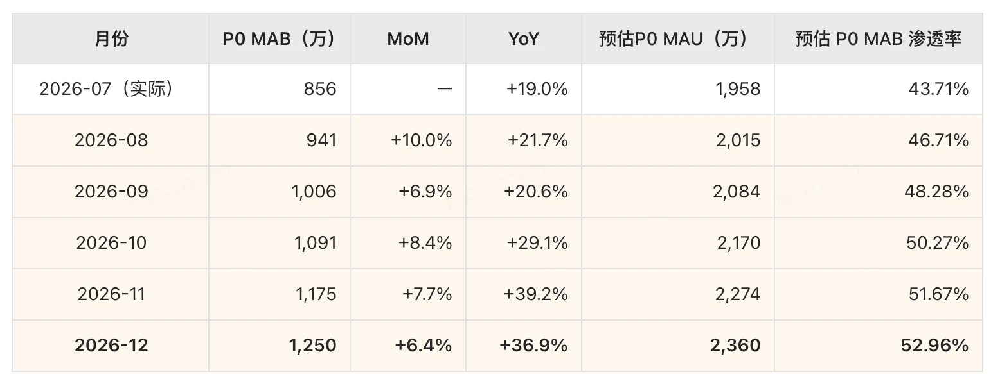
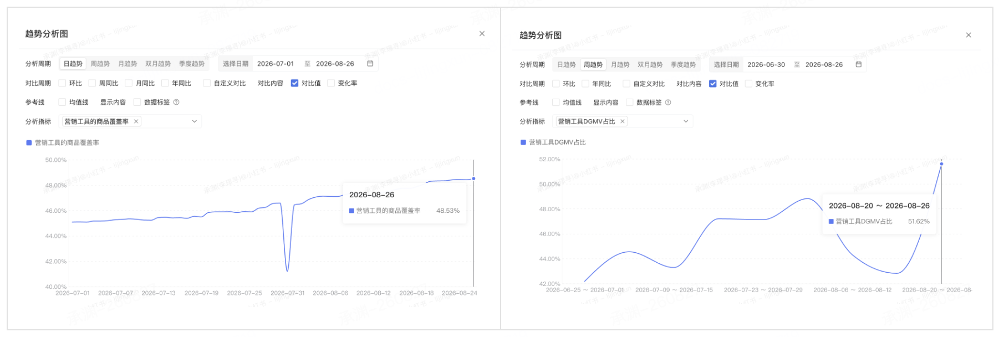
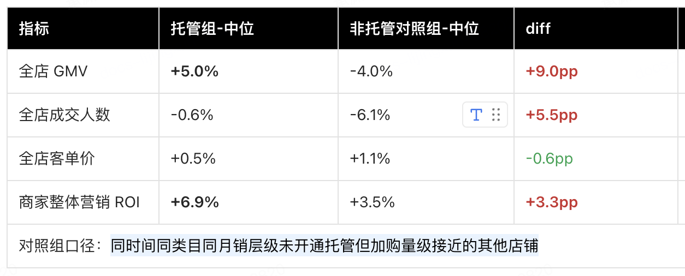
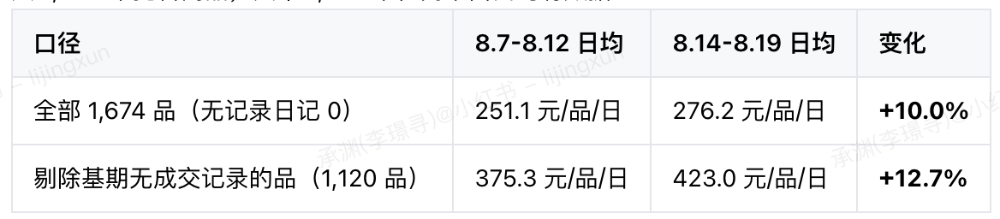
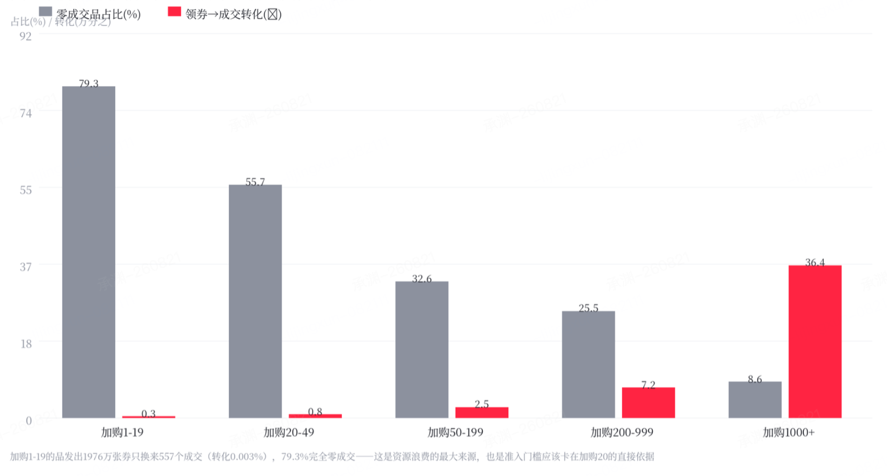
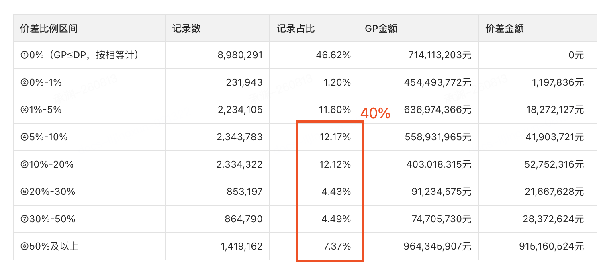
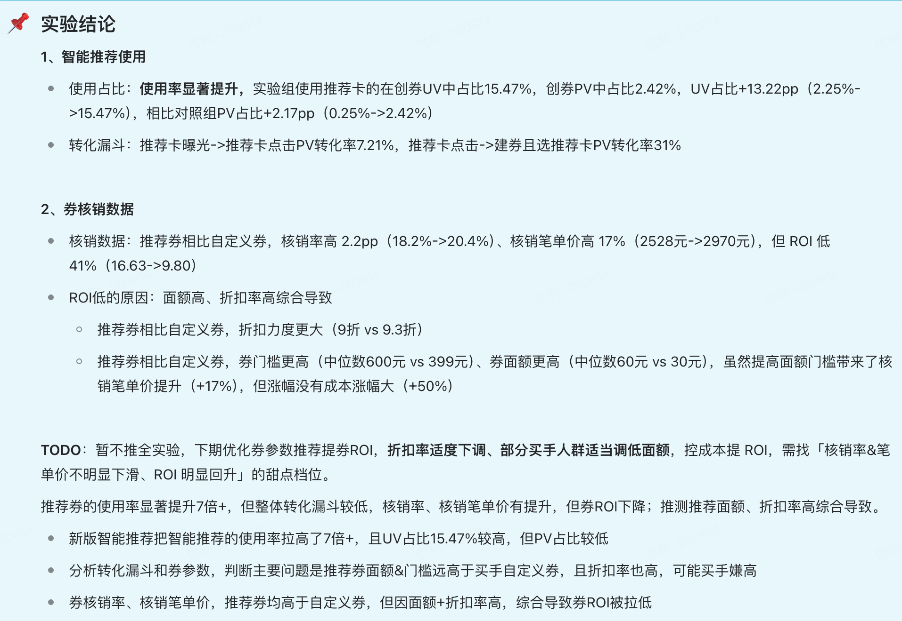

## 周报迭代

周会轮值：班纳、当心、承渊、典庆、非扬、江洋、镜心、九尘、空海、莱壹、猎枭、凌风、立欧、流光、伦太、马达、暮光、南冬、南烟、千岳、仁杰、荣荣、世利、术赤、学琛、遥梦、云沉、章太、赵宇、正南、智零、朱仝、宗杭、平常、萧歌、风上

本周：<redoc-mention mentionId="500045243" mentionName="非扬(杜祥宇)" />

下周：<redoc-mention mentionId="500025377" mentionName="江洋(熊逸帆)" />

## 上周 TODO

| TODO项 | 跟进人 | 进展 |
| --- | --- | --- |
|   |   |   |
|   |   |   |
|   |   |   |
|   |   |   |

## 本周议题

 

# 各方向进展

## 一 用户增长

**业务进展**

<redoc-highlight>
### MAB数据情况：

截止8.26，P0 MAB 843 万（目标 941万，完成度 89.6% ），P0 稳定 MAB 256 万（占比 30.37%，红线 ≥30%），总 MAB 3590 万（目标 4056万，完成度 88.5% ）,年底P0MAB目标为1250w

[用增｜P0人群标签升级](https://docs.xiaohongshu.com/doc/57063f2af8959a2127c440cc3451433a)

UG 整体目标达成压力较大。后续产品侧各方向都会明确目标，并按周跟进完成进度，资源和精力将更加聚焦。对于无法带来明确数据提升的事项，原则上不再投入

 

11月底目标各方向目标

补贴部分：下周一会出一版目标测算

内容增长：

- 市集种草：单月新客转化数2.9w-&gt;10w

- 晒单笔记规模：15w-&gt;30w/月；引导DGMV 50w-&gt;1500w/月

流量部分：

- 个性化push：ctr0.1%-&gt;0.7%,日均发送规模1亿-&gt;2亿

玩法部分：

- 免单卡带动P0稳定MAB 9w-&gt;25w（规模和降cac都要发力才可以） 

- 跳一跳玩法目标 DAU达到50w+，并贡献MAB+10万/月

 

### 重点事项进展：

#### **策略平台升级 **

**升级目标：**在一年一度需求高峰到来前，**完成铲屎 & 基建储备**，重点提升策略配置效率、系统稳定性、迭代效率，并解决策略执行链路黑盒问题

- [**稳定性&迭代效率提升**](https://docs.xiaohongshu.com/doc/dd88f84517e3eb9f19bc869fd2e48c9c)** @智零**：通过领域抽象和模块边界治理，让写好代码变得容易，梳理并治理已腐化内容，当前已分别指定到人在本双月推进落地；后续通过 AI 扫描、CR 和责任田的机制来持续保鲜，避免腐化问题再次发生；[**进展**](https://docs.xiaohongshu.com/doc/4d3e1198e75cfd26c5da2d4be4c889cd)：容器及其相关配置等子项治理完成；

- **解决策略执行黑盒 @流光**：构建用户策略执行链路中各节点的过滤动线，将过程数据实时写入数据流，并基于 Flink 的实时聚合能力，输出用户节点级明细数据与汇总统计数据[策略实时触发漏斗](https://docs.xiaohongshu.com/doc/146c67e181e2a3a93ceeeae70ef7bd79)**，进展：用户过滤明细已上线**

#### **重点推进事项BY快速拿收益**

- **动态触点能力扩覆盖 @莱壹：**

  - [动态触点-数据总结](https://docs.xiaohongshu.com/doc/8c4693c3edaea3930eb1a0a04bc5029a)[商详二期-商笔进入商详实时决策触点时机](https://docs.xiaohongshu.com/doc/44082ec9af50b9dcae7db5dd5fff05d7)现有uid粒度的人群拆分已经接近上限，item侧的价格带特征被先验数据证明是有效的解释变量_（_**_低价格带损失大、中价格带降本效率高_**），商详算法动态触点链路增加携带商品价格的实时触点请求：_用户商笔曝光 -&gt; _**_用户进入商笔，商笔客户端-&gt;商笔工程端-&gt;用增工程端-&gt;算法_**_ -&gt; 算法决策用户发券触发秒数返回用增工程返回客户端 -&gt; 用户进入商详，用增工程读取客户端带入的秒数字段决策几秒触发_。**进展：****客户端已cc，服务端和算法已发布。本周白名单生产验证，预计下周开始对客切流**

  - 动态触点对 UG 发券剩余场域（直播、市集）的覆盖，扩大动态触点能力的应用范围，从而获取更大规模的业务收益（总体预计拿到**月千万+的成本降低**和xx转化提升） **进展：市集调试中，****本周****优先上面商详算法改造****，预计下周发布并白名单验证**

- [**策略执行链路升级**](https://docs.xiaohongshu.com/doc/9db5dda23ac6716e07a6003eba0b8fd3)** @智零 ：**调整优先级过滤与容器渲染节点的执行顺序，解决算法决策空权益时影响其他策略正常触发的问题，提升策略触发率和链路容错能力（会做AB）**进展：**单品商详混资快照适配，秋上新应用实验中。

- **电商Push系统能力建设 @非扬：**建设电商push特征工程，目标打造成为电商底层推送push引擎，覆盖电商实时信号与算法特征两条链路，提升电商push的发送量级和点击转化效率。**Q3完成特征工程和算法独立队列的基建，以及商品、券两大候选的建设****，目标发送量级 ≥ 2亿  ctr ≥ 0.5%。**

**进展：已完成技术评审**[电商push一期技术方案](https://docs.xiaohongshu.com/doc/71f255ef07dfb6faeaa8c8b2041b45b9)**，开发中，项目节奏：9.9上线**

#### **重点推进事项BY业务支撑**

- **稳定性保障@九尘：**补贴发放核心主链路自动化检测全覆盖，要做到核心链路的日常保鲜；治理权益中心大促分支链路野蛮扩散问题，ontrack

- **策略平台产品化升级：**新来的投放产品理了一版规划[投放平台规划-26H2](https://docs.xiaohongshu.com/doc/cfa8e1787b2a3619f0fcce959e4c0d31)，目前沟通下来她的平台的思维还是有的
</redoc-highlight>

**重点项目**

| [商详退出好店好货挽留[货盘、补贴]](https://docs.xiaohongshu.com/doc/4959c8234866d2ff0b72f5509ff91db6)-智零 | 需求：内容场_[MF/搜索-商笔]_-&gt;电商场_[商详]_的MAB新客做挽留转化 <split/> 节奏：一期8.28实验开启，二期触发频控、挂件豁免开发中，8.31上线 |   |
| --- | --- | --- |
| [单品红包弹窗/挂件数值表达逻辑优化](https://pingcode2.devops.xiaohongshu.com/work-item-detail/984896)-智零 | 数据回收：边际增量 MAB+19.5万/月 |   |
| [直播间购物袋关闭新增优惠券激励](https://docs.xiaohongshu.com/doc/f20284bd214fdf19599ac8bfa058b5a9)-智零 | 需求：「关闭购物袋时」触发券催用&好货推荐，促进更深行为和商品转化 <split/> 节奏：受直播侧人力影响，下周与直播侧明确排期 |   |
| [【晒单笔记】激励策略](https://docs.xiaohongshu.com/doc/1c2eb24b53010de9489f11481ece6583)- 空海 <split/> [【晒单有礼】落地页需求](https://docs.xiaohongshu.com/doc/30c4550805cbf42fa3d013c182f8ca4b)- 伦太 | 收益情况：晒单笔记平台活动激励已上线，笔记产出增长 20pt，增长笔记带动的成交及拉新情况需滞后分析 <split/> 需求：晒单笔记新增落地页，订单列表页导航栏作为常驻入口，以此作为阵地来对有意愿创作的用户做内容引导与内容质量提升 <split/> 节奏：开发中，8.31联调，9.2提测，9.8上线 |   |
| [权益池后续条件的0开发接入](https://pingcode2.devops.xiaohongshu.com/work-space?workItem=975199&tab=detail)-九尘 | 背景：策略条件下沉权益中心后，针对一些具备统一取数口径的条件实现低开发成本接入（如：用户维度、买手/商家维度的价格带等） <split/> 节奏：需求已评审，待技术方案，资源问题暂hold |   |
| [条件下沉权益池后的接入和看数](https://docs.xiaohongshu.com/doc/ce1ec9ebd08d34f393c1c24f27bce03a)-九尘 | 背景：策略条件下沉权益中心后，by不同条件分支的分析看数能力建设 <split/> 节奏：需求已评审，待技术方案，资源问题暂hold |   |
| [权益池下的实验支持多层级配置](https://pingcode2.devops.xiaohongshu.com/work-item-detail/1005261)-九尘 | 背景：权益发放规则支持多层级嵌套实验的配置能力 <split/> 节奏：已上线，8.28对客使用 |   |
| 稳定性事项治理  - 九尘 | **事项汇总：**[稳定性事项治理](https://docs.xiaohongshu.com/doc/2a0927000dcefc55808a919ab1bf201d) <split/> **进行中事项**** ：** <split/> 1. 背景：领券弹窗关键信息完整性布防，避免弹窗标题、按钮等缺失故障发生 <split/> 进展：cannery规则验证中（弱拦截 + 告警），预计8.31和券面额防控一起开启强拦截 <split/> 2. 背景：权益发放规则，接入方变多、流量量级增长迅速，执行过程的稳定性防控需要加强，包括规则执行时监控告警、异常降级等 <split/> 进展：开发中 |   |
| [【友好&非友好】单品加补券投放](https://docs.xiaohongshu.com/doc/88a0725c8d6708e0865fdb79a1900f38)- 流光 [算法决策单品加补券](https://docs.xiaohongshu.com/doc/ba38e5cf89b29c0b20680385561d5876) - 流光 <split/>   | 背景：友好商家的混资政策当前只支持店铺多品凑单，对于商家要求较高，同店凑满减的要求比较高，商品粒度的混资需要进行打开 <split/> 节奏：开发中，8.19提测，8.24发布，8.28秋上新对客 |   |
| [【买手券】发券托管-功能方案](https://docs.xiaohongshu.com/doc/1408a214bd8f07fd372abc8a74fbd68e)（买手发券托管）-莱壹 <split/>   | 背景：买手会分配一批发券预算交给平台托管来发放，提高发券效率，托管会走策略平台+权益中心来搞 <split/> 节奏：开发中，9.10整体提测，9.15发布 <split/>   |   |
| [【资源位】投放主播和投放人群支持圈选](https://docs.xiaohongshu.com/doc/dc1122c35cbe58f59e92f91bad4d6700)- 非扬 | 背景：将直播间右上角banner建设为电商收口的资源位，可以控制在「哪些主播」的「什么样的直播间」对「什么样的人」展示banner <split/> 节奏：资源问题，暂hold |   |
| [新增平台加补券-C端链路改造](https://docs.xiaohongshu.com/doc/6f9d1f94c07e176b14e5918ca3b6e028)-商详单品券默塞-南烟、章太 | 背景：商详场域单品加补券依赖弹窗发放，受限于弹窗频控，发放数量较低，故针对商详场景增加基于挂件的的默发能力，并触发商详价格刷新，今天技术方案评审 |   |
| [新增平台加补券-C端链路改造](https://docs.xiaohongshu.com/doc/6f9d1f94c07e176b14e5918ca3b6e028)-会场、优惠券频道、凑单页默塞-萧歌 | 背景：针对非友好商家，会场、凑单页、优惠券频道会作为发券的中心场，需要确保用户可以直接享受加补优惠 |   |
| [【用增玩法】跳一跳玩法](https://docs.xiaohongshu.com/doc/4eef7b3e30c58a6fb5660d5273235536)- 朱仝 | 背景：建立“游玩—分享—新客进入—新客首单”的完整闭环，提升新客访问，拉动MAB增长 <split/> **思考：** <split/> - 这个游戏主要是**拉大盘的MAB**，从星光和历史跳一跳数据来看，**P0人群应该是没效果的****（**历史跳一跳数据的**用户人群偏低龄）** <split/> - 跳一跳游戏同质化高、用户迁移成本低，**效果延续需要依赖持续的游戏运营和推新，有效的话后续可以考虑社区游戏生态的引入** <split/> 节奏：卡在交互稿，下周介入 |   |
| [【免单卡】奖励红包测试改为券包](https://docs.xiaohongshu.com/doc/26662b38ef080b0956e974e9719f51e1)-赵宇 | 背景：降低活动成本，将流量腾挪出来给更多的用户触达活动，扩大活动影响面 节奏：测试中，预计9.2上线 |   |

 

## 二 商家营销

**业务进展**

<redoc-highlight>
**业务目标拆解**

大方向是DGMV，拆解到商家营销的两个维度业务目标（Q3）：

- **成交渗透：**工具gmv渗透率55%；（**当前51.62%，**wow+8.8）

- **供给扩面：**工具 商品覆盖率50%；（**当前48.53%，**wow+0.46%）

**数据解读**：前两周处于大促周期，店铺限时特价被平台限时特价择优后，相关成交未计入工具 DGMV，导致渗透率偏低。

 

### **key事项**

#### **1、商家营销托管**

首个试点选择购物车惊喜券，重点解决商家“不知道哪些商品适合配置、应该配置多少面额”的决策门槛。

- **业务目标**：

  - 参加托管商家DGMV增量 vs 大盘DGMV对照组增量 （+10%）

- **技术进展**：

  - 一期 MVP：已上线，完成 B 端托管创建链路。已完成 8k商家白名单 并放量至80%。<redoc-mention mentionId="500044856" mentionName="遥梦(吴忧)" /> <redoc-mention mentionId="500044130" mentionName="凌风(邵凯凯)" />

  - 二期能力完善：补齐异步链路、量级保障以及全店托管等基础能力，已上线。<redoc-mention mentionId="500044856" mentionName="遥梦(吴忧)" /><redoc-mention mentionId="500050682" mentionName="风上(杨逍卓)" /> <redoc-mention mentionId="500043882" mentionName="当心(范新龙)" /> <redoc-mention mentionId="500044130" mentionName="凌风(邵凯凯)" />

  - 三期策略优化，预计9.7发布，<redoc-mention mentionId="500044856" mentionName="遥梦(吴忧)" /> <redoc-mention mentionId="500044130" mentionName="凌风(邵凯凯)" />  改造点主要围绕：

    - **安全感**：商家能看懂、能掌控、相信托管不会乱来，重点防破价；

    - **效果表达强化：**围绕商家关注的AA结果强化效果表达；

    - **托管效率：**拦截低效品和无效优惠；

- **数据**：

  - **跨店对照数据**：当前开启托管商家686家，托管商品全店 GMV  +5.0% 而对照组 -4.0%，净效应约 +9pp；对照组按同主营行业，同分层，同商品近14天加购UV档，同商品上线前日均DGMV档匹配。

  - **AA数据**：只看大促周期内，托管商品日均dgmv +10%。

  - **留存数据**：整体留存率89.4%。

  - 数据初步验证了产品效果，效果不佳的商家主要存在两类问题：

    - **券策略不合理**：部分托管券力度低于全网自动推广券。三期将增加优惠力度卡控门槛。

    - **商品选择不精准**：目前没有直接证据证明效果与行业或具体商品特征强相关，但初步来看，高加购、高成交基础的商品效果更明确。

 

- **思考**：

  - 这是一个促使商家让利的事情，首要解决的是平台信任（商家对让利是谨慎的）。信任依赖于平台提供更确定的转化策略：明确哪些商品适合参与、什么优惠力度能够带来增量，并持续提升钱效。在验证转化确定性后，下一步才是扩大覆盖。

  - 当前转化放大效率最高的是高加购、高成交基础商品，但这部分商品本身也具备较强的自然成交能力，投放侧有较大的钱效优化空间。所以提升 ROI 本身也是一个建立平台信任、推动托管规模化的前置条件。

#### **2、成交链路提效**

- **定金预售**：解决商家蓄水备货和成交转化问题，已发布。首期聚焦 66 大促商品池，按商家分层评估报名与未报名商品的 DGMV 增量差异。<redoc-mention mentionId="500044856" mentionName="遥梦(吴忧)" /> 

  - **数据**：定向邀约并放量 222 家商家，主要覆盖有爆款、频繁售罄、稀缺上新或具备明确运营节奏的商家，目前实际使用商家 10 家。

  - **Next: **重点解报名率低的问题。

    - **价格力要求较高，但平台缺少专项扶持**，计划拆分为大促和日销两类玩法：

      - **商家日销**：适当降低折扣、定金等准入门槛（已发布<redoc-mention mentionId="500044856" mentionName="遥梦(吴忧)" />），优化商家资质校验，为全面放量做准备（9.16发布<redoc-mention mentionId="500049749" mentionName="萧歌(游敏)" />），重点承接商家日常经营需求。

      - **大促场景**：优先落地大 V 场景（章小惠场），同步争取平台大促流量倾斜；形成标杆案例后复制推广，并逐步拓展至大促场。

    - **与直播场域发券玩法拉不齐**：当前暂不支持购物车合并下单，营销侧需要支持多渠道加购sku券、红包召回能力和锁优惠能力，9.20发布。<redoc-mention mentionId="500041651" mentionName="承渊(李璟寻)" />

- 推荐算法对接**营销信号**：

  - **直播卡 关注秒杀 信号接入**：做直播间涨粉目标，已上线，今天刚开实验； <redoc-mention mentionId="500044856" mentionName="遥梦(吴忧)" />

  - **价格信号接入**：MF-商笔、呼吸灯、直播卡；市集-商品、商笔、直播卡 等推荐场景，目前已经基本接入公域千人一面价，与真实千人千面价存在diff：

该数据基于有优惠的交易数据跑出来的，按优惠拆分占比：

价差大于5%的订单占比24%（40%价差占比 x 60%有优惠订单占比），其中87%的占比为普惠直播渠道优惠贡献。目前两个方案在聊：

  - **引擎接直播千人一面价：**可以解决87%的价格差异问题，最终价差大于5%的订单比例收敛至2.8%；方案改动成本相对确定，需要输出主播、合约维度的直播千人一面价全增量数据。营销侧9.8发布，算法工程侧同步接入，9.15 算法提供先在ctr模型的第一批离线效果，评估效果好的话预计9.23日上线。 <redoc-mention mentionId="500043882" mentionName="当心(范新龙)" /><redoc-mention mentionId="500049749" mentionName="萧歌(游敏)" />

  - **~~精排接千人千面价能力~~**~~，核心挑战在于高qps（750w*100sku）和低时延（10ms）要求，需要从引擎到营销做定制逻辑，，初步评估成本较高。~~

- **复购券C端**治理：

  - 解决未领券状态无表达、领取入口深的问题；补齐模板维度算价召回及结算自动领券，已上线，券引导dgmv+43.7%，数据提升明显。<redoc-mention mentionId="500044856" mentionName="遥梦(吴忧)" /> with算价

  - 复购**人群口径&时效优化**，实验已上线，实际领券人数占老客人数从2.5%提升到17.18%，复购券发放量相比昨天+115%（1.99万-&gt;4.29万），核销量+94%（7762-&gt;1.51万），且核销率比较稳定，券引导dgmv+34.9%。由于订单请求量过大改为数仓清洗下单数据，预计9.1上线 <redoc-mention mentionId="500049749" mentionName="萧歌(游敏)" />

- **任务型优惠**全链路优化：涉及店铺会员入会发券链路改造，项目整体31号上线。<redoc-mention mentionId="500044130" mentionName="凌风(邵凯凯)" />

- **客服营销消息投放**：当前优质营销权益缺乏主动触达通道，因此需要基于用户近期互动行为自动匹配并投递客服优惠消息，提升售前转化与售后复购。涉及分人群、分营销工具类型的消息投递策略，以及商品渲染、任务承接、结算下单等实现链路，技术方案产出中，节奏待定；<redoc-mention mentionId="500044130" mentionName="凌风(邵凯凯)" /><redoc-mention mentionId="500041651" mentionName="承渊(李璟寻)" />  

- **粉丝购物团折上折**：针对现在没有不同等级粉丝差异化运营工具的问题，建设按粉丝等级配置的专属折扣权益，提升高等级粉丝复购与留存、商家分层运营工具使用率及粉丝团交易 GMV，技术方案产出中，节奏待定 <redoc-mention mentionId="500049749" mentionName="萧歌(游敏)" />

 

#### **3、资金安全与预警治理**

- **0元单**强告警：技术侧先通过电话强告警产研，已上线；<redoc-mention mentionId="500044130" mentionName="凌风(邵凯凯)" />

  - 过去两周已发现3个真实风险商家，已同步AM。后续计划完成去噪优化，过滤试用装、兑换装等场景后，将告警消息直接同步 AM。

- 资损**预警口径校准**：增加极限到手价、红线价口径，支持商家维度0元单提醒和14天价格预览，目标是将商家调研中选择 “没风险误报” 比例从39%降至5%。9.2提测，9.8发布。 <redoc-mention mentionId="500050682" mentionName="风上(杨逍卓)" />

#### **4. 低成本增长方向**

- 工具**roadmap简化**：顺手配复购券、商品发布营销推荐。ontrack。@非扬

- 微信摇一摇券支持。<redoc-mention mentionId="500050682" mentionName="风上(杨逍卓)" />

#### 5. 稳定性

- 营销侧整体海外部署，今天回归团队进行第一波回归，下周五第二波回归 <redoc-mention mentionId="500044856" mentionName="遥梦(吴忧)" />

- cdb迁移 <redoc-mention mentionId="500044856" mentionName="遥梦(吴忧)" />

- 多活治理&演练 <redoc-mention mentionId="500044856" mentionName="遥梦(吴忧)" /> 

- 风险工单治理。<redoc-mention mentionId="500044130" mentionName="凌风(邵凯凯)" /> <redoc-mention mentionId="500043882" mentionName="当心(范新龙)" />

- 慢sql治理，当前梳理中 <redoc-mention mentionId="500044130" mentionName="凌风(邵凯凯)" /> 
</redoc-highlight>

 

 

## 三 买手营销

**业务进展**

<redoc-highlight>
### 业务数据

**核心目标：买手DGMV增长与营销工具渗透率**

当前业务数据：

- 买手大盘日均 DGMV：7414 万（周末 8/22 冲到 1.45 亿，周中 8/24 低谷 4657 万，双峰模式明显，周末买手开播更多）

- 买手券核销日均 DGMV：1460 万

- 券核销占大盘：19.0%（区间 14.5%~22.0%）

### key事项

#### 技术事项

1、**统一营销投放平台建设**：

- 进展：已发布，已开双写

2、**稳定性建设：**

- 电商直播稳定性专项：多活演练准备工作待验证，待演练 <redoc-mention mentionId="500001425" mentionName="班纳(曾翔钰)" /> 

3、**买手营销海外部署**：828可测试

- 私域侧+直播侧：自测中<redoc-mention mentionId="500001425" mentionName="班纳(曾翔钰)" />

#### 业务事项

1、**直播任务券智能推荐**：解决买手不知道发什么券（面额/门槛/张数），支持买手按照发券目标发多个档位的券，兼顾「小额券促主推品转化」和「大面额券拉客单价」的双重目标；

当前进展：已上线，数据回收如下

2、**买手营销工具优化**：新增定时任务券周期性自动发放、券复制、券商品范围优化等工具能力，提升买手创券配置效率、工具渗透率

当前进展：hold，本周无进展

3、**买手券全托管**：解决买手不知该发什么券、发多少、发给谁的问题；根据买手X用户X价格带分层发券，并结合直播间实时状态动态调整发券策略，提升买手券整体 ROI与DGMV

当前进展：9.7联调，9.10提测，9.15上线

- **买手链路**：B端已提测，预算管理及数据需求开发中，9.2整体开发完成，联调9.7-9.9（3pd），测试9.10-9.14（3pd），9.15上线<redoc-mention mentionId="500044279" mentionName="世利(李唤)" /><redoc-mention mentionId="500046081" mentionName="镜心(黄逸姿)" /><redoc-mention mentionId="500001425" mentionName="班纳(曾翔钰)" />

- **投放平台**：8.25技术评审，开发8.27-9.4（9.5pd），联调9.7-9.9（3pd），测试9.10-9.14（3pd），9.15上线

- **直播间发券**：开发8.25-8.28（4pd），联调9.8（1pd），测试9.10-9.14（3pd）

- **购物车发券**：开发8.26-9.1（5pd），联调9.4-9.7（2pd），测试9.8-9.10（3pd）

买手券托管流程：买手以直播场次维度创建托管-&gt;填写预算和托管目标-&gt;开播后依据托管目标策略自动发放千人千面券

产品原型：https://hxkmg4.csb.app/

技术链路：

- 买手营销侧：

  - 1、创建买手券模板-&gt;通知投放侧新建拉新客/ROI策略下权益池创建

  - 2、全链路的预算管理：正向链路领券预算强管控防超发，逆向链路券退款链路的资金回退

  - 3、买手动态券链路建设

- 投放侧：根据开播信号在对应托管直播间发券

4、**主播任务券支持发放混资券：**试点混资补贴跟 50 家头部商家对赌，牵引他们在秋上新多备货、多爆发，大促自营 GMV 冲高。

排期节奏：8.26提测，8.26上线，8.27预演，预演通过，行业AM同步开始建券，8.28秋上新开场对C发放
当前进展：已上线，预演通过；40个实验商家陆续配置使用，效果待回收 <redoc-mention mentionId="500001425" mentionName="班纳(曾翔钰)" />

</redoc-highlight>

## 四 营销平台建设

<redoc-highlight>
### 统一营销投放平台   @南烟 @萧歌

**建设目标：**统一买手、商家、平台等多方权益发放链路，沉淀通用投放能力，避免各业务场域**重复建设**，降低多方协同和迭代成本，提升**系统稳定性**与可复用性。同时，进一步**明确营销架构边界**，解决现状职责边界模糊、迭代效率低等问题，实现整体投放效率显著提升，支撑营销日常需求在**三组内闭环**

进度：目前已开启线上双链路diff的比对，过程中的问题持续修复中，接下来重点投入是链路风险梳理和稳定性基建能力的建设，目标中秋节前完成任务券的切流

 

</redoc-highlight>

<redoc-highlight>
**营销工具**

- **技术方向定调：**在券、促销、红包三大垂直模型的基础上，横向沉淀营销场景共性的规则，收口资金履约能力，并在不同业务间复用；让新场景从重复业务开发转向抽象能力建设。

 

**平台指标：**

- 免开发率、业务需求接入效率。

本双月先建立指标基线，业务结果按具体场景单独跟踪。

 

**技术事项**：

- **营销库存能力。** 

  - 将营销库存抽象为独立能力，移除对 Redis 的强依赖，并将分桶逻辑从业务层下沉至库存层，兼顾持久化和高并发场景。能力计划复用于商家券、平台券和买手分批发券等场景。

  - 基础库存能力已上线，一期已应用于买手分批发券。券模板库存切流受大促需求插队影响，延期至九月初。切流涉及新旧库存链路切换及一致性保障，存在库存超发风险，上线时将缩小灰度范围并延长观察周期。

- **买手资金履约能力**收口：买手混资红包支持发放侧扣减买手钱包，保证资金流水一致，**已发布**；<redoc-mention mentionId="500043882" mentionName="当心(范新龙)" />

- **直播营销架构升级**：直播营销架构升级with营销平台建设，同步推进买手券接入，已发布。<redoc-mention mentionId="500043882" mentionName="当心(范新龙)" />

 

**业务事项**：

- **单品混资活动**：目标基于**单品加补工具**降低活动报名门槛，提高整体混资活动渗透率以及转化，当前技术侧工具**选型建议是可叠加的平台券**。with算价、投放 **已上线**。

  - 友好商家：使用动态单品混资券，出资比例算价运行时计算，for投放提供准实时 品/商家 维度核销金额数据。<redoc-mention mentionId="500041651" mentionName="承渊(李璟寻)" /> 

  - 非友好商家：为了解中心化场域默发问题，需要支持动态单品 + 商品标圈池两种模式。<redoc-mention mentionId="500043882" mentionName="当心(范新龙)" />

- **小红卡会员周周购**，通过每周精选生鲜爆品，拉动会员ARPU与留存。新增面向小红卡人群的商家全资促销能力，已上线，首周5天实现1,065单，为活动前的4–5倍，带来69.5%店铺新客和41.1%无花果类目新客，会员订单占比最高达85%，后续非会员贡献80%–95%订单。<redoc-mention mentionId="500041651" mentionName="承渊(李璟寻)" />

- **星光同抵**，通过同价优惠与星光奖励激励下单用户分享，强化星光夜市“低价好物”心智，目标月发笔记120万，并提升分享流量转化。项目整体9.15上线 <redoc-mention mentionId="500043882" mentionName="当心(范新龙)" />

- **行业对赌混资**券：筛选头部商家，配合商家口播自投放模式，根据店铺自营结算 GMV 较基线增长 ≥30%／50%／70% 的不同目标对赌档位提供差异化的平台出资混资券额度。基线为MAX（25年秋上新、26年春上新、26年66大促日均店铺dgmv）。重点验证对赌混资模式的业务效果，以及补贴政策能否兼顾商家参与意愿与平台 ROI。今天上线。<redoc-mention mentionId="500043882" mentionName="当心(范新龙)" />

- **商家混资红包能力**交易结算链路打通。支撑粉丝购物团满返玩法，**已上线**，对比上线前同口径数据，周中新増关注 **71,826 UV**（**+65%**），新增加团 **95,534 UV**（**+733%**），基数较小但增速验证了模式可行性。

- **业务支撑**：小红卡膨胀券结算开卡、头商引入、微信支付优惠、动态买手券、省钱助手、混资直播间抢红包玩法 等场景支撑。
</redoc-highlight>

 

## 五 大促&招商

<redoc-highlight>
### 活动支撑

**七夕促：**延续周末大集的活动框架基础，增加平台券投放和混资报名的直播间整点掉落惊喜红包的限定玩法。目标GMV爆发系数爆发系数 x 1.07混资报名商家数、混资买手报名买手数1048，混资商家报名数2388

- 进展：已结束，活动周期08.07-08.19

- 招商数据：混资商家报名~1270，买手报名~586（周末大集混资商家报名~1243，买手报名~239）

- 会场数据：会场日均UV~84W，和周末促基本持平。日均DAB由周末促的~1.6k增长至~2.4k。预算消耗~6517W，核销率~7.37%，增量兑换比~6.24，Dgmv涨幅~4.03**%。**[26.七夕大促平台券产品复盘](https://docs.xiaohongshu.com/doc/a8b8bea6b12d26143c8dee3e290b1b19)

- 红包数据：累计发放~17.8W张红包，总金额~105.6W，领取UV~4.3W，核销率~58.5%。由于有了宣发和大额红包的噱头，整体的领取情况相较于周末促有较多增长，活动主播涨粉数+33.1%，观播UV+11.6%，观播时长+15%，DGMV+7.3% [七夕红包数据分析](https://picasso-private-1251524319.cos.ap-shanghai.myqcloud.com/formula-static/dibp/shfnuqbh/latest.html)。从数据看平台红包能够在有效提高用户的关注和观播，为商家带来关注量和成交，能够一定程度促进混资商家的开播意愿。同时平台红包有效激发了直播间的互动氛围，观播互动指标全面正向，电商直播大盘：DGMV**+0.74%**、GPM+0.67%、OPM+0.1%、购买UV+0.07%

- 产品洞察：通过数据分析发现「一键领券」和「预约直播」的转化有优化空间，正在跟产品对齐，初步意向是跟着双十一优化掉 [近期两个转化洞察与解法：一键领取 & 直播预约](https://docs.xiaohongshu.com/doc/60967433055e6cfab290a3fb97eef51f)

**秋上新：**主打服装/家居/运动户外类目的主题大促，活动周期08.28-09.24，秋上新行业合计目标158.6亿

- 进展：已对客

  - 平台红包多策略&换肤：[混资直播间定时发红包 支持金、银、铜档位红包 PRD](https://docs.xiaohongshu.com/doc/c7bada93946b8250250c33c128c9b469) holding <redoc-mention mentionId="500008127" mentionName="平常(王青)" />

  - 卡券包改造支持单品混资券玩法 [新增平台加补券-C端链路改造](https://docs.xiaohongshu.com/doc/6f9d1f94c07e176b14e5918ca3b6e028) -- <redoc-mention mentionId="500016481" mentionName="云沉(阚广强)" />

  - 大促会场搭建&大促会场支持单品混资券玩法 [会场组件化 PRD详评](https://docs.xiaohongshu.com/doc/da9a48e3a4a72a7598d000e264cc20b6) -- <redoc-mention mentionId="500043266" mentionName="宗杭(钱超宇)" />

  - 大促会场增加免单卡组件 -- 单独迭代上线

**双十一**

- **玩法：**[【一年一度】大促玩法](https://docs.xiaohongshu.com/doc/419be7709a0dda49896d76e8b5647043)已完成第一轮详评，预计08.31完成需求终稿的评审。目前确定玩法部分采用Predy方案，Predy保障已与麦督对齐，前端已完成方案初评评审，后端预计8.28后介入&方案评审，预计9.4前明确具体的人日和里程碑

 

### 业务支撑

**单品混资：**现有多品混资，凑满减门槛高、用户核销体验差；平台缺乏降价的扶持手段，商家主动降价没动力，"以价换量"在站内没形成好的循环。通过单品混资+流量扶持，降低凑单门槛的同时，通过流量加持来让质地好、有价格优势的品爆发。**进展：**友好报名成功2.3W商品，929个商家；非友好报名2.8W商品，3910商家。

**活动广场改造：**当前活动页的展示效率低、活动权益不清晰、无活动效果，通过对标竞品，提示展示效率来提升商家活动报名率。预期9.1上线。**进展：**联调中**。**[活动广场产品优化方案](https://docs.xiaohongshu.com/doc/1b6595dfbba5ea00cf4a1c97c61bcd7c)<redoc-mention mentionId="500006929" mentionName="术赤(许飞驰)" />

**大促触达：**针对重点商品增加触达+快捷报名能力，拓宽触达点位，提高报名规模，关注重点商品的报名率。**进展：****1.**一期单品直降已全量，新弹窗 vs 老弹窗的AB效果，pv点击率**+21.69%**，uv点击率**+14.98%**，引导报名成功商家数**+119%；2.**二期触达单品混资、商家混资等也计划接入，已开发中，预计9.1日上线。

**头商星选合伙人：**面向站外头部商家的冷启动扶持计划，用"流量+混资补贴+治理保障"三重杠杆，30天完成商家跃迁到B5/B6，转换站外生意为站内增量。一期500头商底池，在女装、珠宝、文玩行业试点，目标扶持100个商家。**进展：**目前已准入账号26家，已开店20家。当前主要问题是行业提报的可准入商家较少，商家的站内人群资产在前期还是偏低。 <redoc-mention mentionId="500028141" mentionName="千岳(沈黎明)" />

**大促托管报名：**通过“大促托管计划”，实现“一次托管，后续默认参与”的自动化机制，简化商家报名链路，同时为下半年密集的活动，储备长期稳定的货品供给。 **进展：**1.托管成功数据：托管报名商家**5194**，报名商品**32.2****万（vs秋上新报名商家****4.23****万、报名商品****280.4****万，占比分别为****12.3****%**、**11.5****%**），后续这些商品也将延续报名双11；2.托管且成功报入秋上新数据：托管报名贡献了秋上新报名商家数**3679**，报名商品数**20.6**万；上线大促预警<redoc-mention mentionId="500037685" mentionName="学琛(范炬涛)" />

 

**其他迭代改造：**

**宠粉清单额度规则改造:**平台希望通过核心品池集中筛选高确定性商品，并给予额外额度，牵引买手优先选择平台意志导向的商品。**进展：**开发中，9.1上线。

**报名门槛优化：**依赖的活动、未来价格门槛前置校验。

 

#### **基础能力建设**

**大促交付标准：**从几次大促的交付流程中看到的问题：大促活动缺少标准的交付SOP，全链路氛围配置效率低、验证成本高，会场搭建定制化开发多，历史招商、投放、氛围在协作就存在交互不合理的问题，接下来动作：

- 氛围交付标准化：目前已通过AI搭建的氛围可视化工具大促活动氛围配置和氛围配置Skill辅助氛围配置，降低配置门槛和配概率。后续还要看下其他卡点如购物车和直播间氛围灯如何优化和收敛 -- 本周Pending无进展

- 会场交付组件化：需求已评审，一期组件化Follow秋上新活动交付[会场组件化 PRD详评](https://docs.xiaohongshu.com/doc/da9a48e3a4a72a7598d000e264cc20b6)

**Mongo下线：**商家混资、买手混资已经就绪，接下来新建的活动直接可迁移至Mysql链路；宠粉清单、星光换购测试进行中 <redoc-mention mentionId="500028141" mentionName="千岳(沈黎明)" />预计9月份完成
</redoc-highlight>

 

## 六 横向项目

**业务进展：横向稳定性相关**

<redoc-highlight>

 

</redoc-highlight>

#### 

# 本周TODO

| TODO项 | 跟进人 | 进展 |
| --- | --- | --- |
|   |   |   |
|   |   |   |
|   |   |   |
|   |   |   |

 