| 仓库 | git link | 业务内容 |
| --- | --- | --- |
| live-rn-mono | [https://code.devops.xiaohongshu.com/fe/live/live-rn-mono/-/tree/master/apps/chaos/src/containers/Coupon](https://code.devops.xiaohongshu.com/fe/live/live-rn-mono/-/tree/master/apps/chaos/src/containers/Coupon) | 买手券 APP <split/> 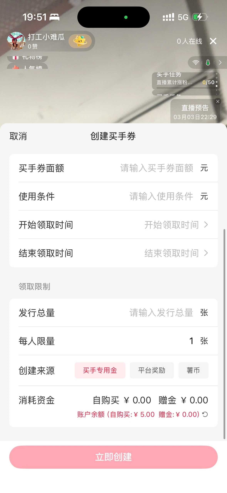 |
| mono-live | [https://code.devops.xiaohongshu.com/fe/live/mono-live](https://code.devops.xiaohongshu.com/fe/live/mono-live) | 买手券 PC <split/> 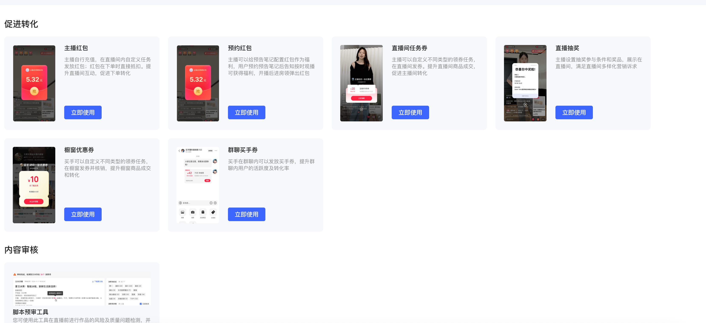 <split/>   |
| 千帆大仓 | [https://code.devops.xiaohongshu.com/fe/shopping/aurora/-/tree/master/packages/promotion](https://code.devops.xiaohongshu.com/fe/shopping/aurora/-/tree/master/packages/promotion) | ark 相关 |
| 千帆 RN <split/> 小红书 APP RN | [https://code.devops.xiaohongshu.com/fe/shopping/merchant-trade](https://code.devops.xiaohongshu.com/fe/shopping/merchant-trade) | 秒杀  营销 C端 <split/> 千帆建券 |
| vibe-marketing-rn | [https://code.devops.xiaohongshu.com/fe/shopping/vibe-marketing-rn](https://code.devops.xiaohongshu.com/fe/shopping/vibe-marketing-rn) | 品牌会员 <split/> 粉丝团 <split/> 小红卡 |
| armor | [https://code.devops.xiaohongshu.com/fe/armor/-/tree/master/packages/lancer-slim/src/containers/join-member-popup](https://code.devops.xiaohongshu.com/fe/armor/-/tree/master/packages/lancer-slim/src/containers/join-member-popup) | 加入品牌会员弹层 |

营销工具

| 平台 | 仓库 | 功能 | 页面路由 | 环境要求 |
| --- | --- | --- | --- | --- |
| 千帆PC | [用户运营](https://code.devops.xiaohongshu.com/fe/ark/-/tree/master/packages/app-circle) | 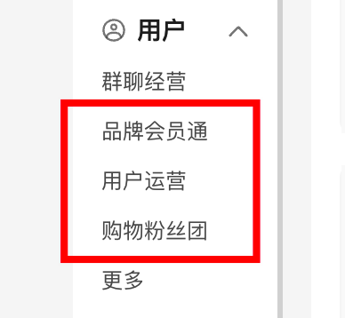 <split/>   | [https://ark.xiaohongshu.com/app-circle/](https://ark.xiaohongshu.com/app-circle/coupon) <split/>   <split/>   <split/>   | - node 14 <split/> - npm 6 |
|  | 品牌会员通 <split/> [packages/promotion/promotion-ark · master · fe / shopping / aurora](https://code.devops.xiaohongshu.com/fe/shopping/aurora/-/tree/master/packages/promotion/promotion-ark) |  | [https://ark.xiaohongshu.com/app-promotion/brand-member/config](https://ark.xiaohongshu.com/app-promotion/brand-member/config) | - node 18 <split/> - pnpm |
|  | 粉丝团 <split/> [packages/promotion/promotion-ark · master · fe / shopping / aurora](https://code.devops.xiaohongshu.com/fe/shopping/aurora/-/tree/master/packages/promotion/promotion-ark) |  | [https://ark.xiaohongshu.com/app-promotion/shopping-fan-group](https://ark.xiaohongshu.com/app-promotion/shopping-fan-group) |  |
|  | [营销工具](https://code.devops.xiaohongshu.com/fe/shopping/aurora/-/tree/master/packages/promotion/promotion-ark) | 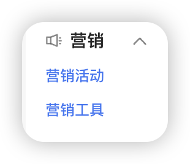 <split/> 营销工具（除满减/赠品/晒单有礼/分期免息）相关功能外所有页面 | [https://ark.xiaohongshu.com/app-promotion/promotion-tools](https://ark.xiaohongshu.com/app-promotion/promotion-tools) | - node 18 <split/> - pnpm |
|  | [晒单有礼](https://code.devops.xiaohongshu.com/fe/ark/-/tree/master/packages/app-promotion) | 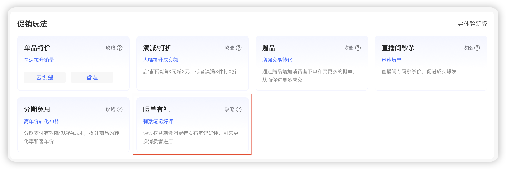 | [https://ark.xiaohongshu.com/app-promotion/share/create?uba_pre=8.promotion_tools..1765247754188&uba_index=2](https://ark.xiaohongshu.com/app-promotion/share/create?uba_pre=8.promotion_tools..1765247754188&uba_index=2) | - node 14 <split/> - npm 6 |
|  | [赠品/满减/分期](https://code.devops.xiaohongshu.com/fe/ark/-/tree/master/packages/ark/src/containers/ark-promotion) | 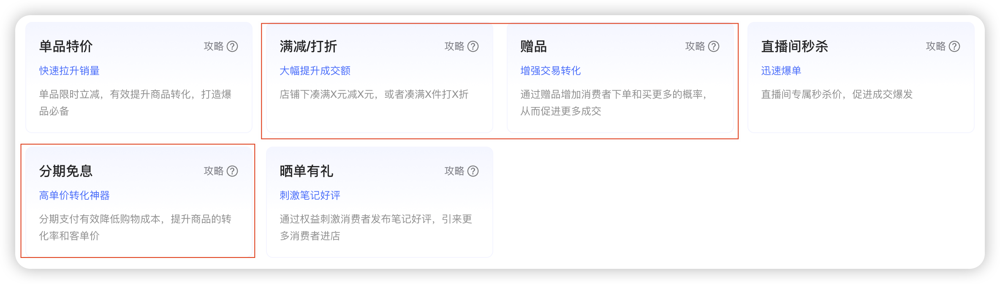 | [https://ark.xiaohongshu.com/ark/promotion/group/multi/gift?fromPage=promotion-tools-home](https://ark.xiaohongshu.com/ark/promotion/group/multi/gift?fromPage=promotion-tools-home) | - node 14 <split/> - npm 6 |
| 鹰眼 | [平台营销](https://code.devops.xiaohongshu.com/fe/odin) | 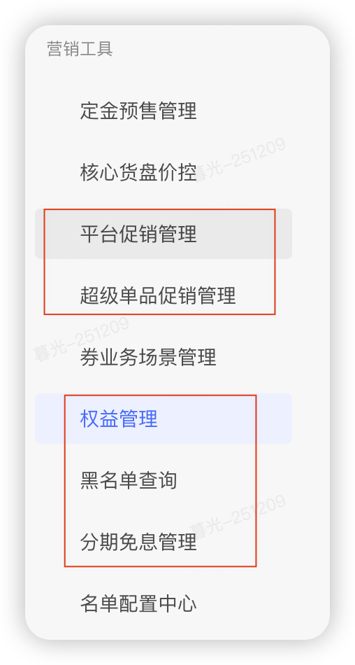 | [鹰眼](https://hawkeye.devops.xiaohongshu.com/odin/coupon/module-manage) | - node 14 <split/> - npm 6 |
|  | [补贴管理](https://code.devops.xiaohongshu.com/fe/shopping/aurora/-/tree/master/packages/promotion/promotion-hawk) | 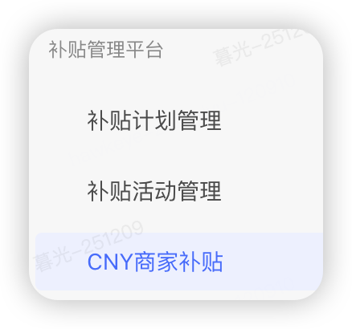 | [鹰眼](https://hawkeye.devops.xiaohongshu.com/promotion/subsidy-plan/list) | - node 18 <split/> - pnpm |

| 业务 | 场景 | link | code | 参数 |
| --- | --- | --- | --- | --- |
|   | 线上包扫码可以进 dev | xhsdiscover://rn/rn-settings |   <split/>  |   |
| 粉丝团 | 直播间内打开粉丝团首页 <split/> 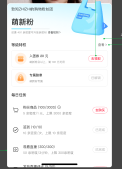 <split/>   | RN页面路由：xhsdiscover://rn/vibe-marketing-rn/fans-club-home?scene=live&source=xxxx&hostId=xxxx&roomId=xxxx&sceneApi=_inside_room_ <split/>   <split/> xhslive://live_rn_popup?height_ratio=75&is_live_business=true&transition_type=1&url=encodeURI(RN页面路由) <split/>   |   | 页面参数：source= 来源，使用方拼接 <split/> hostId= 主播id <split/>   <split/> roomId=直播间id <split/> scene = live <split/>   <split/> sceneApi =  <split/> _场景类型：'inside_room' &#124; 'outside_room'_ |
|  | 直播间外打开粉丝团首页 <split/>  <split/>   | 12.4预取更新 <split/> xhsdiscover://rn/vibe-marketing-rn/fans-club-home?background_transparent_v2=true&needNewRootNavigation=true&statusbar_transparent=true&mode=RN&panel_ratio_type=three_quarters&scene=common&source=shop&hostId=5e56675d0000000001008638&sceneApi=_outside_room_ <split/>   <split/> "hostId": "68c9167a000000002001a97e", "userId": "68c0e5d5000000000302ce69", <split/>   <split/>   <split/> 早鸟购 63158acb000000001b001a79 <split/>   <split/> 5ac442d62ba68e1322ff9f09 |  | 页面参数：source = 来源，使用方拼接 <split/>   <split/> hostId= 主播id <split/>   <split/> scene = common <split/>   <split/> sceneApi =  <split/> _场景类型：'inside_room' &#124; 'outside_room'_ |
|  | 粉丝列表 <split/> 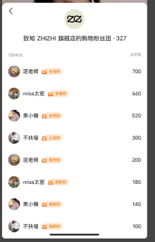 <split/>   | 直播间打开： <split/> xhslive://live_rn_popup?height_ratio=75&is_live_business=true&transition_type=1&url=encodeURI(url) <split/> url 为 xhsdiscover://rn/vibe-marketing-rn/fans-club-member-list?background_transparent_v2=true&scene=XXX&source=XX&hostId=XXX&roomId=XXXX <split/>   <split/> 非直播间打开 客户端&gt;=9.4 使用原生半层 <split/> xhsdiscover://rn_panel?bottom_background_color=00000000&background_color=0000ff00&should_hide_shadow=true&url=XXX <split/> ⚠️：原始url为【xhsdiscover://rn/vibe-marketing-rn/fans-club-member-list?scene=XXX&source=XX&hostId=XXX&roomId=XXXX】，需要encode后拼接在上述链接上； <split/> 客户端&lt;9.4 使用降级RN半层 <split/> xhsdiscover://rn/vibe-marketing-rn/fans-club-member-list?mode=RN&panel_ratio_type=three_quarters&scene=XXX&source=XX&hostId=XXX&roomId=XXXX eg： 粉丝团粉丝列表； <split/> 1. 直播间内： xhslive://live_rn_popup?height_ratio=75&is_live_business=true&transition_type=1&url=xhsdiscover%3A%2F%2Frn%2Fvibe-marketing-rn%2Ffans-club-member-list%3Fbackground_transparent_v2%3Dtrue%26hostId%3D6063208b000000000100861d <split/> 2. 直播间外： <split/> xhsdiscover://rn_panel?bottom_background_color=00000000&background_color=0000ff00&should_hide_shadow=true&url=xhsdiscover%3A%2F%2Frn%2Fvibe-marketing-rn%2Ffans-club-member-list%3Fbackground_transparent_v2%3Dtrue%26hostId%3D6063208b000000000100861d <split/>   |   | 页面参数： scene：直播间 live，普通 common <split/> source= 来源，使用方拼接 <split/>   <split/> hostId= 主播id <split/>   <split/> roomId=直播间id |
|  | 领券页面 |   |   |   |
| 商家会员 | 商家会员中心 | xhsdiscover://rn/vibe-marketing-rn/member-center?seller_id=5a151d9deb90b912e76ee832 |  |   |
|  |   | xhsdiscover://rn/vibe-marketing-rn/member-upgrade-confirm?seller_id=5a151d9deb90b912e76ee832&status=2 <split/>   <split/> xhsdiscover://rn/vibe-marketing-rn/member-upgrade-confirm?seller_id=5a151d9deb90b912e76ee832&status=2 |   |   |
|  | 协议页面 | xhsdiscover://rn/vibe-marketing-rn/member-protocol?seller_id=5a151d9deb90b912e76ee832 |   |   |
|  | 积分使用详情 | xhsdiscover://rn/vibe-marketing-rn/member-points-detail?seller_id=5a151d9deb90b912e76ee832 |   | seller_id |
|  | 商家会员加入半屏 | xhsdiscover://rn/lancer-slim/join-member-popup?scene=2&vendorId=61cb08d2581a9c0001316234&needNewRootNavigation=true <split/>   <split/>   <split/> xhsdiscover://rn/lancer-slim/join-member-popup?scene=2&vendorId=[654215449758730001d1cd5a](https://www.beta.xiaohongshu.com/api/store/edith/mc/user_member_info?seller_id=654215449758730001d1cd5a)&needNewRootNavigation=true <split/> xhsdiscover://rn/lancer-slim/join-member-popup?scene=2&vendorId=5a151d9deb90b912e76ee832&needNewRootNavigation=true <split/>   <split/> xhsdiscover://rn/lancer-slim/join-member-popup?scene=2&vendorId=5a151d9deb90b912e76ee832&needNewRootNavigation=true |  <split/>  <split/>   | vendorId <split/> scene |
| 小红卡 | 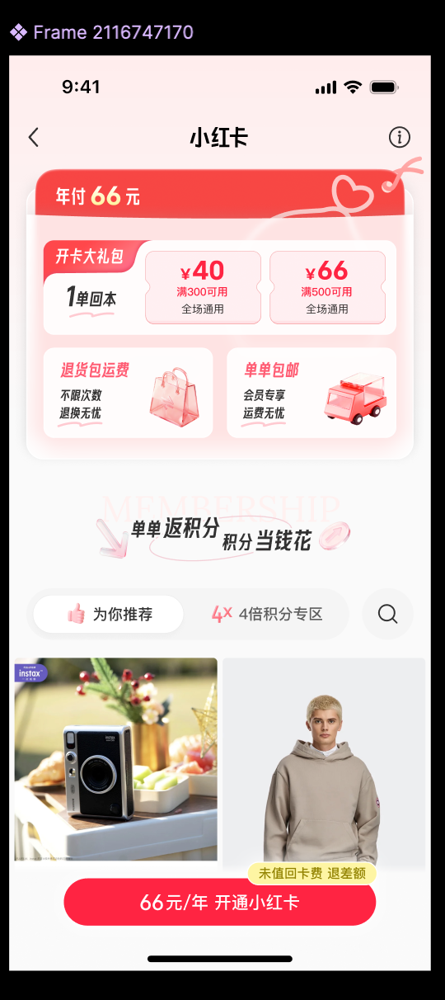 | dp： <split/> xhsdiscover://rn/vibe-marketing-rn/red-card-member?custom_backgroundColor=ffffff <split/> 参数： <split/> source <split/> memberStatus  0 未开卡 1 已开卡 <split/>   <split/>   <split/> xhsdiscover://rn/vibe-marketing-rn/red-card-member?custom_backgroundColor=ffffff&memberStatus=0&source=note |  <split/>   |   |
|   |  | xhsdiscover://store/activity?source=redcard&panel=xhsdiscover%3A%2F%2Frn%2Fvibe-marketing-rn%2Fred-card-member%3Fcustom_backgroundColor%3Dffffff%26source%3Dxxx%26isHalfScreen%3Dtrue&jump_to_2tab=true&panel_extra=%7B%22pull_full%22%3Atrue%2C%22enable_progress_notification%22%3Atrue%2C%22show_grabber%22%3Atrue%2C%22nested_scroll_enable_compat%22%3Atrue%2C%22back_half%22%3Atrue%2C%22over_status_bar%22%3Atrue%7D |  <split/>   |   |
|   | 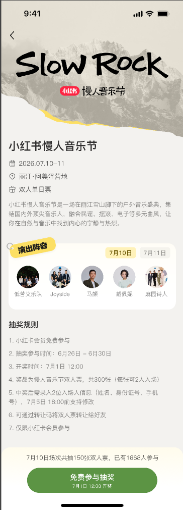 <split/>   | xhsdiscover://rn/vibe-marketing-rn/red-card-member-activity??custom_backgroundColor=ffffff | 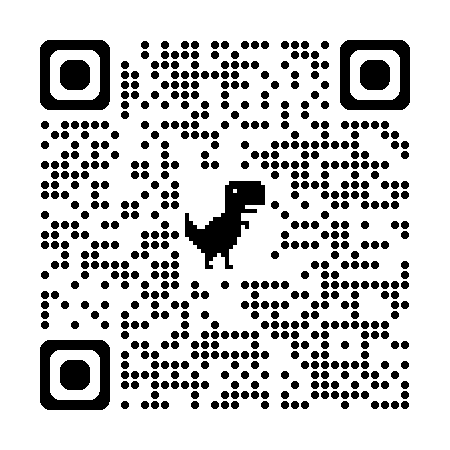 <split/>   |   |
|   | 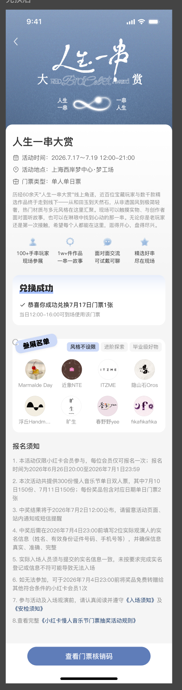 | xhsdiscover://rn/vibe-marketing-rn/red-card-member-points-activity??custom_backgroundColor=ffffff <split/>   <split/>   <split/>   |  <split/>   |   |
|   | 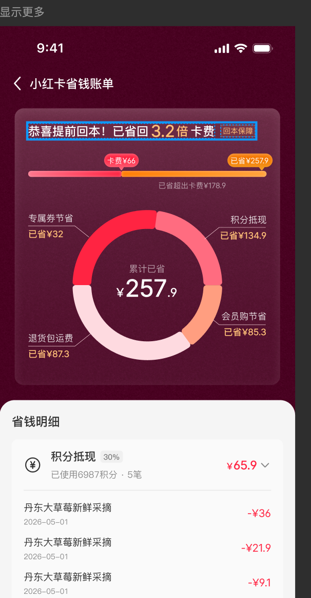 | xhsdiscover://rn/vibe-marketing-rn/red-card-savings-detail | 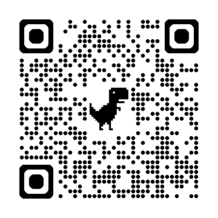 |   |
|   | 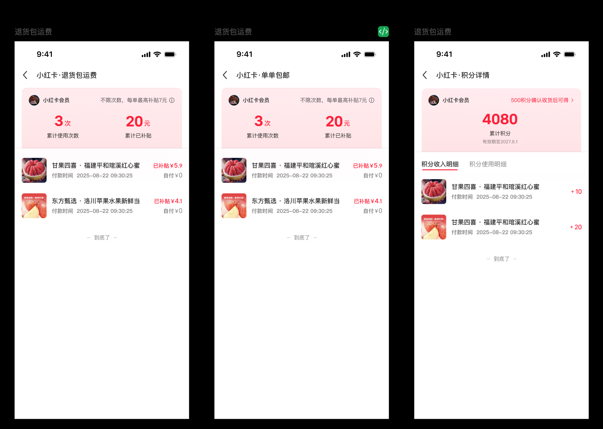 |   |   |   |
|   | 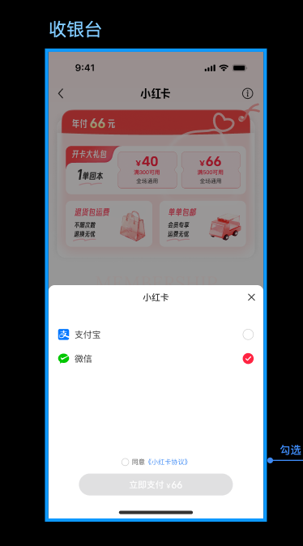 | xhsdiscover://rn_panel?url=xhsdiscover%3A%2F%2Frn%2Fvibe-marketing-rn%2Fred-card-payment%3Fprice%3D10000%26source%3Dmain_venue&panel_ratio=0.5&background_color=ffffff&mask_background_color=D9000000&bottom_background_color=ffffff&isRediOSDoubleDecode=false <split/>   <split/>   <split/> xhsdiscover://rn/vibe-marketing-rn/red-card-payment?mode=RN&background_transparent_v2=true&needNewRootNavigation=true&halfShadowHeight=0.5&halfShadowCorner=12 <split/>   |  <split/>   |   |
|   | 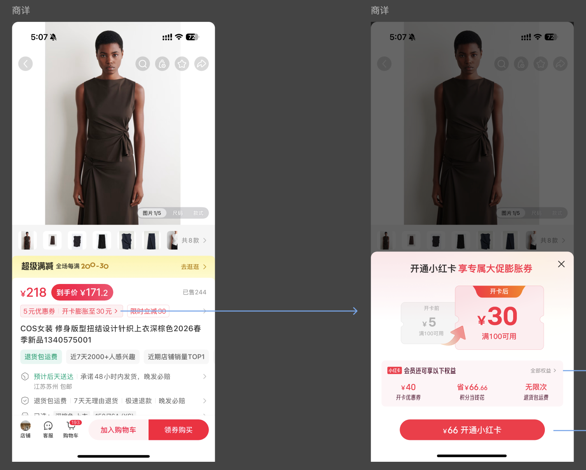 | xhsdiscover://rn_panel?url=xhsdiscover%3A%2F%2Frn%2Fvibe-marketing-rn%2Fred-card-coupon-expansion%3Fsource%3DdetailSuper%26templateId%3D6a5727432aa9080015d7ff66&isRediOSDoubleDecode=false&panel_height=407 <split/> 其中templateId是券模版，从商详跳转进来动态更改此参数 |   |   |
|   | 买手券 |   |   |   |

 