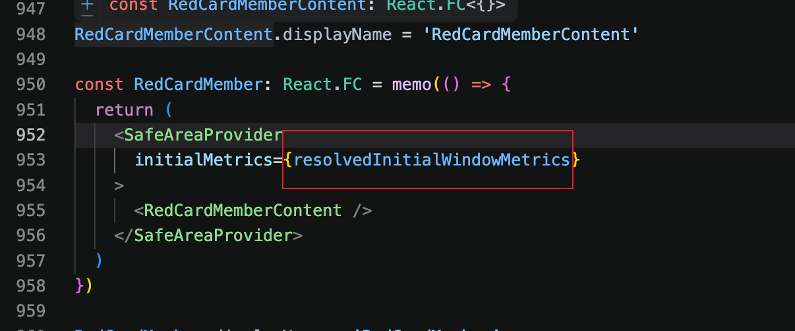
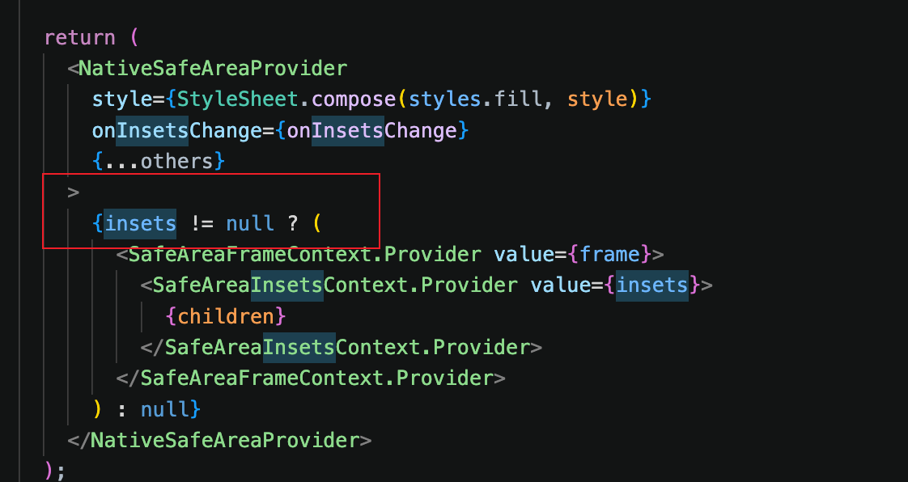
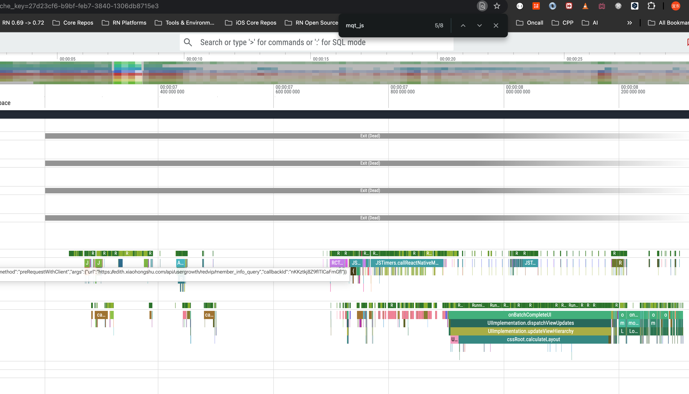
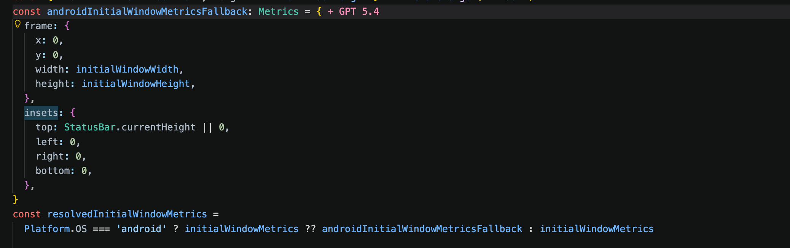

[小红卡体验性能评测](https://docs.xiaohongshu.com/doc/a5a8edac1876b73a576d2d4f797ed583)

### 目前可见问题：

1. 缓存未剔除preloadData剔除

  1. 剔除前：

    1. 安卓低端：[Cache] getBootstrapCache took 237.35 ms

    2. IOS 高端：[Cache] getBootstrapCache took 52.28 ms

  2. 剔除后：

    1. 安卓低端：[Cache] getBootstrapCache took 236.60 ms  变化不大。

    2. IOS 高端：[Cache] getBootstrapCache took 49.32 ms 变化不大。

2. 前置 userid 获取阻塞 

  1. DEV 安卓低端：[Cache] getCurrentUserId took 187.40 ms

  2. IOS 高端：[Cache] getCurrentUserId took 64.50 ms

  3. 更改后，取消通过 bridge 和缓存进行用户 id 获取 =&gt; 0ms

3. 前置缓存获取串行，需要改并行。

 

### 优化注意点：

1. trace 分析，[https://fe.devops.sit.xiaohongshu.com/docs/react-native/performance/analyze.html](https://fe.devops.sit.xiaohongshu.com/docs/react-native/performance/analyze.html)  AI 和源码对应找到加载延时，和渲染延迟。

2. 

 

 

### 优化后整体时序图

<redoc-text-draw remoteTemplate="sequenceDiagram
    participant Page as "main.tsx"
    participant Cache as "cacheStore"
    participant MemberAPI as "memberInfo API"
    participant GoodsAPI as "goodsList API"
    participant Convert as "dataConverter"
    participant GoodsStore as "goodsStore"
    participant View as "GoodsFeedSection / GoodsFeed"
    Page->>Cache: getBootstrapCache()
    Cache-->>Page: cachedMemberInfo + cachedFeeds
    par 并发请求新鲜数据
        Page->>MemberAPI: preloadPostApiUsergrowthRedvipMemberInfoQuery()
        MemberAPI-->>Page: freshMemberInfo / error
    and
        Page->>GoodsAPI: preloadPostApiRockingResourcePlanBatchGet(page=1)
        GoodsAPI-->>Page: freshGoodsResult / error
    end
    alt 缓存完整(memberInfo && feeds.length > 0)
        Page->>GoodsStore: applyBootstrapCache(cachedFeeds)
        Page->>View: 渲染缓存会员信息 + 缓存商品
        Page->>View: 首帧稳定后再开启列表/顶部次级副作用
    else 无完整缓存
        Note over View: 首屏先渲染真实组件最小占位结构
        Note over View: 未开卡/已开卡卡面直接可见
        Note over View: BenefitSection 只保留券包/运费包外壳、积分数字区域布局、商品区外壳
        Note over View: 后续 fresh group 默认 blocking 4 张
    end
    alt 新鲜组请求成功
        Page->>Convert: convertGoodsListToFeedItems(freshGoodsResult.list)
        Convert-->>Page: freshFeeds
        alt 首屏前已命中缓存组
            Note over Page: 根据 freshMemberInfo.cardInfo.status 决定 blocking 数量
            Note over Page: 未开卡 2，已开卡 4
        else 首屏前无缓存组
            Note over Page: 无缓存兜底，fresh group 默认 blocking 4 张
        end
        alt 已有完整缓存且 freshFeeds 为空
            Note over Page: 保留 cachedFeeds，避免底部商品区被覆盖为空
            Page->>GoodsStore: applyBootstrapFresh(cachedFeeds, nextRequestId, hasMore=true)
            Page->>Cache: setMemberInfoCache(freshMemberInfo)
            Page->>Cache: setFeedsCache(cachedFeeds)
        else freshFeeds 非空
            Page->>GoodsStore: applyBootstrapFresh(freshFeeds, nextRequestId, hasMore)
            Page->>Cache: setMemberInfoCache(freshMemberInfo)
            Page->>Cache: setFeedsCache(freshFeeds)
        end
        Note over GoodsStore,View: applyBootstrapFresh 内部会 reconcileGoodsItems
        Note over GoodsStore,View: 对渲染字段未变化的 item 复用缓存对象引用
        Page->>View: 用新鲜数据覆盖当前展示
    else 新鲜组请求失败
        alt 页面上已有缓存组
            Note over View: 保留缓存展示，不额外清空商品列表
        else 页面上无缓存组
            Note over View: memberInfoHydrated=true，但商品区可能无内容
        end
    end" remoteView="show-all"/>

<redoc-text-draw remoteTemplate="sequenceDiagram
    participant User as "用户"
    participant Page as "main.tsx"
    participant MemberAPI as "memberInfo API"
    participant GoodsStore as "goodsStore"
    participant GoodsAPI as "goodsList API"
    participant Convert as "dataConverter"
    participant View as "GoodsFeed"
    User->>Page: PullRefresh / onRequest
    Page->>Page: handleRefresh()
    par 刷新会员信息
        Page->>MemberAPI: postApiUsergrowthRedvipMemberInfoQuery()
        alt 会员接口成功
            MemberAPI-->>Page: freshMemberInfo
            Page->>Page: setMemberViewState(fresh)
        else 会员接口失败
            MemberAPI-->>Page: error
            Note over Page: 保留当前 memberInfo，仅标记 hydrated
        end
    and 刷新商品列表
        Page->>GoodsStore: refresh(true)
        GoodsStore->>GoodsStore: 记录 previousState
        GoodsStore->>GoodsAPI: postApiRockingResourcePlanBatchGet(page=1)
        alt 商品接口成功
            GoodsAPI-->>GoodsStore: list
            GoodsStore->>Convert: convertGoodsListToFeedItems(list)
            Convert-->>GoodsStore: convertedList
            alt convertedList 为空且 previousState.goodsList 非空
                Note over GoodsStore: 保留 previousState.goodsList
            else convertedList 非空
                GoodsStore->>GoodsStore: 用新列表覆盖
                GoodsStore->>Cache: setFeedsCache(convertedList)
            end
        else 商品接口失败
            GoodsAPI-->>GoodsStore: error
            alt previousState.goodsList 非空
                GoodsStore->>GoodsStore: 恢复 previousState，结束 refreshing
            else 无旧列表
                GoodsStore->>GoodsStore: 保持错误态 + 空列表
            end
        end
    end
    GoodsStore-->>View: goodsList / refreshing / hasMore"/>

 

 

 

### 踩坑

1. 安卓情况下initialMetrics为 null 导致第一屏什么也不渲染

<redoc-columns>
<redoc-column ratio="0.2">

</redoc-column>
<redoc-column ratio="0.160407">

</redoc-column>
<redoc-column ratio="0.639593">

</redoc-column>
</redoc-columns>

解决方案：安卓给默认值

2. SafeAreaProvider 里面不能使用SafeAreaView 标签，会让延迟加载，删除标签使用。

3. 

 