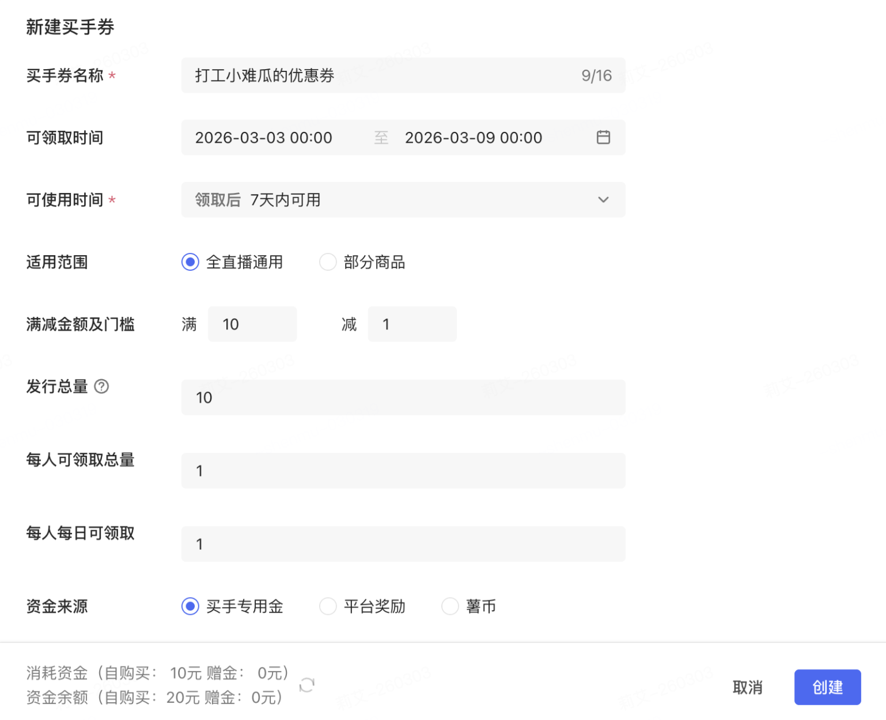
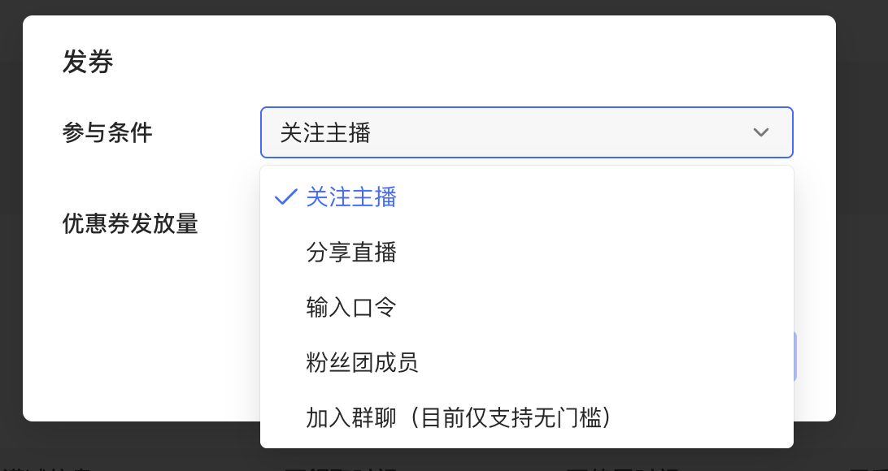
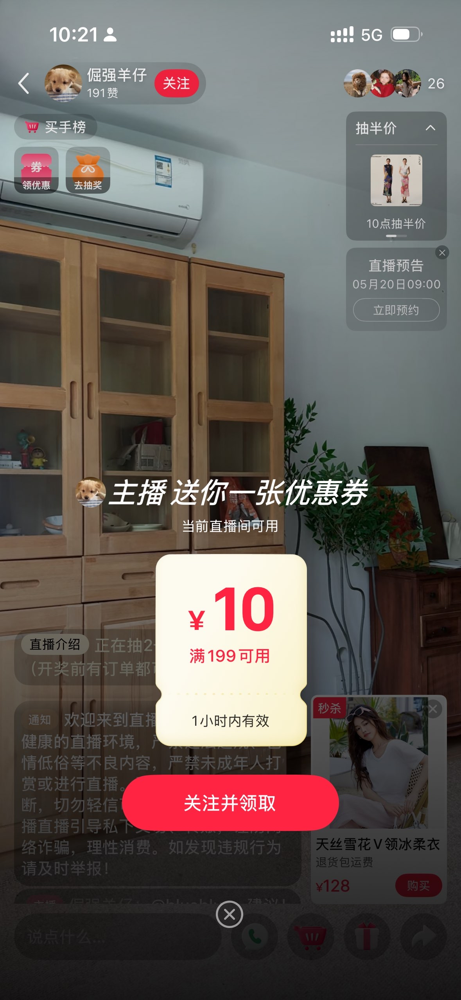
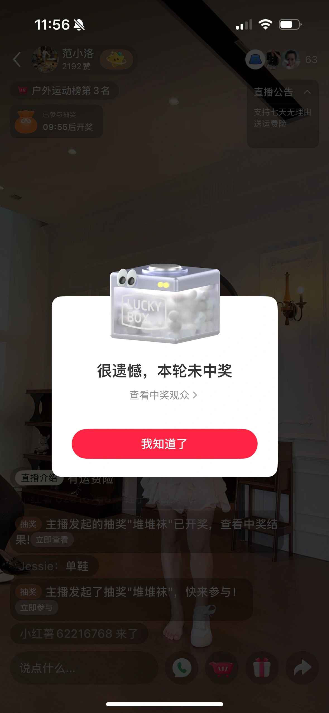
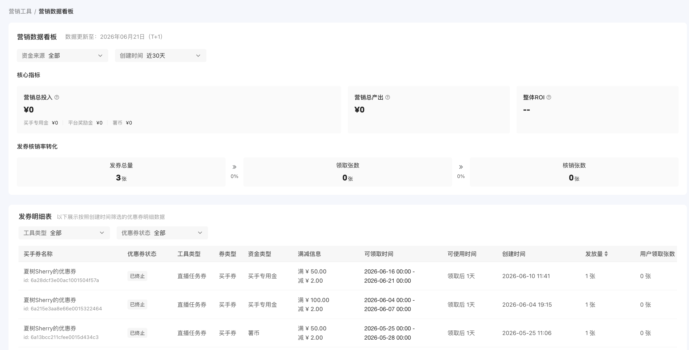
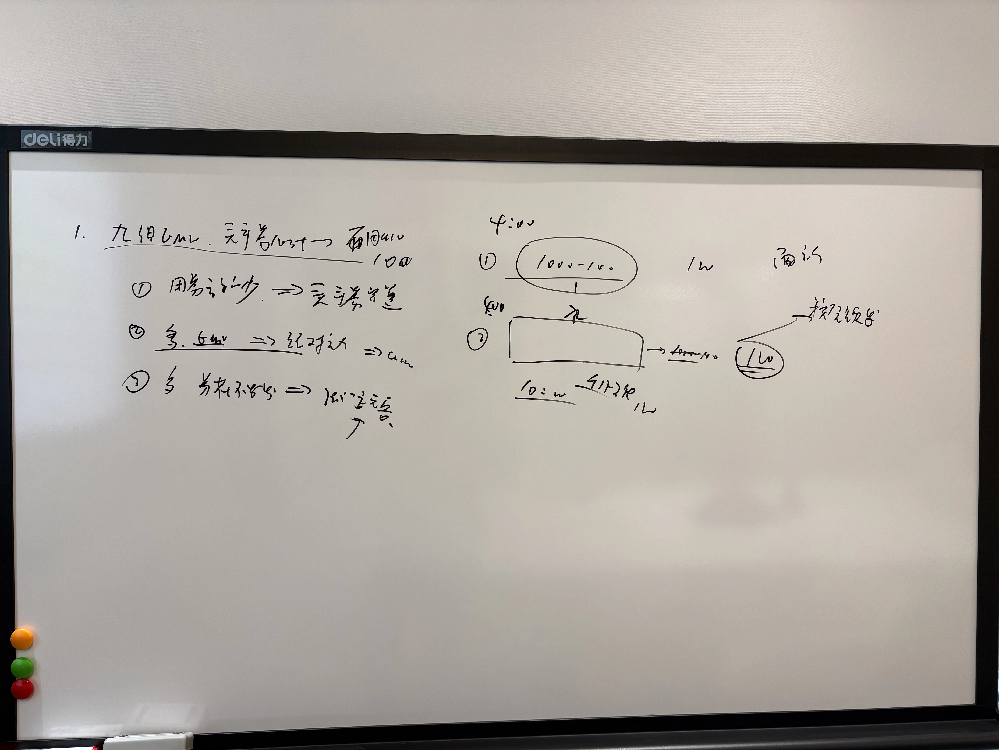

<redoc-highlight>
**围绕工具能力拓展、工具效率提升两大方向，以买手营销工具渗透率与DGMV增长为目标，推进全托管发券、粉丝首单转化、直播间连单、新工具探索、数据建设：**

**1、工具能力：**

- **发券钱效：**

  - **买手券全托管**：解决买手不知该发什么券、发多少、发给谁的问题；根据买手X用户X价格带分层发券，并结合直播间实时状态动态调整发券策略，提升买手券整体 ROI与DGMV（with美来）。

- **新增券类型：**

  - **直播间复购券**：直播间下单有强冲动属性，场内多单买家占比 21% 但贡献 53% DGMV，但目前买手缺乏促进直播间复购的工具；针对本场已下单用户，在支付完成后即时触发复购券，促进场内连续下单。

  - **粉丝新客券**：97%买手粉丝在关注30天内未成交，其中平台成交高频的用户占比42%，但目前买手缺乏促进粉丝首单的工具；针对关注但未下单粉丝，在进入直播间时触发粉丝新客券，促成粉丝首单转化。

- **新工具/玩法探索：**

  - **抽奖增加平台加赠奖励（讨论）**：买手/商家直播间存在大量新客，但现在缺乏一个既能吸引新客参与、又能有效驱动成交转化的工具；通过在抽奖中加赠平台奖励，给未中奖用户中的潜在人群下发平台券，提升新客转化。

**2、工具效率：**

- **买手券整合**：将直播、橱窗、群聊等场域的买手券整合，支持买手通过【新增券配置-发券场景】来设置场域

- **买手营销工具数据建设**：买手当前无法感知发券效果，缺乏"花钱-赚钱-再花钱"的正向循环；建设发券前/中/后全链路数据看板，覆盖目标推荐、实时消耗预警、ROI 归因复盘，提升工具使用渗透与留存。
</redoc-highlight>

# 一、券钱效：买手券全托管，提升买手券ROI，促GMV

## （1）背景

<redoc-highlight>
**问题一：不知道发什么门槛&面额、多少张、发给谁，只能凭感觉经验拍或参考其他买手，券的钱效较低**
</redoc-highlight>

和买手运营调研，现在买手实际发券的流程如下**：**

<redoc-flow-diagram width="964" height="368" url="https://xhs-doc.xhscdn.com/104004dg321nhlf3p6u0u55c01c"></redoc-flow-diagram>

<redoc-highlight>
**问题二：直播场次之间波动大、单场直播内不同时段波动大，但券预算固定，不知道什么时候该多发少发、如何动态调整**
</redoc-highlight>

- **不同场次之间的货盘价格差异大**：越是头部买手，货盘价格波动越大

| 月销 K 分层 | 买手数 | 主流价位 | **货盘稳定占比** | 货盘大幅波动占比 |
| --- | --- | --- | --- | --- |
| 无动销 | 28,276 | ¥104 | 82% | 6% |
| 0~1 万 | 13,595 | ¥93 | 79% | 8% |
| 1~10 万 | 4,075 | ¥172 | 74% | 12% |
| 10~50 万 | 1,426 | ¥245 | 68% | 17% |
| 50~100 万 | 372 | ¥388 | 63% | 23% |
| 100~500 万 | 475 | ¥486 | **58%** | **28%** |
| 500~1000 万 | 60 | ¥791 | **53%** | **37%** |
| **1000 万+** | 52 | ¥746 | **37%** | **38%** |

时间周期：2026-05-16~2026-05-21

_CV = 标准差 / 平均值（CV 越小越稳）_

_货盘稳定 = CV&lt;0.3（场间价差&lt;30%）；大幅波动 = CV≥0.6_

- **不同场次之间的券领取核销差异大：**同一买手不同场直播之间，领券UV、核销 UV、核销率在场次之间的波动剧烈（极差率中位数 &gt; 100%，即「最好场 vs 最差场」差距已超过平均值），客单价相对较为稳定（极差率中位数43%），推测受场次之间流量变化大带来。

| 指标 | 业务含义 | P10 | P25 | **P50 中位数** | P75 | P90 | 均值 |
| --- | --- | --- | --- | --- | --- | --- | --- |
| **uv_claimed_volatility_pct** | 领券 UV 波动 | 21.2% | 53.1% | **102.4%** | 200.0% | 308.9% | 154.2% |
| **uv_used_volatility_pct** | 核销 UV 波动 | 44.4% | 89.1% | **158.2%** | 248.1% | 375.6% | 203.5% |
| **use_rate_volatility_pct** | 核销率波动 | 12.6% | 40.6% | **82.7%** | 148.5% | 218.8% | 109.8% |
| **used_aov_volatility_pct** | 核销客单价波动 | 2.5% | 19.2% | **42.6%** | 84.8% | 127.1% | 58.2% |

_以上为5/11-5/17 在直播间被领过买手券的买手，在5/11-5/24 的电商直播场次之间的数据波动_

_极差率的公式：(max - min) / mean × 100%_

## （2）事项

- 买手券全托管：根据买手X用户X价格带分层发券，并结合直播间实时状态动态调整发券策略，提升买手券整体ROI与DGMV

|   | <redoc-comment commentGid="7654623787151471561" blockId="206b2ba069480e5b88d3242be73ea13a">方案简述</redoc-comment> | 优点 | 缺点 |
| --- | --- | --- | --- |
| 方案A | 用户进直播间自动发券 <split/> - 买手侧：设置托管预算 -&gt; 生成托管计划  -&gt; 自动发券&实时监控  -&gt; 效果复盘&下场建议 <split/> - 用户侧：用户进直播间 -&gt; 自动判断是否发券  -&gt; 发券千人千面 | - C端交互无改造 | - 较难配合主播口播、主动经营 <split/> - 用户侧领取的券面额门槛不一样，直播间内交流，买手较难解释（最大的问题） |
| 方案B | 直播间定时发券 <split/> - 买手侧：设置托管预算 -&gt; 生成托管计划  -&gt; 自动发券&实时监控  -&gt; 效果复盘&下场建议 <split/> - 用户侧： <split/> - 流程：用户进直播间 -&gt; 直播间整点/半点发券  -&gt;倒计时结束-&gt; 发券千人千面 <split/> - 随机机制：用随机来实现千人千面，倒计时结束前，只展示券总面额；倒计时结束，用户侧展示可领取券的面额&门槛 | - C端交互需改造 | - 便于买手口播、主动经营 <split/> - 随机机制，用户好理解能接受和别人领到的券不一样，买手容易解释 |

# 二、券类型迭代

## （1）背景

### **1、看买手券的核销用户画像**

<redoc-highlight>
买手券主要核销用户是高R高U老客 + 粉丝，直播间里80%用户（非粉未购、R0 无购买、沉默/流失老客）承接不足

- 98% 是U5+U6，72% 是 R4+，83% 是粉丝核销
</redoc-highlight>

**买手券核销人群画像 vs 看播大盘对照分析**

[https://ep-hiclouddrive-s2.xhscdn.com/hiclouddrive/104004l0321ppt3deno0fstp0b4.html?sign=f80530964d3a19312ab64571cdca9909&t=6a3b847f](https://ep-hiclouddrive-s2.xhscdn.com/hiclouddrive/104004l0321ppt3deno0fstp0b4.html?sign=f80530964d3a19312ab64571cdca9909&t=6a3b847f)

**维度 1：买家身份**

| 档位 | 看播占比 | 核销占比 | 缺口 |
| --- | --- | --- | --- |
| **粉丝复购** | 2.04% | **45.26%** | **+43pp** ⬆️ |
| 粉丝**90d**未购 | 32.49% | 37.89% | +5pp |
| 非粉复购 | 0.76% | 1.10% | +0.3pp |
| **非粉90d未购** | **64.71%** | 15.75% | **−49pp** ⬇️ |

💡 看播 65% 是非粉路人，买手券核销只占 16%——**4813 万 user×anchor 对的****路人破冰场景承载缺失，可以尝试做新人券**

**维度 2：90d 在该买手处下单频次（粘性）**

| 档位 | 看播占比 | 核销占比 | 缺口 |
| --- | --- | --- | --- |
| **0 单** | **96.14%** | 51.64% | **−44pp** ⬇️ |
| 1 单 | 2.15% | 10.11% | +8pp ⬆️ |
| 2-3 单 | 1.10% | 11.67% | **+11pp** ⬆️ |
| **4-10 单** | 0.50% | 15.17% | **+15pp** ⬆️ |
| **11+ 单** | 0.11% | 11.40% | **+11pp** ⬆️ |

💡 看播 96% 是该买手首次客人，买手券只接住 52%——**尝试新人券**

**维度 3：R 等级（消费力）**

| 档位 | 看播占比 | 核销占比 | 缺口 |
| --- | --- | --- | --- |
| R6 (3k+) | 1.12% | **39.03%** | **+38pp** ⬆️ |
| R5 (1k-3k) | 2.34% | 22.30% | **+20pp** ⬆️ |
| R4 (500-1k) | 2.97% | 11.00% | +8pp |
| R3 (200-500) | 6.10% | 9.37% | +3pp |
| R2 (50-200) | 11.39% | 6.81% | −5pp |
| R1 (0-50) | 13.25% | 3.75% | −10pp |
| **R0 无购买** | **62.82%** | 7.74% | **−55pp** ⬇️ |

💡 看播池子 63% 是平台从未购买的用户，买手券只接住 8%——**平台首购破冰几乎为零**

**维度 3：U 用户分层（生命周期）**

| 档位 | 看播占比 | 核销占比 | 缺口 |
| --- | --- | --- | --- |
| **活跃老客** | 36.00% | **92.04%** | **+56pp** ⬆️ |
| **沉默老客** | 26.72% | 6.24% | **−20pp** ⬇️ |
| **180天流失** | 14.01% | 0.89% | **−13pp** ⬇️ |
| 养成期潜客 | 11.31% | 0.24% | −11pp ⬇️ |
| 转化期潜客 | 7.83% | 0.23% | −8pp ⬇️ |
| 沉默新客 | 2.95% | 0.15% | −3pp |
| 活跃新客 | 1.18% | 0.22% | −1pp |

💡 看播池子 64% 不是活跃老客（含沉默/流失/潜客），买手券没接住——**缺乏****沉默老客唤醒，尝试沉默老客唤醒券**

 

**维度 5：90d 在该买手处累计 GMV（消费深度）**

| 档位 | 看播占比 | 核销占比 | 缺口 |
| --- | --- | --- | --- |
| **0 元** | **95.96%** | 51.65% | **−44pp** ⬇️ |
| &lt;100 元 | 0.91% | 2.56% | +2pp |
| 100-500 元 | 1.75% | 10.39% | +9pp ⬆️ |
| 500-1k 元 | 0.69% | 8.01% | +7pp ⬆️ |
| **1k-3k 元** | 0.50% | 12.74% | **+12pp** ⬆️ |
| **3k+ 元** | 0.20% | 14.64% | **+14pp** ⬆️ |

💡 与频次维度同步——**高消费金额（**1k+）**的老顾客核销占比比看播占比高26pp**

### 2、粉丝新客：买手粉丝中已购粉丝占比低

1. 买手粉丝里的交易粉丝占比只有2.45%，远低于商家11.71%，商家是买手的 **4.8 倍**

  1. 买手"用日常笔记圈粉，但圈来的是泛粉不是买粉"，**买手 56% 粉丝来自普通笔记，但转化率仅 0.28%**

  2. **商家粉丝从一开始就带购物意图**（搜店铺/品类/商品笔记），人群天然垂直，**转化率**11.71%，商家是买手的 **4.8 倍**

**买手涨粉渠道明细：**

| 渠道 | 整体粉丝 | 占比 | 交易粉丝 | 占比 | 交易转化率 | 主播 UV |
| --- | --- | --- | --- | --- | --- | --- |
| 普通笔记 | 7,696.8 万 | 55.45% | 21.2 万 | 6.23% | 0.28% | 24.1 万 |
| 推荐feed | 1,866.7 万 | 13.45% | 28.7 万 | 8.42% | 1.54% | 21.7 万 |
| 直播间 | 1,553.8 万 | 11.19% | 262.2 万 | 76.97% | **16.87%** | 4.2 万 |
| 其他 | 1,149.2 万 | 8.28% | 16.2 万 | 4.77% | 1.41% | 24.1 万 |
| 搜索 | 1,103.0 万 | 7.95% | 6.8 万 | 2.00% | 0.62% | 19.2 万 |
| 个人页 | 346.0 万 | 2.49% | 2.4 万 | 0.70% | 0.69% | 13.5 万 |
| 商品笔记 | 165.8 万 | 1.19% | 3.1 万 | 0.91% | 1.87% | 4.2 万 |

2. 买手粉丝里的非交易粉丝，有42%是平台交易高频或者高U用户，有潜力可以转化下单，有营销工具做功的空间；除了平台交易特征，还可以考虑求购意图行为特征。

交易粉丝的平台行为特征：

| 维度 | 交易粉丝的特征命中人数 | 占交易粉丝 |
| --- | --- | --- |
| 交易粉丝 + 平台高频 | 268.3 万 | **92.7%** |
| 交易粉丝 + 平台高 U | 288.3 万 | **99.6%** |
| 交易粉丝 + (高频 或 高 U) | 288.3 万 | **99.6%** |

命中特征 vs 未命中特征 的交易粉丝转化率：

| 特征 | 命中人转化率 | 未命中人转化率 | lift |
| --- | --- | --- | --- |
| 🅐 平台高频（90d≥2 单） | 2.016% | 0.0633% | **32 倍** |
| 🅑 平台高 U（U3+） | 1.474% | 0.0046% | **322 倍** |
| 任一命中（🅐 或 🅑） | 1.467% | 0.0045% | **329 倍** |

**两个潜力信号**：

- 🅐「**平台高频用户**」= 近 90 天在平台下单 ≥2 单（说明这人爱在小红书买东西）

- 🅑「**平台高 U 用户**」= 用户分层属于 活跃老客/活跃新客/沉默老客（说明这人是平台付费成熟用户）

非交易粉丝里的潜力人群占比：

| 这群人是谁 | 关系数 | 占未转化比例 |
| --- | --- | --- |
| 仅命中🅐（平台爱买，但 U 分层不高） | 97 万 | 0.21% |
| 仅命中🅑（U 分层成熟，但 90d 买得少） | 6332 万 | 13.58% |
| 同时命中🅐和🅑（既爱买又是成熟付费用户） | 1.29 亿 | 27.77% |
| **🎯 类型 1 总潜力（🅐或🅑 至少命中一个）** | **1.94 亿** | **41.56%** |

### **3、看用户在直播间内下单时机**

<redoc-highlight>
**问题：直播间下单有强冲动属性，买手单场直播间里的2单以上用户占比21%，贡献53%DGMV，但目前缺乏干预手段**
</redoc-highlight>

1. **规模在线**：5 个买家就有 1 个连买（21%），不是稀有行为

2. **价值杠杆超预期**：买手侧 21% 的连单买家贡献了 **53% 的 GMV**，商家侧也有 41%

3. **直播间下单的强冲动属性**：应该在下单后马上给用户发券，刺激用户连续下单

  1. 近 60% 的第 2 单发生在第 1 单后 10 分钟内

  2. 很多用户是边逛边买：在MF下单后，当天在关注页球区再次下单的pv3.1w， dgmv 971w，占球区 dgmv21%

**① 场内连单基础数据**

| 指标 | 买手（K播） | 商家（店播） | 差异解读 |
| --- | --- | --- | --- |
| 有购买的「场×人」对数 | 192.3 万 | 440.9 万 | 商家盘子是买手 2.3x |
| 去重买家 UV | 144.6 万 | 280.8 万 | 商家用户基数大 |
| **场内多单买家占比** | **21.15%** | **20.98%** | 几乎打平，每 5 人就有 1 人连买 |
| **场内多单 GMV 贡献** | **53.47%** | **40.93%** | 买手强 12pp，连单是买手 GMV 半壁江山 |
| **场内人均支付单数** | 1.40 单 | 1.53 单 | 商家略高（高频日化品多） |
| 总订单数 | 268.4 万 | 673.4 万 | — |
| 总 GMV（元） | 7.92 亿 | 11.95 亿 | AOV：买手 295 元 / 商家 177 元 |

**④ 第 1~2 单时间间隔分布**

| 间隔档位 | 买手 占比 | 商家 占比 | 中位间隔（买手/商家） |
| --- | --- | --- | --- |
| ≤ 10 分钟 | **59.78%** | **58.33%** | 1.7 min / 2.3 min |
| 10~30 分钟 | 14.71% | 19.64% | 16.6 min / 16.7 min |
| &gt; 30 分钟 | 25.51% | 22.02% | 109 min / 70 min |

## （2）各买手券定位

| 券类型 | 流程机制 | 定位 | 区别点 |
| --- | --- | --- | --- |
| 任务券 | - 买手：设置关注/分享/口令等领取条件，整点半点或配合讲品节奏发送 <split/> - 用户：所有用户可见，用户需满足条件才可领取，不满足需完成任务 <split/> <redoc-columns> <redoc-column ratio="0.343062">  </redoc-column> <redoc-column ratio="0.518094">  </redoc-column> <redoc-column ratio="0.138844">  </redoc-column> </redoc-columns> | 公域转化+流量工具 <split/>   | - 所有人可见 <split/> - 买手口播驱动，用户主动参与任务撬动行为（关注/分享/加团等），牺牲精准换覆盖 |
| <redoc-comment commentGid="7654867573790607578" blockId="36391dd7b0fd18d19abab9ff62de2d40">人群券</redoc-comment> | - 买手：设置发放人群、时机，自动发送 <split/> - 用户：仅被发放人群可见、可领取 | 精准转化工具 <split/>   | - 定向可见 <split/> - 系统自动精准触达，只有目标人群能看见，核心是把已筛选出来的高意向用户推过临门一脚 |

## <redoc-comment commentGid="7654876464371997339" blockId="3f4c2e192f308a515186dbc791c9f105">（3）事项</redoc-comment>

- 新增人群券：主要针对以下重点人群&时机

| 目的 | 重点人群&时机 | 需求 |
| --- | --- | --- |
| 拉新促活 | 粉丝未购用户 | 粉丝新客券：粉丝用户 +未购买，低门槛小额券，引导"试一单"————明确先做 |
| 复购 | 中间层跃迁 | 0单-&gt;1～2单 ——待盘点清楚 |
|  | ~~沉默老客唤醒券~~ | ~~沉默老客唤醒券：历史买过该买手 + 90d 未购 + 进直播间；~~ |
|  | ~~直播间下1单的用户~~ | ~~直播间复购券：~~ <split/> - ~~本场已下过 1 单，支付完成后发券，促成本场直播连续下单~~ <split/> - ~~防漏洞机制：~~~~限定券适用范围，~~~~复购券只能用于第2件不同商品，不能用于重复购买同一SKU~~ |

# 三、新工具探索

## 2.1 拉新：抽奖增加平台加赠奖励，促DAB

### （1）背景

<redoc-highlight>
**问题：直播间新客****占比高，但现在缺乏一个既能吸引新客参与、又能有效驱动首单转化的工具**

- **直播间用户结构**：买手/商家直播间存在大量新客，主播新客占66%+，平台新客占36%+，有营销工具牵引新客转化的空间

- **现有的营销工具**：现在只有抽奖、购物红包、买手券等营销工具，要么促看播/涨粉（抽奖），要么虽然促成交转化但渗透低（买手券），只有明确购物意图的用户才会主动领券，缺乏一个既能吸引新客参与、又能有效驱动成交转化的工具

- **抽奖的拉新效果**：

  - 抽奖参与用户结构：抽奖用户中仍然大部分是新客在参与，主播新客占67%+，平台新客18%+

  - 抽奖的拉新效果：相关性分析，横向对比首单转化率，抽奖参与新客 是 自然看播新客的 20~100 倍
</redoc-highlight>

买手直播间的用户结构近7天数据：

|   | 看播用户 | 成交用户 | 抽奖参与用户 |
| --- | --- | --- | --- |
| UV | 1.52 亿 | 137 万 | 62 万 |
| **平台新客** <split/> > **120天无平台成交** | **36%** | **17%** | **18%** |
| **买手/商家新客** <split/> > **120天对该商家/买手无成交** | **66%** | **80%** | **67%** |

商家直播间的用户结构近7天数据：

|   | 看播用户 | 成交用户 | 抽奖参与用户 |
| --- | --- | --- | --- |
| UV | 1.82 亿 | 291 万 | 142 万 |
| **平台新客** <split/> > **120天无平台成交** | **39%** | **20%** | **25%** |
| **主播新客** <split/> > **120天对该商家/买手无成交** | **70%** | **82%** | **73%** |

对比**首单转化率：**抽奖参与新客 是 自然看播新客的 20~100 倍：

|   | 看播新客（自然基线） | 抽奖参与新客 |
| --- | --- | --- |
| **平台新客** 买手 | 0.16% | **15.7%** |
| **平台新客** 商家 | 0.33% | **13.0%** |
| **主播新客** 买手 | 0.65% | **29.1%** |
| **主播新客** 商家 | 1.22% | **21.3%** |

现有买手营销工具对比：

| 经营目标 | 链路节点 | 工具 | 问题 |
| --- | --- | --- | --- |
| 拉停留 | 进入 → 看播 | - 抽奖（主播渗透12%，买手渗透7%） | 要么促看播/涨粉（抽奖），要么虽然促成交转化但渗透低（买手券），且可能只有明确购物意图的用户才会主动领取，缺乏促进新客转化、且比券的用户参与度更高的工具 |
| 促涨粉 | 看播 → 关注 | - 抽奖 <split/> - 购物红包（主播渗透0.29%，买手渗透1.3%） |  |
| 促下单 | 看播 → 下单 | - 买手券（主播渗透0.29%，买手渗透1.3%） |  |

### （2）事项

- 抽奖增加平台加赠奖励：

  - 平台券常态化，给未中奖的高潜用户加赠奖励，加赠平台券

  - 高潜用户：主播新客、平台新客，叠加购物意图特征（看播时长&gt;n秒、商品笔记阅读&gt;n秒、商品加购&收藏等）

下图：线上抽奖开奖用户未中奖情况

# 四、工具效率

## 3.1 买手营销工具数据建设，提升使用效果感知

### （1）背景

- 现状：

  - 数据较少、缺乏有效指引：只有发券张数、核销张数、核销率、拉动成交金额、ROI的基础数据

  - 买手发券链路上触点不全：仅蒲公英展示数据，app端缺乏营销工具数据，app发券占比8%

### （2）事项

- 围绕买手发券前、发券中、发券后全链路，建设核心数据和引导建议

- 拓展买手发券场景：直播助手、app端

| 阶段 | 买手核心诉求 | 需要看到的数据 |
| --- | --- | --- |
| **发券前** | 我想达成什么目标，该发哪种券？ <split/> 每种券效果怎样？ | 目标→券类型推荐； <split/> 每种券的核销率、ROI等； |
| **发券中** | 券的消耗正不正常？ <split/> 如何根据直播中状态及时调整？ | 实时领取量、核销量、剩余库存； <split/> 当前在线人数变化、新客/老客结构变化； <split/> 库存预警（快发完/发超） |
| **发券后** | 这场券值不值？下次怎么做？ | 发放-&gt;领取-&gt;核销漏斗； <split/> 最终 ROI <split/> 不同用户群的反应差异； <split/> 下次发券的优化建议 |

# 五、落地节奏

| 模块 | 目的 | 事项 | 优先级 | 落地时间 |
| --- | --- | --- | --- | --- |
| 工具能力 | 现有买手券资金的ROI、DGMV增量 | 任务券优化： <split/> - 券参数个性化推荐 <split/> - 发多张券：券包 | P0 | 7-8月：验证最优的发券方式和流程，并全量 <split/> 9-11月：联合运营GTM提渗透、打showcase，在双十一放大效果 |
|  | DGMV增量 | 全托管：新增买手人群券 <split/> - 人群： <split/> - 粉丝新客券——明确先做 <split/> - 中间层跃迁——待盘点清楚 <split/> - 券类型：人群券 <split/> - 模式：手动、自动（全托管） <split/> - 遗留问题：先做基础功能，还是直接自动化全托管，待盘点清楚 | P1 | 7-8月：验证收益，测试调整策略，并全量 <split/> 9-11月：联合运营GTM提渗透、打showcase，在双十一放大效果 |
| 工具效率 | 买手营销工具渗透、留存 | 买手营销工具数据建设，提升使用效果感知 | P0 | 7-8月：迭代上线，收集买手反馈调优 <split/> 9-11月：配合双十一，增加大促相关数据展示 |
|  | 买手营销工具渗透 | 买手任务券整合： <split/> 将直播、橱窗、群聊等场域的任务券整合，通过券配置-发券场景来设置 | P1 | 7-8月：迭代上线 |

 

 