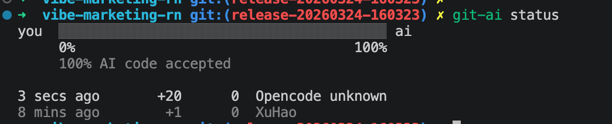
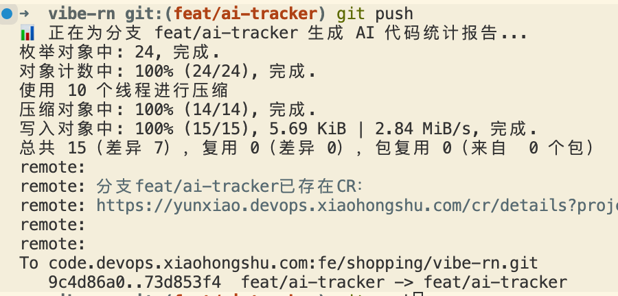
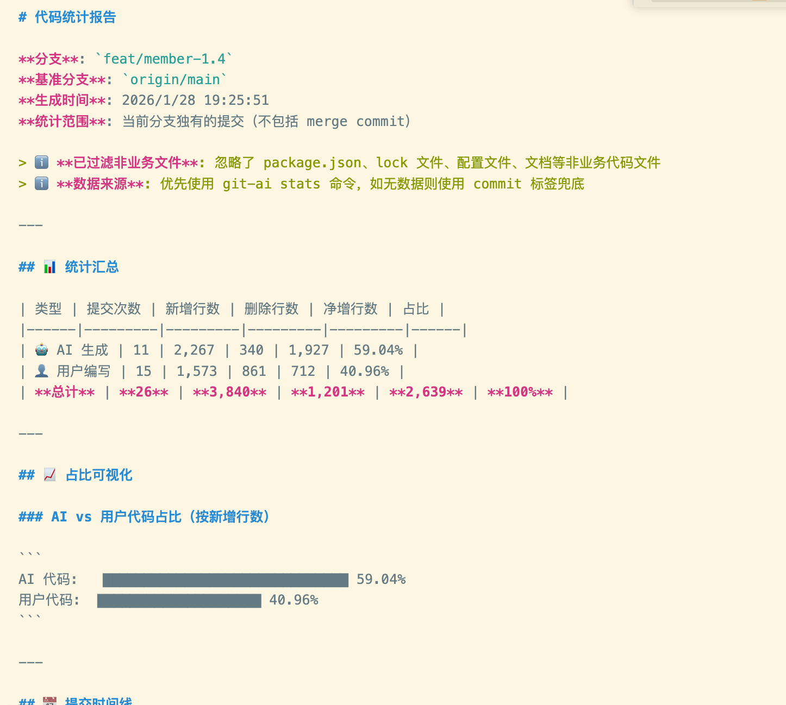
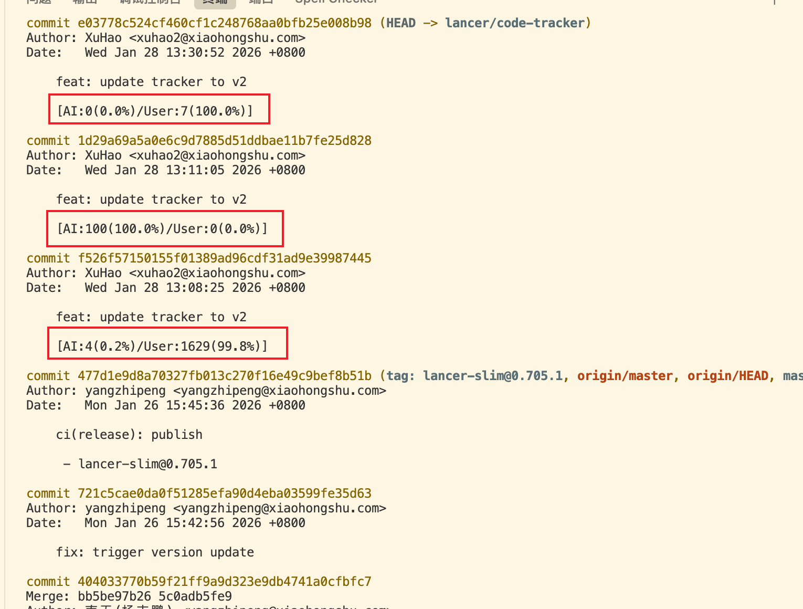
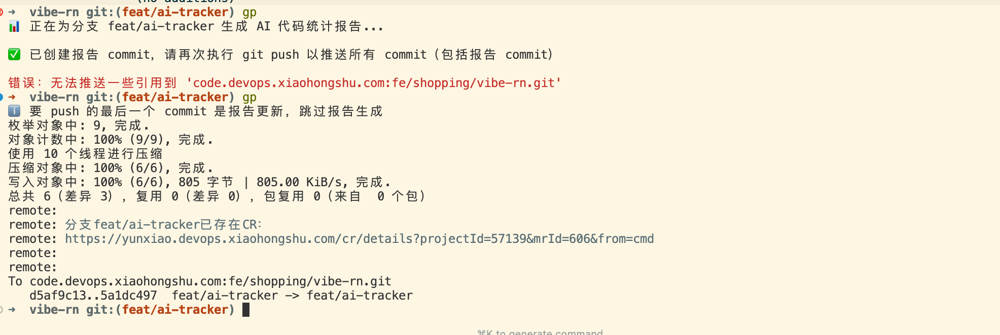
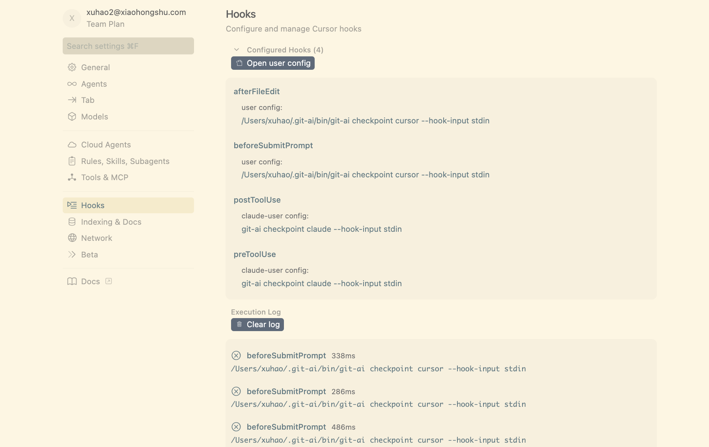
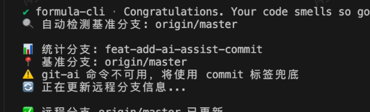

注意：codewiz vscode 插件 暂不支持 hook 代码统计，如果是会用codewiz出码，需要手动给commit打标。

```bash
git commit -m "feat: xxxxx --VibeAiCoding-codewiz"
```

<font backgroundColor="#FFFF33">codwiz-cli 支持统计，目前建议使用，安装文档：</font>[CodeWiz-CLI 快速开始指南](https://docs.xiaohongshu.com/doc/f9231ed568bd4c24e2e765c14c466a14)<font backgroundColor="#FFFF33">安装完 codewiz 后，执行一下命令，重启 codewiz-cli 就能统计到了。</font>

```plaintext
git-ai install-hooks && mkdir -p ~/.config/codewiz/plugin && ln -sf ~/.config/opencode/plugins/git-ai.ts ~/.config/codewiz/plugin/git-ai.ts
```

<br/>



<br/>

### 使用步骤

#### 标准流程

[1. 本地安装 git-ai](https://docs.xiaohongshu.com/doc/7d5afc465b9e151b8fa02be1a43975a8?anchorLinkId=block-fc66521cc97cda222ef8490bf8695a29)

新统计方式接入：

<redoc-mention mentionId="500033350" mentionName="赤红(王亦森)" /><redoc-mention mentionId="500005878" mentionName="朱仝(仝守玉)" /><redoc-mention mentionId="500017698" mentionName="古辰(谷万坡)" /><redoc-mention mentionId="160882893" mentionName="南天(杨志鹏)" />搞下新统计方式的流水线配置，详情查看[CodeWiz-CLI 快速开始指南](https://docs.xiaohongshu.com/doc/f9231ed568bd4c24e2e765c14c466a14)

| 域 | 项目 | 负责人 | 流水线是否安装统计 |
| --- | --- | --- | --- |
| 营销 | vibe-marketing-rn | <redoc-mention mentionId="500011869" mentionName="南冬(徐昊)" /> | 是 |
| 交易链路 | armor | <redoc-mention mentionId="500033350" mentionName="赤红(王亦森)" /> | <br/> |
| 频道用增市集 | vibe-rn | <redoc-mention mentionId="500005878" mentionName="朱仝(仝守玉)" /> | 是 |
| 直播 | live-rn-mono | <redoc-mention mentionId="500017698" mentionName="古辰(谷万坡)" /> | <br/> |
| 橱窗 | wakanda-comp-rn | <redoc-mention mentionId="160882893" mentionName="南天(杨志鹏)" /> | 是 |
| 市集种草 | market-promotion | <redoc-mention mentionId="160882893" mentionName="南天(杨志鹏)" /> | 是 |
| 新大仓 | wakanda-rn-monorepo | <redoc-mention mentionId="160882893" mentionName="南天(杨志鹏)" /> | 是 |

<br/>

<br/>

#### 待废弃：

~~使用ai-assist-commit Skill，初始化个人环境。将这句话发送给安装过 skill 的 IDE 跟随 ai 提示安装个人环境安装。~~

~~tips：项目环境根据表格@南冬进行 mr 提交，大家不需要关心，只需要安装个人环境配置。~~

1. ~~验证效果（设置完，重启IDE 重启shell cli）~~

  1. ~~使用 ai 修改文件，commit 提交代码，git log 查看 commit 信息，git push 会自动生成报~~~~告(注意，第一次push生成报告后会拦截，需要两次push)。~~

<redoc-columns>
<redoc-column ratio="0.2">




</redoc-column>
<redoc-column ratio="0.2">


提交两次push



</redoc-column>
<redoc-column ratio="0.2">
常见错误1：编辑器 hook 报错，



</redoc-column>
<redoc-column ratio="0.194161">
常见错误 2：commit hooks 没执行

检查 hooks 路径，设置为 .hooks

设置路径命令：

```plaintext
 git config core.hooksPath .hooks 
```

<br/>

查看git hook 路径

```plaintext
 git config core.hooksPath
```

</redoc-column>
<redoc-column ratio="0.205839">
常见错误3：git-ai不可用，重启shell 或者IDE

<br/>



</redoc-column>
</redoc-columns>

<br/>

<br/>