# 出海工具 App 选品指南：小团队和独立开发者怎么选方向（万字长文）

> 作者：鱼总聊AI（@AI_Jasonyu）
> 发布：2026-09-21T03:11:06.000Z；抓取：2026-09-23
> 原文：https://x.com/AI_Jasonyu/status/2101871814343319615
> X Article：https://x.com/i/article/2101871409706229760
> 抓取源：`https://api.fxtwitter.com/AI_Jasonyu/status/2101871814343319615`
> 正文由抓取源的结构化 `content.blocks` 顺序转写；完整响应见 `source.json`。

下载不到 5K 的充电动画 App，一个月赚 4 万美元。

靠的是什么？选品。需求足够精准的时候，哪怕没多少流量，产品也能很赚钱。

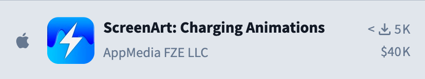

这篇选品长文，是我两年前写的。

当时它首发在生财有术，后来在公众号上也拿到了不错的阅读量，是我那几年写得最用心、也最长的一篇。两年过去，文章里不少跟社群相关的说法、以及当时的口吻都已经过时，所以这次重发到 X 之前，我把语言和措辞整体顺了一遍。

现在把它分享给更多做产品的开发者。不管你是做 iOS 独立开发，还是做 Web 出海，选品这件事的思路其实是相通的，希望能对你有用。

---

先说说写这篇文章时的我。

我是一名从 2022 年 9 月开始的创业者。在此之前，我在一家专注海外市场的公司工作了近四年，参与过许多出海工具产品从零到一的过程。我曾负责的产品登上过美国 App Store 的下载榜首，其中一款还得到过苹果 ASM 官网的长期展示。我的职业路径，也经历了从资深 UI 设计师，到产品经理，再到业务负责人的转变。

那时的我，既是出海工具领域的创业者，也是 AI 领域的自媒体人。创业的头一年多里，我上线了 12 款 iOS 工具应用和 2 款 Android 应用，还有几款在开发中，这些产品每月带来的收入接近 1 万美元。同一时间，我也把大量精力投进了 AI 自媒体，积累了超过 10 万关注，虽然变现还不多，但也算跑通了一条新赛道：AI 自媒体 + 知识付费。

OK，进入正题。

# 一、选对方向，为什么这么重要

选对出海工具 App 的方向，至关重要。“出海”这个词，做产品的开发者大多不陌生，“工具”也不难理解；但“出海工具 App”这个组合，可能对不少人来说还有点新鲜，因为专门讲它的内容确实不多。而且 App 作为一种产品形态，从开发到上架再到运营，环节比网站多不少，一个人做的话每一环都得自己过一遍。

为了讲清楚，我把它拆成三个部分：

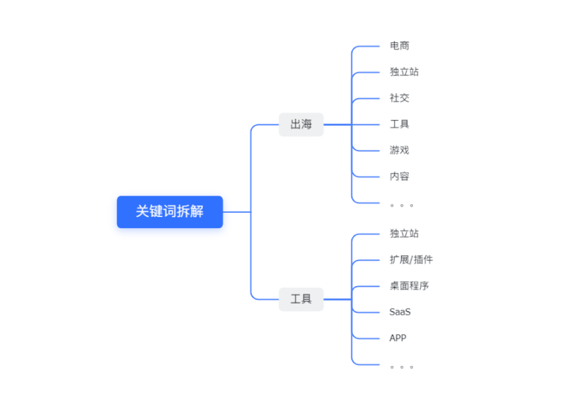

1、出海：把产品推向海外市场。
2、工具：能帮用户解决特定问题的软件。
3、App：用户下载后使用的应用程序。

这三个概念一叠加，就构成了一个非常细分的市场。

那“出海工具 App”到底是什么？我让 GPT 给了一个很直观的回答：

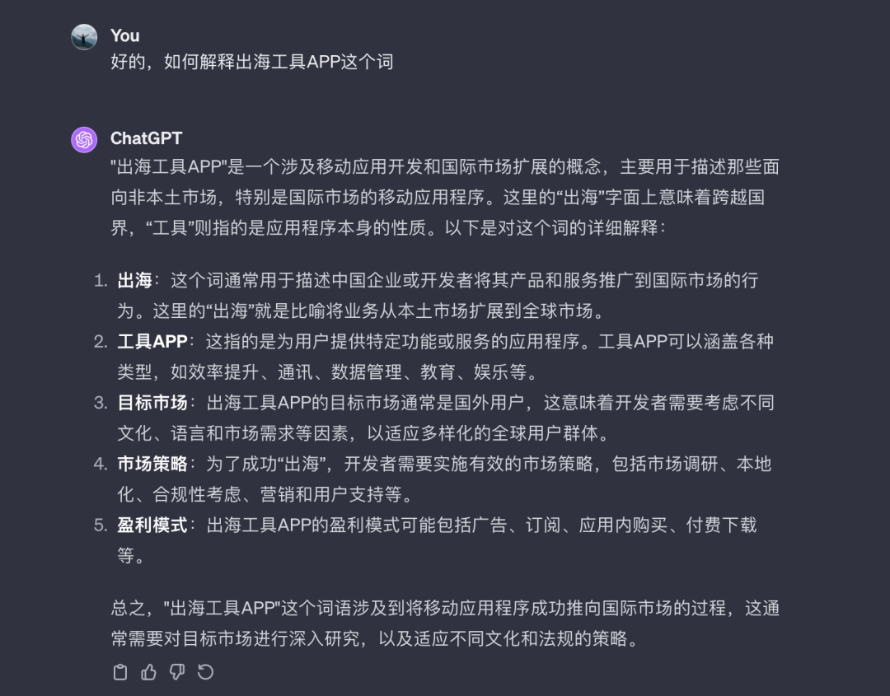

开发一款出海工具 App，是一个复杂而多环节的过程，包含市场调研、产品规划、设计开发、测试验证、上市推广等关键步骤，大致是这样一条链路：

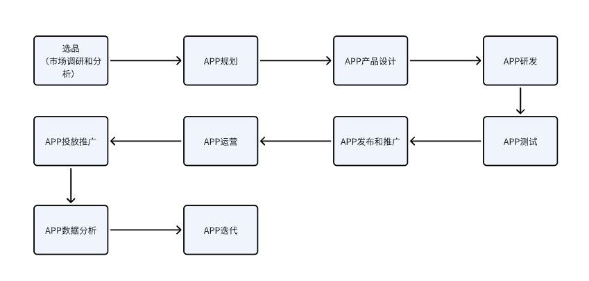

选品，也就是选定正确的产品方向，只是这条链路里的起点。但正因为它站在起点，重要性不言而喻，尤其对资源有限的小团队和独立开发者来说。没有足够的资源去试错，一旦方向选错，很可能就是项目夭折，甚至从此放弃独立开发。

在我自己的开发经历里，也有过凭直觉、而不是凭市场数据做决策的时候，结果就是产品既没流量也没收入。分享两个给我启发的例子：

1、Instagram 最初是一个叫 Burbn 的社交平台，功能一大堆。但创始人通过市场研究和用户反馈意识到，用户最喜欢的其实是分享照片。于是他们砍掉其他功能，专注把照片分享体验做简单、做极致，这个决策直接带来了 Instagram 的爆发式成功。
2、抖音在计划出海时，做了深入的市场研究，针对不同国家的文化和用户偏好做本地化调整，最终孕育出全球现象级产品 TikTok。

对市场的敏感洞察，对用户反馈的迅速回应，都是独立开发者成功的关键。这意味着，你得投入时间和精力去真正理解市场与用户，找到那些最有潜力、最贴合需求的方向。

正确的方向，是产品成功的一半。

我知道，在这个流量至上的时代，很多人可能会反对我这个说法，觉得流量才是关键。没错，流量确实重要，但我始终认为：如果产品是“1”，流量就是后面的“0”。只有先有好的产品，流量才能发挥出最大的作用。

# 二、哪些方向尽量不要选

在选择出海工具 App 的方向时，有些路可能不太适合小团队和个人开发者走。这些建议来自我多年的行业经验，但它不是一成不变的规则，毕竟每个人的经历和认知都不一样。我目前的经验主要集中在工具类应用上，对其他类型的产品了解有限。如果你有不同看法，欢迎理性交流。

在产品选型上，我总结了一套“三不选”的原则：

1、不选竞争激烈的方向。在一个白热化的领域，再微小的创新也难以冒头，更别说资源有限的小团队或个人了。
2、不选需要高投入的方向。大规模的广告投放、昂贵的用户获取成本，都可能迅速烧光有限的资金。
3、不选难以合规的方向。面对严格的监管，合规的难度和成本都可能成为绊脚石。

选对路径，能帮你省下大量的时间和资源。记住，选对的不只是起点，它还关乎你能走多远。

## 1. 不选高度竞争的方向

所谓高度竞争的方向，就是巨头云集、用户基数巨大、利润丰厚的品类。在这些领域，大企业和成熟开发者挤成一团，市场早已是一片红海。

以 App 市场为例，社交媒体、流行游戏（三消、策略、RPG 等）、视频流媒体、健康健身应用，都属于高度竞争的方向。我们今天聚焦工具类应用，其实已经排除了那些竞争异常惨烈的赛道。

就拿浏览器来说。市场上的主要玩家 Google Chrome、Mozilla Firefox、Apple Safari、Microsoft Edge，不仅功能丰富，而且经过多年发展，早已拥有庞大的用户群和高度认可。这个时候再挤进去，挑战极大，大概率拿不到什么像样的流量。

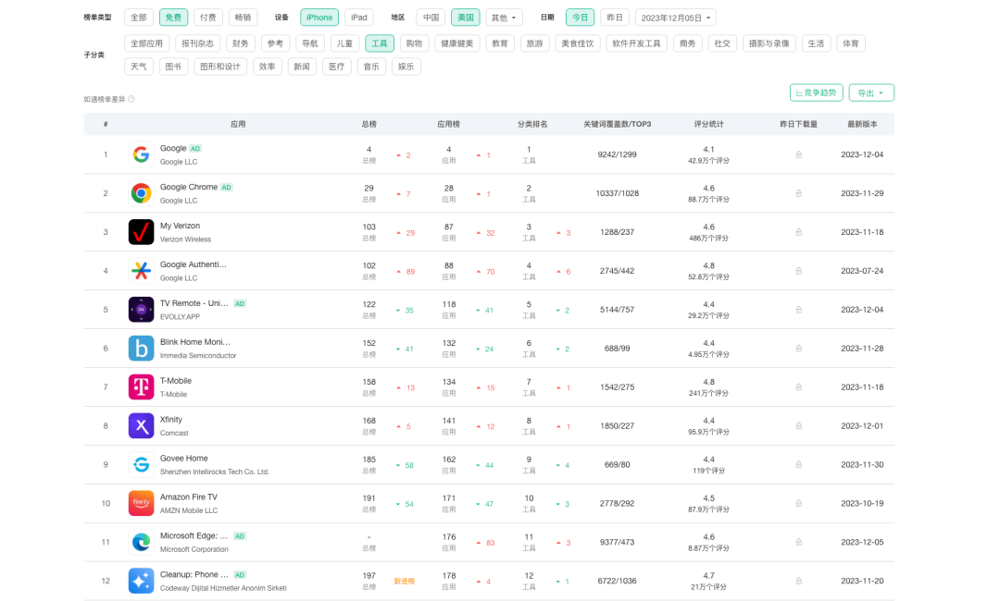

邮件客户端、云存储、防病毒与安全软件，也是同样的道理。对我们这些资源有限的小团队和个人开发者来说，进入这类市场，风险和挑战往往远超承受范围。

## 2. 不选高成本投入的方向

另一类要避开的是高成本投入的市场。App 的成本可能出现在开发人力、技术、服务器、维护、投放等各个环节：

1、开发人力成本高：专业图形和视频编辑软件，比如《Adobe Photoshop Express》《剪映》，开发成本极高。这类 App 需要复杂的图像、视频处理能力，要求开发者具备专业技能和深厚的领域经验，开发周期长，成功的不确定性也很大。
2、技术成本高：需要使用昂贵 SDK 的产品。例如涉及人像分割和特效的视频处理 App，SDK 年费可能高达数十万元，产品一旦推不起来，这些钱就打了水漂。
3、服务器成本高：云存储类 App，比如《Dropbox》，需要大量服务器资源来存储和同步用户数据。如果商业模式撑不起这笔前期投入，成本就可能收不回来。
4、维护成本高：社交应用、企业 CRM 系统这类工具需要持续更新和维护，以适配不断变化的需求，也是资源有限的小团队该避开的方向。
5、投放成本高：VPN、清理工具、健康类 App 竞争激烈，推广往往要靠大量投放和市场营销，回收周期长，对个人开发者风险偏高。

对个人开发者和小团队来说，低成本、高回报的方向尤其重要。避开这些高成本市场，才能把有限的资源用在刀刃上，去找那些既能发挥自身优势、又能满足市场需求的机会。

## 3. 不选难以合规的方向

一定要合规、一定要合规、一定要合规！

开发者最怕的不是没流量、不赚钱，而是产品上不了线，或者被下架、被封号。所有努力因为不合规打了水漂，那才是最大的损失。所以稳健赚钱的第一原则，就是尽量别碰不合规的产品。如果确实要做，那账号隔离一定要处理妥当（这个话题以后可以单独再聊）。

很多人都说，《刑法》里提到的行业往往最赚钱。App 市场也一样，那些不被允许的领域，利润往往最丰厚。于是有人会想尽办法伪装上架，但这类做法风险极大，尤其不适合独立开发者和小企业。下面几种产品类型，建议避开：

1、VPN 服务 App：人在国内，千万别想着做这类应用，否则等着你的可能是“缝纫机”；即使做海外，也得充分了解当地市场和法规，没有足够成本之前，不要轻易尝试。
2、加密货币钱包与交易 App：涉及金融监管、安全性和欺诈风险，审核过程中可能面临更严格的审查。
3、通话录音或“间谍”App：涉及隐私和法律问题（比如通话录音需要对方同意），通常在 App Store 的上架审核中就会受限。
4、版权内容共享 App：用于共享或下载受版权保护内容的工具，可能因侵权而无法上架；即使侥幸上架，后续也可能面临法律风险，被罚款甚至踩缝纫机。

除了上面这些类型，还有几个在独立开发者里卷到不行的品类，被戏称为中国独立开发者的“三件套”：ToDo、记账、日记（笔记）。这几个品类在国内做，机会相对较小，市面上的竞品已经相当多，也很难做出差异化。我待过的很多独立开发者群里，做得最多的就是 ToDo 和日记这两类。想赚钱的话，不建议新入局 App 市场的开发者再去做。如果要做，就得在市场竞争、本地化和用户习惯上多下功夫，在调研、规划和设计上做足功课，做出适应国际化的差异产品。

总之，对小型开发者和小企业来说，避开上述类型是明智的。只有在你有相关产品经验、并且懂得如何规避风险时，才可以考虑尝试。

# 三、那到底该怎么选方向？

选对产品方向，既复杂又关键。基于我的个人经验，我总结了五个选品法则：做自己、近市场、近流量、看榜单、抄同行。

## 1. 做自己

“做自己”，就是从个人需求出发去找产品方向。对很多普通开发者来说，这反而是个挑战：要么缺少创意，要么想法恰好落在前面说过的不该选的方向里。

那怎么更好地挖掘自己的需求？有人是上厕所时突然灵光一闪，有人是睡梦里梦到一个好点子，还有人能在日常里发现需求。我的很多灵感，就来自生活里的琐事，尤其是上厕所、睡觉的时候，以及我在体验各种 App 的时候。

举个例子，我手机上的应用超过 400 个，覆盖各种品类。我会根据自己的需求下载、体验多种同类产品，这既能帮我发现潜在需求，也有助于在众多应用里找灵感（小提示：你也完全可以从这些 App 里找到不错的产品方向）。

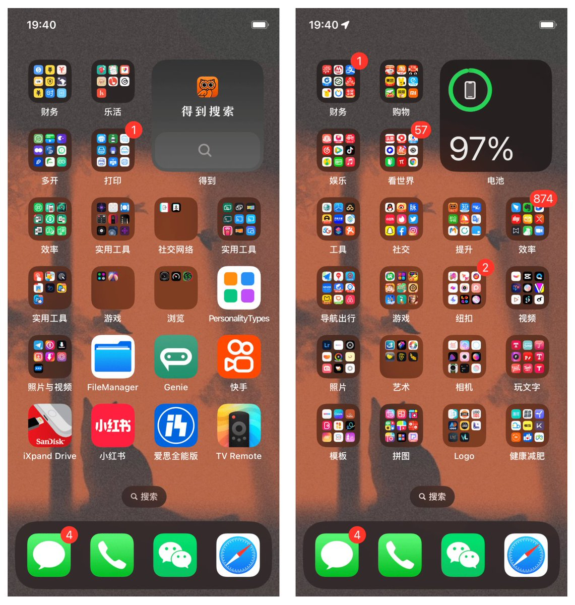

再举个例子。有次我在上厕所，因为便秘（这下被大家知道了），就想到有没有应用可以记录排便情况，帮助判断健康状况、给出饮食建议。在 App Store 上一搜，还真有类似的产品。这类产品下载量不高、市场小众，但竞争也少；如果设计和体验够好，是有可能被推荐的。只是商业价值不高，不在我的考虑范围内。这只是“从个人需求出发”的一个例子。

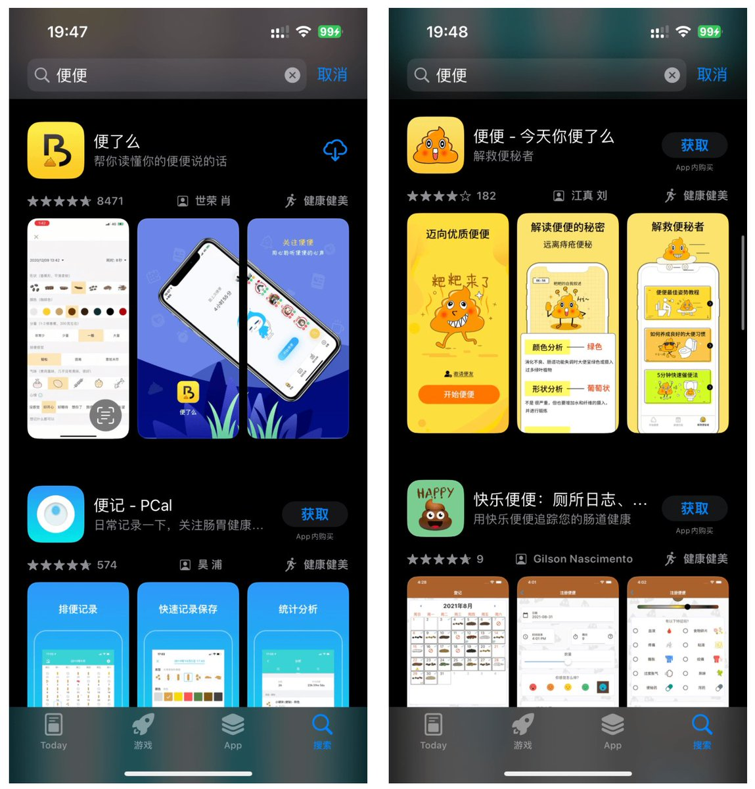

发掘需求的方法：

1、回顾自己在日常生活或工作中遇到的问题和挑战，想想有没有可能用一款 App 来解决。很多成功的 App 就起源于开发者自己的需求，比如“钱迹”的开发者李唐、“白描”的开发者陶乐正。
2、从个人爱好或趣味活动里发掘点子：你热爱园艺，可能就会想到一个园艺管理或植物识别的 App；你爱好阅读，可能就会想到一个摘录书籍内容的 App。
3、深入探索自己的情感和心理需求，比如减压、焦虑管理，这些往往是很多人共有的需求，可以转化为心理健康类应用，像白噪声、失眠记录，都是很有市场的。

发掘需求时的注意事项：

1、记录灵感：发现潜在需求时，一定要立刻记下来。我有过几次夜里想到好点子、却没及时记录而忘掉的经历，事后非常后悔。现在不管是在夜里想到还是梦里出现的点子，我都会马上记在手机上，然后去市场上找类似产品体验。
2、整理和调研：我会把记录下来的产品思路整理进 Notion；需要头脑风暴或开发新产品时，再把这些思路拿出来做详细整理和市场调研。

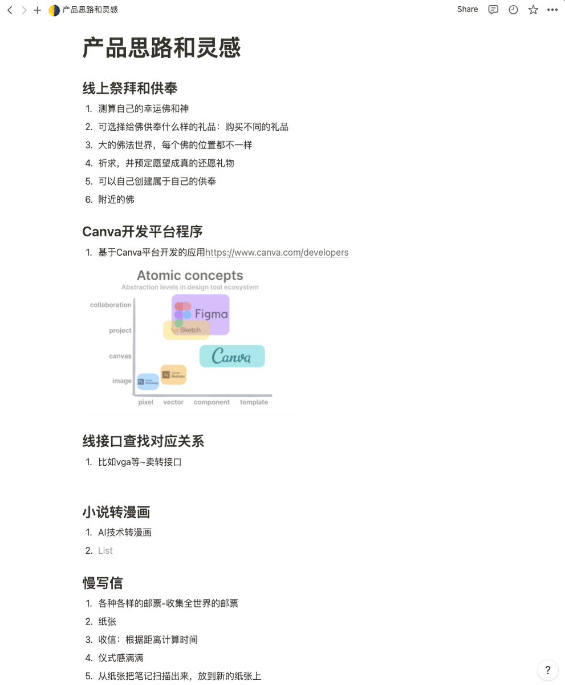

## 2. 近市场

“近市场”，也就是靠近市场，关注市场上投放较多的工具产品，了解它们的品类、数据表现和变现方式。几个关键方法：

1、成为市场运营专家：如果你本身就是市场运营，那你自然懂投放策略，也可能积累了不少资源，包括查看某些产品投放数据的能力，这通常需要通过付费平台获得。
2、善用数据平台：国内有不少数据平台，比如广大大、热云数据，能提供 App 市场和投放数据；如果你关注 ASA（苹果搜索广告）的投放，七麦数据、点点数据也是很好的资源。
3、建立合适的人脉：如果你不是市场专家，那就多认识一些这个领域的人。结交懂投放的朋友，能给你带来巨大的好处。

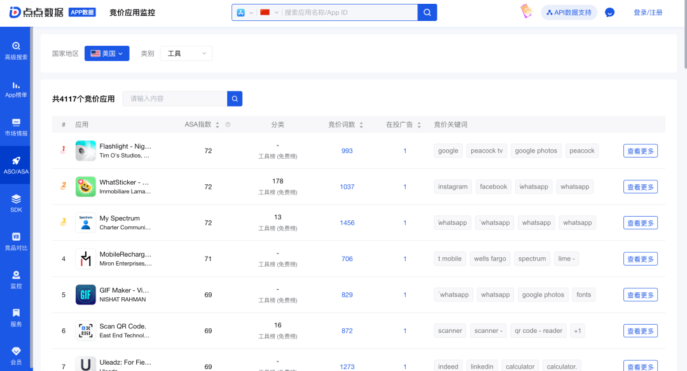

看投放数据时，有个很实用的技巧：专注一年内上线的小团队产品。这样既能排除掉大公司和资金雄厚的团队，也能避开那些拥有高权重老账号、老产品的竞争。大家站在大致相同的起跑线上，你就能看出哪些产品值得被重点投放，再进一步筛选。

这能帮你识别出市场上正在被关注的产品类型，从而更好地定位自己的开发方向。

## 3. 近流量

“近流量”强调的是：流量在哪里，产品方向就应该在哪里。这里的“流量”，主要指的是那些大型平台，比如 Instagram、YouTube、Canva、TikTok。这些平台掌握着互联网的主要流量，围绕它们尚未被满足的需求来做应用，是非常明智的选择。

举几个基于不同平台的例子。

基于 Instagram：

1、Layout from Instagram：图片拼接工具，让用户能在 Instagram 发布创意拼贴，补上了 Instagram 发帖不能拼图的痛点。
2、Text On Photo：给图片加文字的工具，就这一个功能，补上了 Instagram 发帖时图片无法加文字的痛点。

基于 YouTube：

1、VidIQ：YouTube 优化工具，提供视频分析、观众洞察和 SEO 建议等，在美区摄影榜上排名也挺靠前。
2、HD Video Downloader：YouTube 视频下载 App，基于“非会员无法下载视频”的痛点。这类产品前两年非常火爆，流量也不错，不过会有潜在的侵权和上架风险。

基于 TikTok：

1、InShot：视频编辑应用，提供剪辑、滤镜、音乐叠加等功能，很适合做 TikTok 视频。
2、SaveTik：同样是 TikTok 视频下载应用，刚需，技术实现也不难，只要比别人先做出来，就能拿到不错的流量和营收。

可以看出，挖掘大平台上未被满足的需求，围绕这些需求开发 App，是一个高效的策略。它既能帮你抓住现有流量，又能给用户提供有价值的服务，从而提高产品成功率。

这几年很多成功产品，都是基于像 TikTok 这样的新兴平台，以及 Instagram 这样的老牌社交平台推出的。比如视频特效 App Prequel，就是踩在短视频和社交平台的浪潮上崛起，成了该品类的超级巨头，年营收高达 2440 万美元。

每一个新平台的崛起，都会带来新机会。就拿当年的 GPT Store 来说，可以围绕它开发辅助类 App，比如专门给商店里的应用做排名、分类，或者提供独立存档；甚至可以在它的框架下，做出全新的非 App 类产品。

再比如 AI 绘画领域的 Midjourney，当时一直没有自己的 App，所以那些冒充、模仿它的 App 也能拿到不错的流量。如果在此基础上把用户体验做得更好、把使用门槛降得更低，就能获得更多流量和口碑。更进一步，还可以把 AI 绘画能力落到具体场景，做细分 App，比如专做电商图的、专做 Logo 设计的。

随着新平台、新技术不断涌现，去探索和利用这些机会，能给开发者带来巨大的潜在市场和盈利空间。

## 4. 看榜单

“看榜单”是我多年的内功之一，这里把它系统整理成一套“心法”给大家。

看什么榜单

1、先定位市场与平台：开始分析榜单前，先确定你的主要市场（国家）、平台（iOS 或 Android）和品类。比如你专注美国市场的 iOS 工具类，或者印尼的 Android 商务类。
2、如果不确定市场：可以先观察几个成熟市场，比如美国、日本、韩国。当然，国家越多，分析的时间和精力也越多。
3、平台选择：如果不知道从哪个平台起步，我建议先从 App Store 开始。相比 Google Play，App Store 对开发者更友好，主要体现在三点。

一是用户付费意愿：iOS 用户通常更愿意为应用和内购付费，收益潜力一般高于 Google Play。

二是市场分割较少：iOS 生态更统一，开发和测试需要适配的设备、系统版本更少，能降低开发和维护成本。

三是处理更人性化：App Store 处理违规时通常会先给警告，即使封号也会结算你的收益；而 Google Play 可能不明原因就封号、没收收益，想再上架也更难。

仔细分析榜单，你能了解市场热门趋势、用户偏好和潜在盈利模式，为产品开发提供重要指导。

榜单从哪儿来

榜单来源无非几个大平台：App Annie（后来改名 data.ai，2024 年被 Sensor Tower 收购了）、Sensor Tower、点点数据、七麦数据。如果要导出榜单，可以按这个顺序作为优先级选择。

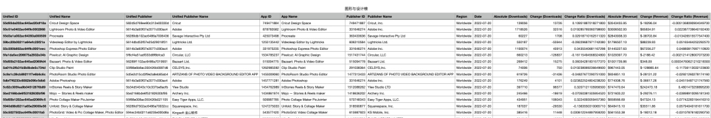

上面是 Sensor Tower 的榜单数据导出结果。

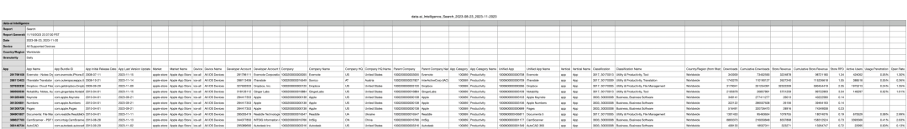

上面是 App Annie 的榜单数据导出结果。

App Annie 提供的数据可能包括上线日期、商店页面查看次数、活跃用户数、使用渗透率、打开率等关键指标。而点点数据、七麦数据在收入数据的准确性上可能稍逊于前两者，尤其是对海外产品。

不过，用这些平台有个主要障碍：数据大多要付费，而且费用不低，一年的费用通常都是数万元人民币。这就需要你动用人脉了：

1、利用人脉资源：如果有做投放或运营的朋友，可以请他们吃个饭，客气地请对方帮你导出所需数据。
2、在线市场找服务：也可以在闲鱼、淘宝上找人代导出，费用视情况而定，通常和请人吃顿饭差不多。
3、使用免费榜单：如果前两种都行不通，还可以用一些平台的免费榜单，比如七麦的免费榜和畅销榜。

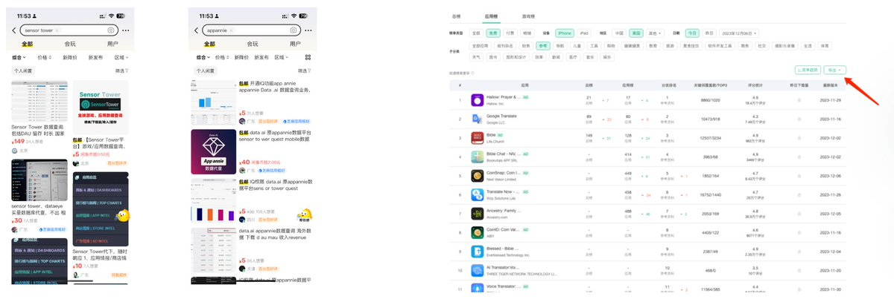

榜单如何筛选

筛选榜单数据时，保证数据的可操作性和相关性至关重要：

1、时间范围：通常选 3 到 6 个月的数据比较合适。这个跨度足够长，能帮你看清市场趋势，包括周期性变化和长期走向，同时避免被短期异常数据误导。
2、下载量：我一般选月下载量 3000 以上的应用，也就是日下载量超过 100。下载量太低，可能说明该品类需求不大，或者竞争过于激烈。
3、收入：通常筛选月收入 500 美元以上的应用。500 美元不算多，但对个人开发者或小团队来说，能找到有稳定营收的产品已经相当不错了。

通过对这些关键数据的筛选，你能更高效地锁定那些有潜力、又符合自己资源和能力范围的应用类型。这既减少了分析工作量，也提高了找到合适市场机会的可能性。

榜单如何看（☆重点）

在讲具体看法之前，先明确我们看榜单的目的：找到高用户需求、低市场竞争、高用户价值、良好商业潜力，且现有解决方案尚不完善的细分市场或品类。

下面我拿一份 2023 年 8 月到 11 月的“图形与设计”榜导出数据，把整个过程走一遍。

第一步，先做数据清洗。 拿到的榜单数据里往往有很多字段，比如开发者名称、开发公司、Bundle ID 等，这些对判断作用不大，先删掉，让表格更整洁、便于查看和比较。

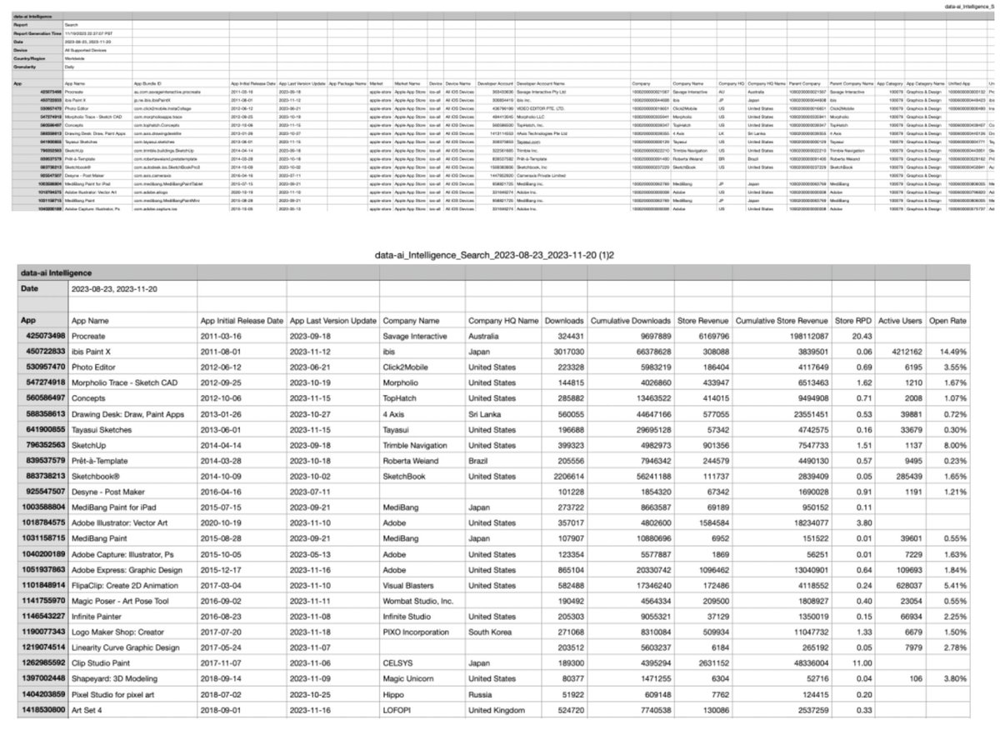

上面是清洗前后的字段对比，第一张图的字段还远没有展示完。

第二步，再做一遍数据筛选。 这个阶段我会过滤掉上线时间很久的 App，尤其是下载排行前 50 的那些。这些老牌 App 可能已经占住了大部分市场份额，权重也很高，留给新应用的空间很小，参考它们没有太大价值。App Store 市场在那些年是有红利的，我们更要参考那些在没有红利期的情况下成长起来的应用，才更有意义。

从时间维度上，我会忽略掉 2017 年以前发布、并且长期在下载榜前 50 的产品。比如下图里，我就会筛掉红框里的这些。

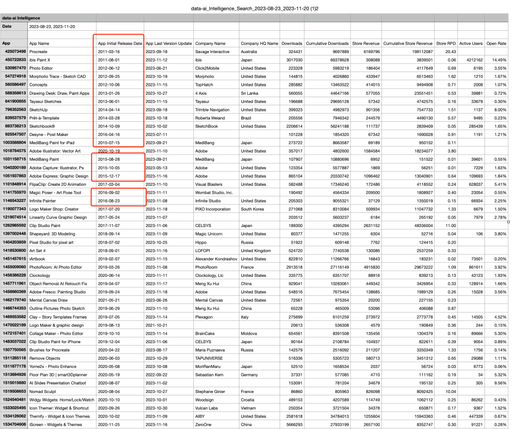

第三步，按下载量排名，找出下载和 ARPU 都比较高的产品并标注。

怎么算 ARPU 高？按表格里的 Store RPD 降序排列（这里先把 ARPU 和 RPD 当一个数值看），找到中间位置对应的 RPD 数字，超过这个数的，就视为 ARPU 较高。比如有 700 组数据，我就找第 350 个对应的 RPD 值，我这里找到的数值是 0.36 美元。

然后按下载量从高到低开始标记，也不需要标记太多，排名前 200 的标记出来即可（工具、摄影这种大榜单可以多标一些，图形设计这种小榜单可以少一点）。

顺便解释一下两个指标：RPD 是每下载收入，等于累积收入除以累积下载量；ARPU 是平均每用户收入，等于总收入除以用户数。

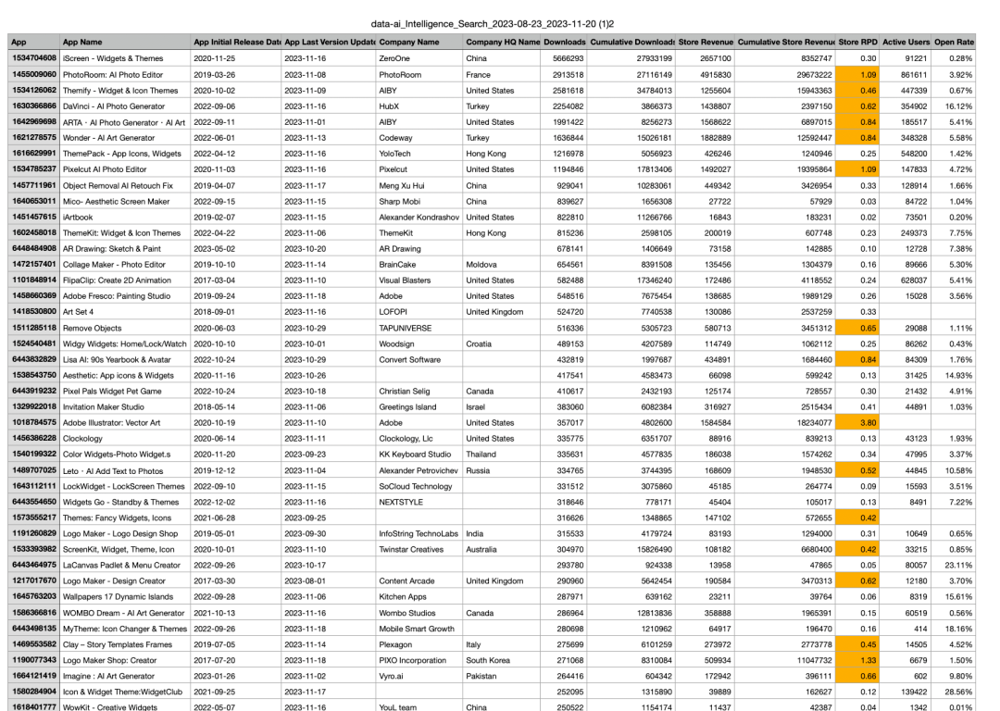

这一步通过筛选和标记，我们找到了一批高需求、高用户价值的产品。

第四步，通过筛选排序补充一些产品。 榜单里还有些特殊存在值得关注。一类是 ARPU 异常高的，说明用户对它的付费意愿非常强，用户群体的价值高，这类产品往往有更高的盈利潜力；另一类是下载榜、收入榜前列里最近一年内才上线的产品，说明市场接受度好、势头在往上走，成功可能来自创新的概念、优秀的体验或者精准的定位。这两类我会特别关注并标记。

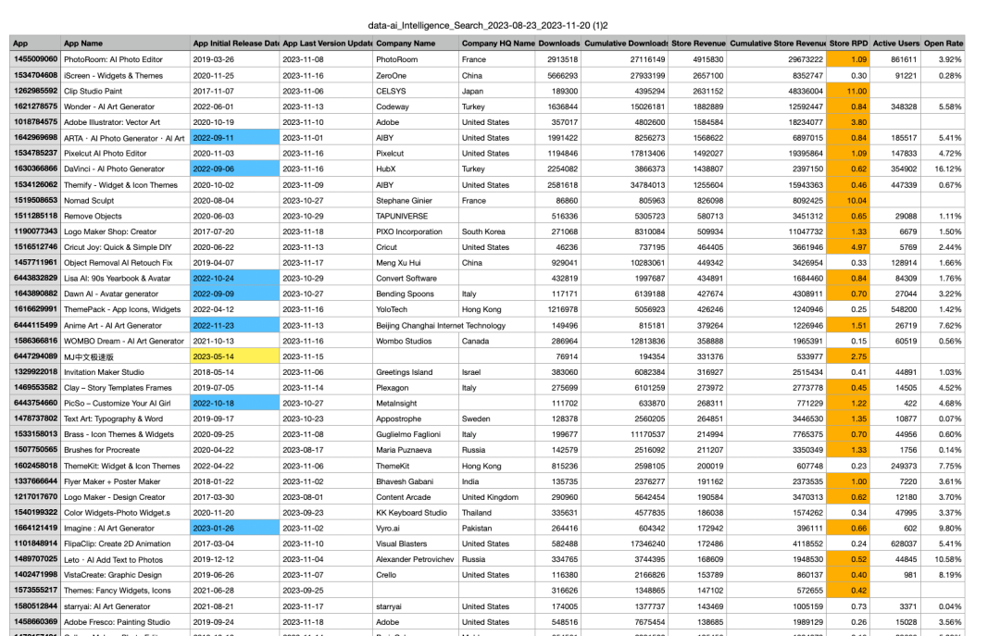

第五步，把标记过的产品整理到新表格。 把所有标记过的 App 放到新的表格或 Sheet 页里。经过前几轮筛选，我把榜单里近 700 个应用筛到只剩 110 个左右。但逐个分析还是太多，肯定不行，所以要继续缩：

1、根据上线时间排序和筛选：比如淘汰 2019 年以前上线的应用，聚焦近期上线、潜力不错的。
2、再次筛掉下载量和 ARPU 都低的应用，缩小范围。
3、利用变化趋势数据（如果拿得到）：借助 Sensor Tower 等其他数据源，看下载量和收入的变化趋势，避开那些当下表现不错、但趋势正在下滑的应用。

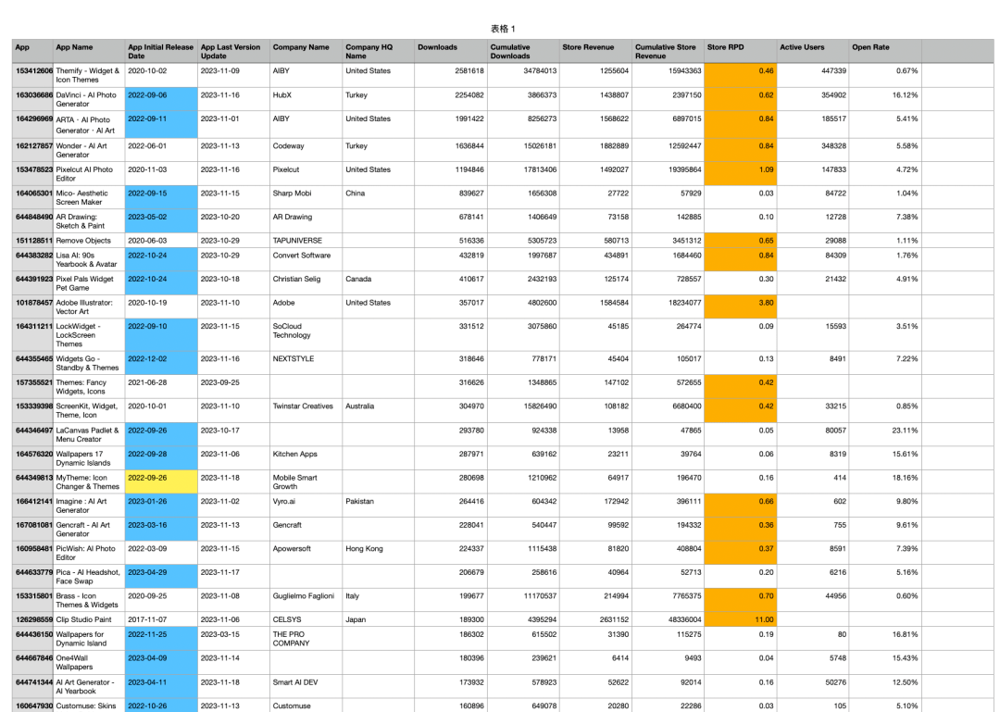

第六步，深入分析被标记的重点 App。 这一步至关重要，能帮我们理解当前市场的热点趋势和竞争格局。

1、重点分析标记的 App：从筛选结果里挑出大约 20 个标记过的 App 做深入分析。
2、识别共同点和趋势：在这些标记的产品里，我发现一个显著的共同点：大多是 AI 绘画类 App，只有少数是海报或 Logo 设计 App。这说明在当时的艺术与设计榜单里，AI 绘画正成为一个重要趋势，这类产品有很大的商业潜力和很高的付费意愿。
3、评估竞争情况：虽然热门，但这类市场竞争也非常激烈，需要进一步分析，才能决定是否进入。
4、综合分析决定是否进入：最终决定前，要综合市场趋势、用户需求、竞争态势，以及自身的资源和能力。这一步直接影响产品的成功可能性和盈利能力。

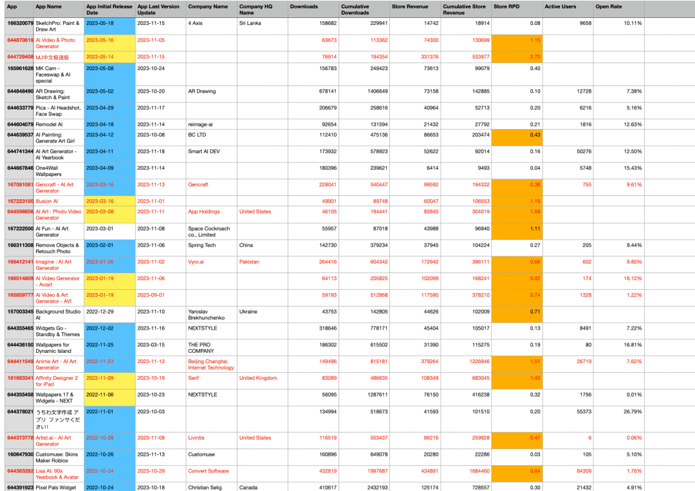

第七步，给其他 App 分类。 分析完重点 App 之后，把剩下的 App 也分个类，能帮我们看清哪些方向有高市场潜力、高用户需求和商业价值。我当时分了四类：

1、P 图类：AI 图片视频特效、AI 换脸、图片矢量化等。
2、设计类：家具设计 AI、壁纸设计、AI P 图、团扇制作、游戏皮肤制作、海报设计、Logo 设计、3D 建模、印章制作、Story 创作等。
3、绘画类：专业绘画软件、AI 绘画软件等。
4、小组件：普通小组件、灵动岛宠物、充电动画等。

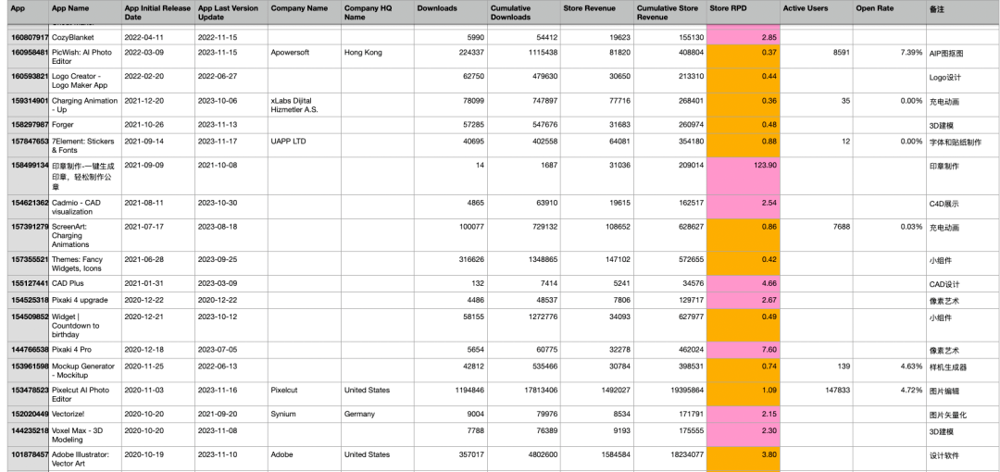

分完类，就能更清楚地看到不同类别的 App 在市场上的表现和潜力。接下来，结合自己的经验、兴趣，以及第四部分要讲的判断方法，做最后的分析和决策。

值得注意的是，有些分类里的产品不太适合个人开发者，比如 3D 建模、图片矢量化和专业绘画软件，技术难度、开发周期和市场竞争都不小。不过这只是初步判断，更客观的分析要放到下一个环节。

第八步，手动挑选每个分类的头部产品。 根据下载量、营收、RPD、打开率等综合数据，选出每个品类里的一个产品。这一步有几个关键点要注意：

1、注意数据的准确性：上面这个表里其实是有异常数据的，比如那个印章制作 App 的 RPD 高到 123.9 美元，高得离谱的数值，往往说明数据本身有问题。数据平台提供的数据可能异常或不准确，要谨慎对待，把它们当作参考，而不是决策的绝对依据。
2、真正的头部产品：有些情况下，所选榜单未必展示出一个领域真正的头部产品。比如在图形设计榜里挑出的海报设计和 Logo 设计 App，可能并不是该领域最顶尖的，因为在摄影摄像榜里，可能有更多头部。
3、打开思路：这个筛选过程的目的，是找到高用户需求、高用户价值、良好商业潜力的产品方向，帮你打开思路、跳出原有的思维框架。比如那个“团扇制作”的 App，就帮我打开了思路：它只在日本区上架，但排名非常靠前，营收也很不错。这个思路能不能扩展到其他国家？能不能用在别的领域？

当你能通过分析榜单上的产品，全面了解它们的核心功能、目标用户群、变现方式和独特商业策略时，你的“内功”就修炼到一定水平了。这种能力靠的是持续地观察、分析竞品，全面审视你想涉足的产品类型所在的市场。这是一个长期的过程，但价值显而易见。

内功的修炼，就是不断去看、去分析竞品，把你想做的产品类型榜单横扫一遍。当你能做到“说一个产品，就能脑补出这个 App 的全部”时，你就相当于“修仙界”的元婴大能了。想再突破到化神期，就需要修炼一些“外功”，这部分我们在第四点里细讲。

Tips：做数据分析的时候，可以让 GPT 这类大模型介入，帮你提效。

## 5. 抄同行

正所谓天下产品一大抄，做产品的人，都要有先抄后超的觉悟。做设计出身的我，其实天然鄙视“抄”这件事；后来做博主也是一样，别人发什么我就不发什么，这也导致我的流量起得比较慢。

但创业这件事，活下来真的很重要。慢慢地我也改变了想法：别再把“抄”当成可耻的事，换个角度想，我们不过是想给用户提供更好的服务，多给市场增加一个竞争对手，让这个赛道不被垄断而已。这么一想，心里就舒服多了。那我就把“抄同行”的几条心法交给大家：

1、蹭热度：还记得“木鱼”App 在抖音刷屏的那阵子吗？那个时候，最快的复制就是流量密码。
2、看社媒：经常刷一刷社媒和产品网站，比如 Product Hunt、X。
3、找朋友：直接找做投放的朋友，问问他都在投哪些产品。

当你通过这些方法拿到产品路子后：如果手上有数据，就可以直接去做一个更好的；如果没有，就按第四点去分析。

# 四、如何最终确定你的方向可以做了？

当你通过前面的步骤积累了不少产品点子后，具体要开发哪一个，反而会让人犯难。这个阶段，“外功修炼”就变得至关重要了，它决定了你能不能进入更高层次的产品开发阶段。

## 1. 产品方向要考虑的维度

很多人迟迟不敢动手，是因为根本判断不了值不值得做，也不知道怎么判断。这里给大家一套我用来思考“某个方向值不值得做”的维度，一共五个：

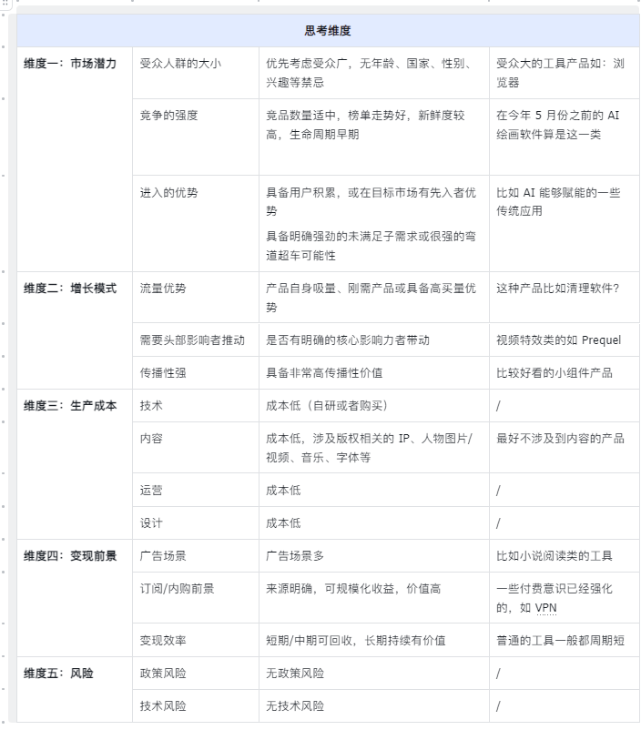

维度一：市场潜力

1、受众人群的大小：优先考虑受众广，没有年龄、国家、性别、兴趣这类限制的。比如浏览器这种受众很大的工具。
2、竞争的强度：竞品数量适中、榜单走势好、新鲜度高、生命周期处于早期。比如 2023 年 5 月之前的 AI 绘画软件。
3、进入的优势：具备用户积累，或者在目标市场有先入优势；或者有明确、强劲的未被满足的子需求，有弯道超车的可能。比如能用 AI 改造的一些传统应用。

维度二：增长模式

1、流量优势：产品自身吸量、刚需，或者有很强的买量优势。比如清理软件。
2、是否需要头部影响者推动：有没有明确的核心影响力者带动。比如视频特效类的 Prequel。
3、传播性：具备非常高的传播价值。比如比较好看的小组件产品。

维度三：生产成本

技术、内容、运营、设计四项成本都要低。技术上自研或者购买都行；内容上最好不涉及版权相关的 IP、人物图片 / 视频、音乐、字体，最好是不涉及内容的产品。

维度四：变现前景

1、广告场景：广告场景多。比如小说阅读类的工具。
2、订阅 / 内购前景：来源明确、可规模化、价值高。比如付费意识已经被教育过的品类，像 VPN。
3、变现效率：短期 / 中期可回收，长期持续有价值。普通工具的周期一般都比较短。

维度五：风险

没有政策风险，没有技术风险。

## 2. 小开发者重点考虑的维度

当然，并不是所有维度都完美才能做，那样的产品基本不存在。对小企业和个人开发者来说，刚开始做的时候，只要能有效控制成本，也不用瞻前顾后、把每个因素都算尽。就我而言，一般会重点看这几条：

1、受众不需要太多，只要不是少得可怜，就可以考虑，重点是竞争和变现如何；
2、竞争局势如何，是不是头部一家独大、其他小产品基本没流量没收益；对工具类产品，我更喜欢“百家争鸣”的局面，即使新品上去，也能分到一杯羹；
3、最好不要那种全靠投放和运营才能起来的产品，不适合我这种不太懂流量玩法的小团队；
4、开发周期控制在 1～2 个月，研发成本不超过 3 万；
5、受众一定要有还算不错的付费意愿，单价也还可以；
6、没有政策风险，技术上能实现；
7、别忽视你个人的兴趣和热情。如果你非常有信心和热情，而且这件事确实被验证过，那就别犹豫。

在研究榜单的过程中，我的主要目的是寻找那些用户需求旺盛、市场竞争相对较低、用户价值高、商业潜力良好，且现有解决方案仍有提升空间的细分市场或品类。但要完全看清市场竞争程度和现有方案的成熟度，光靠榜单数据远远不够，还需要投入更多精力做深入调研，比如在数据平台上深挖竞品数量、翻阅用户评论，以获得更全面的市场视角。

至此，我把自己的“武功秘籍”毫无保留地分享出来了。这里想强调一点：

如果你对某个方向充满信心，并且成本在你的可控范围内，那么动手去做，往往比光做分析更关键。这个时代，行动力才是最宝贵的。很多人都有闪光的想法，但真正付诸行动的少之又少。所以，别犹豫，大胆去实现你的想法。

# 五、出海工具还值得做吗？

先把结论放前面：值得！很值得！非常值得！

## 1. 为什么值得？

一是做工具 App 的商业模式实在太好了。这是真正的躺赚模式：产品做好了，放在商店里等收钱就行，就这么简单。

二是成本低。哪个创业项目能几万块就启动，还能撬动千万级市场？

三是有机会实现财务自由。跟自媒体一样，做 App 也可能因为一些运气，给你带来泼天的财富，你接不接？

## 2. 还能不能做？

想做一件事，任何时候都不算晚。

即使应用市场已经下行，即使开发者已经卷到不行，只要你坚持待在这个圈子里，就总有新机会产生，总有新方向等你开拓。举几个简单的例子：

1、2018 年的 Pre-Order，带来了预定 App 的机会；
2、iOS 14 带来了桌面小组件的小红利；
3、iOS 16 带来了锁屏小组件的小红利；
4、ChatGPT 引爆的这波 AI 浪潮，带来了 AI 对话、AI 绘画的新产品机会。

……

别太悲观，找到突破口才是你该做的事。作为一个小的创业者，我始终相信自己，也希望你能相信自己能做到。

## 3. 工具 App 出海能赚到钱吗？

把“吗”字去掉，我直接上截图。开头那个充电动画 App 是一个，再看三个不同量级的：

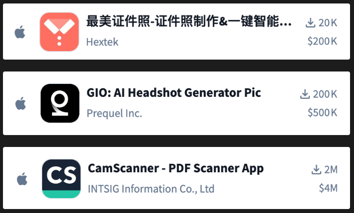

看到这些真实的数据，你有没有被震到？反正我每次看到别人的产品那可怕的营收，都会被激励到，好像那些营收马上就要进我钱包一样，哈哈。

## 4. 工具 App 出海该怎么做？

谈“工具 App 如何成功出海”是个广阔而复杂的主题，涵盖团队组建、账号注册、产品开发流程、上架流程、ASO 优化、运营投放策略等多个方面，本篇万字长文的“选品指南”只是其中一环。这个话题实在太大，不可能在一篇文章里全讲完。

坦白说，这是我当时写过最长的一篇，第一次的万字长文就献给了生财有术，和一起做产品的朋友们。我那时还不确定以后还能不能持续产出这样的实操干货，毕竟需要巨大的精力和投入。

写完的时候，长长地吐了一口气。从构思结构到最后完成，整整五天，我全身心扑在这篇上。那种专注的感觉很奇妙。在那之前的一段时间里，我的精力被切成了无数碎片，除了想新的产品方向，还得忙这些事：

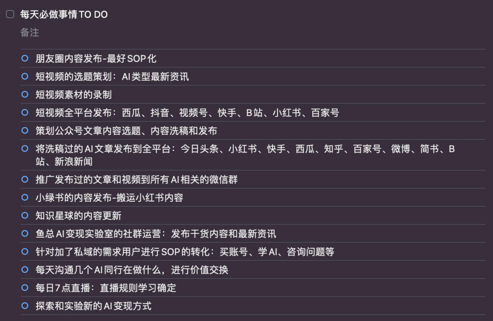

现在你知道我当时有多忙、多碎片了吧……

在这篇文章的最后，我想再重申一点：虽然我分享的内容主要集中在方法层面，目的是给刚入门或感到迷茫的开发者一些方向指引，但想在这个领域真正做出成绩，关键还是不断提升自己，最终做出优秀的产品。

总之一句话：找到正确的需求，是产品成功的一半。这条路可能既漫长又充满挑战，但只要坚持、目标明确，成功就在不远处。

# 六、两年后的几句补充

以上是两年前的原文。写完这篇之后，我自己的情况变了不少，有几句话得补在这里。

写这篇的时候，我刚解散过一次团队，回到产品上；2024 年又组了团队、开了公司，2026 年 4 月再次解散。公司这两年是亏的，之前产品赚的钱，基本都亏在了开发新产品上，App 这条线也没做任何增长。我现在是一个人做，重心放在 X 平台的 IP 和 PaywallPro 上，App 产品线基本不再主动投入。

但有一件事反过来验证了这篇文章：我那几年做的产品里，有几个产品，到今天还在稳定盈利。这两年我没在它身上做任何增长动作，它还在给我打钱。所以这套选品方法我现在依然认可：方向选对了，一个产品真的能吃很多年。

变了的是两件事。一是 AI 把开发成本压得很低，一个人做 App 比两年前容易得多，“开发周期 1～2 个月、研发成本不超过 3 万”这条现在可以往下砍。二是“躺赚”这个词我会说得更谨慎一点：选品对了只是第一步，后面能不能持续赚钱，还得看上线之后的订阅转化和自然流量。订阅转化那一块，是我现在在 PaywallPro 里天天研究的事，以后单独写。

如果你也在做出海产品，不管是 App 还是网站，评论区聊聊你现在卡在哪一步，选品、上架还是变现，我都可以说说自己的看法~~
