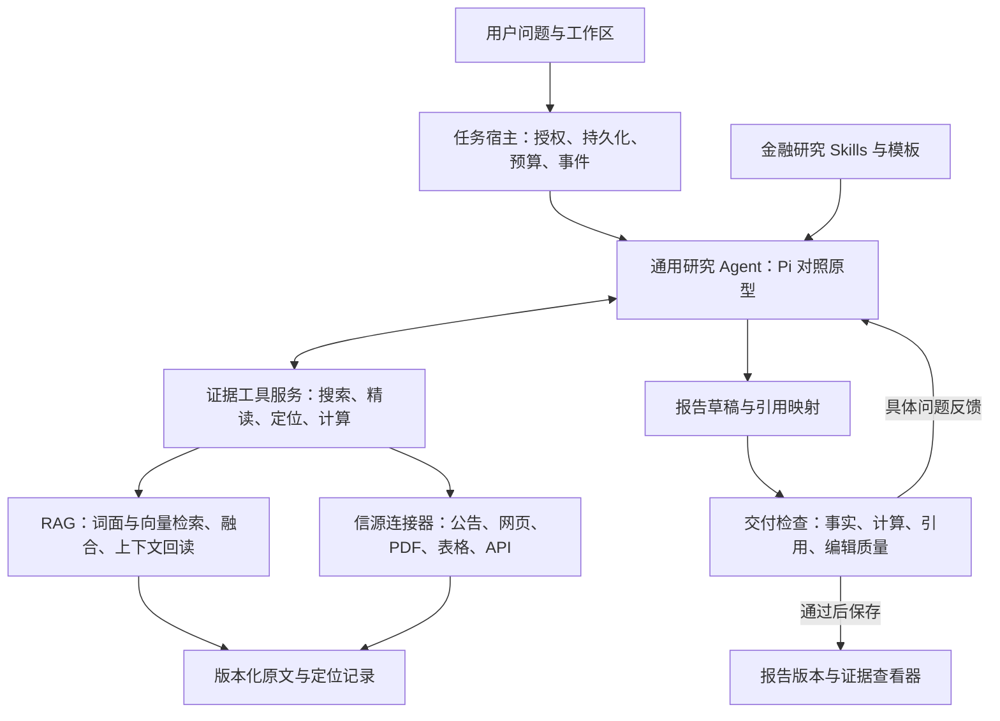

# Cited Alpha：通用 Agent 与字段级证据架构 Review

日期：2026-09-10。状态：代码与官方框架文档审查后的目标设计，未实现 Pi 运行适配器，未完成新架构线上验收。

## 决策

用户确认以通用 Agent 能力承载金融投资研究，允许参考 Pi 或 Web Agent 框架；跨信源溯源和字段级定位是必须保留的产品区别。

建议优先验证 Pi SDK 作为服务端研究执行底座，现有 Python 服务继续提供检索、原文、定位、计算与交付 API，Web 保留报告和证据体验。此次不迁移文档存储、不同时引入多个 Agent 框架、不把整个 MkAgent 桌面产品移植到云端。

此前 RAG 评估建议保留研究状态机；结合真实产物失败及用户新要求，修订为：保留任务可靠执行状态，替换固定领域研究状态机。排队、运行、失败、取消、保存仍然必要；“必须按特定维度顺序研究并生成固定章节”不再作为运行基础设施约束。

## 目标结构

这是能力边界，不要求新增七个微服务。首版保留现有 Web、Backend、ML 部署，用一个 Node 运行适配层接入 Pi；是否独立部署由沙箱与任务生命周期决定。证据服务先从现有 ML 模块抽出稳定工具接口。

## 框架比较

| 候选 | 官方能力与本次判断 | 接入时仍需负责 |
|---|---|---|
| Pi SDK | 会话、工具扩展、Skills、压缩、事件；适合文件式研究、计算和多模型研究原型 | 多租户执行隔离、云端会话持久化、任务租约与恢复、证据合同 |
| Vercel AI SDK ToolLoopAgent | 通用多步工具循环与停止条件，适合 Web 集成对照 | 不能把工具循环当成可靠任务执行系统；文件环境、长期会话等需独立实现或接入 |
| Codex App Server | 可承载自定义客户端与 Codex 执行交互，作为强通用能力的对照候选 | 服务端身份与部署方式、隔离和商业接入需实测确认 |

依据：[Pi SDK](https://pi.dev/docs/latest/sdk)、[AI SDK ToolLoopAgent](https://ai-sdk.dev/docs/reference/ai-sdk-core/tool-loop-agent)、[Codex App Server 架构](https://openai.com/index/unlocking-the-codex-harness/)。AI SDK 页面本轮直接打开失败，能力仅依据官方检索结果，不据此宣称已验证完整运行语义。Pi 在线 latest 文档可能与本地版本不同，接入前锁定版本并核对类型。

本地 MkAgent 的 `packages/pi-agent-server/src/index.ts` 已可见 `createAgentSession`、`customTools`、SessionManager 与事件订阅，是可参考的宿主接入例子，不是 Cited Alpha 已接入证明。

只先实现一种底座。适配边界只保留 start/resume/steer/cancel/events 和工具调用，不提前建设复杂的多框架插件平台。

## Agent 自主性与必须执行的规则

Agent 可以决定如何搜、何时换信源、读哪些表格、如何计算、怎样组织报告；金融 Skills 描述研究方法、口径陷阱和模板，不硬编码步骤状态机。默认一个研究 Agent，独立编辑审查是一项有界调用，不先搭多 Agent 团队。

授权、预算、文件隔离、证据版本不可变、工具写入幂等由服务执行，不寄托于提示词。用户提供的网页和文件内容属于数据，不能改变工具权限。断开浏览器只断开观察，不取消或重新创建研究任务。

Agent 笔记和草稿允许自然语言；正式报告关键事实仍需引用支持。交付检查集中判断“最终内容是否成立”，原文抓取和数字提取时的基础校验仍保留。删除的是多层复制的同一种业务规则，不是删除边界检查。

## RAG 十环节如何保留

| 环节 | 服务职责 | Agent 可决定 |
|---|---|---|
| Parsing | 原文版本、解析版本、页表字段定位；暴露截断与OCR质量 | 是否换来源或查看图像确认 |
| Chunking | 保留标题、表头、单位、脚注及父子关系 | 是否扩展到整节或相邻页 |
| Embedding | 候选召回索引，不作为事实真源 | 使用语义检索的查询 |
| BM25 | 精确指标、实体、数字词面召回 | 搜同义词、原文术语 |
| Hybrid | 按权限与信源范围取互补候选 | 选来源、日期、主体过滤 |
| RRF | 服务内融合候选排名，保留不同来源定位 | 需要时扩大候选预算 |
| Rerank | 可选相关性排序，收益需评测 | 不自行解释为事实支持 |
| Context assembly | 回读权威原文，带表头/脚注/版本与访问确认 | 根据缺失条件继续精读 |
| Generation | 通用 Agent 写作、计算、修订 | 研究顺序和表达结构 |
| Verification | 事实支持、数值计算、定位和编辑检查 | 根据明确问题修复或披露缺口 |

现有 document_store 的 RRF 修复已经发布；跨真实语料的召回提升尚未量化。生产 embedding 禁用的现状意味着不能把 SEC canary 当成完整向量检索验收。

## 核心合同：证据返回位置，而不只返回文本

建议最小 EvidenceRef 公共部分：`evidence_id`、`source_id`、`snapshot_id`、`content_sha256`、`parser_version`、`retrieved_at`、`source_uri`、`locator`、`excerpt`、`capabilities`。访问身份由服务端工作区上下文注入，模型不能自行指定 tenant 来改变权限。具体字段名需与现有模型映射，避免平行新增证据账本。

| 信源 | 原始定位 | 语义上下文 |
|---|---|---|
| HTML/新闻/公告 | 快照内 block ID、文本区间及引用原文；DOM/XPath可作辅助 | 标题、章节、发布日期；动态 DOM 不是跨版本稳定 ID |
| PDF | 页码、坐标框、文本 span；扫描件保留OCR与图像关联 | 阅读顺序、表头、单位、跨页脚注 |
| Excel/表格 | 工作表、单元格或范围、原公式与显示值 | 行列标题、合并单元格、单位、注释 |
| JSON/API | 响应快照、JSON Pointer、记录键、查询参数和数据时点 | 字段定义、币种、调整口径、分页完整性；不记录凭证 |
| SEC/XBRL | filing accession、concept、contextRef、unitRef及原文元素定位 | 主体、期间、维度、合并/分部范围；不能只凭 concept 判等 |

字段级溯源有两段：**报告中的字段/断言 → 证据字段；证据字段 → 原文位置。** 两段都必须稳定。不能只有报告链接到文档，也不能只有解析器知道某个 cell，却丢失报告与 cell 的关系。

检索 chunk ID 不作为永久引用 ID。引用绑定原文快照与解析版本；重建索引后仍能打开旧报告的证据。解析升级可新增定位映射，不覆盖旧快照。定位失效必须显式报告，不能静默改指向最新网页。

纯文本来源只能声明文本级定位，不虚构单元格或页坐标。服务应返回 `location_precision` 和截断/不可读信息，让 Agent 判断能否支持用户要求。

对金融数值再保存语义口径：主体、指标、值、单位、币种、期间、合并范围、报告/推导属性。原文精确高亮只能证明数字在那里，不能证明该数字是营收；收入与收入成本必须通过行标题、表结构或 XBRL 语义区分。

派生值引用计算记录：公式、输入 evidence_id、精度和单位。用户点击同比增长率，应看到计算过程以及两个期间的原始字段。原始资料有冲突时保留双方及其口径，不用去重消除分歧。

## 建议暴露的工具（目标接口，尚未实现）

- `search_sources`：发现相关文件和外部资料；返回候选，不宣称已验证。
- `search_evidence`：跨已授权来源的词面/向量/结构检索，返回 locator 与上下文预览。
- `read_evidence`：按 locator 精读原文，并补表头、单位和脚注。
- `calculate`：引用输入证据执行可复算计算，持久化计算记录。
- `check_report`：检查草稿的引用、口径、计算和论证，返回具体可修订问题。
- `save_report`：使用服务签发且绑定草稿哈希的检查结果，原子保存正文、引用映射与版本；同一次提交幂等。

工具内部可复用多个细粒度函数，不要求每个现有模块暴露为模型工具。论文式强制逐段 Claim JSON 可替换为自然正文加独立 citation map，但关键陈述的支持范围仍需要记录。检查通过后正文再改变，必须重新检查，避免旧检查结果覆盖新草稿。

## 现有模块取舍

| 现有能力 | 处理 |
|---|---|
| document_ai、document_store、source_content | 保留解析、存储与定位；对外统一证据工具；路径差异显式暴露 |
| document_store_tools | 复用搜索/精读语义，经服务适配让通用 Agent 调用 |
| Workspace/Run/outbox、权限与artifact版本 | 保留可靠执行与产品状态；与 Agent 会话 ID 做映射 |
| Task/ResearchPlan/profile dimension 多层合同 | 合并成轻量研究要求与大纲，不作为固定执行编排 |
| Evidence ledger/Claim/引用 | 保留溯源与口径价值，审查哪些字段可合并，避免新旧双真源 |
| Writer/固定报告树/重复fallback | 改为自然报告文档加引用映射；模板作为参考；阶段成果明确标注 |
| Backend 重复财务规则 | 收敛到共享证据校验结果；Backend保留权限、版本、哈希、原子保存验证 |
| Web原文resolve/source-html/source-file | 保留兼容，扩展各类型定位显示；不能只换成外链列表 |

代码锚点：ML `service/agent/document_store_tools.py` 已描述页行表格单元格引用，`service/document_store/*` 提供检索回读；Web `src/app/services/workspaces.ts` 已有 workspace/artifact 作用域的引用 resolve 与原文接口。所有未发布修改仍与当前生产版本区分。

## 迁移与验收

1. 先冻结现有引用行为样本，覆盖HTML、PDF、表格和API字段。尚无生产适配的来源先列缺口，不声称已有。
2. 在测试环境接通一个 Pi 研究运行器，复用现有证据服务。锁定框架版本、模型、预算，保留既有运行器作为对照。
3. 同一语料与问题分别生成短核验、财报分析、跨来源比较，审查正文质量、事实正确性、定位成功率、耗时、成本和人工修订量。
4. 杀掉运行进程、断开SSE、重建索引、更新网页，核对恢复行为、幂等保存、旧引用和权限撤销；会话JSONL不等同于云端可靠恢复。
5. 达到报告产品标准且定位无退化后，按工作区灰度。用新的运行类型/版本隔离，不能直接改写运行中旧任务。
6. 确认新路径覆盖后删除不再使用的固定编排，不永久维护两套领域流程。

关键验收链：搜索命中 → 精读字段及表头脚注 → 可复算分析 → 自然报告 → 点击报告数字 → 定位正确版本原文的字段。任一步降级，都必须被记录，而不是靠页面有一个引用按钮算通过。

首个对照原型只检验架构是否更简单且报告/证据更好；框架安装成功、工具跑通或模型自称已验证均不算完成。
