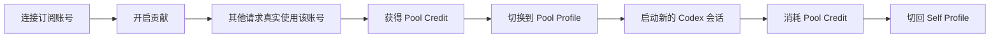

# Codex 弹性额度池 PRD v0.1

> 状态：方案评审稿  
> 日期：2026-09-21  
> 产品形态：macOS 优先的 Codex 桌面伴侣工具  
> 当前范围：架构验证与快速实现，不进入商业化设计

## 1. 产品定义

已有 ChatGPT Plus / Pro 的 Codex 用户，在自己的订阅额度暂时空闲时，可以把账号设为可贡献；在个人额度不足或希望保留个人额度时，可以快速切换到平台提供的 Pool Profile，开启一个新的 Codex 会话使用池子容量。

产品解决的是同一批订阅用户在不同时间段的需求错配。一个成员今天可能贡献，明天也可能借用。产品不把用户固定分成卖方和买方，也不向使用者分发其他成员的 OAuth 凭证。

## 2. 产品目标

### 2.1 当前版本目标

1. 用户可以连接并验证自己的 Codex 订阅账号。
2. 用户可以明确开启或暂停额度贡献。
3. 用户可以在 Self Profile 与 Pool Profile 之间快速切换。
4. Pool Profile 启动的新 Codex 会话可以通过平台 Gateway 使用账号池。
5. 用户可以看清贡献、消费与余额变化。
6. 任何切换失败都能恢复到切换前的可用状态。

### 2.2 非目标

当前版本不实现：

- 原 Codex 会话跨账号续接；
- Self 额度耗尽后的自动切换；
- 生成过程中的账号热切换；
- 现金收益、提现、押金和清算；
- 开放市场、供需竞价和动态汇率；
- 多 Provider 兑换；
- 完整商业化风控和运营后台。

## 3. 核心原则

### 3.1 用户主动切换

系统不在后台悄悄改变当前使用来源。用户通过明确操作进入 Pool Profile，并知道这会启动一个新会话。

### 3.2 凭证不跨用户

消费者只持有平台 Key。贡献账号的 OAuth 凭证由 Gateway 使用，不写入消费者的电脑，不出现在接口响应和日志中。

### 3.3 入池不等于获得额度

开启贡献表示账号可被调度。只有真实请求成功完成并结算后，用户余额才增加。

### 3.4 权益与实时供给分开

`Pool Credit` 表示用户拥有的调用权益；`池子状态` 表示此刻能否找到可执行账号。两者必须分开展示。

### 3.5 切换可逆

Self Profile 是用户的默认安全状态。切换前保存完整快照，切换失败自动回滚，切回后原有 OAuth、配置和历史状态保持不变。

## 4. 目标用户

### 4.1 核心用户

已经订阅 ChatGPT Plus / Pro、日常使用 Codex，但使用强度呈现明显波峰波谷的个人开发者。

典型特征：

- 有时连续数天轻度使用；
- 发布、赶项目或集中开发时短期高强度使用；
- 希望保留原生 Codex 工作方式；
- 接受在新会话中使用池子，不要求延续原会话。

### 4.2 角色模型

产品只有一个成员角色。成员可以同时拥有两种能力：

- `Contributor`：账号处于可调度状态，真实交付后获得 Pool Credit；
- `Consumer`：使用 Pool Profile，消耗 Pool Credit。

管理员只负责 PoC 期间导入测试账号、查看健康状态和处理失败，不作为首版产品角色设计。

## 5. 核心用户故事

| ID | 用户故事 | 优先级 | 验收结果 |
|---|---|---:|---|
| US-01 | 作为订阅用户，我希望连接自己的 Codex 账号，以便验证套餐和额度状态 | P0 | 授权成功后显示套餐、账号健康状态和最新额度快照 |
| US-02 | 我希望一键开启贡献，以便让闲置额度被池子使用 | P0 | 状态进入“可贡献”；真实交付前余额不增加 |
| US-03 | 我希望随时暂停贡献，以便立即保留后续容量给自己 | P0 | 不接收新请求；进行中的请求显示并等待完成 |
| US-04 | 我希望快速切到池子额度，以便在新 Codex 会话继续工作 | P0 | 切换完成后启动 Pool Profile；客户端不包含上游账号凭证 |
| US-05 | 我希望快速切回自己的 Pro，以便恢复原生订阅使用 | P0 | Self Profile 恢复，原 OAuth 和配置校验一致 |
| US-06 | 我希望知道自己的权益和当前池子是否可用，以便决定是否切换 | P0 | 同时展示 Pool Credit 与池子流动性，不混为一个数字 |
| US-07 | 我希望查看每次贡献和消费记录，以便理解余额变化 | P1 | 每笔记录包含时间、方向、CU、状态和关联请求 |
| US-08 | 切换失败时，我希望继续使用原来的模式 | P0 | 自动回滚并给出可重试原因，不留下半切换配置 |
| US-09 | 授权失效时，我希望知道该怎么恢复 | P1 | 账号退出调度，界面显示“需要重新授权”及唯一主操作 |

## 6. MVP 范围

### 6.1 P0 闭环



### 6.2 延后能力

- 押金与负余额；
- 自定义贡献时段；
- 多档保留比例；
- 高级路由策略；
- 账户组与组织管理；
- 多平台和跨模型兑换。

## 7. 信息架构

桌面应用使用三个一级入口：

1. `概览`：当前模式、主要切换动作、Pool Credit、池子状态、贡献状态；
2. `记录`：贡献与消费流水、失败和待结算记录；
3. `设置`：账号授权、Gateway 连接、启动行为和诊断。

账号健康与配额属于概览的二级详情，不单独占用一级导航。PoC 只支持一个成员账号，暂不设计账号搜索、卡片网格和批量操作。

## 8. 核心页面与交互

### 8.1 首次启动

#### 页面目标

让用户理解 Self 与 Pool 的关系，并完成自己的账号连接。

#### 内容顺序

1. 标题：`让 Codex 额度在不同时间段流动起来`
2. 简短说明：`平时贡献闲置额度，需要时切到池子使用。你的登录凭证不会提供给其他成员。`
3. 主操作：`连接我的 Codex 账号`
4. 次操作：`先查看体验说明`

#### 授权完成

显示账号脱敏标识、套餐、授权状态和最近额度快照。主操作变为 `进入概览`。

### 8.2 概览页

#### 第一层：当前使用模式

页面最上方展示唯一主状态：

- `正在使用：我的 Pro`
- `正在使用：池子额度`
- `正在切换…`
- `切换失败，已恢复我的 Pro`

对应主操作：

- Self 模式：`使用池子额度`
- Pool 模式：`切回我的 Pro`
- 切换中：按钮禁用并显示进度；
- 失败：`重新尝试`，同时保留当前可用模式。

#### 第二层：切换决策信息

只展示两个数据：

- `我的 Pool Credit`
- `当前池子状态`

池子状态使用文字：`充足`、`紧张`、`暂无容量`、`状态未知`。颜色作为辅助信息，不单独承担语义。

#### 第三层：我的贡献

一行完成贡献管理：

- 开关：`贡献闲置额度`
- 当前状态：`可贡献`、`正在服务 1 个请求`、`已暂停`、`额度保留中`、`需要重新授权`
- 辅助信息：今日已贡献 CU、进行中请求数；
- 二级入口：`查看账号状态`。

#### 第四层：最近活动

展示最近 3 条贡献或消费记录。完整列表进入“记录”。

### 8.3 切到 Pool 的确认层

点击 `使用池子额度` 后打开轻量确认层，不展示技术配置。

内容：

- 标题：`使用池子额度开启新会话？`
- 说明：`当前 Codex 会话不会迁移。应用会切换到 Pool Profile，并启动一个新的 Codex 会话。`
- 决策信息：Pool Credit、池子状态；
- 主操作：`切换并启动 Codex`
- 次操作：`取消`

当池子状态为 `暂无容量` 时，主操作禁用，文案为 `池子暂时不可用`。当状态未知时，主操作允许点击，但明确显示 `启动时将再次检查`。

### 8.4 切换过程

切换分为四步，界面只展示当前步骤：

1. 保存当前 Profile；
2. 检查 Gateway；
3. 应用 Pool Profile；
4. 启动 Codex。

成功后概览进入 Pool 模式。启动 Codex 失败但 Profile 已切换成功时，提供 `再次启动 Codex` 与 `切回我的 Pro`。

任何配置写入失败都执行回滚。回滚成功显示 `切换失败，已恢复我的 Pro`；回滚失败进入阻断态，提供 `修复配置`，不继续启动 Codex。

### 8.5 切回 Self

Pool 模式点击 `切回我的 Pro`：

1. 检查是否有由工具启动的 Pool Codex 进程；
2. 提示用户关闭或由工具关闭；
3. 恢复 Self Profile 快照；
4. 校验 OAuth 与配置摘要；
5. 可选地启动 Self Codex。

确认层文案：`池子会话不会合并到原会话。切回后，你可以继续打开原来的 Codex 任务。`

### 8.6 记录页

默认按时间倒序展示统一流水：

| 字段 | 示例 |
|---|---|
| 类型 | 贡献 / 消费 / 调整 |
| 数量 | `+4.2 CU` / `-3.8 CU` |
| 状态 | 待结算 / 已完成 / 已撤销 / 失败 |
| 时间 | 2026-09-21 14:32 |
| 来源 | Codex · GPT 模型 |
| 请求 ID | 脱敏短 ID，可复制 |

筛选只保留 `全部 / 贡献 / 消费`。PoC 不提供复杂日期和模型筛选。

### 8.7 设置页

设置分成三组：

- `我的账号`：账号状态、套餐、重新授权、移除账号；
- `Pool Gateway`：连接状态、地址只读展示、重新检测；
- `Codex 切换`：Self/Pool Profile 路径、启动 Codex、恢复备份。

危险操作集中在底部，并要求二次确认。移除账号前必须关闭贡献并等待进行中请求结束。

## 9. 状态模型

### 9.1 Profile 状态

```text
SELF
  -> SWITCHING_TO_POOL
  -> POOL
  -> SWITCHING_TO_SELF
  -> SELF

任一 SWITCHING 状态
  -> ROLLING_BACK
  -> 原状态 或 RECOVERY_REQUIRED
```

### 9.2 贡献状态

| 状态 | 含义 | 用户可执行操作 |
|---|---|---|
| `OFF` | 用户未开启贡献 | 开启贡献 |
| `AVAILABLE` | 可以接收新请求 | 暂停贡献 |
| `BUSY` | 正在处理请求 | 暂停新请求 |
| `RESERVED` | 个人保留阈值触发 | 查看额度状态 |
| `COOLDOWN` | 上游限额或临时错误 | 等待恢复、查看原因 |
| `REAUTH_REQUIRED` | OAuth 无法刷新 | 重新授权 |

### 9.3 池子状态

| 状态 | 判定 | 展示 |
|---|---|---|
| `AVAILABLE` | 至少一个合格账号可接单 | 充足 |
| `TIGHT` | 可用账号少于阈值 | 紧张 |
| `EMPTY` | 没有合格账号 | 暂无容量 |
| `UNKNOWN` | Gateway 不可达或快照过期 | 状态未知 |

## 10. 关键异常与恢复

| 场景 | 产品行为 |
|---|---|
| Gateway 不可达 | 阻止进入 Pool，Self 不受影响 |
| Pool Key 失效 | 显示重新连接，不触碰 Self OAuth |
| 池子启动后无账号可用 | Codex 获得明确容量错误；客户端建议切回 Self |
| 贡献账号 OAuth 失效 | 立即移出调度，提示重新授权 |
| Profile 写入失败 | 自动恢复快照，不启动 Codex |
| Codex 启动失败 | 保留已成功应用的 Profile，允许重启或切回 |
| 应用异常退出 | 下次启动读取事务记录并完成恢复 |
| 正在贡献时关闭共享 | 停止新请求，显示进行中请求直至结束 |

## 11. 数据与接口契约

### 11.1 客户端最小状态

```text
member_id
profile_mode
switch_transaction_id
self_profile_snapshot
pool_profile_version
contribution_enabled
account_health
pool_credit
pool_liquidity
gateway_health
```

### 11.2 Gateway 最小能力

- 平台 API Key 鉴权；
- `/v1/models`；
- `/v1/responses` 与 SSE；
- OAuth 账号选择；
- quota cooldown；
- 请求 usage 与账号归属记录；
- 客户端不可见的贡献账号凭证。

### 11.3 账本规则

PoC 使用单一 `CU`，只验证正向余额：

- 成功贡献：`Pool Credit + settled_CU`；
- 成功消费：`Pool Credit - settled_CU`；
- 失败请求：不结算；
- 中断请求：按实际可核验 usage 结算，否则进入待处理；
- 不允许余额小于零。

## 12. 事件与观测

首版记录以下产品事件：

- `account_connected`
- `contribution_enabled`
- `contribution_paused`
- `profile_switch_started`
- `profile_switch_succeeded`
- `profile_switch_failed`
- `profile_rollback_succeeded`
- `pool_codex_launched`
- `pool_request_settled`
- `pool_capacity_unavailable`

日志中不得记录 OAuth token、平台 Key、完整 prompt 和完整上游响应。

## 13. 交互与视觉方向

- 桌面工具采用安静、克制、可扫描的工作界面；
- 首页只保留一个主操作，Self 与 Pool 的来源必须一眼可辨；
- 使用间距、文字层级和分隔线组织内容，减少卡片堆叠；
- 额度百分比是账号诊断信息，不作为首页最大的视觉元素；
- 绿色只表达健康或可用，橙色表达容量紧张，红色只用于需要用户处理的失败；
- 所有状态同时提供文字，不依赖颜色、图标或动画单独表达；
- 切换过程保持在当前窗口，不用多个系统弹窗串联。

## 14. 验收标准

### 14.1 功能验收

1. Self 模式下继续使用用户原有 OAuth，未经过 Pool Gateway。
2. 从点击确认到启动 Pool Codex，在正常环境下不超过 5 秒。
3. Pool 客户端只持有平台 Key，无法读取被调度账号身份和凭证。
4. A 账号进入 cooldown 后，后续新请求可以选择 B 账号。
5. 切回 Self 后，`auth.json`、`config.toml` 与切换前摘要一致。
6. 任一切换步骤失败时，应用可以自动恢复或明确进入人工恢复状态。

### 14.2 体验验收

1. 用户在概览页 3 秒内能判断当前使用 Self 还是 Pool。
2. 用户能区分 Pool Credit 和池子实时容量。
3. 用户不需要理解 `base_url`、OAuth token 或 `CODEX_HOME` 才能完成切换。
4. 暂停贡献后，界面明确区分“停止新请求”和“进行中请求尚未结束”。
5. 空、加载、失败、过期、禁用、恢复成功状态都有明确文案和下一步。

## 15. 实现分期

### Phase 0：本地架构验证

- 直接运行 Cockpit Tools / CLIProxyAPI；
- 导入两个自有测试账号；
- Pool Profile 指向 `127.0.0.1`；
- 验证请求、轮换和恢复。

### Phase 1：可用的桌面 PoC

- Self / Pool 双 Profile；
- 一键切换与事务回滚；
- 概览、记录、设置三个入口；
- Pool Credit 正余额账本；
- 远程测试 Gateway。

### Phase 2：封闭互助测试

- 多成员授权；
- 贡献开关与真实交付结算；
- 池子流动性状态；
- 凭证轮换、审计和异常处理。

## 16. 当前未决问题

这些问题不阻塞 Phase 0，但进入 Phase 1 前需要确定：

1. `CU` 按上游 usage、请求次数还是估算成本折算；
2. 首版是否设置统一的账号保留阈值；
3. Pool Profile 使用独立 `CODEX_HOME`，还是复用 Cockpit 的备份/恢复机制；
4. Pool 模式退出时，是否默认关闭由工具启动的 Codex 进程；
5. 贡献账号的长期凭证由远程 Gateway 托管，还是由贡献者本地节点持有。

