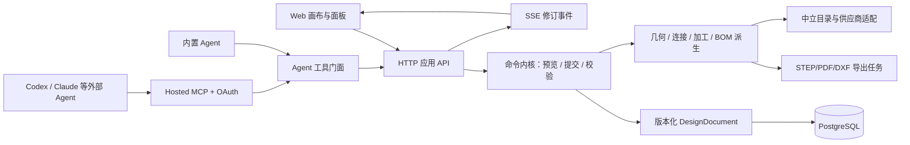

# Agent 可操作的铝构件创意平台：首版技术方案

> 实施进度（2026-09-23）：新工程已迁至独立 [BeamJoin 仓库](https://github.com/NolanSoloBuilder/agent-native-aluminum-platform)。M0 的模板/空白项目、版本化命令内核、PostgreSQL 预览与提交、Web 3D 和本地 stdio MCP 已经运行并完成 API、MCP、真实页面联调；M1 的属性编辑已部分实现。托管 OAuth、真正的内置大模型 Agent、供应商映射、CAD 导出及作品发布仍按下述 M1–M3 里程碑实施。目录当前仅含平台自绘中立样例，未接入嘉立创商品数据。

日期：2026-09-23。状态：实施基线。配套[产品规格](2026_09_23_agent_native_aluminum_platform_product_spec.md)。首版允许删除现有 Demo 并从新工程开始；本文规定需要从第一天保持一致的契约，以及每个里程碑的完成条件。

## 1. 架构结论

采用**一个版本化设计文档、一个确定性命令内核、多个操作入口**。人工画布、内置 Agent、外部 Agent MCP 和将来的自动化都提交同一种有类型命令。3D 网格、BOM、连接和加工明细是设计文档与固定目录/规则版本的派生结果。供应商从中立规格映射到具体商品，不参与定义设计对象的身份。



第一版选择模块化单体：Web、API/MCP、后台导出 Worker 三个进程，PostgreSQL 一个事务数据库，对象存储放导出包和用户图片。HTTP 承接请求，SSE 推送修订；MCP 只是业务服务的一种协议门面。无需微服务、CRDT、通用 CAD 约束引擎或独立多 Agent 编排器。

### 必须成立的不变量

1. 每一个可见实体有稳定 ID；不能从 mesh 反推 BOM，也不能只在 Three 场景里保存连接关系。
2. 同一设计文档、目录版、规则版和求解器版，得到同一结构哈希、切料明细、BOM 与校验结果。
3. 人工和 Agent 的同义操作调用同一个命令处理器；MCP 无直写数据库或画布的捷径。
4. `preview` 只产生候选和差异，不改项目修订；`commit` 要么一个事务全部成功，要么全部失败。
5. 采购映射/报价可失效，设计意图与历史修订不因此改变。换供应商需要重新解析、检查和显式接受差异。
6. 所有外部可写操作以项目 ACL、OAuth scope、修订号和幂等键约束；Agent 的浏览器链接不携带令牌。

## 2. 具体技术选型与边界

| 部分 | 首版选择 | 原因与替换边界 |
| --- | --- | --- |
| Web | React + TypeScript + Vite；Three.js + React Three Fiber | [Three.js](https://threejs.org/docs/pages/TransformControls.html)有拾取/变换与截面拉伸，[R3F](https://r3f.docs.pmnd.rs/api/canvas)组织 React 场景。画布是设计投影，不保存工程事实。 |
| 领域内核 | 纯 TypeScript 包，含命令、参数生成、连接定位、规则校验、BOM | API 进程执行权威计算；浏览器 Web Worker 可用同包做拖动中的临时预览。版本化、无浏览器/数据库依赖。 |
| API | Node.js + TypeScript + Fastify；共享 JSON Schema/TypeScript 契约；SSE | 模块化单体，业务规则只在领域包。浏览器 POST 命令，SSE 接收 revision 通知；断线后按 revision 补读。 |
| Agent 接入 | 官方 MCP TypeScript SDK，托管 Streamable HTTP，OAuth 授权；HTTP API 仍是应用服务主接口 | [MCP 当前协议](https://modelcontextprotocol.io/specification/2026-07-28/basic/transports)明确 Streamable HTTP。实现版本协商并用真实 Codex/Claude 客户端做兼容测试，不假定每个客户端立刻支持最新修订。 |
| 存储 | PostgreSQL：项目头、不可变修订快照、变更记录、目录和提案；S3 兼容对象存储：图片/导出包 | 项目修订以数据库事务提交；对象文件通过内容哈希关联。初期每次提交保存 JSONB 快照，后续可做归档，不做“事件日志为唯一真源”。 |
| 异步导出 | 后台 Node Worker + 数据库任务/出站事件；CAD 导出接口首实现为 replicad/OpenCascade.js | [replicad 官方文档](https://github.com/sgenoud/replicad/blob/main/packages/replicad-docs/docs/use-as-a-library.md)说明 STEP 导出及 WASM 的计算/加载成本。只在导出 Worker 中运行 CAD 几何，不阻塞画布；依赖许可证及导出一致性验收。 |
| 供应商 | 中立 Catalog + `SupplierAdapter`；首版嘉立创映射为受许可/用户逐单信息驱动的示例适配器 | 不在代码中写死供应商 SKU、售价、加工 API。未获授权时只导出询价包，不自动同步目录或下单。 |

建议仓库分包为 `apps/web`、`apps/api`、`apps/worker`、`packages/contracts`、`packages/domain`、`packages/catalog`、`packages/agent-tools`。所有 API/MCP/Agent 入参用一份版本化 schema；数据库迁移使用显式 SQL。不要为未来的材质或供应商预先做动态插件执行框架，首版扩展点保持为类型化接口和版本化数据。

## 3. 设计数据与目录数据

### 3.1 中立物料、具体商品与报价分开

设计模板可引用 `PartRequirement`（如需要 30×30、特定槽口接口和允许的载荷估算范围）。项目实例必须解析到一项有**确切几何**的 `CatalogPartRevision`，否则保持 `unresolved`。同样叫“2020”的两件商品可能具有不同中心孔、槽口和加工兼容性；只把名字映射到 SKU 会造成错误替换。[嘉立创工艺参数](https://xc.jlcfa.com/process)展示了 2020D 与其它欧标 20 系列在端面攻牙上的差异。

```ts
type PartRequirement = {
  id: string;
  family: 'profile' | 'panel' | 'hardware';
  envelopeQ?: [number, number];       // 持久化长度以 0.01 mm 整数表示
  slotInterface?: string;
  preferredMaterial?: string;
  constraints: Record<string, unknown>;
};

type CatalogPartRevision = {
  id: string; revision: string; family: string;
  sectionGeometry?: { outer: Point2Q[]; voids: Point2Q[][]; slots: SlotAnchor[] };
  material: { grade?: string; density?: number };
  capabilities: string[];
  provenance: AssetProvenance;
};

type AssetProvenance = {
  sourceUrl?: string; acquisitionMethod: string; licenseDocumentId?: string;
  allowedUses: ('internal_design' | 'user_display' | 'public_share' | 'export_redistribution')[];
  verifiedAt: string; expiresAt?: string; revocationPolicy?: string;
};

type SupplierListing = {
  supplierId: string; sku: string; catalogPartRevisionId: string;
  matchStatus: 'verified_equivalent' | 'needs_review';
  supplierGeometryRevisionId?: string;
  verification: { checks: { field: string; expected: string; observed: string; tolerance?: string; evidenceAssetId?: string }[]; verifiedAt: string };
  offeredFinishes: string[]; processRuleSetId?: string;
  provenance: AssetProvenance;
};

type QuoteSnapshot = {
  designRevision: number; documentHash: string; mappingRevision: string; ruleSetRevision: string;
  supplierId: string; supplierQuoteId?: string; customerId?: string;
  lines: { bomKey: string; sku?: string; quantity: number; processes: string[]; unitPrice?: string; lineTotal?: string }[];
  subtotal?: string; tax?: string; shipping?: string; total?: string; currency?: string;
  deliveryRegion?: string; capturedAt: string; expiresAt?: string;
  evidenceAssetId?: string; acquisitionMethod: 'manual_upload' | 'authorized_api';
};
```

报价快照只有设计哈希、采购映射/工艺版本、数量、适用客户与交付地区都匹配且未到期时才为 `QUOTE_CURRENT`；任一项变化转为 `QUOTE_STALE`。用户上传报价原件仅用于自己的项目核对，公开作品和 fork 不复制该文件。

设计 BOM 记录中立物料、长度、工艺和数量；采购 BOM 才记录供应商 SKU、映射规则、包装数量、缺失项。自绘中立截面是平台设计候选，不自动等于供应商实物。只有外形、槽口、中心孔、材质、表面处理、供货长度、公差和加工能力逐项核对，才将映射标为 `verified_equivalent`；缺任一关键字段时保留 `needs_review`，采购 BOM 标为未完成。供应商变更走 `resolveSupplierCandidates → compareFit → previewRebind → commit`，显示截面、槽、孔、表面处理、价格来源差异，不能静默替换。

嘉立创 FA 的[服务条款](https://www.jlcfa.com/text/protocol)（[集团帮助中心版本](https://www.jlc.com/portal/server_guide_36741.html)）限制目录、数据和图片的再利用；自有目录使用自绘截面、获授权的规格和数据。首版适配器可存供应商 ID、用户逐单选定的商品信息及其合法来源，不批量抓取其商品资产建立独立镜像。每项截面、图片、CAD 和工艺资产都有用途范围；未取得公开分享或导出再分发权的资产不能随作品发布或询价包传播。供应商合作后由许可范围决定同步深度。市场有新型材来源时，只需新增候选与规则映射，不改项目文档的核心对象模型。

### 3.2 项目文档与模板

```ts
type DesignDocument = {
  schemaVersion: number;
  projectId: string;
  revision: number;
  unit: 'qmm';                   // 1 qmm = 0.01 mm
  catalogReleaseId: string;
  ruleSetRevision: string;
  solverVersion: string;
  templateOrigin?: { templateId: string; version: string; forkOfPublicationId?: string };
  assemblies: Assembly[];
  parts: Part[];
  joints: Joint[];
  processFeatures: ProcessFeature[];
  constraints: DesignConstraint[];
  intent: { useCase?: string; envelope?: BoxQ; clearances?: Clearance[]; loadNotes?: string[] };
};

type Assembly = {
  id: string;
  kind: 'parametric_frame' | 'free_group';
  generator?: { id: string; version: string; parameters: Record<string, number> };
  childPartIds: string[];
  overrides: { partId: string; field: string; value: unknown; policy: 'keep' | 'recompute' }[];
};

type PartBase = {
  id: string;
  requirementId?: string;
  catalogPartRevisionId?: string;
  placement: { originQ: [number, number, number]; rotation: [number, number, number, number] };
  processFeatureIds: string[];
  origin: { assemblyId?: string; semanticKey?: string; createdBy: 'template' | 'human' | 'agent' };
};

type Part =
  | (PartBase & { kind: 'profile'; shape: { lengthQ: number; sectionRotationQdeg: number } })
  | (PartBase & { kind: 'panel'; shape: {
      outline: Point2Q[]; holes: Point2Q[][]; thicknessQ: number;
      mountingEdgeIds: string[]; edgeTreatment?: string;
    } })
  | (PartBase & { kind: 'hardware'; shape: { catalogAnchorId?: string } });

type ProcessFeature = {
  id: string; targetPartId: string; type: 'tap' | 'through_hole' | 'counterbore' | 'cut';
  anchorId: string; localPositionQ: Vec3Q; parameters: Record<string, number>;
  ruleRef?: string;
};

type Joint = {
  id: string;
  participants: { partId: string; anchorId: string }[];
  method: string;
  fastenerPartIds: string[];
  processFeatureIds: string[];
};
```

`ProcessFeature` 单独记录目标构件、端面/槽面/板面锚点、孔型和尺寸、规则出处。`DesignConstraint` 包括外形尺寸、相对对齐、净空、对称与固定连接方式。型材局部 +X 轴是从端点 A 到端点 B，唯一名义长度是 `shape.lengthQ`；其局部轴为 `[0,0,0]→[lengthQ,0,0]`，`placement` 才将它变换到世界坐标。型材槽口、孔和切割特征一律用局部坐标与锚点表示。面板 `outline/holes` 位于局部 XY 平面，板厚沿局部 +Z 轴，安装边引用稳定的轮廓边 ID。世界坐标约定 X=宽、Y=高、Z=深；文档中使用 0.01 mm 整数，角度和变换在计算边界量化，渲染才转换为浮点场景坐标。尺寸、名义切长、公差和采购下料长度是不同字段。

模板是**版本化参数定义 + 生成器 ID + 生成后的可编辑构件图**。内置生成器是经过测试的函数，公开模板不能上传任意可执行脚本。生成件有稳定语义键，例如 `leg.nw`、`rail.top.front`，整体改宽时只重算受约束的子图；用户添加的自由构件仍在文档里。局部 override 冲突时，命令返回目标对象和两种处理选择，不自动抹掉手工修改。用户也能明确解除某构件与参数组件的关联，随后它按自由构件处理。

## 4. 命令内核与工程计算

### 4.1 有类型的命令

首版命令清单：`CreateProject`、`InstantiateTemplate`、`CreateFrame`、`SetAssemblyParameter`、`AddProfile`、`SetPartGeometry`、`MoveParts`、`DuplicateParts`、`MirrorParts`、`AlignParts`、`ReplaceCatalogPart`、`AddPanel`、`ConnectParts`、`SetJointMethod`、`AddProcessFeature`、`GroupParts`、`DeleteParts`、`DetachFromAssembly`、`BindSupplierCandidate`。显隐、相机和当前选中态属于个人视图设置，不修改工程文档。Agent 和 UI 使用相同命令名与字段定义。

新构件在一个批次中可使用 `clientRef`，例如先 `AddProfile(clientRef='middleRail')` 再 `ConnectParts(partRef='middleRail')`；服务端给它稳定 ID 并在预览/提交之间保持映射。命令不允许内嵌任意 JavaScript、公式字符串或 mesh 二进制。参数生成器和规则由服务端版本化发布。

```json
{
  "baseRevision": 12,
  "commands": [
    {"type": "SetAssemblyParameter", "assemblyId": "frame-1", "name": "widthQ", "value": 85000},
    {"type": "ReplaceCatalogPart", "partIds": ["leg-nw", "leg-ne", "leg-sw", "leg-se"], "catalogPartRevisionId": "section-4040-r3"}
  ],
  "idempotencyKey": "client-generated-uuid"
}
```

一次命令批次限定目标项目、数量与执行时限。处理流程固定：schema/权限 → 读取固定目录与规则版本 → 生成或修改装配图 → 传播参数/约束 → 定位连接与加工 → 几何及供应商能力校验 → 生成 BOM 和变化摘要。硬错误拒绝提交；未覆盖的制造规则可保留为草稿，并在差异里列出待确认项。输出的 `designRules`、`supplierDfm`、`procurementMapping` 是三项独立状态；询价包就绪要求指定供应商下分别为 `pass/pass/complete`。

### 4.2 约束与校验范围

首版针对直线型材做确定性参数求解和连接图传播，不求解任意 CAD 几何约束。交互中拖动的 mesh 只是瞬时视觉反馈；鼠标释放后才形成 `MoveParts` 或 `SetAssemblyParameter` 命令。对于自由构件，端点、截面方向、槽口锚点和连接节点构成关系图；长度取自端点与连接方式，不以屏幕像素推算采购值。

| 级别 | 示例 | 结果 |
| --- | --- | --- |
| 硬错误 | 负切长/零长度、引用不存在的构件、已知不匹配的槽/螺母、孔与端面或相邻孔冲突、所选供应商明确不支持加工 | 阻止命令提交或供应商映射，并返回规则 ID、实体 ID、实测参数和建议改法 |
| 未解析 | 自由角度接头无已知工艺规则、供应商资料缺少槽口/孔参数、采购关键件无具体候选 | 允许保存草稿，阻止标为“通过当前规则/可询价” |
| 警告 | 单梁在给定支承/荷载下的挠度估计、倾倒风险、动态载荷、接头刚度、需要现场固定 | 显示假设和待工程复核项；不输出整件安全结论 |

一次导出的同一修订应附 `documentHash`、`catalogReleaseId`、`ruleSetRevision`、`solverVersion` 和校验报告。规则变化不隐式重写旧项目；用户执行“按新规则重新校验/升级”，看到差异再保存新修订。

### 4.3 派生数据

`derive(design, catalog, rules)` 输出 `{scene, dimensions, jointPlacements, processList, designBOM, procurementBOM, diagnostics, hash}`。同一函数在 API 中作为权威计算，Web Worker 只用于局部交互预览。`scene` 按截面轮廓与长度生成显示几何；需要高精度加工形体时由后台 CAD Worker 生成 B-rep。BOM 由构件与连接图生成，按截面/切长/表面处理/工艺分组；一个连接的五金只计一次。导出服务消费固定修订和派生结果，不能各自再解释一套长度公式。

## 5. 预览、提交、撤销与并发

| HTTP 应用接口 | 输入 | 输出与副作用 |
| --- | --- | --- |
| `GET /v1/projects/:id/context` | 可选实体范围、分页 | 项目修订、目录/规则版、参数概要、对象 ID、校验摘要；大项目按实体分页读取 |
| `GET /v1/catalog/search` | 规格/槽口/用途/供应商过滤 | 中立规格、可用候选、来源状态和明确的缺失字段 |
| `POST /v1/projects/:id/previews` | `baseRevision`、`commands[]`、幂等键 | `proposalId`、`previewHash`、作用实体、3D/尺寸/BOM diff、诊断、过期时间；**不变更项目修订** |
| `POST /v1/projects/:id/commits` | `proposalId`、`previewHash`、`expectedRevision`、幂等键 | 一个新修订、`changesetId`、`documentHash`；冲突返回最新修订和变化摘要 |
| `POST /v1/projects/:id/undo-previews` | `changesetId`、`baseRevision` | 逆变更预览及冲突；提交仍走通用 commit |
| `GET /v1/projects/:id/events` | `Last-Event-ID` / `afterRevision` | SSE 最小通知 `{revision, changesetId}`；断连后按修订补读，敏感差异另走鉴权 API |
| `POST /v1/projects/:id/exports` | 固定 revision、格式、范围 | 异步任务 ID；导出完成后取得带哈希的包 |

`preview` 保存短期提案，但不会写项目头或权威设计修订。提案持久化**规范化命令、`clientRef→实体 ID` 映射、候选文档哈希、预览哈希**，并绑定 `baseRevision + catalogReleaseId + ruleSetRevision + solverVersion + commandHash`。新实体 ID 在 preview 冻结，映射纳入预览哈希；commit 重放时不会产生另一批随机 ID。提案还绑定创建用户/客户端、项目和当时的自动提交策略。提案过期、项目目录/规则升级或修订变化后必须重新预览。

`commit` 在 PostgreSQL 事务内检查**当前**项目 ACL、客户端 scope、服务端保存的项目/命令/时效白名单，以及提案的创建者或显式批准的转交关系；用户在网页应用 Agent 提案时记录批准者。随后从固定 base + 已存命令重算候选，比较 `previewHash/documentHash`，使用 `UPDATE projects ... WHERE revision = expectedRevision` 比较并交换；同时写不可变 `project_revisions`、`changesets`、`audit_events` 和待推送事件。客户端回传的 diff 仅用于展示，不作为写入依据。重复的 `idempotencyKey` 对同一用户、项目和请求哈希返回第一次结果；同键不同内容报错。MCP 和 UI 都不能绕过这一步。

V1 以项目为写入串行边界。并行 Agent 可各自生成提案，但提交依次推进修订；不自动合并影响同一装配/连接的变更。若两批命令只触及不相关实体，可在刷新最新修订后自动**重新预览并重验**，再让用户应用。撤销通过逆命令产生新修订；若之后的人工作业依赖了该连接或构件，撤销先报告冲突，绝不回退数据库快照覆盖其他人的改动。恢复某个历史版本也写成新的修订并记录来源。

一个兼容工具返回可长这样：

```json
{
  "proposalId": "prop-742",
  "baseRevision": 12,
  "previewHash": "sha256:...",
  "diff": {
    "changedEntityIds": ["frame-1", "leg-nw", "rail-top-front"],
    "dimensions": [{"key": "outerWidthQ", "from": 90000, "to": 85000}],
    "bom": [{"key": "section-3030-r2/rail", "quantityDelta": -2}]
  },
  "diagnostics": [
    {"severity": "needs_review", "ruleId": "supplier.mapping.missing", "entityId": "leg-nw", "message": "当前供应商尚无已验证候选"}
  ],
  "readiness": {"designRules": "pass", "supplierDfm": "incomplete", "procurementMapping": "incomplete"}
}
```

## 6. Agent 运行形态与工具契约

### 6.1 内置 Agent 与外部 Agent

内置 Agent 的对话服务分三步：理解意图与补充缺参；读取真实项目/目录并计划命令；预览、解释差异，按用户给该会话的权限提交。模型只提出命令，规则和数据库由服务端决定。提示词、模型供应商与规划策略可替换，命令 schema、实体 ID 和校验结果保持不变。对话记录保存请求、引用的设计修订、工具调用结果与用户确认，不存私有供应商凭证明文。

外部 Agent 使用托管 MCP。首版工具集控制在语义清晰的 10 项左右：

| MCP 工具 | 用途与权限 |
| --- | --- |
| `projects_list`, `templates_list` | 发现有权项目与模板，`design:read` |
| `design_get_context`, `design_get_entities` | 读取概要、实体与当前修订；支持分页和选区，`design:read` |
| `catalog_search` | 查询中立规格及可授权的供应商候选，`catalog:read` |
| `design_preview_commands` | 传类型化命令批次，返回提案、差异和诊断，`design:propose` |
| `design_commit_proposal` | 提交已预览提案，`design:write` 且符合项目自动提交策略 |
| `design_validate`, `design_get_bom`, `design_list_proposals` | 读取固定修订的规则报告、清单和可见提案，`design:read` |
| `editor_open` | 返回带项目/提案 ID 的 HTTPS 链接，`design:read` |
| `export_request` | 导出指定修订，`design:export` |

项目创建、模板复制与发布也有专门的 API/工具；发布需要独立 `design:publish`，无供应商下单工具。工具均有严格输入/输出 schema，响应带修订、单位、可追溯 ID 和错误码。外部 Agent 无权提交一个未预览过的任意 JSON 文档。多个 Agent 通过 `design_list_proposals` 看彼此可见的候选及修订，再分别读取、评议或提交，不共享可写草稿。MCP 的[工具规范](https://modelcontextprotocol.io/specification/2026-07-28/server/tools)支持可发现的工具及其 schema；这些工具的具体业务语义由本平台定义。

`editor_open` 的标准结果是网页 URL 和项目上下文。支持浏览器面板的宿主可以根据插件说明打开页面；宿主没有该能力时仍可返回链接给用户。页面凭用户自己的登录与项目 ACL 读取数据，不把 MCP token 塞进 URL。ChatCut[官方文档](https://chatcut.io/docs/agent-plugin)所示的并排编辑器是交互参照，不代表 MCP 协议能强制所有客户端打开浏览器。

### 6.2 授权、执行策略和多 Agent

MCP 采用受保护的 HTTP 资源，按[现行 MCP OAuth 规范](https://modelcontextprotocol.io/specification/2026-07-28/basic/authorization)提供 Protected Resource Metadata；未授权返回 HTTP 401 和带 `resource_metadata/scope` 的 `WWW-Authenticate`；授权服务器提供元数据发现、客户端注册/预注册、PKCE、`resource` 参数和 token 受众/范围校验。每次请求携带 Bearer token；权限同时受用户身份、项目 ACL（owner/editor/viewer）、客户端 scope（read/propose/write/export/publish）约束。每个工具调用重新检查权限，用户可撤销某客户端授权。开发期可用本地回环环境进行兼容性测试；对外部署采用 HTTPS，不把项目权限寄托在 MCP transport session 上。互操作测试同时覆盖仍使用 2025-11-25 握手的客户端与[2026-07-28 请求级协议](https://modelcontextprotocol.io/specification/2026-07-28/basic/transports)；协议会话绝不当成项目修订或授权状态。

每个外部客户端可选 `proposal_only`（默认）或 `safe_auto_commit`。后者只能在指定项目、指定时间和非高风险命令范围内提交；整项目删除、批量替换物料、公开发布、询价或以后下单仍要求独立授权/确认。编辑器清楚展示是哪位用户、哪个 Agent 客户端、使用了哪些命令。多 Agent 首版只允许并行读取和独立提案，统一按项目修订顺序提交；无需让多个 Agent 同时直接维护一份可写草稿。

### 6.3 与画布共享上下文

画布选区通过 `{entityIds, featureIds, revision}` 传给 Agent，Agent 读取前检查版本；若对象已被删或改，要求重新选择。用户点选某根梁时，Agent 可以获取该梁的截面、长度、连接、加工和约束，而不只是截图。Agent 返回的实体 ID 能定位画布高亮、右栏属性和 BOM 行。模板/社区文本可能包含不可信指令，应以数据字段注入模型上下文，工具与权限层不执行其中的命令。

## 7. 画布、实时同步和导出

Web 画布订阅权威项目修订。相机、选中态、面板折叠状态留在客户端；工程实体由服务器修订提供。拖动期间可本地渲染“影子构件”和吸附点，释放鼠标后调用预览/提交。Agent 提案以半透明叠影、增删颜色、尺寸标签和关联 BOM 行展示。选择和变换借助 Three.js/R3F，截面显示网格从 `CatalogPartRevision` 的轮廓派生，按截面版/长度缓存；性能不足时使用实例化/LOD，但不得改变尺寸值。[Three.js 的变换控件](https://threejs.org/docs/pages/TransformControls.html)和[截面拉伸](https://threejs.org/docs/pages/ExtrudeGeometry.html)可作交互底座。

浏览器 SSE 只推送 `{revision, changesetId}`，客户端再经鉴权 API 取差量/完整快照；连接断开时用 `afterRevision` 补事件，日志被清理时取最新快照。建连、每次回放和事件发送都检查当前项目权限；撤权时终止现有流并阻止重连。SSE 响应使用 `Cache-Control: no-store`、严格同源/CORS 策略；基于浏览器 cookie 的写入接口校验 CSRF/Origin。MCP 客户端无需维持与浏览器相同的长连接，每次读取和提交显式带修订。这与 MCP 最新传输规范的请求级语义一致。[MCP Streamable HTTP 规范](https://modelcontextprotocol.io/specification/2026-07-28/basic/transports)。

导出 Worker 从**固定**项目修订生成：设计 JSON、CSV/PDF 的型材和五金 BOM、切料/加工表、装配尺寸图、支持几何范围内的 STEP，以及面板 DXF。面板 DXF 来自 `PanelPart.shape` 和 `ProcessFeature`：外轮廓、内开孔、钻孔、尺寸标注分别写到约定图层，文件单位为 mm；首版只允许通过校验的平面轮廓/孔型导出加工图。STEP B-rep 由 `GeometryExportPort` 承接，首个实现使用 replicad/OpenCascade.js；[replicad 文档](https://github.com/sgenoud/replicad/blob/main/packages/replicad-docs/docs/use-as-a-library.md)说明其 STEP 能力和 WASM worker 注意事项。按同一输入独立重读 STEP 体数量、外包尺寸与单位，校对文档和 BOM；不支持的孔/连接绝不以“看似完整”的 STEP 交付。若该库在目标部署环境未通过许可证和正确性检查，改用受控的服务端 CAD 导出实现，`GeometryExportPort` 和设计文档契约不变。

## 8. 数据库、审计与作品发布

| 表/集合 | 关键字段与约束 |
| --- | --- |
| `projects` | `id, owner_id, head_revision, title, visibility, created_at`；head 用于 CAS |
| `project_revisions` | `(project_id, revision)` 唯一，`document_jsonb, document_hash, catalog_release_id, rule_set_revision, solver_version, created_at`；不可变 |
| `changesets` | `project_id, from_revision, to_revision, actor_user_id, agent_client_id, commands_jsonb, inverse_jsonb, summary` |
| `proposals` | `id, project_id, base_revision, catalog_release_id, rule_set_revision, solver_version, commands_jsonb, client_ref_map_jsonb, command_hash, candidate_document_hash, preview_hash, diff_jsonb, diagnostics_jsonb, creator_user_id, creator_client_id, policy_id, approved_by_user_id, expires_at, state`；命令/映射创建后不可变 |
| `idempotency_records` | `(principal_id, project_id, key)` 唯一，存请求哈希和响应指针 |
| `catalog_parts`, `catalog_releases`, `supplier_listings`, `supplier_mappings`, `rule_sets` | 所有供求映射和规则版本可追溯；商品映射记录授权与核验时间 |
| `templates`, `publications`, `fork_edges` | 模板生成器版本；发布保存不可变快照/哈希及来源 revision；fork 保存原作和许可，原私人项目删除后公开作品仍按发布策略保留 |
| `export_jobs`, `assets`, `audit_events`, `project_acl`, `oauth_grants` | 导出状态与对象哈希；操作审计；项目与客户端权限 |

同一事务中写项目新修订和待发布事件；导出任务以及 SSE 读者按修订拉取，通知丢失也能重放。公开作品展示的是发布时的项目快照，且只使用拥有可再分发权的缩略图、截面和附件。用户上传的第三方模板需声明许可；fork 与公开前验证许可/素材范围。删除或撤销公开作品走产品内容策略，不直接修改历史项目修订。

## 9. 质量门禁与可观测性

**领域测试**：同一命令在浏览器预览与服务端产生一致的设计哈希；参数改型保持语义 ID 与手工 override；连接图无悬空引用；切长、孔位、五金数与 BOM 可复算。将嘉立创公开[工艺案例](https://xc.jlcfa.com/process)仅用作规则理解/人工核对样例，真实目录数据须有来源许可。针对 2020D/普通欧标 20 等易混淆规格建立反例。属性测试覆盖重复/逆序命令、镜像后双计件、极限尺寸和自由构件。

**接口测试**：HTTP 与 MCP 的读、预览、提交结果一致；过期修订返回 `REVISION_CONFLICT`，过期提案返回 `PREVIEW_STALE`；重复幂等键只产生一个修订；无 scope 的外部客户端不能提交，拿到别人的 `proposalId` 也不能越权提交。撤销后不会覆盖中途人工更改。真实 Codex 与另一种外部 MCP 客户端分别完成授权、工具调用、编辑器打开、提交和撤权；撤权后已有 SSE 连接停止收到项目事件。

**工程导出测试**：固定修订重复导出得到一致 BOM/切料表；STEP 用独立读取器回读单位、实体数、外形尺寸；DXF 回读外轮廓、孔和图层；未覆盖工艺得到 `supplierDfm=incomplete`。抽取真实 10–20 个桌、架、柜案例，由人工比对尺寸、连接件、孔位与可采购信息。

**性能目标**：首版按 200 根型材、50 块板、200 个连接件的项目基准测试，普通开发机交互保持可用，单次规则预览目标 P95 < 3 秒、修订提交目标 P95 < 1 秒（不含异步 CAD 导出）。这些是验收目标，需在第一轮实现后实测调整，不作为当前性能事实。记录 `projectId/revision/commandType/ruleVersion/latency/diagnosticCode` 等指标；日志避免记录完整私有设计、令牌和原始用户提示词。

## 10. 实施计划与依赖

| 阶段 | 交付物 | 退出门槛 |
| --- | --- | --- |
| M0：契约与垂直样例 | 领域 schema、命令与错误码、两个中立截面、一种连接、一个框架模板、一个从空白构件图；Web/HTTP/MCP 调同一预览内核 | 同一改宽命令从 UI 和测试 MCP 得到相同哈希/BOM；确立目录素材的许可来源 |
| M1：人工编辑闭环 | 3D 选择/拖动/吸附，框架参数与自由构件同项目，连接/面板，保存、版本、撤销、规则校验、BOM | 模板改型与空白自由定制两个验收场景可重复完成；重载不丢几何或关系 |
| M2：Agent 闭环 | 内置 Agent 计划/补问/预览/提交；OAuth 托管 MCP、外部客户端授权；网页 handoff、SSE、冲突处理 | Codex 和另一 MCP 客户端完成人工接续的真实端到端设计修改，旧修订不能覆盖新修改 |
| M3：交付与分享 | 修订固定的导出包、STEP/DXF 支持子集、作品发布/复制/来源、嘉立创示例采购映射（仅获许可或用户逐单信息） | 导出读回与 BOM 一致；未经许可素材不发布；映射/报价失效状态正确 |
| M4：真实任务验收 | 10–20 个用户案例、错误分类、性能/安全回归、操作记录与文档 | 模板、空白、内置 Agent、外部 Agent 四路径可交付；所有硬错误可定位，未覆盖场景不误标“可询价” |

建议以一位产品/设计负责人、1 位 3D 前端、1 位领域/几何工程师、1 位 API/MCP 工程师和 1 位全栈/测试工程师为基线团队，按 **4–5 个月私有测试版**估算。它是排期假设，需在 M0 用截面精度、连接规则和外部 Agent 授权互操作结果重新估算。用户可以先按 M0 的契约独立审查后续交付，不必保留旧 Demo 的代码。

### 风险与收敛方式

- **材料权利与真实性**：优先自有中立规格/几何；供应商 SKU 与素材必须记录许可依据。缺少授权时保留手工采购候选和询价包，不做商品库镜像。[嘉立创 FA 服务条款](https://www.jlcfa.com/text/protocol)。
- **自由设计的制造覆盖**：所有直线构件可以编辑，只有支持的连接/加工进入规则已检查状态；新增规则按版本扩展，不假装任意空间布置已可制造。
- **CAD 导出准确性**：导出在 Worker 做，范围受规则限制，并用独立读取器验证；CAD 库失败只替换导出适配器，不改变设计数据。
- **Agent 误操作与并发**：提案预览、项目 scope、版本 CAS、幂等和审计形成同一边界；浏览器点击不能绕过命令服务。
- **过度架构**：不做通用 CAD 内核、市场全品类插件系统或实时多人 CRDT；围绕型材装配图和供应商适配接口扩展。
