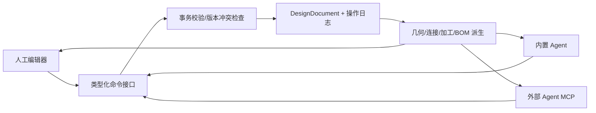

# AI 铝构件创意平台：编辑器与 Agent 协作方案（讨论稿）

> 2026-09-23 更新：本稿的首版范围和供应商假设已被用户进一步明确。实施以[首版产品方案](2026_09_23_agent_native_aluminum_platform_product_spec.md)及[首版技术方案](2026_09_23_agent_native_aluminum_platform_technical_architecture.md)为准。

日期：2026-09-23。目标是先确定产品与数据契约，再扩展当前 `adhoc_jobs/aluminum_editor_demo/`。本稿不代表三家竞品的所有功能均已实操通过；编辑入口与能力的证据边界见[编辑能力对比](aluminum_editor_capability_comparison_20260923.md)。

## 1. 产品边界与借鉴对象

平台以可购买、可加工的铝型材装配设计为核心。用户可从空白画布或模板开始，用自然语言生成或修改结构，再手工精修、分享可继续编辑的作品。3D 场景、尺寸、连接、加工和 BOM 应来自同一设计数据，避免“图形改了，物料没变”。

| 参照对象 | 借鉴的能力 | 当前证据与边界 |
| --- | --- | --- |
| [嘉立创 FA 型材/配件](https://xc.jlcfa.com/profile-accessory-list)、[工艺参数](https://xc.jlcfa.com/process) | 供应商型材系列、规格/表面处理、连接件、加工规则与材料清单 | 官方目录和工艺页可核对 6063-T5、长度公差、端面攻牙、孔和连接件适配。具体 SKU、库存、价格持续变化，需单独同步与标记来源。 |
| [乐玩 DIY 编辑器](https://www.lewandiy.com/editor) | 快速搭建与自由编辑：多选、吸附、移动/旋转/镜像/复制、对齐、整体拉伸；型材/连接/板材/配件面板；清单和图纸导出 | 2026-09-23 检查到控件与菜单；部分自动功能标 PRO，复杂编辑后的联动准确性未验证。 |
| [80/20 IdeaBuilder](https://ideabuilder.io/)、[官方功能页](https://8020.net/ideabuilder) | Box/Door 等标准构型器、SKU 选型、连接方式、面板/脚轮、实体树/属性、装配清单和图纸 | 实际页面可见构型器与控件；自动五金、加工、BOM、STEP 等由官方功能页描述，本次未逐项完成导出。 |
| [ChatCut Agent Plugin](https://chatcut.io/docs/agent-plugin)、[官方插件仓库](https://github.com/ChatCut-Inc/agent-plugin) | Agent 用结构化工具修改同一项目，浏览器编辑器在 Agent 侧实时打开，人可接续编辑 | 官方文档说明支持 Codex/Claude Code 等桌面 Agent，并使用 hosted MCP；不应把它简化成 Agent 只模拟点击网页。 |

## 2. 材料和供应商数据

先建**内部工程语义**，再映射嘉立创 FA 物料，避免供应商 SKU 直接成为设计对象的唯一身份。

- `CatalogProfile`：内部 ID、供应商/供应商 SKU、系列/槽型/截面尺寸、截面几何、可选表面处理、标准长度和来源版本。截面数据用于准确渲染及槽面定位；外观 mesh 只是可替换缓存。
- `CatalogPart`：角码、螺栓、螺母、脚轮等，以及其兼容的槽宽、系列、连接方式。
- `ProcessRule`：可进行的切割、端面攻牙、沉头孔、扳手孔等加工及参数范围、匹配条件；规则附来源和生效版本。以[嘉立创公开工艺参数](https://xc.jlcfa.com/process)为参考，遇到未覆盖规格返回“待确认”，不能默认可制造。
- `SupplierOffer`：价格、库存、交期、购买链接和抓取时间，独立于设计数据；报价过期时提示刷新。尚未验证嘉立创提供可用的公共编辑/报价 API，不能把自动下单写进第一阶段承诺。
- 项目保存 `catalogVersion` 与原 SKU 映射。目录更新后先展示“哪些型材已下架/工艺规则已变”，经用户确认再迁移项目，历史 BOM 仍可复现。

第一批只做一个可用闭环：常见 2020/2040、3030/3060、4040 系列和对应连接件/加工；具体 SKU 逐项校对后录入。全目录同步、实时价格/下单依赖合法数据来源和接口合作，单列后续阶段。

## 3. 编辑器的信息结构

| 区域 | 基础交互 | 对齐来源 |
| --- | --- | --- |
| 顶部 | 项目/版本、保存、撤销重做、视图、测量、设计校验、导出 | 三家共同的编辑主流程 |
| 左侧材料与创建 | 型材/连接件/加工/面板/门/抽屉/配件，按系列筛选；单根、矩形框架/箱体构型器 | 嘉立创的物料分类，乐玩的快速搭建，IdeaBuilder 的 Box/Door Creator |
| 中央 3D 画布 | 点选/多选/框选、移动/旋转/复制/镜像、吸附/对齐、尺寸标注、可见性、相机视角 | 乐玩自由编辑和 IdeaBuilder 拖放吸附 |
| 右侧上下文 | 构件树、参数属性、连接/加工、错误定位；下方 BOM 与版本差异 | 嘉立创构件明细，IdeaBuilder Entities/Properties |
| Agent 面板 | 需求对话、选中对象/范围、改动提案、3D 高亮、BOM 变化、警告、应用/撤销、执行记录 | ChatCut 同项目的 Agent 与编辑器并排工作形态 |

功能优先级不是照搬菜单：首版先完成型材选型、框架参数、手工编辑、连接规则、BOM、撤销与 Agent 修改同一闭环；之后加面板/门/孔加工/批量操作与图纸；抽屉、复杂五金、社区、报价/下单再扩展。菜单可以提前设计信息架构，但未实现的能力不应伪装可用。

## 4. 设计文档是唯一可写事实来源

现有 Demo 的 `Beam` 只有规格数字、长度、位姿、颜色；`makeFrame` 直接生成十二根独立梁，重新生成会失去设计意图；`summarizeBom` 仅按梁汇总。因此不能直接把当前 React/Three 状态暴露给 Agent。

建议的最小模型：

```text
DesignDocument { id, revision, catalogVersion, units, assemblies[], parts[], joints[], constraints[] }
Assembly       { id, kind: frame|box|free, parameters, childIds[], overrides[] }
Part           { id, kind: profile|panel|hardware, catalogRef, geometryParameters, placement }
Joint          { id, partA/anchorA, partB/anchorB, method, hardwareIds[], processIds[] }
ProcessFeature { id, targetPartId, type, dimensions, position, ruleRef }
```

“框架外宽 900 mm”是 `Assembly` 参数；横梁长度/位置由求解器根据截面、连接方式计算。“用户单独改一根梁”记录显式 override，并在随后整体改宽时提示是否保持该局部修改。每个构件、连接、加工都有稳定 ID。面板厚度、固定边以及门铰接等也需成为语义对象，不能只在 Three 场景里挂 mesh。

从 `DesignDocument + CatalogSnapshot` 派生 3D、尺寸、连接/孔位、BOM、校验结果、导出数据。几何内核初期可使用规则化参数求解和 Three.js 渲染；尚不需要完整通用 CAD 约束求解器。遇到无可用连接件、长度/工艺超界、碰撞或未建模规则时返回结构化诊断，不能“猜一个看着合理的结构”。

## 5. 人和 Agent 共用命令内核



画布拖动和属性输入都转成同一命令，例如 `CreateFrame`、`SetAssemblyDimensions`、`AddProfile`、`ReplaceProfileSku`、`MoveParts`、`ConnectParts`、`AddPanel`、`AddProcessFeature`、`DeleteParts`。每个命令规定输入 schema、前置条件、影响对象、失败原因和撤销行为。应用时携带 `expectedRevision` 与幂等键；命令按项目事务串行提交，防止 Agent 覆盖人工刚做的修改。外部 Agent 的 MCP 是这套应用服务的适配层，而不是独立实现编辑逻辑。

Agent 的基本流程：读取当前设计、材料目录和选中范围 → 生成一组命令 → 在副本上 `preview` → 展示 3D 差异、受影响构件、BOM 差异和制造警告 → 用户应用后提交 → 画布订阅同一项目新 revision。低风险动作可按用户偏好自动提交；影响加工、报价、导出等步骤应明确显示后果。浏览器页面可在 Agent 工作区内打开，用于观察和手工接续；DOM 自动化作为兼容路径，核心操作走结构化命令。

首版支持“一个人 + 一个 Agent”。多 Agent 以后可分别提出设计、校验、材料替代方案，但所有写入仍经过同一命令/版本机制；先不引入独立的多 Agent 编排系统。

## 6. 范围与验收

1. **工程内核与人工闭环**：目录最小子集、设计文档、框架/单根编辑、连接与 BOM 派生、命令/撤销、保存/重载。画布只负责显示和交互意图。
2. **Agent 闭环**：内置对话调用读取/预览/提交工具；同一批命令可包装为外部 MCP；Agent 工作区打开同一设计 URL 并看到修订。先做“改已有模板”，再做“从需求生成初稿”。
3. **制造和作品**：面板/门、孔加工、图纸、版本分享与 fork；供应商报价/订单在拿到稳定接口和授权后接入。

统一验收任务：从 `900 × 500 × 750 mm` 的型材桌架，把外宽/深/高改为 `850 × 450 × 900 mm`，改粗四角立柱，保留下层净空、面板和连接方式。分别用人工与 Agent 操作，验证两条路径得到同一设计结构；连接/孔位、尺寸、BOM 一致；无法满足时给出具体冲突；保存/重载、撤销和并发编辑不丢改动。还需在真实嘉立创目录中逐项核对所用 SKU 与工艺。

## 7. 需共同确定的产品取舍

1. **供应商范围**：建议首版以嘉立创 FA SKU 为主要物料来源，但内部模型保留多供应商映射，避免日后模板被单一 SKU 锁死。
2. **首版主路径**：建议先“模板改型 + 工程闭环”，自然语言从零生成限制在标准框架/箱体；任意创意结构放后续。
3. **Agent 入口**：建议同一内核同时提供内置对话和外部 MCP，外部 Agent 可打开设计页观察与接手；第一阶段不做仅靠浏览器点击的 Agent 控制。

这些是方案建议，尚未作为实施决定。用户确认优先级后，再把它拆为数据契约和迭代任务；当前 Demo 可作画布原型，但设计内核需要重构。
