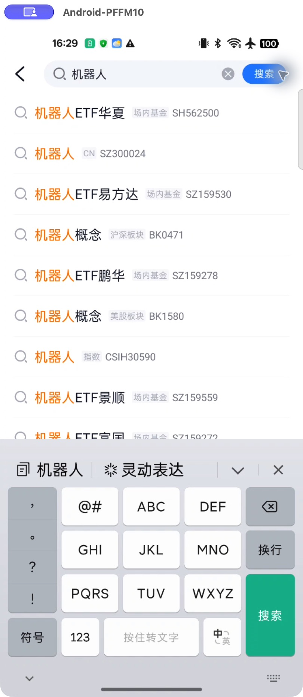

# scrcpy 接入记录｜2026-10-28

用户授权先接入 scrcpy。本次范围为安装、连接、投屏与轻量输入验证，不安装 uiautomator2，不再次更改雪球自选。

## 已完成

- 通过 Homebrew 安装 scrcpy 5.0.1；安装过程同时安装或升级其所需的 SDL、FFmpeg、编码及 USB 等依赖。
- `scrcpy --version` 正常返回，动态库加载正常。
- Android SDK ADB 检测到已授权 USB 设备，服务端日志识别为 OPPO PFFM10 / Android 15。
- 已启动 scrcpy 连接进程，关闭音频，最长边1440、最高30帧，不自动同步剪贴板。
- 创建了可重复启动脚本 `adhoc_jobs/android_control/start_scrcpy.sh`，并通过 zsh 语法检查；通过进程环境复用现有 SDK ADB，不修改全局 PATH。

## 实机核验结果

初次启动时手机电源状态为 Dozing，系统 Keyguard 显示锁定；用户随后自行解锁。未尝试绕过锁屏或读取解锁凭据。

纯 CLI 进程未被当前 macOS 桌面控制工具识别。创建 `~/Applications/Android投屏.app`：复制 Homebrew 的 scrcpy 二进制，增加本机启动器与 Info.plist，明确传入现有 ADB 和 scrcpy-server 路径。未另行下载第三方二进制。桌面入口元数据和二进制哈希记录在 `desktop_entry.json`。

通过原生桌面控制绑定该 App 后，已经实际核验：

1. 窗口 `Android-PFFM10` 显示手机实时画面。
2. 通过窗口鼠标点击，从雪球其他页切换到自选，并进入搜索。
3. 通过桌面窗口的普通粘贴输入“机器人”，三个字完整进入手机搜索框，已读取截图确认；没有通过逐字拼音注入代替此次粘贴测试。
4. 清除测试输入，通过右键返回到雪球自选页。

窗口保持打开。配置为最高30帧，不将该配置等同实际帧率测量；本次未进行性能基准测试。未修改任何证券分组或执行交易，也没有安装后续 uiautomator2 方案。

## 官方资料

- 安装：https://github.com/Genymobile/scrcpy/blob/master/doc/macos.md
- 快捷键：https://github.com/Genymobile/scrcpy/blob/master/doc/shortcuts.md
- 剪贴板：https://github.com/Genymobile/scrcpy/blob/master/doc/control.md
