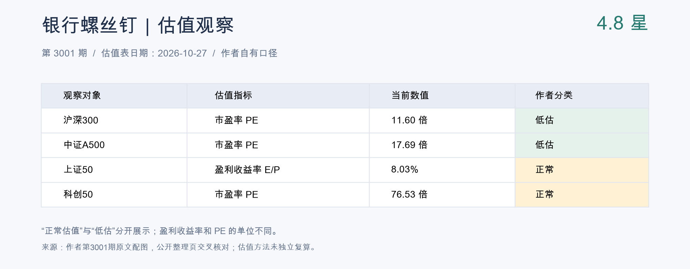

# A 股晨报｜ETF、上证与科创

2026-10-28 · 完整版。按北京时间09:00盘前口径，行情截至2026-10-27收盘。本次盘前口径报告在当日补充完成，不使用10月28日盘中行情。

**螺丝钉整体4.8星：估值吸引力提高，尚未到你的5星重点观察线。** 星级是作者衡量市场整体估值和投资价值的指标：星越高，代表其口径下投资价值越高；它既不是基金质量评分，也不代表短期上涨概率或收益保证。最新一期为10月27日第3001期，较前一期4.7星提高0.1星，距离你选定的5星线还有0.2星。整体星级与单个指数的低估／正常分类要分别看。结合你空仓、计划50万元的状态，今天继续等待并准备分批方案；科创50仍属作者正常估值区，暂不作为默认首笔。[星级及估值表原文](https://www.sina.cn/news/detail/5358751491031596.html)

## 今天对你最重要的事

1. **5星观察线｜尚未触发，继续等待并准备分批方案。** 你已确认A股空仓、计划资金50万元、回撤容忍度按30%理解。最新核验的整体估值为4.8星，较前一期4.7星上升0.1星，距你的5星重点观察线差0.2星。达到5星时会重点提醒，先评估首笔方案；当前没有已批准的首笔金额或仓位比例。[银行螺丝钉第3001期](https://www.sina.cn/news/detail/5358751491031596.html)
2. **首笔候选｜先比较宽基，科创暂不作为默认首笔。** 作者口径下，沪深300、A500为低估，上证50、科创50为正常。科创50近20交易日下跌24.45%，收盘低于60日均线约20.60%；跌幅大与估值低分别判断。下一步是核实资金持有期限、现金保留与目标指数估值，再给可审阅的金额草案。[估值原文↗](https://www.sina.cn/news/detail/5358751491031596.html) · [均线计算↓](./trend_metrics.json)
3. **作者对照｜估值改善与趋势风险同时存在。** 银行螺丝钉强调估值和盈利更新，群同步作者仍谨慎看科技反弹；两者不能直接合并为共同买入信号。09:01后的作者补充已与盘前材料分开。[群内作者摘要与消息索引](./sources/feishu_author_digest.json)

## 市场与 ETF

| 观察对象 | 收盘（指数：点；ETF：元） | 当日涨跌 | 近20交易日变化 |
|---|---:|---:|---:|
| 上证指数 [行情↗](https://web.ifzq.gtimg.cn/appstock/app/fqkline/get?param=sh000001,day,,,80,qfq) | 3,648.30 | -1.33% | -7.64% |
| 上证50 [行情↗](https://web.ifzq.gtimg.cn/appstock/app/fqkline/get?param=sh000016,day,,,80,qfq) | 2,746.79 | -0.80% | -4.84% |
| 沪深300 [行情↗](https://web.ifzq.gtimg.cn/appstock/app/fqkline/get?param=sh000300,day,,,80,qfq) | 4,049.55 | -1.32% | -10.79% |
| 科创50 [行情↗](https://web.ifzq.gtimg.cn/appstock/app/fqkline/get?param=sh000688,day,,,80,qfq) | 1,252.28 | -4.81% | -24.45% |
| 上证50ETF · 510050 [行情↗](https://web.ifzq.gtimg.cn/appstock/app/fqkline/get?param=sh510050,day,,,80,qfq) | 2.862 | -0.56% | -4.66% |
| 沪深300ETF · 510300 [行情↗](https://web.ifzq.gtimg.cn/appstock/app/fqkline/get?param=sh510300,day,,,80,qfq) | 4.123 | -1.34% | -10.53% |
| 科创50ETF · 588000 [行情↗](https://web.ifzq.gtimg.cn/appstock/app/fqkline/get?param=sh588000,day,,,80,qfq) | 1.320 | -4.42% | -24.53% |

区间为2026-09-21至10-27，共21个收盘观测点、20个收益间隔。指数使用价格指数，ETF使用接口前复权日线；前复权未核验为分红再投资总收益。区间变化不等于最大回撤。

[腾讯财经日线来源示例](https://web.ifzq.gtimg.cn/appstock/app/fqkline/get?param=sh000001,day,,,80,qfq)；完整链接与数据在同目录market.json及原始响应中。上证、沪深300、科创50的收盘与单日涨跌和[10月27日雪球收评](https://www.xueqiu.com/2141023190/414105647)一致，均为第三方数据。ETF份额、净申购和溢价率本期未取得独立核验数据。

## 当日估值表

**整体4.8星。** 先看主观察方向对照；作者当日全部27个低估品种保留在下方折叠名单中。

### 主观察方向对照

[来源：作者原文↗](https://www.sina.cn/news/detail/5358751491031596.html) · [估值原图↓](./sources/3001_first.jpg)

上图保留沪深300、A500与上证50、科创50的对照，方便区分低估和正常。整体4.8星来自作者原图，不采用整理页4.81的额外精度。上证指数000001没有可核对的本期估值行，不能拿上证50代替。同篇养老估值图自身日期为10月26日，本期不混入当日常规表。详细来源校验见[补全记录](lsd_update.md)。

### 全部低估品种：27项

[来源：作者原文↗](https://www.sina.cn/news/detail/5358751491031596.html) · [完整估值原图↓](./sources/3001_first.jpg) · [结构化数据↓](./valuation_cheap.json)

| 指数 | 指数代码 | 估值指标 | 当日估值 |
|---|---|---|---:|
| 中证全指 | CSI000985 | 市盈率 | 15.17倍 |
| 中证800 | SH000906 | 市盈率 | 14.16倍 |
| 中证500 | SH000905 | 市盈率 | 23.90倍 |
| 沪深300 [行情↗](https://web.ifzq.gtimg.cn/appstock/app/fqkline/get?param=sh000300,day,,,80,qfq) | SH000300 | 市盈率 | 11.60倍 |
| 中证A50 | CSI930050 | 市盈率 | 15.72倍 |
| MSCI质量 | MI707717L | 市盈率 | 23.52倍 |
| 中证A500 | CSI000510 | 市盈率 | 17.69倍 |
| 中证红利低波 | CSIH30269 | 盈利收益率 | 11.09% |
| 优选300 | CSI931069 | 盈利收益率 | 10.54% |
| 自由现金流 | CSI932365 | 市盈率 | 10.76倍 |
| 沪港深红利低波 | CSI931157 | 盈利收益率 | 10.52% |
| 中证价值 | CSI931052 | 市盈率 | 10.75倍 |
| 中证A100 | SH000903 | 市盈率 | 14.74倍 |
| 中证红利 | SH000922 | 盈利收益率 | 10.21% |
| 沪港深消费50 | CSI931357 | 市盈率 | 24.63倍 |
| 中证白酒 | 399997 | 市盈率 | 21.66倍 |
| 食品饮料 | CSI930653 | 市盈率 | 23.56倍 |
| 中证消费 | 000932 | 市盈率 | 24.14倍 |
| 生物科技 | CSI930743 | 市盈率 | 50.48倍 |
| 消费红利 | CSIH30094 | 市盈率 | 21.38倍 |
| 中证医疗 | 399989 | 市盈率 | 49.25倍 |
| 消费龙头 | CSI931068 | 市盈率 | 22.10倍 |
| 恒生消费 | HKHSCGSI | 市盈率 | 13.82倍 |
| 消费50 | CSI931139 | 市盈率 | 22.03倍 |
| 证券行业 | 399975 | 市净率 | 1.52倍 |
| 医药100＊ | 000978 | 市盈率 | 28.27倍 |
| 港股科技 | CSI931573 | 市盈率 | 31.22倍 |

＊医药100：作者原图为绿色、整理页接口标为低估；整理页自身的阈值计算却显示正常，存在口径差异。本表保留作者低估分类，不把它排除，也不据此独立认定已达到买入条件。

市盈率PE、市净率PB以“倍”计，盈利收益率E/P以“%”计。不同指标的数值不能直接横向排序；没有将整理页的阈值位置当历史估值分位。

**对你的用途：这27项是完整研究池，不是50万元要买入的27只基金。** 消费、红利、医药等指数之间可能重叠。后续达到整体5星观察线时，仍从预算、持有期限、估值和分散程度出发筛选首笔；宽基研究候选与行业／港股候选分别判断。

[完整低估数据及口径](./valuation_cheap.json) · [作者完整常规估值原图](./sources/3001_first.jpg) · [作者第3001期原文](https://www.sina.cn/news/detail/5358751491031596.html) · [公开整理页](https://yzb.yhlsd.com/)。整理页运营归属未核实，作者原图为优先依据。

## 我的状态与下一步动作

你已确认A股/ETF空仓、计划投资资金50万元、回撤容忍度按30%理解，并选择银行螺丝钉整体5星作为重点观察线。持有期限、每月新增资金和回撤统计范围尚未确认；这些缺项会影响权益仓位和分批节奏。此前美股讨论的加仓阈值不套用于A股。

| 今天要回答的问题 | 当前证据 | 对你的动作含义 |
|---|---|---|
| 是否达到我的重点观察线？ | 整体4.8星，低于5星；较前一期4.7星上升0.1星 [本期↗](https://www.sina.cn/news/detail/5358751491031596.html) · [前期↗](https://www.sina.cn/news/detail/5358391119841336.html) | 尚未触发。继续等待，准备投入方案，不把0.2星差距换算成指数还需下跌多少 |
| 是否所有指数都便宜？ | 沪深300、A500属于作者低估区；上证50、科创50属于正常区 [原文↗](https://www.sina.cn/news/detail/5358751491031596.html) | 达到整体5星后仍逐项筛选，不把全市场星级当每只ETF的评级 |
| 本次调整主要在哪里？ | 近20交易日科创50跌24.45%，上证50跌4.84% [数据↓](./market.json) | 科创波动明显更大；不将50万元首笔方案集中押在科创方向 |
| 今天需要准备什么？ | 资金预算已知，持有期限和投入节奏未定 | 确认这笔钱几年内不用、保留多少现金，再决定首笔金额；本期不下达买卖数量 |

30%是你的风险约束，不是策略能保证的最大跌幅。若50万元全部投入，30%的跌幅约对应15万元账面损失，仅帮助理解金额尺度。需要进一步明确：30%指整个投资账户（含现金）的回撤，还是已投入权益资金的回撤，以及从成本还是从账户高点计算。

## 5星触发后如何行动

**5星只触发重点评估，不自动等于买入。** 达到后按下列顺序给出结论，避免只汇总作者文章。

| 阶段 | 检查内容 | 日报给出的下一步 |
|---|---|---|
| 当前：4.8星 | 当日作者原文、估值表日期、目标指数低估与否 | 等待观察线，准备候选和现金安排 |
| 首次达到或超过5星 | 是否为新一期有效数据；沪深300/A500等候选是否仍低估；盈利更新是否改变判断 | 重点提醒，并提出可审阅的首笔分批方案，列金额、占50万元比例和主要反证 |
| 资金期限与分批规则确认后 | 现金保留、权益总额度、首笔和后续批次、同一条件重复触发怎么办 | 才把方案纳入个人执行清单，成交仅在你明确反馈后登记 |
| 星级下降或指数反弹 | 是价格修复、盈利变动还是作者修正；原买入条件是否仍成立 | 更新观察阶段，不因一天上涨就追买，也不虚构持仓或止盈单 |

当前没有你确认的首笔比例、目标仓位或追加条件。本报的具体投入方案后续会标为“建议草案”，与已确认规则分别展示。期望控制在30%回撤范围内，需要同时管理权益暴露和现金比例，不能只靠高星级或分批买入。

## 银行螺丝钉：最新核验观点

本次成功取得的最新一期为 **10月27日21:56，第3001期**。原文正文和当日常规估值表均已读取。以下为作者观点及自有估值口径，相关方法和资金流未独立复算。

**科创：**作者将科创50由高估调整为正常估值，并提示三季报更新会改变指数估值。正常区尚不等于低估区；其PE变化要结合盈利更新判断。[第3001期原文](https://www.sina.cn/news/detail/5358751491031596.html)

**ETF：**10月26日文提到近期沪深300、A500指数基金出现较大资金流入。后续需核对基金份额和净申购，不能仅凭作者观察推断资金身份或已确认市场底部。[第3000期原文](https://www.sina.cn/news/detail/5358391119841336.html)

**上证：**作者的整体星级覆盖沪深市场，估值对应点位会随盈利变化。因此，不能把5星套成上证指数的固定点位。[第3000期原文](https://www.sina.cn/news/detail/5358391119841336.html)

**配置：**第3001期讨论的是个人养老金内A系列指数与红利搭配。其账户与Y份额范围须保留，不能直接变成普通证券账户的ETF交易安排。[第3001期原文](https://www.sina.cn/news/detail/5358751491031596.html)

## 群内作者更新：已通过南冬CLI读取

已核验CLI用户为南冬，群名“陈老师星球内容分享”。该群是你指定的作者内容同步入口，以下按群内“星主回答／新动态”标记归属，未独立读取原知识星球正文。盘前读取范围为10月25日09:00至10月28日09:00，共26条消息，分页已完成；另读到09:00后5条补充消息。已过滤成员提问、评论、点赞和无关话题，仅保留作者相关内容的摘要。

**重远投资观本期要点：科技指数跌幅大，不代表已经出现可靠买点；技术反弹与趋势恢复需要分别判断。** 以下来自你指定群内同步的作者内容，覆盖10月27日晚及28日09:00后补充，过滤成员回复。[作者摘要与时间记录↓](./sources/feishu_author_digest.json)

| 主题与原内容时间 | 重远投资观：群同步作者摘要 | 对你空仓50万元计划的意义 |
|---|---|---|
| 科技反弹 · 10月27日19:00、19:09 | 反弹高度和持续性尚不确定，较大均线乖离不保证反弹成功 [来源记录↓](./sources/feishu_author_digest.json) | 不能只因科创50跌幅大就优先投入 |
| 参与方式 · 10月27日20:13 | 不熟悉短线反弹交易的人，可以等待更充分的调整 [来源记录↓](./sources/feishu_author_digest.json) | 先明确资金期限、现金保留和分批方案；你的短线经验尚未确认 |
| 趋势纪律 · 10月27日22:15 | 强调科创50、创业板的60日线纪律；其他震荡类指数不机械套用 [来源记录↓](./sources/feishu_author_digest.json) | 科技方向单独观察，不把该规则直接变成沪深300的统一买卖条件 |

本期已读更新没有提供可直接执行的ETF代码、买入金额或仓位计划。下文个人动作是本报结合你已确认条件作出的研究判断，不作为作者交易指令。

作者所述资金行为、历史极值与概率属于其判断，本报未验证为普遍有效的统计规律。群内同期有机器人故障提示，API窗口读取完整不代表原星球资料完整；一张截图未用于本期A股判断。

### 用行情核对：价格与趋势是另一条观察轴

| 指数 | 10月27日收盘 | 60交易日均线 | 距均线 |
|---|---:|---:|---:|
| 上证指数 [行情↗](https://web.ifzq.gtimg.cn/appstock/app/fqkline/get?param=sh000001,day,,,80,qfq) | 3648.30 | 3866.12 | -5.63% |
| 上证50 [行情↗](https://web.ifzq.gtimg.cn/appstock/app/fqkline/get?param=sh000016,day,,,80,qfq) | 2746.79 | 2869.93 | -4.29% |
| 沪深300 [行情↗](https://web.ifzq.gtimg.cn/appstock/app/fqkline/get?param=sh000300,day,,,80,qfq) | 4049.55 | 4477.43 | -9.56% |
| 科创50 [行情↗](https://web.ifzq.gtimg.cn/appstock/app/fqkline/get?param=sh000688,day,,,80,qfq) | 1252.28 | 1577.27 | -20.60% |

均线使用本报已保存的腾讯指数价格日线，按最近60个交易日收盘算术平均独立计算；数据截至10月27日。科创50乖离较大，只说明其距均线较远，不自动形成反弹买点。上表其他指数均线仅作背景，不等于群作者建议对它们执行同一趋势规则。

### 两位作者对照：银行螺丝钉与重远投资观

| 对照项 | 银行螺丝钉：10月27日本期 | 重远投资观：群同步 | 对你的动作含义 |
|---|---|---|---|
| 主要观察角度 | 整体4.8星，关注估值与盈利更新 [原文↗](https://www.sina.cn/news/detail/5358751491031596.html) | 强调科技趋势与反弹失败风险 [来源记录↓](./sources/feishu_author_digest.json) | 估值改善与趋势风险可以并存；不能直接合并为共同买入信号 |
| 科创50是否优先投入 | 正常估值，尚非低估买入信号 [原文↗](https://www.sina.cn/news/detail/5358751491031596.html) | 跌幅大和较大乖离不能替代买点，强调趋势纪律 [来源记录↓](./sources/feishu_author_digest.json) | 暂不作为默认首笔；后续分别核验估值和趋势 |
| 沪深300、A500 | 作者归为低估，前一期观察到基金资金流入 [本期↗](https://www.sina.cn/news/detail/5358751491031596.html) · [前期↗](https://www.sina.cn/news/detail/5358391119841336.html) | 本期已读内容未给这两项明确交易安排；不机械套用科技趋势规则 [来源记录↓](./sources/feishu_author_digest.json) | 列为研究候选；需分别核验估值与科技趋势纪律的适用范围 |
| 整体5星与首笔计划 | 星级提供估值观察；5星是你选定的重点评估线 [原文↗](https://www.sina.cn/news/detail/5358751491031596.html) | 已读更新未提供可直接对应的5星规则、金额或仓位 [来源记录↓](./sources/feishu_author_digest.json) | 当前4.8星继续等待；到5星再提出金额、比例、现金保留及反证齐全的草案 |

### 当前买入条件与仓位：哪些可以比较

| 问题 | 银行螺丝钉 | 重远投资观 | 对你空仓50万元的含义 |
|---|---|---|---|
| 何时考虑买入？ | 本期给4.8星及分指数估值，整体5星是你自定重点评估线 [本期↗](https://www.sina.cn/news/detail/5358751491031596.html) | 已读观点谨慎看科技反弹，强调趋势纪律 [群同步记录↓](./sources/feishu_author_digest.json) | 估值、趋势、已有持仓成本分别检查，不能见到作者买入就照搬 |
| 买入是新增风险还是换仓？ | 本期养老金搭配有特定账户与份额背景 [本期↗](https://www.sina.cn/news/detail/5358751491031596.html) | 已读内容未给完整调仓安排 [群同步记录↓](./sources/feishu_author_digest.json) | 你是空仓新资金；先确定权益总额度与现金，不直接复制老组合换仓 |
| 现在该配多少？ | 本次资料不能确定其普通证券账户当前总仓位 | 已读更新无可执行的金额、现金比例及完整仓位 | 不能推断两位作者建议统一仓位；你的首笔比例仍待方案确认 |

**一致与差异如何理解：**螺丝钉的估值改善与重远对科技趋势的谨慎并不矛盾，也没有足够证据说二者发出了相反交易指令。以上“对你的动作含义”为本报研究判断。

### 重远09:00后补充：不混入盘前判断

**10月28日09:01**的新动态再次强调：下行趋势中的反弹与趋势恢复不同，本次反弹能否成功尚不确定。[09:01来源记录↓](./sources/feishu_author_digest.json) **11:22**的回答指出，盈利有支撑的成分股也可能随指数卖出承压，盈利吸引力仍需与短期下跌风险分别考虑。[11:22来源记录↓](./sources/feishu_author_digest.json)两条用于更新风险观察，不改变目前4.8星尚未达到你5星观察线的事实。[作者摘要与时间记录↓](./sources/feishu_author_digest.json)

[已筛选作者摘要与消息索引](sources/feishu_author_digest.json)保留消息ID、原内容时间和同步时间，不包含成员提问或个人资料。每日报告沿用这套筛选口径，只增量纳入作者有实质变化的更新。

## FiNews补充：只保留影响你决策的信息

[FiNews A股日报](https://a.finews.fyi/)纳入补充来源，负责发现盘面和ETF资金线索。具体星级与投资计划仍回查作者原文，关键报价仍用未四舍五入的行情序列核验。

| 本次信息 | 对你的用途 | 核验状态 |
|---|---|---|
| 10月27日主要指数普跌，沪深成交额1.46万亿元、较前一日减少1478亿元 [财联社↗](https://finance.eastmoney.com/a/202610273909986024.html) | 说明当前市场承接偏弱，补充等待与分批评估的背景；缩量本身不能确认底部 | 主要指数与本报序列一致；成交额及缩量数与财联社原报道一致 |
| 科创50ETF截至10月26日近一周净流入近240亿元 [报道↗](https://finance.sina.com.cn/stock/marketresearch/2026-10-27/doc-iniwsfqu7015597.shtml) | 作为资金承接线索，不能抵消科创50仍属正常估值的事实 | 已读中证网经新浪转载的原报道，属Wind引用口径，未独立复算基金份额 |
| 页面“成交热度2%” [FiNews↗](https://a.finews.fyi/) | 仅是成交额在近250个交易日中的百分位 | 不等于估值低分位或螺丝钉高星级，不用作买入条件 |

来源：[财联社10月27日复盘](https://finance.eastmoney.com/a/202610273909986024.html)、[科创50ETF资金报道](https://finance.sina.com.cn/stock/marketresearch/2026-10-27/doc-iniwsfqu7015597.shtml)。

本次发现FiNews的510300日跌幅为-1.41%，而本报未四舍五入前复权日线为-1.34%，该差异尚未解决，不能当两份完全一致的行情证据。另有一条机构持股新闻标题与摘要中的机构名称不一致，日历里“明日”等相对时间也需转换并回查官方日程。页面摘要只作为线索，暂不直接用于动作判断。个股热榜、连板和无关行业新闻不进入你的主报告。

## ETF事件与下一项观察

近期背景：上海市委金融办10月20日转载上交所首批主动ETF于10月19日获批的消息，属于首期资料基线，不是今天新增。研究时区分主动ETF与被动指数ETF，也不据获批推断产品已上市。[官方消息](https://jrj.sh.gov.cn/SC212/20261020/0543fb886c54411e9eb312da77651ae9.html)

| 方向 | 接下来核查什么 |
|---|---|
| 科创50及588000 | 三季报更新后的盈利与PE；正常估值区是否变化 |
| 沪深300、A500基金 | 基金份额及净申购是否支持作者的资金流入观察 |
| 上证及大盘蓝筹 | 相对抗跌能否持续；避免用全市场星级机械换算上证点位 |
| 两位作者 | 新文、新估值表、实质观点变化；区分核验失败与无更新 |

本期按你确认的空仓、50万元计划资金、30%回撤容忍度和整体5星重点观察线组织。具体持有期限与仓位方案仍待确认，尚无交易执行。

## 每日交付与来源状态

每天北京时间09:00在当前聊天交付完整HTML晨报（图表内嵌，可离线阅读），聊天给出简短观察与HTML链接。内容首先回答你的个人阶段、5星观察线是否触发和下一步动作，再给指数变化、各指数估值及作者分歧、必要事件和下次触发条件。FiNews作补充信源，只有影响你决策的信息才纳入。报告归档本目录对应日期，HTML为主要阅读产物，Markdown和原始来源保留用于核验。已增加群内作者更新及其与银行螺丝钉的对照。休市日简报，缺数据不补画。自动任务a-etf保持ACTIVE，首次定时执行效果待运行验证。

版式与“美股投资”日报保持一致：报刊式页眉与日期、置顶目录、今日判断、四指数横栏、首页三项重点、主观察表和估值图。详细作者材料、触发规则与来源默认折叠；图表可放大，支持打印/保存PDF。HTML生成直接复用美股日报CSS和交互脚本，保持独立市场数据与判断规则。
