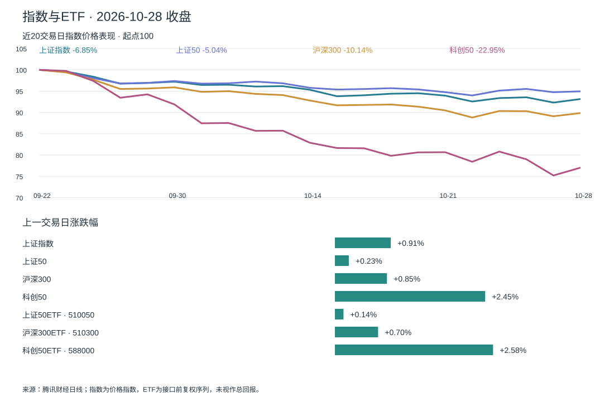
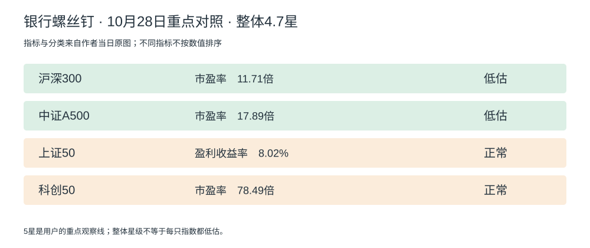

# A 股晨报｜ETF、上证与科创

2026-10-29 · 北京时间09:00盘前口径，行情截至2026-10-28收盘；本次09:05开始补齐交付，不含10月29日盘中数据。群消息截点为09:00。

**螺丝钉整体4.7星，较前一期下降0.1星，距你的5星观察线还有0.3星：今天继续等待并准备方案。** 星级衡量作者口径下的整体估值与投资价值，越高代表其口径下投资价值越高；不是基金质量评分、短期上涨概率或收益保证。10月28日第3002期正文明确为4.7星，不能采用整理页4.75的额外精度。你目前A股/ETF空仓、计划资金50万元；昨日反弹并未触发你选定的观察条件。[本期原文↗](https://www.sina.cn/news/detail/5359112091341831.html) · [前期4.8星↗](https://www.sina.cn/news/detail/5358751491031596.html)

## 今天对你最重要的事

1. **5星尚未触发，不因一天反弹改变入场规则。** 上证涨0.91%，科创50涨2.45%；整体星级回落至4.7。下一步先确定50万元多久不用、保留多少现金，再准备首笔研究草案；当前没有你批准的买入比例。[作者原文↗](https://www.sina.cn/news/detail/5359112091341831.html) · [行情数据↓](./market.json)
2. **科创反弹仍在60日线下方。** 收盘1282.93点，独立实算MA60为1570.42点，乖离-18.31%（前一交易日-20.60%）；近20交易日仍跌22.95%。距均线收窄不等于趋势恢复，作者原图科创50仍为正常估值，暂不作为默认首笔。[均线计算↓](./trend_metrics.json) · [估值原图↓](./sources/3002_valuation.jpg)
3. **完整低估表按作者原图保留21项。** 辅助整理页显示27项，其中6项未出现在作者本期原图中；本期不把辅助数据多出的行混入“作者全部低估”。原图绿色区域与整理页阈值仍有医药100分类差异，已在折叠表标注。[原图↓](./sources/3002_valuation.jpg) · [低估数据与差异↓](./valuation_cheap.json)

## 市场与 ETF

| 观察对象 | 收盘（指数点；ETF元） | 当日涨跌 | 近20交易日变化 |
|---|---:|---:|---:|
| 上证指数 [行情↗](https://web.ifzq.gtimg.cn/appstock/app/fqkline/get?param=sh000001,day,,,80,qfq) | 3,681.47 | +0.91% | -6.85% |
| 上证50 [行情↗](https://web.ifzq.gtimg.cn/appstock/app/fqkline/get?param=sh000016,day,,,80,qfq) | 2,753.01 | +0.23% | -5.04% |
| 沪深300 [行情↗](https://web.ifzq.gtimg.cn/appstock/app/fqkline/get?param=sh000300,day,,,80,qfq) | 4,083.87 | +0.85% | -10.14% |
| 科创50 [行情↗](https://web.ifzq.gtimg.cn/appstock/app/fqkline/get?param=sh000688,day,,,80,qfq) | 1,282.93 | +2.45% | -22.95% |
| 上证50ETF · 510050 [行情↗](https://web.ifzq.gtimg.cn/appstock/app/fqkline/get?param=sh510050,day,,,80,qfq) | 2.866 | +0.14% | -4.94% |
| 沪深300ETF · 510300 [行情↗](https://web.ifzq.gtimg.cn/appstock/app/fqkline/get?param=sh510300,day,,,80,qfq) | 4.152 | +0.70% | -9.99% |
| 科创50ETF · 588000 [行情↗](https://web.ifzq.gtimg.cn/appstock/app/fqkline/get?param=sh588000,day,,,80,qfq) | 1.354 | +2.58% | -22.98% |

图表基期2026-09-22至10-28，共21个收盘点、20个收益间隔。指数为价格指数，ETF为接口前复权日线，未证明为分红再投资总回报；区间变化不等于最大回撤。[完整数据↓](./market.json)

上证、科创50收盘及日涨幅与公开收评一致。[新华财经科创收盘报道↗](https://finance.sina.com.cn/jjxw/2026-10-28/doc-iniwukpw3342633.shtml) · [东方财富收评↗](https://finance.eastmoney.com/a/202610283911816369.html)。FiNews主要指数与本报一致，但其510300涨0.65%、588000涨2.27%，与腾讯日线实算0.70%、2.58%不符，未当作ETF交叉验证成功。[FiNews当期数据↗](https://a.finews.fyi/api/reports/2026-10-28)

## 当日估值表

**整体4.7星｜数据日10月28日，第3002期。** 沪深300和A500仍低估，上证50、科创50仍正常。辅助页为4.75，本报以作者当期正文4.7为准。[原文↗](https://www.sina.cn/news/detail/5359112091341831.html)

### 主观察方向对照

[作者原文↗](https://www.sina.cn/news/detail/5359112091341831.html) · [完整估值原图↓](./sources/3002_valuation.jpg)

沪深300PE11.71倍、A500PE17.89倍；上证50盈利收益率8.02%、科创50PE78.49倍。PE与盈利收益率不能直接比大小。上证指数000001未在原图单独给估值，不能用上证50代替。科创PE较前期76.53倍提高，不能只凭价格变化归因，仍需核验盈利更新。

### 全部低估品种：21项

[作者原文↗](https://www.sina.cn/news/detail/5359112091341831.html) · [当日完整原图↓](./sources/3002_valuation.jpg) · [逐项数据与差异↓](./valuation_cheap.json)

| 指数 | 代码 | 指标 | 当日估值 |
|---|---|---|---:|
| 中证红利低波 | CSIH30269 | 盈利收益率 | 11.11% |
| 沪港深红利低波 | CSI931157 | 盈利收益率 | 10.53% |
| 中证红利 | SH000922 | 盈利收益率 | 10.21% |
| 优选300 | CSI931069 | 盈利收益率 | 10.57% |
| 自由现金流 | CSI932365 | 市盈率 | 10.76倍 |
| 中证价值 | CSI931052 | 市盈率 | 10.87倍 |
| 沪深300 | SH000300 | 市盈率 | 11.71倍 |
| 中证800 | SH000906 | 市盈率 | 14.33倍 |
| 中证A100 | SH000903 | 市盈率 | 14.89倍 |
| 中证全指 | CSI000985 | 市盈率 | 15.53倍 |
| 中证A50 | CSI930050 | 市盈率 | 15.8倍 |
| 中证A500 | CSI000510 | 市盈率 | 17.89倍 |
| 消费50 | CSI931139 | 市盈率 | 21.98倍 |
| 消费龙头 | CSI931068 | 市盈率 | 22.17倍 |
| 医药100＊ | 000978 | 市盈率 | 28.31倍 |
| 中证消费 | 000932 | 市盈率 | 23.86倍 |
| 中证500 | SH000905 | 市盈率 | 24.37倍 |
| 中证白酒 | 399997 | 市盈率 | 21.26倍 |
| 中证医疗 | 399989 | 市盈率 | 49.7倍 |
| 港股科技 | CSI931573 | 市盈率 | 31.83倍 |
| 证券行业 | 399975 | 市净率 | 1.5倍 |

＊医药100原图绿色、辅助接口低估，但辅助页阈值计算为正常，保留作者分类并标记差异。辅助页另外列低估的6项（沪港深消费50、食品饮料、MSCI质量、消费红利、生物科技、恒生消费）未出现在本期作者原图，不能确定作者本期仍覆盖它们，未混入21项。本表是作者本期原图绿色区域全量，非所有市场指数的低估全集。[辅助原始数据↓](./sources/valuation_dashboard_data.json)

这是研究池，不是50万元需要买入的21只基金。指数之间存在成分重叠；到5星仍需筛选目标、资金期限和分散方式。盈利收益率单位为%，PE/PB单位为倍；辅助页阈值位置不当历史百分位，国债辅助字段日期较旧，不用于本期决策。

## 我的状态与下一步动作

已确认：A股/ETF空仓、计划50万元、回撤容忍度按30%理解，整体5星为重点观察线。持有期限、每月新增资金、回撤统计范围、首笔与追加比例尚未确认。

| 今天的问题 | 当前证据 | 下一步动作 |
|---|---|---|
| 是否到重点观察线？ | 整体4.7星，较上期-0.1星，距5星0.3星 [原文↗](https://www.sina.cn/news/detail/5359112091341831.html) | 继续等待；不把星差换算为指数还需跌多少 |
| 哪些方向可先研究？ | 沪深300、A500低估；上证50和科创50正常 [原图↓](./sources/3002_valuation.jpg) | 先比较宽基候选，不押注单一科技反弹 |
| 反弹改变了什么？ | 科创涨2.45%，距MA60仍-18.31% [计算↓](./trend_metrics.json) | 风险有所修复，但未形成你已确认的入场条件 |
| 现在准备什么？ | 预算已知、资金期限和权益总额度未知 | 明确资金几年内不用、保留现金、可承受损失的统计范围，再拟首笔金额 |

若50万元全投，30%跌幅约15万元；这只是风险金额尺度，不保证策略回撤不超过30%。目前没有交易执行，也没有已确认仓位计划。

## 5星触发后如何行动

首次核验达到或超过5星时，重点提醒并提出首笔分批草案，写明金额、占50万元比例、保留现金、追加条件与主要反证。资金期限未确认会限制草案可执行性。5星仅触发评估，不自动交易；同日重跑不重复称跨档。

## 银行螺丝钉：最新核验观点

最新有效估值文为10月28日21:49第3002期。作者观察成长反弹较多、价值红利短期偏弱；提出止盈后可用债券承接、将来更高星级再评估股票资金回流。后者是其策略叙述，不是给你普通证券账户的具体买入金额。[本期原文↗](https://www.sina.cn/news/detail/5359112091341831.html)

对于你的计划：星级比上一期降低，未触发5星；红利和宽基可作候选研究，但不能从作者介绍其既有策略推断其今日总仓位或让你照搬。文中书籍推广、历史调查盈利率和行情类比未作为本报交易依据。

## 群内作者更新：已通过南冬CLI读取

**重远投资观本次新增已核验的是港股科技与估值方法补充，未见新的A股明确买入或仓位安排。** CLI只读拉取10月28日09:00至29日09:00共12条消息、10条作者候选，已审阅并过滤回复与无关内容。昨日报过的09:01科技反弹与11:22盈利支撑不重复当作新消息；本次两条新摘要如下。未检出不等于作者未发布，群同步不保证原星球资料完整。[来源记录↓](./sources/feishu_author_digest.json)

| 作者原内容时间 | 新增摘要 | 对你的用途 |
|---|---|---|
| 10月28日11:41 | 作者认为估值需结合业绩与PE/PB，并区分成长、价值、周期；低估也可能伴随盈利欠佳 [来源记录↓](./sources/feishu_author_digest.json) | 科创PE变化继续核对盈利，不能把一个静态PE作为全部买入依据 |
| 10月28日11:46 | 对恒科/中概的评估强调成分变化与盈利；保守者可继续等估值或右侧条件，怕踏空者才考虑定投 [来源记录↓](./sources/feishu_author_digest.json) | 这是港股科技语境，不能直接移植到科创50；未给你确定的买入金额与仓位 |

### 用行情核对：价格与趋势是另一条观察轴

| 指数 | 10月28日收盘 | 60交易日均线 | 距均线 |
|---|---:|---:|---:|
| 上证指数 [行情↗](https://web.ifzq.gtimg.cn/appstock/app/fqkline/get?param=sh000001,day,,,80,qfq) | 3681.47 | 3863.93 | -4.72% |
| 上证50 [行情↗](https://web.ifzq.gtimg.cn/appstock/app/fqkline/get?param=sh000016,day,,,80,qfq) | 2753.01 | 2867.09 | -3.98% |
| 沪深300 [行情↗](https://web.ifzq.gtimg.cn/appstock/app/fqkline/get?param=sh000300,day,,,80,qfq) | 4083.87 | 4469.34 | -8.62% |
| 科创50 [行情↗](https://web.ifzq.gtimg.cn/appstock/app/fqkline/get?param=sh000688,day,,,80,qfq) | 1282.93 | 1570.42 | -18.31% |

使用最近60交易日指数收盘算术平均独立计算，原始日线已保存。科创从-20.60%收窄到-18.31%，只能说明离均线更近，不能推导反弹成功概率。其他指数均线仅作背景，不把重远科技纪律泛化为全部宽基规则。[计算与算法↓](./trend_metrics.json)

### 两位作者对照：当前买入条件与仓位

| 项目 | 银行螺丝钉 | 重远投资观 | 对你空仓50万元的含义 |
|---|---|---|---|
| 买入观察条件 | 整体4.7星，沪深300/A500低估；5星是你选定评估线 [原文↗](https://www.sina.cn/news/detail/5359112091341831.html) | 新增补充强调估值结合盈利；此前科技趋势风险判断未被新的A股交易指令替代 [来源记录↓](./sources/feishu_author_digest.json) | 估值与趋势分别判断，当前仍等待5星，不制造共同买入信号 |
| 科创50 | 本期正常估值PE78.49 [原图↓](./sources/3002_valuation.jpg) | 新增港股科技评论不直接适用科创50；本报实算仍低于MA60 [来源记录↓](./sources/feishu_author_digest.json) · [行情计算↓](./trend_metrics.json) | 暂不作为默认首笔；反弹与低估分别核验 |
| 仓位安排 | 本期既有股债策略叙述未给你具体仓位 [原文↗](https://www.sina.cn/news/detail/5359112091341831.html) | 本期相关更新未给可执行金额或现金比例 [来源记录↓](./sources/feishu_author_digest.json) | 先明确权益总额度、现金保留与期限；没有统一作者仓位可复制 |

以上动作含义是本报结合你确认条件的研究判断，与作者摘要区分；两位观察轴不同不代表给出相反指令。

## FiNews补充：只保留影响你决策的信息

1. **反弹与成交承接：**FiNews给沪深成交1.63万亿元、放量约1675亿元，与金十当日收评口径一致；这说明当日成交回升，不等于ETF净申购或确认底部。[金十收评↗](https://flash.jin10.com/detail/20261028150034629800) · [FiNews当期↗](https://a.finews.fyi/api/reports/2026-10-28)
2. **科技反弹仍需看盈利兑现：**科创50收盘涨2.45%，媒体报道科创板多数个股回升；本报只将其作为反弹证据，不把市场报道中的个股盈利外推为整个科创50已低估。下次仍核对指数PE及盈利变化。[新华财经科创收盘报道↗](https://finance.sina.com.cn/jjxw/2026-10-28/doc-iniwukpw3342633.shtml)

FiNews个别ETF报价涨幅与本报不同，新闻及日历线索未逐项取得原始公告的，不作为动作条件。“成交热度”属于成交额历史位置，不是估值星级。本期不复用昨日“近240亿”作为新增资金流。

## ETF事件与下一项观察

| 观察方向 | 下次核验内容 |
|---|---|
| 螺丝钉整体星级 | 新一期原文是否达到5星；本期正文与辅助页精度差异仍以作者为准 [作者入口↗](https://www.sina.cn/media/5546795997) |
| 科创50与588000 | PE和盈利更新、MA60乖离是否继续修复，ETF份额/净申购能否单独核验 [本期数据↓](./trend_metrics.json) |
| 沪深300/A500 | 分指数低估状态是否变化；用户资金期限与现金保留是否明确 [估值依据↓](./sources/3002_valuation.jpg) |
| 重远作者更新 | 仅纳入新增、与投资条件或仓位有关的作者内容；已读无新A股指令不补造结论 [来源记录↓](./sources/feishu_author_digest.json) |

## 每日交付与来源状态

今天使用10月28日收盘及29日09:00前材料，09:05启动补齐；未混入今日盘中行情。新星级4.7已核验，仍处5星线下。HTML复用美股日报CSS与交互，图表为内嵌SVG，可放大与打印；完整低估名单、作者详情默认折叠，来源紧邻内容。本期按作者原图21项出表，辅助27项差异显式保留；不复用昨天27项当今天原图全量。

飞书读取分页完成但不是原星球完整性证明；仅归档两条审核后投资摘要，不保存无关个人信息。行情源与主要指数收评交叉核验，ETF两源差异未解决。预算仍是计划资金，未发生交易。日更采集使用带显式日期的collect_market.py，拒绝数据日缺失，固定样稿脚本不作日常采集入口。[行情数据↓](./market.json) · [作者摘要↓](./sources/feishu_author_digest.json) · [低估表差异↓](./valuation_cheap.json)
