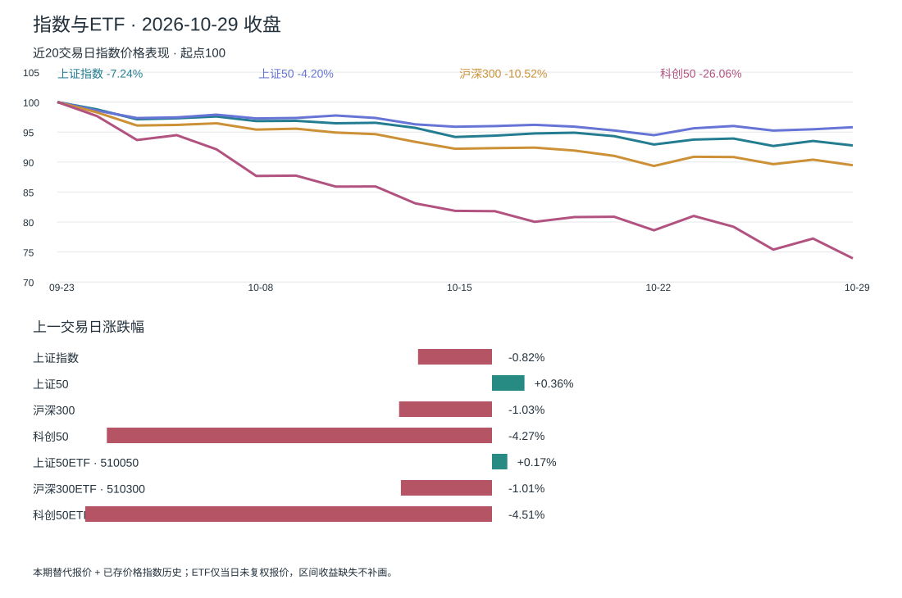
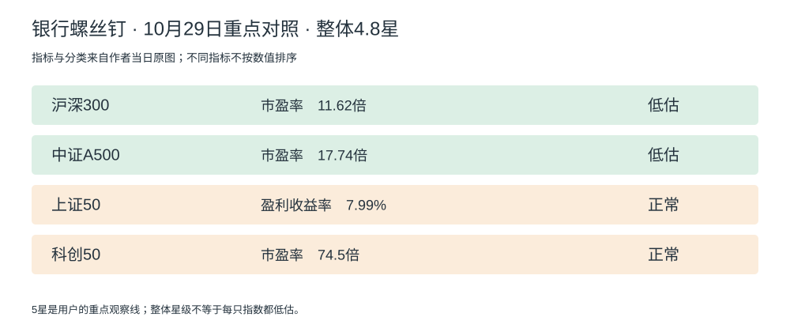

# A 股晨报｜ETF、上证与科创

2026-10-30 · 北京时间09:00盘前口径。行情截至10月29日收盘，群作者消息截到今日09:00；本次09:00后采集交付，不含今日盘中数据。

**螺丝钉整体4.8星，较上一期4.7星上升0.1星，距你的5星观察线还有0.2星：继续等待，准备首笔评估材料。** 星级衡量作者口径下的整体估值和投资价值，越高表示该口径下投资价值越高；不是基金质量评分、短期上涨概率或收益保证。第3003期原文已读，作者也提及若未来回到5星，宽基和组合可能出现较大买入机会；目前尚未触发。你仍是A股/ETF空仓、计划50万元，不能把“接近”当“达到”。[本人原文↗](https://www.xueqiu.com/3079173340/414577843) · [上期4.7星↗](https://www.sina.cn/news/detail/5359112091341831.html)

## 今天对你最重要的事

1. **估值更接近观察线，但仍不提前执行。** 本期4.8星，沪深300/A500仍低估，上证50和科创50仍正常。整理页为4.84，本报用作者正文4.8，不额外增加精度。[原文↗](https://www.xueqiu.com/3079173340/414577843) · [原图↓](./sources/3003_valuation.jpg)
2. **科创反弹回吐，趋势风险重新扩大。** 科创50收1228.09点、跌4.27%，低于10月27日1252.28点；实算MA60为1562.91点，乖离-21.42%，前一日为-18.31%。幅度大不能替代买点，科创暂不作为默认首笔。[新华财经收盘报道↗](https://www.cnfin.com/gs-lb/detail/20261029/4488120_1.html) · [均线计算↓](./trend_metrics.json)
3. **两位作者都要看估值，但买入规则尚不能合并。** 螺丝钉本期认为部分红利仍低估、可考虑定投；重远新增观点强调A股科技估值与盈利风险。前者并非给你批准了金额，后者也没有给出仓位比例。先明确持有期限与现金保留，再准备5星后的分批草案。[螺丝钉↗](https://www.xueqiu.com/3079173340/414577843) · [来源记录↓](./sources/feishu_author_digest.json)

## 市场与 ETF

| 观察对象 | 收盘（指数点；ETF元） | 当日涨跌 | 近20交易日变化 |
|---|---:|---:|---:|
| 上证指数 [来源↗](https://cn.investing.com/indices/shanghai-composite-historical-data) | 3651.43 | -0.82% | -7.24% |
| 上证50 [来源↗](https://cn.investing.com/indices/shanghai-se-50) | 2762.79 | +0.36% | -4.20% |
| 沪深300 [来源↗](https://summary.jrj.com.cn/stock/sh/000300) | 4041.84 | -1.03% | -10.52% |
| 科创50 [来源↗](https://www.cnfin.com/gs-lb/detail/20261029/4488120_1.html) | 1228.09 | -4.27% | -26.06% |
| 上证50ETF · 510050 [来源↗](https://xueqiu.com/S/SH510050/notices) | 2.871 | +0.17% | 未取得复权序列 |
| 沪深300ETF · 510300 [来源↗](https://a.finews.fyi/api/reports/2026-10-29) | 约4.11 | -1.01% | 未取得复权序列 |
| 科创50ETF · 588000 [来源↗](https://xueqiu.com/S/SH588000?from=status_stock_match) | 1.293 | -4.51% | 未取得复权序列 |

**本期行情源有降级，已经明示而未复用昨日数值。** 腾讯日线接口本次连续返回501，新浪报价接口也未成功；四个指数当前收盘改用已核验的公开收盘报价，与已保存至10月28日的价格指数日线衔接，前收盘一致性检查通过。20交易日区间为9月23日至10月29日，MA60按完整60个已知收盘独立计算。跨源可能有后续修订差异；没有补造开高低或成交量。[替代报价与出处↓](./sources/fallback_quotes.json) · [计算数据↓](./market.json)

ETF只列本期未复权收盘报价，不将其拼接到旧前复权序列，所以20交易日收益留缺。510300本期只有两位小数约价，FiNews报-1.01%，另一个公开报价页约-0.99%，差异未解决；不输出精确订单价格。588000雪球报1.293/-4.51%，FiNews报1.29/-4.73%，采用明确收盘时间和三位精度的雪球报价，仍保留来源差异。[510300替代报价↗](https://ttm.financial/m/hq/s/510300) · [588000收盘报价↗](https://xueqiu.com/S/SH588000?from=status_stock_match) · [FiNews当期↗](https://a.finews.fyi/api/reports/2026-10-29)

## 当日估值表

**10月29日第3003期：整体4.8星。** 沪深300PE11.62倍、A500PE17.74倍低估；上证50盈利收益率7.99%、科创50PE74.50倍正常。PE和盈利收益率不能直接按数值比高低；上证指数没有本期独立估值行，不用上证50代替。[本人原文↗](https://www.xueqiu.com/3079173340/414577843)

### 主观察方向对照

[作者原文↗](https://www.xueqiu.com/3079173340/414577843) · [完整常规估值原图↓](./sources/3003_valuation.jpg)

科创PE由前一期78.49变为74.50，价格和盈利更新都可能影响PE，不能仅据这一变化独立断定盈利改善。正文整体4.8与辅助4.84精度不同，以作者正文为准。

### 全部低估品种：21项

[作者原文↗](https://www.xueqiu.com/3079173340/414577843) · [完整原图↓](./sources/3003_valuation.jpg) · [结构化低估数据↓](./valuation_cheap.json)

| 指数 | 代码 | 指标 | 当日估值 |
|---|---|---|---:|
| 中证红利低波 | CSIH30269 | 盈利收益率 | 10.91% |
| 沪港深红利低波 | CSI931157 | 盈利收益率 | 10.46% |
| 中证红利 | SH000922 | 盈利收益率 | 10.14% |
| 优选300 | CSI931069 | 盈利收益率 | 10.40% |
| 自由现金流 | CSI932365 | 市盈率 | 10.76倍 |
| 中证价值 | CSI931052 | 市盈率 | 10.9倍 |
| 沪深300 | SH000300 | 市盈率 | 11.62倍 |
| 中证800 | SH000906 | 市盈率 | 14.22倍 |
| 中证A100 | SH000903 | 市盈率 | 14.81倍 |
| 中证全指 | CSI000985 | 市盈率 | 15.35倍 |
| 中证A50 | CSI930050 | 市盈率 | 15.77倍 |
| 中证A500 | CSI000510 | 市盈率 | 17.74倍 |
| 消费50 | CSI931139 | 市盈率 | 22.39倍 |
| 消费龙头 | CSI931068 | 市盈率 | 22.44倍 |
| 医药100＊ | 000978 | 市盈率 | 28.15倍 |
| 中证消费 | 000932 | 市盈率 | 24.28倍 |
| 中证500 | SH000905 | 市盈率 | 23.93倍 |
| 中证白酒 | 399997 | 市盈率 | 21.74倍 |
| 中证医疗 | 399989 | 市盈率 | 49.69倍 |
| 港股科技 | CSI931573 | 市盈率 | 31.06倍 |
| 证券行业 | 399975 | 市净率 | 1.48倍 |

＊医药100原图绿色、辅助接口低估，但辅助阈值算法显示正常，保留作者分类并注明差异。原图绿色21项已逐行核对；辅助数据27项中另有6项未出现在本期原图，不能当成作者本期覆盖的低估全集。本表是作者本期原图绿色区域全量。[辅助原始数据↓](./sources/valuation_dashboard_data.json)

21项是研究池，不是50万元应买21只基金；消费、医药和红利等成分可能重叠。盈利收益率单位为%，PE/PB单位为倍；不把整理页阈值位置当历史百分位。

## 我的状态与下一步动作

已确认A股/ETF空仓、预算50万元、可接受回撤按30%理解、整体5星为重点观察线。资金持有期限、每月新增资金、回撤统计范围和分批仓位仍未确认；不能从美股规则推定。

| 问题 | 当前证据 | 对你的下一步 |
|---|---|---|
| 到观察线了吗？ | 整体4.8星，较4.7提高0.1，距5星0.2 [原文↗](https://www.xueqiu.com/3079173340/414577843) | 继续等待；不把星差换算成还需下跌多少点 |
| 首笔先研究什么？ | 沪深300/A500低估；科创50正常且距MA60仍-21.42% [原图↓](./sources/3003_valuation.jpg) · [计算↓](./trend_metrics.json) | 先比较宽基，避免首笔集中押科技反弹 |
| 红利能否先买？ | 作者认为部分红利可定投，但该说明不是你的资金方案 [原文↗](https://www.xueqiu.com/3079173340/414577843) | 可列研究候选；若希望在5星前投入，需先另行确认规则及金额，目前不视为已授权 |
| 当前该准备什么？ | 预算已知，期限、权益上限和现金保留未定 | 明确几年内不用及至少保留现金，再拟首笔金额、追加条件和反证 |

30%只是风险约束，不能保证策略最大回撤；50万元全部投入后30%约15万元损失，仅作金额尺度说明。没有交易执行或虚构持仓。

## 5星触发后如何行动

首次核验达到或超过5星时重点提醒，先核对目标宽基自身估值和资金期限，再提出可审阅的分批草案：首笔金额、占50万元比例、保留现金、后续条件及反证。不能把作者“大笔买入机会”直接变成你一次性投入50万元；需保留足够现金应对继续下跌。未确认草案不登记为既定仓位规则。

## 银行螺丝钉：最新核验观点

本期为10月29日21:59第3003期，雪球正文显示于10月30日01:25修改，均在本期09:00截点之前。新浪详情本次跳到门户首页，已改从本人雪球正文及配图核验，不把跳转当原文读取成功。[本人原文↗](https://www.xueqiu.com/3079173340/414577843)

作者强调成长与价值的轮动，认为部分红利仍有估值吸引力，判断红利是否高估应结合PE、股息率与盈利变化，而非只看最近涨幅。他也提示不同平台的加权估值口径可能产生明显差异。对未来5星的宽基机会是条件性判断，相关资金流、历史纪录和底部判断未由本报独立复算。[原文↗](https://www.xueqiu.com/3079173340/414577843)

**红利单项星级与整体星级分开：**同篇红利配图自身日期是10月28日，标为4.1星；这不是10月29日整体4.8星，也不是用户选定的5星整体观察线，不将其当当日新红利快照。[红利配图↓](./sources/3003_dividend.jpg)

## 群内作者更新：已通过南冬CLI读取

CLI按南冬profile读取10月29日09:00至30日09:00，共14条消息、13条作者候选，已审核并过滤回复、重复及无关内容，仅归档三条投资摘要。群同步不等于原知识星球全文，覆盖不保证完整。[来源记录↓](./sources/feishu_author_digest.json)

| 作者原内容时间 | 新增作者观点摘要 | 对你当前计划的意义 |
|---|---|---|
| 10月29日20:10 | 作者将A股科技风险归于估值偏高，提醒业绩变化可能放大风险，未提供可复算的跨市场估值数据 [来源记录↓](./sources/feishu_author_digest.json) | 不把跌幅大等同便宜；需要明确具体指数、盈利与估值口径 |
| 10月29日11:37 | 作者提醒60日线会动态下移，不能把未来反弹接近均线固定为一个点位；对经验不足者倾向宽基研究 [来源记录↓](./sources/feishu_author_digest.json) | 每天重算科创均线；宽基也有亏损风险，不将其“未来解套”表述当保证 |
| 10月29日11:45 | 作者认为上证到3000、创业板到1600较难，基于其情景和点差假设 [来源记录↓](./sources/feishu_author_digest.json) | 是作者预测，不作为本报止跌保证、买点或资金配置阈值 |

### 用行情核对：价格与趋势是另一条观察轴

| 指数 | 10月29日收盘 | 60交易日均线 | 距均线 |
|---|---:|---:|---:|
| 上证指数 | 3651.43 | 3860.97 | -5.43% |
| 上证50 | 2762.79 | 2864.55 | -3.55% |
| 沪深300 | 4041.84 | 4460.03 | -9.38% |
| 科创50 | 1228.09 | 1562.91 | -21.42% |

指数使用已归档历史加本期核验收盘，按60个交易日收盘算术平均。科创乖离由-18.31%扩大到-21.42%，只说明当前距均线较远，不自动产生买点；其他指数均线仅作背景，不机械套用科技趋势纪律。[方法与结果↓](./trend_metrics.json)

### 两位作者对照：当前买入条件与仓位

| 项目 | 银行螺丝钉 | 重远投资观 | 对你空仓50万元的含义 |
|---|---|---|---|
| 买入观察条件 | 整体4.8，提及未来5星宽基机会；部分红利可定投 [原文↗](https://www.xueqiu.com/3079173340/414577843) | 本期强调科技估值与盈利风险，未给出量化买入门槛 [来源记录↓](./sources/feishu_author_digest.json) | 等待你选定的整体5星线，并先确定资金规则 |
| 科创是否便宜？ | 科创50本期正常估值PE74.50 [原图↓](./sources/3003_valuation.jpg) | 对“A股科技”给较高估值的定性判断，标的范围和方法未对齐 [来源记录↓](./sources/feishu_author_digest.json) | 观察角度有差异，未能判定同一标的同口径的真实分歧；不强行合成共识 |
| 仓位安排 | 原文是研究方向，未给你首笔金额或现金比例 [原文↗](https://www.xueqiu.com/3079173340/414577843) | 本期未给可执行仓位或加减仓比例 [来源记录↓](./sources/feishu_author_digest.json) | 仍无可照搬的仓位；首笔方案须结合期限、权益上限和现金 |

以上个人动作是本报研究判断，未当作作者联合交易指令。

## FiNews补充：只保留影响你决策的信息

1. **科创下跌重新压过昨日反弹：**科创50跌4.27%、成分股成交约711亿元，比前一日略缩量；这是价格与成交观察，不等于ETF净流出或确定底部。[新华财经原报道↗](https://www.cnfin.com/gs-lb/detail/20261029/4488120_1.html)
2. **上证50与科技走势分化：**上证50涨0.36%，科创跌4.27%；这提示首笔候选需要比较风格和估值，不只盯跌幅最大的方向。它不能证明价值风格未来一定跑赢。[上证50收盘↗](https://cn.investing.com/indices/shanghai-se-50) · [科创收盘↗](https://www.cnfin.com/gs-lb/detail/20261029/4488120_1.html)

FiNews提供当日发现线索，主要指数与其他报价核验，ETF差异见主表下方。成交热度不是估值；未独立核对原始公告的新闻和日历不作为个人动作依据。未取得ETF份额与净申购，不以涨跌/成交额替代资金流。[FiNews当期数据↗](https://a.finews.fyi/api/reports/2026-10-29)

## ETF事件与下一项观察

| 方向 | 下次具体检查 |
|---|---|
| 整体星级 | 下一期是否首次达到5星，以及目标指数仍低估与否 [作者入口↗](https://www.xueqiu.com/3079173340/column) |
| 科创50及588000 | 盈利与PE变化、MA60乖离能否收窄，不能把接近历史极值当必涨 [计算↓](./trend_metrics.json) |
| 两位作者 | 新的买入条件、仓位或现金安排是否明确；只增量纳入作者实质更新 [来源记录↓](./sources/feishu_author_digest.json) |
| 你的首笔草案 | 确认长期不用的期限、权益总额度和现金保留，再决定金额与分批节奏 |

## 每日交付与来源状态

今天的星级、报价与作者摘要均按10月29日数据更新，未将昨天数值冒充今天。四指数行情采用公开收盘核验加已存历史，源切换已说明；ETF复权区间缺失保留空缺。常规估值原图日期10月29日、绿色21项已查看；红利配图日期10月28日单列。共享美股CSS与交互、默认折叠全表、内容旁来源链接、内嵌图表和打印功能沿用。

本期只有空仓研究和资料更新，不操作券商。金融行情存在来源差异，本文不提供精确订单价。渲染、内链、日期及表格计数完成静态核验；未额外执行本地HTML浏览器视觉核验。[行情证据↓](./sources/fallback_quotes.json) · [作者摘要↓](./sources/feishu_author_digest.json) · [低估表↓](./valuation_cheap.json)
