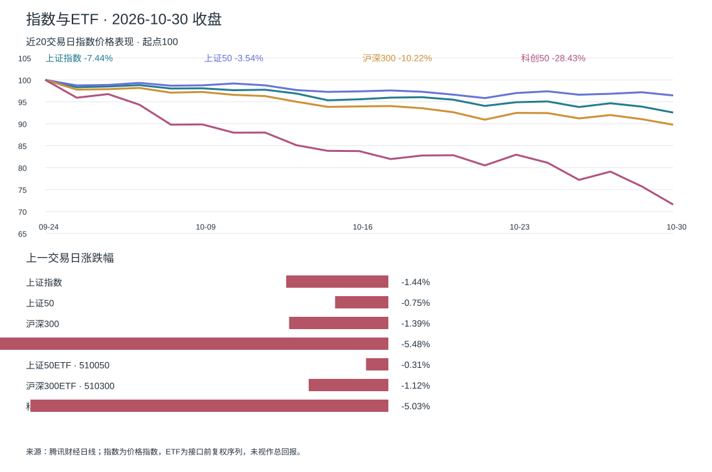
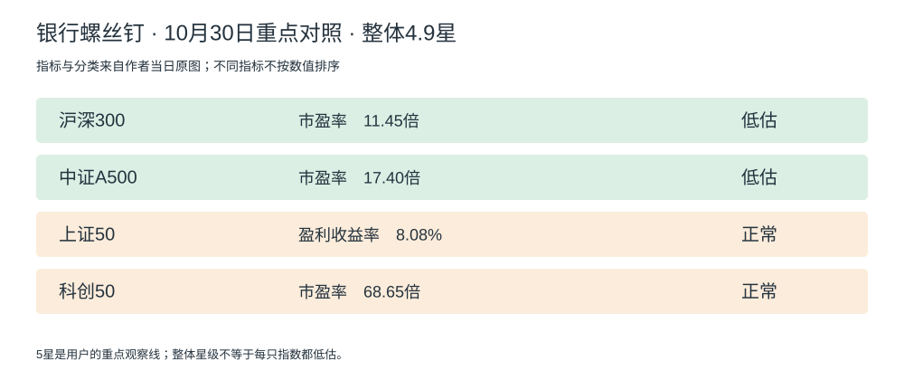

# A 股晨报｜周末观察

2026-10-31 · 周六休市简报。使用10月30日收盘与今日09:00前作者信息，重点更新个人观察条件，不重复昨日长篇材料。

**螺丝钉整体4.9星，较上一期4.8提高0.1星，距你的5星重点观察线仅差0.1星，但尚未触发。** 星级代表作者口径下整体估值与投资价值，越高代表其认为越有吸引力；不是基金质量评分、涨幅预测或收益保证。对你空仓、计划50万元的状态，周末先把资金期限、现金保留与权益总额度明确，准备5星后的首笔评估，今天不预先下买入指令。[第3004期原文↗](https://www.sina.cn/news/detail/5359838227598095.html)

## 今天对你最重要的事

1. **进入重点准备阶段，仍等有效5星。** 作者本期4.9星；“到5星进入底部区域”是作者的估值判断，不能保证价格见底。尚无你确认的首笔金额或比例。[原文↗](https://www.sina.cn/news/detail/5359838227598095.html)
2. **科创跌幅与趋势风险继续扩大。** 科创50收1160.84点、日跌5.48%；实算MA60为1555.79点，乖离-25.39%，前一日为-21.42%。超跌程度增加不等于必有反弹。原图科创PE68.65仍属正常区，暂不作为默认首笔。[行情与算法↓](./trend_metrics.json) · [原图↓](./sources/3004_valuation.jpg)
3. **宽基候选扩大，仓位规则不能抄作者。** 本期常规表绿色23项，比前期多MSCI A50与北证50；北证50波动与市场范围独特，出现低估不等于自动列为你的首笔。重远称通常会留部分仓位，但未给当前准确比例，不能据此设置你的目标仓位。[原图↓](./sources/3004_valuation.jpg) · [来源记录↓](./sources/feishu_author_digest.json)

## 市场与 ETF

| 观察对象 | 10月30日收盘（指数点／ETF元） | 当日涨跌 | 近20交易日变化 |
|---|---:|---:|---:|
| 上证指数 [行情↗](https://web.ifzq.gtimg.cn/appstock/app/fqkline/get?param=sh000001,day,,,80,qfq) | 3599.02 | -1.44% | -7.44% |
| 上证50 [行情↗](https://web.ifzq.gtimg.cn/appstock/app/fqkline/get?param=sh000016,day,,,80,qfq) | 2742.11 | -0.75% | -3.54% |
| 沪深300 [行情↗](https://web.ifzq.gtimg.cn/appstock/app/fqkline/get?param=sh000300,day,,,80,qfq) | 3985.5 | -1.39% | -10.22% |
| 科创50 [行情↗](https://web.ifzq.gtimg.cn/appstock/app/fqkline/get?param=sh000688,day,,,80,qfq) | 1160.84 | -5.48% | -28.43% |
| 上证50ETF · 510050 [行情↗](https://web.ifzq.gtimg.cn/appstock/app/fqkline/get?param=sh510050,day,,,80,qfq) | 2.862 | -0.31% | -3.28% |
| 沪深300ETF · 510300 [行情↗](https://web.ifzq.gtimg.cn/appstock/app/fqkline/get?param=sh510300,day,,,80,qfq) | 4.065 | -1.12% | -9.97% |
| 科创50ETF · 588000 [行情↗](https://web.ifzq.gtimg.cn/appstock/app/fqkline/get?param=sh588000,day,,,80,qfq) | 1.228 | -5.03% | -28.31% |

腾讯日线接口本次恢复，七个标的均验证末日为10月30日。指数为价格指数，ETF为接口前复权序列，未视为分红再投资总回报；20交易日区间从9月24日至10月30日，区间涨跌不是最大回撤。主要指数与北京商报收评相符。[行情数据↓](./market.json) · [北京商报收评↗](https://finance.eastmoney.com/a/202610303916483869.html)

## 当日估值表

**第3004期｜数据日10月30日｜整体4.9星。** 沪深300PE11.45倍、A500PE17.40倍低估；上证50盈利收益率8.08%、科创50PE68.65倍正常。PE与盈利收益率分开看；上证指数没有本期单独估值行。[作者原文↗](https://www.sina.cn/news/detail/5359838227598095.html)

### 主观察方向对照

[作者原文↗](https://www.sina.cn/news/detail/5359838227598095.html) · [完整常规原图↓](./sources/3004_valuation.jpg)

创业板PE25.33倍，作者称其口径约25倍以下进入低估，当前仍正常。创业板与科创50是不同指数，不能把创业板阈值套给科创50，也不将PE差换算成价格还需下跌多少。

### 全部低估品种：23项

[作者原文↗](https://www.sina.cn/news/detail/5359838227598095.html) · [当日原图↓](./sources/3004_valuation.jpg) · [逐项数据↓](./valuation_cheap.json)

| 指数 | 代码 | 估值指标 | 当日估值 |
|---|---|---|---:|
| 中证红利低波 | CSIH30269 | 盈利收益率 | 10.83% |
| 沪港深红利低波 | CSI931157 | 盈利收益率 | 10.40% |
| 中证红利 | SH000922 | 盈利收益率 | 10.06% |
| 优选300 | CSI931069 | 盈利收益率 | 10.38% |
| 自由现金流 | CSI932365 | 市盈率 | 10.76倍 |
| 中证价值 | CSI931052 | 市盈率 | 10.95倍 |
| 沪深300 | SH000300 | 市盈率 | 11.45倍 |
| 中证800 | SH000906 | 市盈率 | 13.97倍 |
| MSCI A50 | 746059 | 市盈率 | 13.82倍 |
| 中证A100 | SH000903 | 市盈率 | 14.59倍 |
| 中证全指 | CSI000985 | 市盈率 | 14.99倍 |
| 中证A50 | CSI930050 | 市盈率 | 15.66倍 |
| 中证A500 | CSI000510 | 市盈率 | 17.40倍 |
| 消费50 | CSI931139 | 市盈率 | 22.89倍 |
| 消费龙头 | CSI931068 | 市盈率 | 22.80倍 |
| 医药100 | 000978 | 市盈率 | 28.21倍 |
| 中证消费 | 000932 | 市盈率 | 24.88倍 |
| 中证500 | SH000905 | 市盈率 | 23.32倍 |
| 中证白酒 | 399997 | 市盈率 | 23.01倍 |
| 北证50 | BJ899050 | 市盈率 | 35.86倍 |
| 中证医疗 | 399989 | 市盈率 | 49.98倍 |
| 港股科技 | CSI931573 | 市盈率 | 31.04倍 |
| 证券行业 | 399975 | 市净率 | 1.47倍 |

23项按作者10月30日原图绿色区域逐行核对，MSCI A50与北证50本期进入绿色。辅助整理页仍停留10月29日4.84，未用于本期估值或分类，不能把旧的阈值差异直接当今天的新冲突。此表是作者本期常规原图的完整低估区，不是所有市场指数低估全集，也不是50万元应买入的23只基金；行业、跨境与宽基指数存在重叠。[辅助旧数据及日期↓](./sources/valuation_dashboard_stale.json)

## 我的状态与下一步动作

你仍为空仓，预算50万元、回撤容忍度按30%理解；整体5星是观察线。周末只准备三项：这笔钱几年内不用、保留多少现金、首笔及后续批次如何分配。持有期限未明确前，不能给出已可执行的权益仓位。30%不是策略能保证的最大回撤。

## 5星触发后如何行动

首次取得有效新一期整体星级≥5时重点提醒，重新核验沪深300/A500等候选自身估值；提出首笔金额、占50万元比例、保留现金、后续触发条件及反证齐全的草案。未经你确认不写成既定规则，不执行交易，也不因4.9接近5而提前称触发。

## 银行螺丝钉：最新核验观点

10月30日21:54，第3004期。作者认为创业板估值中枢随指数结构变化而下降，历史低百分位不必然等于绝对低估；提示同时观察估值、杠杆和资金条件。文中两融规模、机构ETF流入估计和底部信号为作者判断，本报未独立复算，不把它们合成已确认底部。[本人原文↗](https://www.sina.cn/news/detail/5359838227598095.html)

附带港股估值图日期实际为10月29日、港股单项星级4.8，与常规表10月30日整体4.9不同；不混入本期23项，也不当作今天新港股估值。[港股原图↓](./sources/3004_hk.jpg)

## 群内作者更新：已通过南冬CLI读取

读取10月30日09:00至31日09:00共29条消息、25条作者候选，审核后归纳以下新增要点；多条“维持原判断”和21:55/22:04回答去重，成员回复与无关个人资料不归档。群同步不等于原星球全文。[来源记录↓](./sources/feishu_author_digest.json)

| 主题／作者原时间 | 重远投资观新增摘要 | 对你当前计划的意义 |
|---|---|---|
| 反弹与能力圈 · 10月30日22:04 | 仍认为技术反弹只适合有经验者，需考虑失败；依据投资逻辑而非浮亏行动 [来源记录↓](./sources/feishu_author_digest.json) | 不因跌幅、乖离扩大改成抢反弹；他的科技趋势卖出纪律不直接泛化到所有宽基 |
| 仓位 · 21:05、21:03 | 作者称通常极少清仓、会留部分仓位，并接受谨慎管理下的踏空；无当前准确总仓位 [来源记录↓](./sources/feishu_author_digest.json) | 回答中的“跑70%”不等于作者本人仓位；不将作者风格复制为你50万元的比例 |
| 估值 · 20:47 | 当前业绩与增长决定估值，不能机械套用过去高增长时的平均PE [来源记录↓](./sources/feishu_author_digest.json) | 与螺丝钉“估值中枢变化、低分位未必低估”有方法层面相通处 |

### 两位作者对照：买入条件与仓位

| 问题 | 螺丝钉本期 | 重远本期 | 本报对你的含义 |
|---|---|---|---|
| 是否到买入评估阶段？ | 整体4.9，关注后续5星及成长指数低估 [原文↗](https://www.sina.cn/news/detail/5359838227598095.html) | 仍对超跌反弹谨慎，经验不足者可等更明确的熊市宽基条件 [来源记录↓](./sources/feishu_author_digest.json) | 等你选定的5星触发评估；两位没有共同给出立即买入指令 |
| 怎么理解“便宜”？ | 历史分位受估值中枢变化影响，创业板尚正常 [原文↗](https://www.sina.cn/news/detail/5359838227598095.html) | 历史平均PE不能替代当前盈利和增长评估 [来源记录↓](./sources/feishu_author_digest.json) | 方法有共同点，仍需同指数、同盈利和估值口径比较 |
| 现在投入多少？ | 本期未给适用于你账户的金额与现金比例 | 作者通常不清仓，但当前比例未知 [来源记录↓](./sources/feishu_author_digest.json) | 你的起点是空仓；首笔取决于期限、权益总额度和现金保留，不照抄留仓比例 |

以上个人动作是本报研究判断。宽基也有亏损风险，作者关于未来牛市或回本的表述不作为收益保证。

## ETF事件与下一项观察

1. **继续核验5星与目标指数是否同时满足条件。** 0.1星只表示距观察线的星级差，不能转换为价格点位；下一有效估值更新前不自动跨档。[作者入口↗](https://www.xueqiu.com/3079173340/column)
2. **科创与成长的盈利更新。** 科创本期PE降到68.65仍正常，MA60乖离扩大到-25.39%；分别看估值与趋势，不将“跌很多”当唯一依据。[原图↓](./sources/3004_valuation.jpg) · [计算↓](./trend_metrics.json)

## 每日交付与来源状态

周六简报使用周五新收盘与新作者信息。星级已更新至4.9、尚未触发5星；常规估值原图为10月30日，辅助页与港股图日期更早，分别标注。FiNews当期主要指数与腾讯相符，未把新闻摘要、成交热度或报价差异当作投资条件；没有取得独立ETF份额和净申购数据。[FiNews当期↗](https://a.finews.fyi/api/reports/2026-10-30)

保持共享美股样式、内嵌图表、原图下载、默认折叠全表和就近来源链接。没有券商操作或交易；静态核验覆盖日期、21个区间观测点、23行估值表、折叠与内链，未进行日报HTML视觉核验。[来源审计↓](./sources/source_audit.json) · [群作者记录↓](./sources/feishu_author_digest.json)
