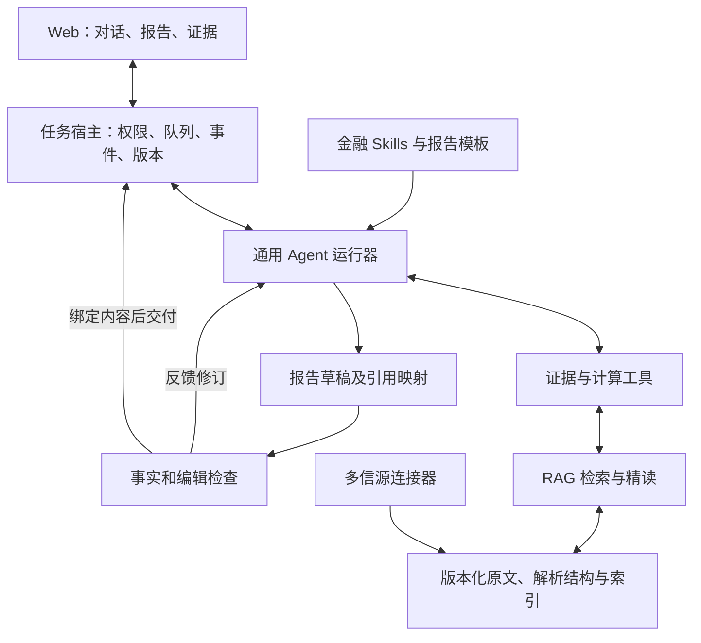

# 总方案 v0.1：以报告和证据为中心的金融研究 Agent

日期：2026-09-10。设计状态：总方案已形成，等待后续子方案验证与修订。此文定义目标与边界，不宣称目标能力已上线。

## 1. 目标与成功标准

Cited Alpha 是可以持续研究的金融工作台。用户表达问题，Agent 自主寻找资料、精读、计算、写作及修订，交付能读懂、能据此判断、可核对来源的报告。

产品的区别是两段完整溯源：报告中的数字或判断 → 对应证据字段 → 指定版本的原文位置。派生指标进一步连接计算过程和输入字段。

成功必须同时满足：报告回答问题且有论证；关键事实与计算正确；引用支持相应陈述并能定位；研究能恢复和续接；系统复杂度不再随报告类型增加一套专用执行流程。

初期面向需要理解公司、财报和事件的研究用户。用户画像、使用频次及付费价值仍需产品验证，不将设想当成已验证需求。不纳入交易执行、账户管理与自动投资决策。

## 2. 当前问题与设计原则

真实验收发现：模板强制比较表导致短任务失败；报告重复审计段落；成本行被误认作收入；修复后又出现事实 token 校验失败。说明运行成功、格式合法、事实正确和报告有用必须分别评估。

原则：

1. 研究过程由通用 Agent 决定；权限、预算、数据持久化由宿主强制执行。
2. 研究笔记自由表达，正式报告保留精确引用；不要求每次思考都通过领域 JSON 合同。
3. 证据在获取时就记录版本和定位，不能写完报告后靠猜测补引用。
4. 模板提供默认结构，用户范围决定必答问题，证据决定分析深度。
5. 检索相关性、来源可信度、事实支持是不同判断；排序分数不能替代验证。
6. 先复用已有代码和存储，按验证结果减掉重复编排，不一次重建所有服务。

## 3. 产品形态

默认布局：研究对话、报告正文、按需打开的证据面板。报告是主要产物，聊天用于指导研究与解释。

主流程：提出问题 → 确定范围 → 研究中可调整 → 形成草稿 → 检查与修订 → 保存正式版本 → 继续追问或更新。

首屏报告直接给结论与最关键依据。正文按业务问题组织，图表承载比较和趋势。引用展示简洁，打开后呈现原文、定位、口径及必要脚注。执行日志进入运行详情。

必须设计的状态包括：研究中、草稿、检查未通过、部分完成、正式交付、失败和取消。任务状态与报告状态分开；后台任务终止不应把已有草稿抹掉，保存草稿也不代表报告合格。新版本失败时，旧版本注明其版本时间，不能暗示已更新。

用户修改正文后，原引用不能无条件继续显示为已验证。修改需标记待复核范围，导出和分享必须明确版本及状态。

模板目录：事实核验、财报分析、公司深度、公司比较、事件影响、估值研究。首期验证短核验和财报分析，跨来源比较用于验证证据模型；其余模板逐步增加，不新增专用运行引擎。

## 4. 总体技术架构

这些是职责边界，不等于独立微服务。初期保留现有 Web、Backend、Python ML/检索服务；通用 Agent 通过薄运行适配层调用已有能力。Pi 是首选验证候选，最终版本与部署方式由运行器子方案和原型结果决定。

业务 Backend 是任务、授权和正式报告版本的权威；原文/证据服务是快照和定位的权威；Agent 会话保存推理上下文、工具记录与工作文件。避免三处分别维护一份相互竞争的业务任务状态。

### 运行器边界

只设计必要的启动、续接、用户补充、取消和事件接口。会话记录不是可靠调度器；任务宿主处理租约、幂等、重试与故障恢复。研究代码和文件在任务执行环境中隔离。工具结果携带证据身份，压缩上下文后通过 ID 精读恢复，不依赖模型记住全文。

不同时引入 Pi、Codex、另一套 Web Agent loop。先比较一个候选与现有实现，满足需求后再谈可替换性；不建设通用框架插件平台。

### RAG 边界

解析 → 分块 → 索引建设属于资料处理；查询时执行词面/向量召回、融合、可选重排、原文回读。Agent 根据任务决定检索范围、补读和换源。字段和表格读取可以直接走结构查询，不必每次先做向量搜索。

保留之前十环节中的能力，不将其变成每个问题必须执行十步的固定流程。缺证、无权限、截断、过期、定位精度不足分别返回，不能统一表现为“没有答案”。

### 报告边界

正文采用可渲染的文档结构，引用映射独立关联稳定段落/字段身份；具体 Markdown/AST 与现有 ReportDocument 的兼容由子方案确定。禁止仅使用会随编辑漂移的字符偏移作为唯一引用锚点。

先检查引用和确定性数值，再独立评估论证与可读性，按具体问题有界修订。检查结果绑定草稿、证据集、规则版本；内容改变后重新检查。保存报告版本与引用关系是原子操作。

## 5. 核心数据关系

| 概念 | 内容与边界 |
|---|---|
| ResearchTask | 用户问题、范围、截止时点、来源约束、运行身份；不保存固定研究步骤 |
| AgentSession | 上下文、工具事件、工作文件；关联任务但不替代任务权威状态 |
| SourceSnapshot | 原始内容、来源、抓取时间、哈希及版本；不被重新抓取覆盖 |
| EvidenceRef | 快照内定位、原文摘录、解析版本、精度和语义口径 |
| Calculation | 公式、输入证据、结果、单位、精度与执行记录 |
| ReportVersion | 正文、引用映射、父版本、检查状态与交付时间 |

这些是概念对象，不要求每个新建数据库表。详细设计必须先映射到现有 Workspace/Run/Artifact/Evidence 结构，避免再建平行真源。

定位类型至少考虑 HTML block/text span、PDF page/bbox、表格 sheet/cell、API response/JSON Pointer、XBRL concept/context/unit。不同类型声明真实支持程度；未实现的类型不能假装具有字段级定位。

数字必须携带主体、指标、期间、币种、单位、分部/合并口径与报告/推导属性。重建索引不改变永久引用，解析器升级保留旧定位解释。相互冲突的证据不能因为去重而丢失。

## 6. 部署与迁移约束

沿用已确认的三个原工作目录及 `feat_codex/financial-report-agent-plan-writer-20260717` 分支。任何应用修改、构建和发布前重新核对分支、HEAD、状态及 worktree；本轮只设计。

迁移采用工作区级新运行路径。旧任务继续按原版本完成，旧报告继续可打开。先建立引用兼容和评测基线，再接新运行器，不先修改所有历史数据。保留旧运行器只服务迁移与回滚，设明确删除条件，避免永久双轨。

默认不迁移数据库、不整体替换 RAG 框架、不一次部署六类模板、不放大生产模型调用规模。成本和性能以实测后设置的预算为准，本方案不虚构吞吐、金额或日期承诺。

## 7. 第一条完整实现范围

一位已授权用户在已有工作区提出问题；新运行器调用现有证据工具；读取一个官方文档中的正确字段及表头；生成短核验并保存；用户点击数字定位原文；刷新或恢复后仍看到同一任务和版本。

这一条链路同时验证 Agent、RAG、证据、报告和可靠执行。随后扩展第二来源与派生计算，再验证完整财报分析。优先证明从输入到产物的闭环，不先把每个底层组件分别重写完。

## 8. 分层验收

| 层 | 核心判据 |
|---|---|
| 产品 | 用户可理解结论和局限；无重复审计正文；报告形态匹配问题 |
| 事实 | 关键数字、期间与口径正确；派生值可复算；冲突明确呈现 |
| 定位 | 引用真实支持，点击到正确版本字段；缺少精度时显式降级 |
| RAG | 固定样本中证据召回、上下文完整性与权限过滤可测 |
| 运行 | 刷新不重建任务；进程故障可恢复或明确失败；保存幂等 |
| 演进 | 旧报告可读；新路径可回滚；每项新合同有明确不可替代职责 |

数值/引用等硬门槛在固定验收样本中要求无已知错误；这不等于统计证明普遍零错误。报告编辑质量沿用产品标准，召回率、延迟和成本门槛在基线测量后冻结，不能验收后倒推通过标准。

## 9. 已决定与待验证

已决定：报告中心、通用 Agent、字段级溯源、多模板、增量迁移、先总后分、本轮无应用修改。

待子方案验证：Pi具体版本与API；云端沙箱和会话恢复实现；正文结构与引用编辑语义；每类来源支持矩阵；共享验证边界；现有未提交修改如何吸收；性能/费用预算。

重大决策使用简短 ADR：问题、约束、候选、取舍、验证结果、回滚方式。仅对真正有替代方案且成本较高的决策写 ADR，不为每个函数制造文档。

## 10. L2 审查后的决策补充

2026-09-10。本节更新前述待验证项，属于目标实现决策，不代表已部署。

- 运行轨道继续以数据库 `harness_contract_version` 为唯一权威，新增 `research-v1`，扩展列长度与约束。ContextPack冻结研究参数，不另建可独立变更的runtime开关。所有worker/retry/resume/watchdog先支持新值后，才接纳新任务。禁止用假v2/v3元数据承载新运行器。
- 原文完整性与计算由确定性服务验证；一次独立模型审查同时评估事实支持和编辑质量，保持两类结果。它独立于写作上下文，不宣称为两次独立审查。后续是否拆分依实际误判评测决定。
- 检查通过的候选由Backend持有并绑定正文、证据、计算、运行和规则版本；交付复用未变更的检查结果，避免同一稿重复付费审查。重写任何相关内容都使旧结果失效。
- 财报分析需要指标表与字段引用；当前paragraph-only协议是实现起点。首发前同步扩充合同、模型工具、renderer及导出，不能用长段落或Markdown表格字符串冒充已支持的结构表格。
- 财务计算复用Backend权威Decimal实现，ML工具委托调用；不复制一套运算到ML。期间/主体/单位可比性与数值正确分别检查。

专题入口：[产品验收](06_report_experience_acceptance.md)、[运行接入](07_run_integration_design.md)、[工具与恢复](08_runtime_tools_design.md)、[报告交付](09_report_delivery_design.md)。当前进入按这些设计分批实施的准备阶段，04验收矩阵仍全部保留，真实MVP尚未完成。
