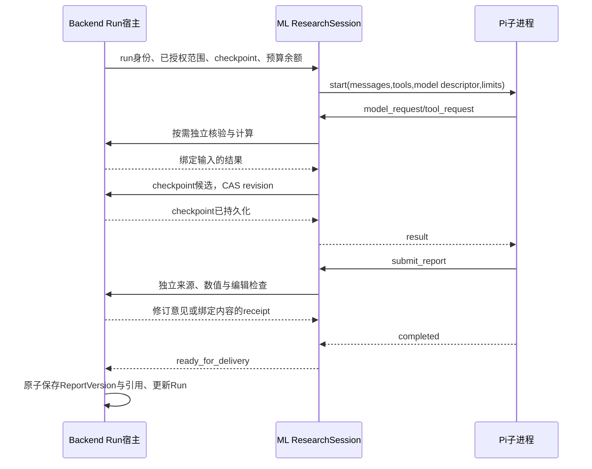

# L2：通用运行器、金融工具与恢复设计

日期：2026-09-10。状态：设计与当前代码审查，不是生产能力声明。

## 1. 本轮结论

Pi 只拥有自主研究循环，Python ML 宿主持有模型与工具，Backend 持有证据独立核验、确定性计算、业务运行和交付版本。不要为了让 Agent 调用计算，在 ML 再复制一份 Decimal 运算。

第一阶段通过受认证的 Backend 内部工具边界委托计算；ML 只声明 `calculate` 工具并转发证据 ID。研究过程使用一个宿主 checkpoint 包恢复。Node messages、证据 catalog、计算结果、预算必须一起保存，单独恢复聊天消息不算任务恢复。

## 2. 当前代码已证明什么

以下均为本轮读取工作目录所得，尚未代表上线。

| 位置 | 当前能力 | 缺口 |
|---|---|---|
| ML `ResearchSession` | 合并证据工具与 `submit_report`，Pi 正常结束且草稿检查通过才返回 `ready_for_delivery` | 提示词要求计算工具，但实际定义只有证据/提交工具；无计算 dispatcher；没有持久 checkpoint |
| ML `PiProcess` | 单子进程 JSONL，固定版本，模型/工具回调，调用数双重上限，超时回收子进程 | 每次启动调用数重置；未绑定业务 run/attempt 或累计预算；`on_event`只是可注入接口 |
| ML `ResearchModelGateway` | Python model-policy 选 `agent_deep_research`；忽略 Node 的模型选择；真实 usage 记录 | 记录 usage 不等于执行金额/token 上限；descriptor 的 65536 是桥接上下文描述，不是实际上下文裁剪 |
| ML `DocumentResearchTools` | 注入用户和授权文档，候选/精读分离，恢复时校验证据 hash 和文档版本 | catalog 是内存；没有旧解析器注册或独立原始文档读取证明 |
| ML `SecResearchTools` | SEC 官方发现、原始 bytes capture、字段/段落证据；可从 catalog 恢复来源 | 原文解析与已读块集合是内存；恢复后要再次读取原文才能新增 citation；当前仅 recent submissions |
| Backend `research_report/calculations.py` | Decimal sum/difference/ratio/growth_rate，输入 ID、单位币种、除零、精度检查 | 无 ML 可调用的计算工具边界；同单位不能证明业务口径可比 |
| Backend report contract | 引用计算 ID；交付构建时调用权威 `calculate` 复算 | 需要接入研究时已登记的计算请求，不能相信模型提交结果 |
| ML Dockerfile | Python 3.12.9 与既有解析依赖 | 未装 Node/Pi；本机全局安装不能作为生产就绪证据 |

## 3. 工具分工和最小调用合同

| 工具 | 模型可提供 | 宿主注入/生成 | 返回性质 |
|---|---|---|---|
| `find_filings` | 单一 ticker/entity、form、report year、filing cutoff | 官方 client 与请求总预算 | 候选 URL，不可直接引用 |
| `read_filing` | 已发现 URL、query、分页 | bytes 上限、同 accession、capture、解析版本 | 原文块与字段索引 |
| `cite_filing_field/text` | 已读字段/段落索引 | 原文 quote、snapshot/hash、确定性 evidence ID | 可信来源提案，待 Backend 独立核验 |
| `search_documents/read_document` | 查询、授权文档 ID、真实页/行/cell ID | viewer 身份、workspace 文档范围、版本信息 | 候选或精读证据 |
| `calculate`（待实现） | operation、inputEvidenceIds、precision | run/owner、证据集、计算 ID、运算与receipt | 可复算派生值，不可伪造原始事实 |
| `submit_report` | 报告正文、工具颁发的引用 ID | 当前证据/计算目录、独立检查 | 修订意见或待交付草稿 |

工具参数禁止携带用户身份、任意 snapshot URI、可信 quote、计算结果和审核 receipt。真实工具错误应给 Agent 有界可操作错误码；诊断详情保留宿主，避免只剩 `host_execution_failed` 导致盲目重复调用。权限/协议错误终止当前执行，普通来源不可用可让 Agent 换来源。

### 3.1 为什么委托 Backend 运算

现有 Backend 已在报告构建时权威复算。新增共享 PyPI 包会引入独立发布与版本管理；复制到 ML 会产生精度、边界和舍入规则漂移。当前规模下增加一个小的认证内部计算操作，比两份实现更容易审查。

建议使用已有 ML↔Backend 内部认证与业务 run 路由承载新操作，不新建公开计算服务。操作名称和路由在 L3 接线时选定，不能把本段建议当成已有 endpoint。

请求逻辑体：

```json
{
  "schemaVersion": "research-calculation-request/v1",
  "runId": "host-owned-run",
  "checkpointRevision": 7,
  "operation": "growth_rate",
  "inputEvidenceIds": ["current-year-evidence", "prior-year-evidence"],
  "precision": 4
}
```

runId、checkpointRevision 和幂等键由宿主封装，模型仅看后三个参数。输入顺序具有含义：difference 为首项减次项；ratio 为首项除次项；growth_rate 为 `(首项/次项-1)*100`。工具描述必须明确，不能靠模型猜顺序。

Backend 回读 run 所属 owner/workspace 和指定 checkpoint 的证据。尚未独立核验的证据先走已有 source-integrity authority。随后调用现有 `calculate`，生成由 request、输入证据 hash、运算规则版本组成的计算 ID。重复同一请求返回同一记录；同幂等键不同内容报冲突。

响应包含 `calculationId / operation / inputs / valueDecimal / unit / currency / precision / rounding / engineVersion`。金额始终十进制字符串。ML 保留其原始结果给后续模型与报告工具，不二次计算或改写精度。正式交付时 Backend 仍复算，并比较绑定输入的结果。

### 3.2 数学正确之外的金融口径

当前 `calculate` 注释已明确不证明金融语义。新增运算前置条件放 Backend 同一权威模块附近，不放 Node：

- `growth_rate`：相同 entity/metric/currency/unit，period 不同且时间顺序明确；年度/季度/YTD不能混比；维度集合一致。
- `sum`：明确加总的是互斥业务分部或可加期间；不把总额与子项一起相加。
- `ratio`：允许不同指标，例如利润/收入，但主体和期间一致；不能简单强制 metric 相同。
- 无法证明条件时返回 `comparability_unknown`，Agent 可继续查材料，不能自动把缺失期间当一致。

首期不支持自由 Python 表达式、跨币种换算或 arbitrary formula AST。增加新公式时先扩展权威计算模块及合同测试，不能把自由代码解释器当作金融计算事实真源。

## 4. 正常执行与权威状态



`Pi agent_end` 不是业务完成，`completed:succeeded` 也不代表报告通过。只有 Backend 保存成功并回读版本后，产品才显示“已完成”。已通过草稿发生任何正文、引用或计算变化，应失效旧检查 receipt。

## 5. checkpoint：保存什么，何时保存

复用既有 Workspace Run checkpoint/事件持久化能力，新增版本化 payload，不另建平行任务真源。

最小 payload：`schemaVersion / runId / attemptId / revision / runtimeVersion / toolContractVersion / messages / rawEvidenceCatalog / calculations / pendingEffects / acceptedDraft / budgetUsage / sourceDiscoveryState`。

- `messages` 保留 Pi 原生结构，包括 Vertex opaque thought signature，不能保存成纯文本再恢复。
- `rawEvidenceCatalog` 保留原文版本/定位/receipt，Backend 再投影成报告 evidence；不能只存给 UI 的裁剪字段。
- `calculations` 存权威输入和结果记录。Agent 不得通过 messages 注入可信计算目录。
- `pendingEffects` 至少记录 toolCallId、请求hash、幂等键、状态与结果引用。
- `budgetUsage` 使用 Backend 账本累计值，重启不得归零。
- `sourceDiscoveryState` 记录已授权来源发现结果；不得恢复任意模型自填 URL。

持久化节点：模型调用前记预算预留；工具副作用前记 intent；工具返回后先保存结果/catalog再把 result 发回 Pi；完整 turn 后保存可续接 messages。checkpoint CAS 使用 run 当前 attempt lease 和 revision，旧进程不能覆盖新进程结果。

## 6. 失败与恢复协议

| 中断点 | 恢复动作 | 禁止行为 |
|---|---|---|
| 浏览器刷新 | GET 同一 run 并恢复观察 | 再 POST 创建研究 |
| 模型请求超时 | 标记结果未知并按宿主预算处理；按策略允许有限重试 | 宣称没有产生 provider费用 |
| 只读工具完成、result未送回 | 从已持久化结果补同一 toolCallId 的 toolResult | 改 ID重做整条研究 |
| capture写成功、回执未保存 | 重试同内容寻址写；独立读hash后恢复 | 覆盖旧对象 |
| 计算完成、响应丢失 | 同幂等键查询/重试 Backend 计算 | 让模型重新填写计算结果 |
| submit通过、未发布 | 从绑定receipt检查草稿仍一致，再继续交付 | 再运行模型随意重写已验收内容 |
| 发布提交成功、响应丢失 | 回读 run/version幂等关联 | 创建重复版本 |
| 预算耗尽/用户取消 | 保存明确终态和可恢复研究材料 | 把不完整草稿标为正式报告 |

Pi `continue()` 当前要求末尾是 user 或 toolResult。不能把含待执行工具的 assistant消息直接塞进去期待自动重放。宿主必须从 durable pendingEffects 补齐工具结果，或从最后完整安全 turn恢复。未知副作用不自动重试；先查幂等结果。SEC 当前恢复 catalog后需要重读 retained源恢复解析/seen信息，后续应优先从可信快照读取而不是重新访问 live URL。

## 7. Node生产依赖与隔离

生产镜像当前只有 Python，必须增加独立构建阶段安装固定 Node版本和全局 `@earendil-works/pi-agent-core@0.85.1`、`@earendil-works/pi-ai@0.85.1`，将运行时和全局依赖拷入最终镜像。Node最低版本22.19.0；具体patch/digest在构建时固定。为传递依赖记录锁定树/完整性和镜像摘要；仅钉两个顶层包仍不能保证所有子依赖完全可复现。

只在私有 ML Runner角色启用 Pi功能，公开ML API不启动模型研究循环。显式配置绝对 `node_binary / PI_MODULE_ROOT / entrypoint`；启动探针验证version/import/JSONL ready，不调用真实模型。禁止在容器启动时联网npm install。

子进程仅获得PI_MODULE_ROOT，凭据保留Python。core没有内置文件/shell工具；这不意味着Node进程是OS沙箱。若未来增加代码执行，需单独隔离服务和资源限制，不能顺手挂上宿主shell。

## 8. 预算和上下文

现有 Node 和 Python均限制model/tool调用次数及wall time，这是正确的纵深校验。下一步将“每次进程限制”扩展为“每个业务run累计账本”。

每次model_request先确认剩余调用次数、token和预算上限，按当次max_output_tokens预留输出额度；响应后记录实际provider usage并结算预留。缺usage时不能填0，记录unknown并按保守策略限制下一次请求。重试、editorial reviewer和工具内部embedding等模型调用都计入同一run；只计Pi主循环会漏账。

金额上限需版本化定价来源和provider真实token分类，费用估计与账单分别表述。先实现硬调用/token/时间上限，再启用可核实的金额估计，不能用默认零cost欺骗预算器。

上下文变长时优先减少工具原文返回、按需精读。压缩只处理研究笔记和历史过程，不删除证据catalog，不截断工具调用/结果配对或Vertex thought signature。自动compaction还未接入，先提供显式大小检查与可恢复错误，不把模型contextWindow字段当完成证明。

## 9. 实施顺序与验收

1. **P0计算闭环**：Backend新增内部计算委托入口，ML工具仅转发；用真实XBRL两年输入生成增长率，报告点击派生值可展开公式及两个字段。
2. **P0恢复闭环**：落durable checkpoint和幂等effect记录；分别在工具结果发送前、计算返回后、版本保存后杀进程，证明无重复费用调用或版本（结果未知费用明确标记）。
3. **P0生产构建**：固定Node/Pi镜像依赖、私有Runner配置、离线JSONL smoke；通过既有PR→main→Actions发布和runtime版本回读。
4. **P0统一预算**：研究/审核/检索模型的累计账本；恢复后预算不重置；超额前停止下一次调用。
5. **P1能力扩展**：SEC历史分页、可信快照重读、模板skills注入、可控上下文压缩，按用户真实任务逐项验证。

本设计不允许以“Pi测试通过”替代MVP验收。最终需要正式页面生成一份可读的公司财报分析，至少覆盖原始财务字段、派生计算、业务解释和具体不确定性；跨来源引用能打开正确原文位置；刷新和一次进程中断后继续同一任务与版本。
