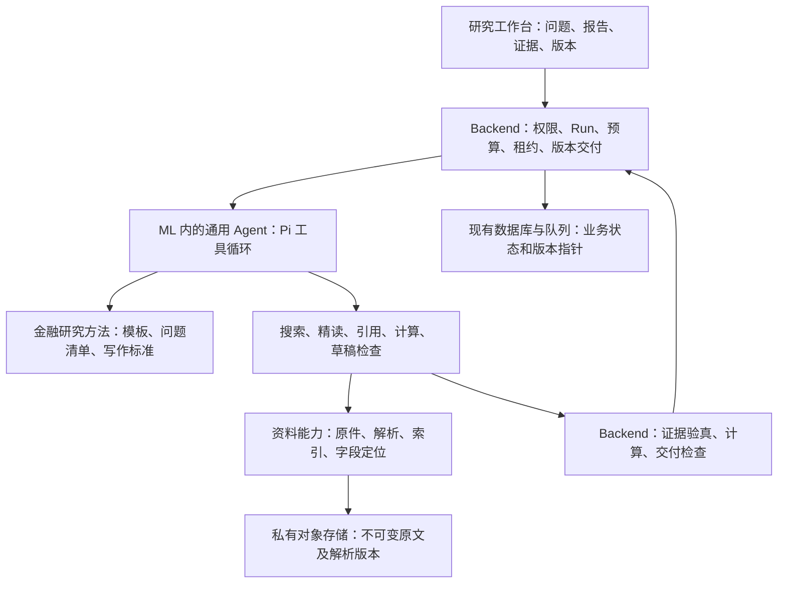
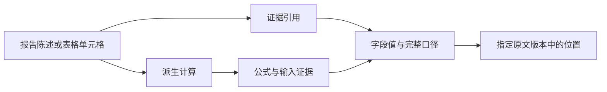

# 产品与架构总览：先定义产物，再细化实现

日期：2026-09-10。性质：目标设计及后续细化顺序；不是上线清单。配套权威总方案见 `00_master_plan.md`，完整验收范围见 `04_mvp_delivery_contract.md`。

## 产品要交付什么

Cited Alpha 是面向投资研究的工作台。用户提出研究问题，系统交付可阅读、可核验、可继续更新的研究报告。最小产品闭环是：提出问题、得到结论、核查关键事实、继续研究、保存新版本。

默认界面以报告为中心：左侧研究任务和资料，中间报告正文，右侧按需打开对话或证据。执行过程用简短进展表示，工具日志留在运行详情。小屏按页切换，不压缩成三列。

用户点击一个数字，应看到原始披露、主体与财年、币种与单位、表头和脚注；点击派生指标，应先看到公式和输入，再进入各输入的原文。无法精确定位的来源明确标注实际精度。

## 一个完整用户旅程

用户输入“分析某公司年度表现，重点看收入质量与现金流”。系统形成研究范围与默认报告结构，用户可以随时补充要求。Agent寻找官方材料，核查数字及解释，必要时补充其他来源；报告逐渐形成可读草稿。通过检查后保存正式版本，保留尚无证据支持的问题。

用户随后要求“加入竞争对手对比”，系统以当前报告版本和新要求继续研究，保存新版本。旧报告仍能打开，旧引用仍指向原来的资料快照。更新失败时保留旧版，并明确更新尚未完成。

## 报告模板的定位

模板定义需要回答的问题、推荐结构、适用指标和质量标准。事实核验、财报分析、公司比较等共用一个运行器。Agent根据用户要求选择方法，按证据调整篇幅。模板不规定每次必须检索几次、调用哪些工具，也不能强迫缺少证据的章节生成结论。

完整报告的默认阅读顺序：主要结论、关键指标、业务原因、现金流与财务质量、风险与反证、待验证问题。短核验只需要答案、口径和引用。估值只有在用户范围需要且输入充分时展开。

## 技术职责与复杂度控制

图中的方法、工具、资料能力是模块职责。搜索和阅读的先后由 Agent 根据问题决定；权限、预算和正式版本的保存由宿主控制。模型可以调整研究计划，不能自行把一份未核验草稿标成正式交付。

| 部分 | 核心责任 | 设计约束 |
|---|---|---|
| Web | 报告阅读、对话指导、原文查看、版本切换 | 页面状态反映真实任务和报告状态 |
| Backend任务宿主 | 权限、任务持久化、预算、恢复、报告版本 | 业务状态只有一个权威来源 |
| 通用Agent运行器 | 规划、选工具、精读、写作、按反馈修订 | 一套循环，多种研究方法；Pi作为当前验证方向 |
| 资料与证据能力 | 原文归档、解析、检索、精确回读、引用身份 | 检索索引可重建，原文版本和引用身份保持稳定 |
| 计算与检查能力 | 可复算计算、引用完整性、事实支持和可读性检查 | 确定性检查与模型判断分别记录 |

初期保持现有Web、Backend、ML三仓和部署边界。表中的职责通过模块实现，不据此增加微服务、多个Agent编排层或通用插件平台。

## RAG如何成为产品差异

资料处理时保存原件、来源元数据、内容哈希及解析版本，保留标题、表格、脚注和位置。查询时先按权限、公司、期间等范围过滤，再按需要做词面与语义召回、融合及重排。结构化字段查询可以直接定位表格或XBRL事实。

Agent得到候选后回读原文，并选择可以支持具体陈述的证据。正式报告的引用只绑定已保存的证据身份。向量相似、重排分数和模型自信都不等于事实已经核实。

永久溯源链：报告中的陈述或单元格 → 引用关系 → 证据及语义口径 → 原文快照 → 字段位置。计算值另外保存公式、输入证据和精度。检索片段只是寻找证据的入口。

## 按层产出

| 层级 | 交付物 | 完成判据 |
|---|---|---|
| L0 总方案 | 本总览及00：产品、边界、核心链路、范围 | 能解释用户得到什么，以及每项复杂度为何必要 |
| L1 产品和能力设计 | 用户旅程、报告样稿、页面状态、来源支持矩阵、运行职责 | 正常、缺证、冲突、失败和续研行为均明确 |
| L2 实现设计 | 数据与接口契约、代码映射、恢复机制、兼容与迁移 | 对应现有模块，数据权威和失败责任明确 |
| L3 实施验收 | 可运行功能、真实报告、原文点击、恢复与发布证据 | 完整用户链路通过，而非仅有单元测试 |

下一份优先细化“产品与报告体验”：并排呈现短核验、完整财报、公司比较三种产物，定义首屏、正文、引用、计算和续研交互。随后细化来源能力矩阵和证据契约，再完成运行器与宿主、报告交付、迁移设计。已有02–11材料按这条主线校准，避免重复建立合同。

## 实现顺序与最终验收

实现按用户可验收的链路推进：单文档核验与字段定位 → 多来源及计算 → 完整报告与续研版本 → 故障恢复、灰度与生产回读。前面的链路用于降低集成风险，最终交付仍覆盖完整MVP。

正式验收必须保存真实问题、实际报告、来源快照、计算记录、检查结果及操作证据。离线测试、模拟页面和运行成功分别说明其证明范围，不作为报告质量合格的替代证据。

## 总方案评审基线（2026-09-11）

总方案先冻结用户价值与责任边界，具体库、接口与性能参数留在对应子方案验证。已有实施记录继续保留；此处只描述目标，不代表重新验收或已上线。

| 决策 | 采用方式 | 对后续设计的要求 |
|---|---|---|
| 核心产品单位 | 一个研究项目下的报告、资料和后续研究 | 对话可以续接，报告必须有独立、可打开的版本 |
| 研究自由度 | 一个通用 Agent 循环，按需选择金融方法与工具 | 模板增加不应新增运行状态机；并行任务仅在独立研究确有收益时引入 |
| 质量约束 | 正式交付检查关键事实、引用、计算、问题覆盖和可读性 | 研究过程可以探索；缺证或检查失败时明确保留草稿或部分完成状态 |
| 原文与检索 | 不可变原文是引用依据，索引用于发现证据 | 重建索引、换模型、升级解析器后，旧报告引用仍可解释 |
| 来源精度 | 各类来源声明实际定位能力 | PDF页级回退不能显示为字段级；表格需要同时展示表头、单位及脚注 |
| 复杂度边界 | 复用现有三仓，以模块承担职责 | 不为图中每个框新建服务；业务任务状态和计算各有唯一权威 |

下一层按三个真实产物展开：短事实核验、完整财报分析、多来源比较。每份样稿同时定义首屏结论、必答问题、引用点击结果、缺证表现和续研动作。样稿是产品规格，必须标注示例性质，不能作为真实 Agent 交付成绩。

每项实现都要对应一个可观察行为。例如，验收“字段引用”时，用户从报告数字打开指定版本原件，看到对应字段及其口径；验收“续研”时，用户追加比较要求后得到新版本，旧版本仍然可读。底层测试证明局部合同，完整链路另行验收。

## 分层交付的依赖与文档权威

分层产出使用同一套文档逐步补齐，不为每轮讨论新建一份总方案。范围以04为准；本文件和00说明产品目标与架构，06说明用户看到什么，02及10说明证据能证明什么，07–09说明如何运行、恢复和交付。05只记录实际进展，历史成功记录不能覆盖后续失败。

| 下一层需要回答的问题 | 已有落点 | 进入实现或验收的条件 |
|---|---|---|
| 三种研究请求分别交付怎样的正文？ | 06：短核验、完整财报、多来源比较样稿及J1–J6 | 用户问题、可读正文、引用点击和缺证表现逐项对应 |
| 每一种原件究竟能定位到哪里？ | 02证据合同、10 PDF坐标 | 原件版本、位置、字段口径、定位精度及回退均可解释 |
| 运行失败后谁负责恢复，如何避免重复？ | 07 Run接入、08工具与恢复 | 同一Run、租约、持久checkpoint、累计预算与未知副作用处理一致 |
| 谁判断报告可以交付？ | 09报告生成和交付 | 引用与计算确定性检查、语义审查、版本保存各有权威，人工验收实际正文 |
| 什么证据能证明MVP可用？ | 04验收矩阵、05实际记录 | 三类真实请求、原文点击、计算、续研、恢复及生产回读全部完成 |

产品取舍：先让用户完成一次完整研究。初期只提供经过实际验收的模板和来源能力；未通过的类型显示具体限制。界面可以简洁，后台仍保留足以复现报告的原件、输入与运行记录。

## 本轮设计推进基线

用户再次明确先产出总方案，再逐层细化和实现。本轮以本总览作为评审入口，保留已有代码与验证记录，先完成设计校准；不在总方案讨论中继续扩大应用修改或触发新的付费研究。

总方案的核心取舍是：通用运行能力保持薄，金融专业性放在研究方法、证据工具、计算和报告标准中。每增加一个合同，都要指出它保护的用户行为；无法对应来源核验、恢复、授权或版本一致性的约束，应考虑合并或删除。

下一层先产出三份明确标记为设计样稿的产物规格：

| 请求 | 用户首先看到什么 | 必须可操作的核验 | 范围控制 |
|---|---|---|---|
| 一个财务事实 | 直接答案、期间与口径 | 点击数字打开对应原件字段 | 不强制生成长报告 |
| 完整年度分析 | 核心判断、指标表、业务解释、风险和反证 | 表内字段、派生公式和叙述依据均可检查 | 缺少依据的原因解释明确保留为待验证 |
| 多来源比较 | 可比较的指标与来源差异 | 查看每项数据各自的版本、期间、单位和定位 | 同一机构的两个文件与独立机构来源分别标记 |

三份规格共同决定证据面板和报告结构，随后才冻结工具接口。工具设计优先检验“搜索—精读—使用证据”是否自然：完整原文字段可在一次读取中显式登记并返回稳定证据身份，登记本身不表示事实支持检查通过。是否采用这一优化、容量和恢复约束，归入08及相关实现评审，不在总览复制底层协议。

阶段结果按产物说明：总方案回答产品是什么；样稿说明用户得到什么；契约说明如何保证可核验；实现设计说明如何复用现有系统；真实验收说明最终做到了什么。各层完成记录不得互相替代。

## 研究需求到报告规格：本轮进一步冻结的设计

用户提出问题后，先形成一份轻量研究规格：研究对象、必答问题、资料截止时点、来源范围、期望篇幅与明确排除项。它是对用户要求的解释，供用户查看和纠正；只有无法合理推断且会改变研究方向的缺项才需要追问。规格不是另一套强制确认流程，也不增加独立业务状态机。

例如用户要求“分析年度业绩，重点看现金流，不做估值”，规格应明确需要回答业绩变化、现金流与利润差异及其证据，排除估值。Agent可以组合财报分析和现金流研究方法，报告只保留与这些问题有关的章节。用户中途调整要求时记录范围变化，已保存版本仍保留原来的研究规格。

模板分成三类可组合内容：需要回答的问题、分析方法提示、报告块及质量要求。工具清单与执行顺序不写入模板。增加行业或报告类型，优先增加方法与来源映射；只有数据能力确实缺失时才新增工具。

### 一条结论如何走到原文

这条链路既用于产品交互，也用于交付检查。直接披露值打开对应字段；派生值先显示公式和全部输入；分析判断显示支持依据及推断边界。字段精度不足时，显示实际页级或段落级位置。原始PDF与留存解析图分别标明来源和坐标精度，不能因为解析图能够高亮，就宣称原始PDF已经实现同等定位。

### 控制复杂度的具体取舍

| 设计问题 | 冻结的责任边界 | 后续实现审查要检查什么 |
|---|---|---|
| 下一步做什么 | 通用Agent根据问题与工具结果决定 | 新模板不增加专用研究状态机 |
| 能访问什么、是否还能运行 | 宿主检查权限、累计预算和任务状态 | 模型不能改变授权、截止时间或交付状态 |
| 如何搜索 | 检索模块负责候选发现，精读模块返回版本化材料 | 索引更新不改变旧引用；字段查询不强制经过向量检索 |
| 什么内容可交付 | 确定性检查与语义审查分别出结果，宿主绑定候选后保存 | 格式合法、事实支持和用户问题覆盖分别验收 |
| 如何继续研究 | 新运行关联已有报告版本与新增要求 | 新版本独立保存；失败不覆盖旧版 |
| 如何降低运行成本 | 复用已校验的不可变材料，减少重复读取与上下文传输 | 不以省I/O为由省略请求授权或丢失恢复证据 |

### 每层的评审材料

L0以本总览和00为入口，冻结产品目标、责任与完整MVP边界。L1沿用06的三类样稿，再补对应屏幕布局和引用展开内容；样稿中的设计占位符不得冒充实际数字。L2沿用02、07–10、21、23中的合同，给出正常、缺证、冲突、超时和续研路径的接口示例及现有模块映射。L3按真实用户链路交付，将报告、字段点击、计算、版本与恢复的证据回填04/05。

先后顺序是单文档核验、多来源与计算、完整财报与续研、生产验收。每批必须能交付一个可观察的用户结果；底层优化仍服务于这条顺序，不单独视为产品完成。性能目标应在实际链路测量后冻结，包含首次查看、重复查看和整份报告耗时，不能只选择缓存命中的结果。
