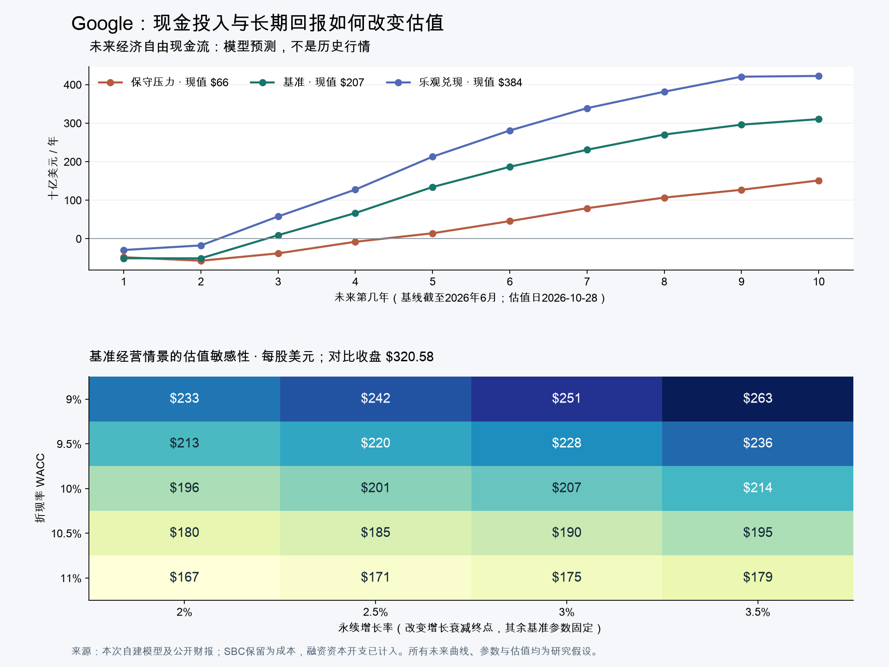

# Google估值与机器人供应链筛选｜2026-10-28

本次价格统一采用 **2026-10-27美国常规收盘、美元**。Google为320.58美元；财务基线使用截至6月30日的最新已发布季度，普通股数取7月15日披露。尚未使用Q3结果。目标是给你3–5年、优先控制回撤的资金提供有依据的候选与价格，预算及持仓仍未确认。[Google报价](https://stockanalysis.com/stocks/googl/statistics/) · [最新季度原始披露](https://www.sec.gov/Archives/edgar/data/1652044/000165204426000071/goog-20260630.htm)

**结论：Google现价没有达到我为你要求的安全边际；机器人筛选也没有发现三只可以直接称为现价明显低估的股票。** Google基准经营现金流模型约207美元，较快增长检查约229美元，乐观兑现约384美元。你适合优先等待估值与价格匹配；RRX、CGNX、ATS进入有条件的研究名单，三者分别对应盈利与去杠杆、视觉技术整合、项目订单与回款风险。

**今天对你最重要的事**

1. **Google经营业务有增长，320美元的价格也要求较强兑现。** 排除投资浮盈后，当前价格约需25.7倍TTM经营利润支持。基准DCF为207美元；更低折现率或更快增长可以提高估值，乐观情景可支持高于现价，但与控制回撤所需的安全边际是两回事。
2. **首笔研究区间180–195美元，后续160–175、140–155。** 这是依照本次模型提出的Google专属预算分批草案，不是保证见底、历史支撑或已经批准的下单。下一份财报可能上调或下调这些价格；触价时先更新模型。
3. **机器人优先看RRX，其次等待CGNX价格，ATS风险最高。** 现价相对我自建基准的折让分别约4%、负25%、9%，尚不够把它们一起列成低估买入清单。主题机会可以通过真实业务兑现，也可能早已进入股价。

**Google估值结果**

| 情景 | 前5年收入年增速假设 | 第6–10年增速逐年变化 | 成熟营业利润率 | 折现率 / 永续增长 / 终值ROIC | 模型现值（美元/股） |
| --- | --- | --- | --- | --- | ---: |
| 保守压力 | 10% | 5%逐年降至2.5% | 28% | 11% / 2.5% / 12% | 66 |
| 基准 | 18% | 9%逐年降至3% | 36% | 10% / 3% / 15% | 207 |
| 乐观兑现 | 22% | 12%逐年降至3.5% | 38% | 9% / 3.5% / 18% | 384 |

这些是我的经营与资金成本假设，不是公司指引、概率预测或价格上下限。压力情景反映收入减速而前期投入难以及时收缩；乐观情景同时要求强增长、较好的利润率与投入回报。不能将384美元单独拿出来当目标价，也不能把66美元理解为最坏损失已被封住。

**我对“现在算不算低估”的回答是：按你的风险偏好，不算明显低估。** 当前价320.58比基准DCF高约55%；较快增长检查只把前5年收入年增速改为20%、第6年起由10%衰减至3%，其他假设不变，约229美元。将折现率降至9%时，估值约251美元。320美元能够成立，需要更强的增长、现金转换或更低的回报要求，当前并没有给这些不确定性留下充足余量。

反向估值提供另一种检查：在基准其他参数固定时，前5年收入需要约 **29.1%年复合增长** 才能使模型现值接近320.58。这只是一个条件解；市场也可能是在押注更低资本开支、更高利润率或较低折现率，不能将29.1%说成市场唯一预期。

现金流图是**未来模型预测**，未混入历史行情。模型前两年经济自由现金流为负，包含将股权薪酬保留为经济成本的影响，不能直接把这一数值当作同期必须筹集的现金。所有情景都完整扣除假设资本开支；既没有将全部AI投资永久当作无收益支出，也没有把它直接当作可以全部加回的“增长投入”。

### 表面16倍PE为什么不足以回答问题

第三方TTM市盈率16.08倍、预期23.96倍、P/FCF73.60倍，分母分别对应已实现盈利、市场预期盈利与已实现现金流。公司Q2其他收益含980亿美元净收益，主要来自股权投资重估；这些资产仍有价值，但这笔浮盈不能永久外推成每年经营利润。Q2经营现金流390.69亿美元、现金资本开支449.24亿美元，自由现金流为负58.55亿美元。[估值统计](https://stockanalysis.com/stocks/googl/statistics/) · [Q2公司业绩](https://www.sec.gov/Archives/edgar/data/1652044/000165204426000066/googexhibit991q22026.htm)

我改用含股权薪酬和租金、排除投资收益的TTM营业利润1476.28亿美元作为经营起点，另算投资资产。这个营业利润由2025全年1290.39亿＋2026上半年804.66亿−2025上半年618.77亿重建。[2025年报](https://www.sec.gov/Archives/edgar/data/1652044/000165204426000018/goog-20251231.htm) · [2026半年报](https://www.sec.gov/Archives/edgar/data/1652044/000165204426000071/goog-20260630.htm)

### 资本开支决定价值何时兑现

基准以4458.7亿美元TTM收入起步，前两年收入假设约5261亿、6208亿美元；资本开支假设为收入44%、45%，即约2315亿、2794亿美元。随后投入占比下降，到第5年27%，第10年接轨成熟增长所需再投资。折旧摊销由收入8%、10%过渡至12%。这些是高投入延续、随后现金回报逐步改善的**分析假设**，并非公司已经宣布未来各年的金额。

如果实际资本开支很快下降且盈利没有受损，207美元会偏保守；如果资产更新更快、折旧上升压低利润、客户需求回报不足，模型仍可能偏乐观。终值占基准企业价值约73%，所以我保留敏感性表与压力情景，不用个位数精确价格制造确定性。[十年逐期现金流](./google_forecast.csv) · [全部模型输入](./google_model_inputs.json) · [计算输出及敏感性](./google_valuation_model.json)

**对你当前状态的建议**

当前没有确认Google持仓，也没有确认股票总预算。我的建议是**暂缓在320美元附近为低估理由建仓Google**，把它留在重点观察；按时间投入QQQM的讨论可以独立继续，等待Google便宜不必等同全部资金一直空仓。

以下比例的分母是以后单独确定的 **Google专属预算**，不是全部资金，也不是每次剩余现金；仅为方案草案。如果你以后给Google预留总资金5%，表中20%首笔才相当于总资金1%。直接持股还要加上VOO、QQQM中已有的间接风险。

| 研究价格（美元/股） | 相对当前基准207的折让约 | Google专属预算草案 | 到价时还必须成立的条件 |
| --- | ---: | ---: | --- |
| 180–195 | 6%–13% | 首笔20% | 新财报后模型仍支持此价值，搜索/云经营未实质恶化，融资与稀释可控 |
| 160–175 | 16%–23% | 再投入30% | 下跌主要来自估值收缩；订单、客户需求与单位现金回报没有相应崩塌 |
| 140–155 | 25%–32% | 再投入30% | 重新核算下行情景后仍有余量，股票总风险预算未超限 |
| 余下20% | 无固定触价 | 等经营证据或保留 | 不为凑满仓位投入；跳过价格区间时不自动连买三笔 |

从320.58到首档约需再跌39%–44%。这不是预计一定会跌到；它说明在本次回报要求下，Google目前可能不是这笔低回撤资金必须持有的个股。如果后续盈利和资本回报改善，把研究价位上修，比坚持一个永久不变的低价更合理。即使180美元入场，相对本次66美元压力情景仍有约63%的下行；分批与折让不能替代股票总预算约束。

原QQQ/QQQM/VOO/BRK.B的15%/25%观察档继续独立；这里的“估值折让”与“距52周高点回撤”分母不同，不混成同一规则。首次跨到多个价格区间也先复核估值与总预算，不能将下跌当作基本面仍成立的证据。

与你的3–5年期限有关：假设希望获得10%年化、忽略股息税费及汇率，320.58买入后五年末需要约516美元；230买入则约370美元。它们只是收益门槛计算，非五年目标预测。十年DCF用于估当前资产价值，不能保证五年内市场会给同样估值。

### 哪些新信息会推翻结论

- **可上修：** 搜索与云的经营利润增长、单位资本开支带来的新增收入及现金回报同时改善；投入放缓没有损害客户留存和增长；实际股数/融资优于假设。
- **需下修或放弃加仓：** 搜索商业化受损，AI投入继续上升而现金回报恶化，债务/股权融资扩大，或账面投资显著贬值。单日上涨或新产品发布不足以单独上调价值。
- 第三方日历指向10月28日美国盘后Q3；本次官方动态页未完整返回对应公告正文，日期仍标待官方核实。下一份财报一旦发布，先用新经营数据、股数和资产负债表替换本模型，再讨论任何首笔，不机械沿用今天的数字。

**机器人供应链筛选**

筛了RRX、CGNX、ATS、NOVT、ROK、TER、ZBRA、AMBA、STM九家。**优先研究顺序为RRX、CGNX、ATS；现价均未达到本次要求的充足安全边际。** 这是有限候选筛选，不是全市场穷尽或排名回测。

| 公司 | 10/27收盘美元 | 真实相关环节 | 本次基准研究价值 | 较有余量的研究价位 | 对你的判断 |
| --- | ---: | --- | ---: | ---: | --- |
| Regal Rexnord / RRX | 158.21 | Kollmorgen关节电机、传动与运动控制 | 165 | 130–140 | 最接近有估值依据的候选；等价位或去杠杆/现金流改善 |
| Cognex / CGNX | 58.22 | 机器视觉、拟收购RealSense机器人感知 | 46 | 39–40 | 业务质量候选；现价已要求较高增长 |
| ATS Corp / ATS | 19.00 | 自动化系统集成、项目交付 | 21 | 16–17且订单/回款改善 | 三者风险最高；不适合用作回撤控制核心资产 |

九个收盘由本次Yahoo日线与Stock Analysis核对，不混入盘后。机器人相关收入未完整单独披露时不编造占比，整家公司不能套用人形机器人远期市场规模。RRX、CGNX、ATS也没有共同的保证收益或最大亏损边界。[价值组报价和来源](./robotics_value_sources.json) · [质量组报价和来源](./robotics_quality_sources.json)

### RRX：真实产品关系，较小折让仍需等待

Kollmorgen有用于机器人关节的无框电机，供应链关系成立；公司AMC整个分部约占集团Q2收入30.65%，不能将此当机器人收入。公司2026调整EPS指引中点10.60美元含0.57美元一次性退税，且对照表还加回0.32美元股权薪酬。[公司指引与调整表](https://investors.regalrexnord.com/investors/ir-news/press-release-details/2026/REGAL-REXNORD-REPORTS-SECOND-QUARTER-2026-FINANCIAL-RESULTS/default.aspx) · [Kollmorgen产品](https://www.kollmorgen.com/en-us/solutions/robotics/humanoid-robots)

主报告恢复SBC为持续经济成本，采用 **10.60−0.57−0.32=9.71美元** 作为参考，而不是只剔退税后的10.03。按我假设的17倍，基准165.07；保守8.25×14=115.50、乐观11.5×18=207.00。17倍不是已验证的历史低位；这是考虑行业周期、负债与调整成本的研究假设。每股盈利已含利息，不再额外扣净债务。当前价只有约4%基准折让，135美元附近才约18%；130–140可以研究首笔。

正面是订单与运动控制需求改善、存在去杠杆空间；风险是净负债较高，其他调整项目和收购摊销仍有真实经济含义，调整利润未必全部变成可分配现金。先看下一季剔除退税后的利润、现金转化和净债务，不能仅为机器人标签给高倍数。[初筛底稿，采用较宽松去退税口径；本报告额外恢复SBC](./robotics_value_screen.md)

### CGNX：产品质量成立，收购不能同时算机会与免费现金

公司拟以约5亿美元现金收购RealSense，并有留任和RSU安排，预计Q4完成；这些成本会影响可分配现金及股数。全年调整EPS指引中点1.66美元，现价约35倍该指引。机器人收入占比未单独披露。[公司收购公告](https://investor.cognex.com/news/news-details/2026/Cognex-to-Acquire-RealSense-Expanding-Machine-Vision-Leadership-into-High-Growth-Robotic-Perception-Market/default.aspx) · [全年指引](https://www.sec.gov/Archives/edgar/data/851205/000085120526000061/a07052026-xex991xq22026ear.htm)

五年每股盈利价值折现检查：EPS1.66，未来增长8%/12%/18%，第五年退出PE22/26/30，要求回报11%，年股息暂按0.34固定，得到33/46/69美元。增长与倍数全为假设，既不是完整企业DCF，也没有再把收购前现金全部加一遍。以基准46.40再留15%余量，约39.44；我把39–40列为待价区。最强反证是整合效果和利润上修足以维持高估值；风险是制造业周期、现金支出和实际摊薄。[可复算模型](./robotics_quality_sources.json)

### ATS：现金流赔率存在，订单和杠杆使它更激进

公司FY27 Q1订单、积压与收入均同比下降，当季FCF为负。第三方P/FCF约10倍不能直接照用：公司还扣无形资产支出，按公司口径重建TTM FCF约2.063亿加元，折美元后对现价的现金流收益率约8%。项目里程碑收款可能造成大幅波动，8%不是稳定派息率。[公司季报](https://www.sec.gov/Archives/edgar/data/1394832/000139483226000023/ats-pressreleasexfy27q1.htm)

采用同口径含租赁净债务11.92亿加元、TTM调整EBITDA4.043亿加元，基准假设10倍EV/EBITDA，9702万股及1美元=1.40126加元参考汇率，得到20.97美元。保守350百万加元EBITDA×8倍、乐观450×11倍，对应11.83/27.64。倍数为主观假设、并非同业统计结论。19美元的价位只比基准低约9%，至压力情景却约有38%下行，16–17也必须同时看到订单、回款和负债改善；否则继续等待，不能靠跌幅抵消业务恶化。

### 暂不作为低估首选的六家

| 公司 | 收盘美元 | 本次排除或等待原因 |
| --- | ---: | --- |
| NOVT | 149.35 | 精密运动业务成立，但约40倍公司全年调整EPS；7月并购后的股数与负债仍需桥接 |
| ROK | 439.20 | OTTO与工业自动化业务成立，约33倍公司全年调整EPS，价格已要求较高增长 |
| TER | 323.68 | 机器人约占Q3收入7.35%，测试业务主导；不能按机器人给全公司估值 |
| ZBRA | 381.67 | 已出售原Robotics Automation业务，且盈利含关税追偿；只能保留工业视觉/RFID相邻研究 |
| AMBA | 67.12 | 高预期倍数、GAAP亏损及SBC风险，尚缺低估依据 |
| STM | 48.68 | 当前已反映较多复苏预期，10/29Q3待公布，先核对新周期盈利 |

逐家公司资料、官方披露和缺口见[质量组底稿](./robotics_quality_screen.md)、[价值组底稿](./robotics_value_screen.md)。这些是研究淘汰理由，不能从中推断股价一定下跌。

**口径、核验和缺口**

### Google经营DCF如何计算

采用美元名义十年FCFF：每期收入×营业利润率×(1−21%税率)＋折旧摊销−资本开支−增量营运资本。营运资本按增量收入2%估算。SBC保留在营业成本，不加回；未来融资资产投入计入capex，融资本金不再扣一次。经营租金已在利润中，故不再另扣经营租赁负债。

第6–10年增长线性衰减至终值增长；第10年净再投资与当年增长/终值ROIC匹配。终值FCFF11=NOPAT10×(1+g)×(1−g/ROIC)，再除以WACC−g。独立审阅指出的原第10年增长与再投资不一致已修正；交付数字全部采用修正模型。

### 投资资产和资本桥（十亿美元）

| 项目 | 最新账面基线 | 本模型处理 |
| --- | ---: | --- |
| 非股权现金与债券 | 155.411 | 另留20/30/40运营现金，非全部分配 |
| 市场股权，含非流动 | 101.189 | 按90%/70%/50%保留，合并价格、流动性与税不确定性 |
| 非市场证券 | 131.461 | 按75%/50%/25%保留 |
| 纯有息债务 | 100.164 | 扣除 |
| 融资租赁 | 2.590 | 在融资资产capex假设一致的前提下扣除 |
| 优先股索偿代理 | 19.250 | 扣索偿额，股数不再加优先转股；不重复扣同一股息 |
| 少数股东权益 | 7.100 | 扣账面代理，公允值未单独测定 |
| 当前普通股分母 | 12.230十亿股 | 不把季度加权摊薄数冒充当前股数 |

基准净桥约132.87十亿美元、每股贡献10.86美元；保守/乐观每股约5.70/16.02。折价是研究假设，六月之后资产价值和融资变化尚未由新季度披露更新，不能再把全部递延税负重复扣掉。未来若净新增10%普通股、企业价值不变，模型每股价值还需除以1.10。运营、税务和融资不确定性都不会因列成表就消失。[资本审计与原披露索引](./google_capital_audit.md) · [逐项来源数据](./google_capital_sources.json)

### 方法交叉检查与边界

同一基准资产桥下，假设18/22/26倍TTM经营利润分别对应228/276/325美元。这个倍数网格说明当前价格需要怎样的经营估值，但本次没有验证这些倍数处于历史或同业便宜区间，因此**不把它当作独立证明Google合理值必然在228–325之间的证据**。本次核心结论依靠现金投入、增长和回报假设下的DCF与反向检查。

报价已跨源核对；Google财务表与资本桥由独立研究交叉审阅。机器人价格也跨源一致，RRX再经主线程恢复SBC；ATS财年现金流底稿部分来自可读取搜索索引，且汇率为日线参考，非同步成交价。个人税、买卖价差、未来人民币汇率与实际下单单位未计，模型不是收益承诺。

研究工件：[模型输入](./google_model_inputs.json) · [模型输出](./google_valuation_model.json) · [现金流CSV](./google_forecast.csv) · [价值组证据](./robotics_value_sources.json) · [质量组证据](./robotics_quality_sources.json) · [主线程RRX口径复核](./parent_normalization_review.json) · [算术与终值检查](./valuation_checks.json)。用户尚未确认采用任何预算、仓位或交易；本次未操作券商账户，也未改变四标的15%/25%提醒状态。
