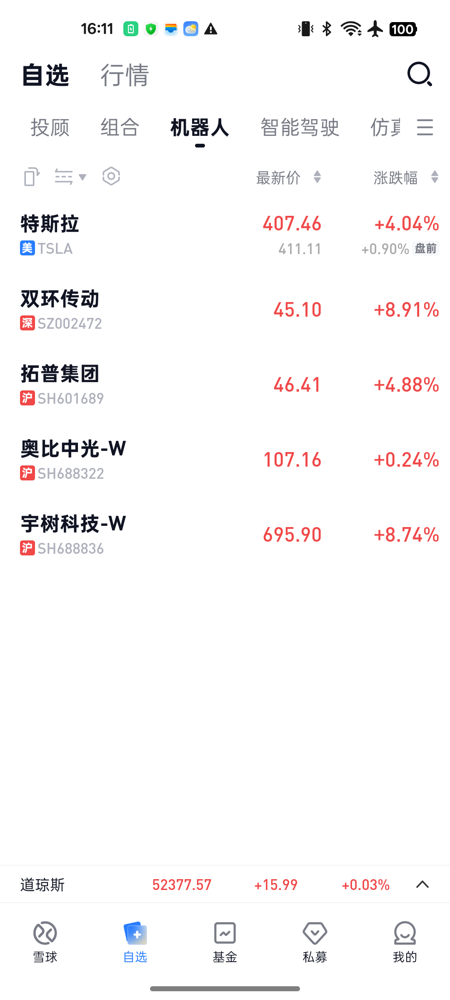

# 雪球自选整理完成

执行日期：2026-10-28（北京时间）。在用户已连接的安卓手机雪球 App 内操作，仅添加自选和管理分组。

**已在自选主页逐组核对：14只证券，5个分组。已有自选保留；没有执行证券交易。**

**完成名单**

| 分组 | 数量 | 已在App读回的证券 |
| --- | --- | --- |
| 机器人 | 5 | 特斯拉（TSLA）、双环传动（SZ002472）、拓普集团（SH601689）、奥比中光（SH688322）、宇树科技（SH688836） |
| 智能驾驶 | 2 | 小鹏集团（XPEV）、地平线机器人（09660） |
| 仿真感知 | 5 | 豪威集团（SH603501）、海康威视（SZ002415）、索辰科技（SH688507）、群核科技（00068）、五一视界（06651） |
| 能源存储 | 1 | 闪迪（SNDK） |
| 算力平台 | 1 | 英伟达（NVDA） |

**未添加的三项**

| 公司 | 实际搜索与处理 |
| --- | --- |
| 银河通用 | Galbot 股票搜索暂无结果；此前也未确认其可交易上市代码，未用相似名称公司代替。 |
| 三星电子 | Samsung 搜索当前可见结果为三星品牌基金；005930 搜索暂无结果。基金不是三星电子股票，未替代添加。 |
| SK 海力士 | SKHynix、000660 股票搜索均暂无结果，未添加。 |

上述只说明本次 App 检索与可见结果，不宣称雪球全市场均不支持某国证券。后续可在确认正确证券身份与行情入口后再补充。

**执行核验**

每只股票先核对市场和代码，再保存到指定分组；保存后重新打开分组选择页验证。最后在自选主页检查了5组的股票代码，数量分别为5、2、5、1、1。原有自选和其他分组成员关系保留，没有添加同一公司的其他上市地证券，也没有设置价格预警或下单。

这是研究观察名单，不代表这些公司已被证明低估；新增自选也不代表用户持有这些股票。截图中的行情仅是执行时界面，不作为重新估值或买入建议。

**App结果截图**

[智能驾驶分组截图](./group_2.png) · [仿真感知分组截图](./group_3.png) · [能源存储分组截图](./group_4.png) · [算力平台分组截图](./group_5.png)

[逐组核验数据](./final_audit.json) · [未匹配证券的搜索记录](./availability_checks.json)
