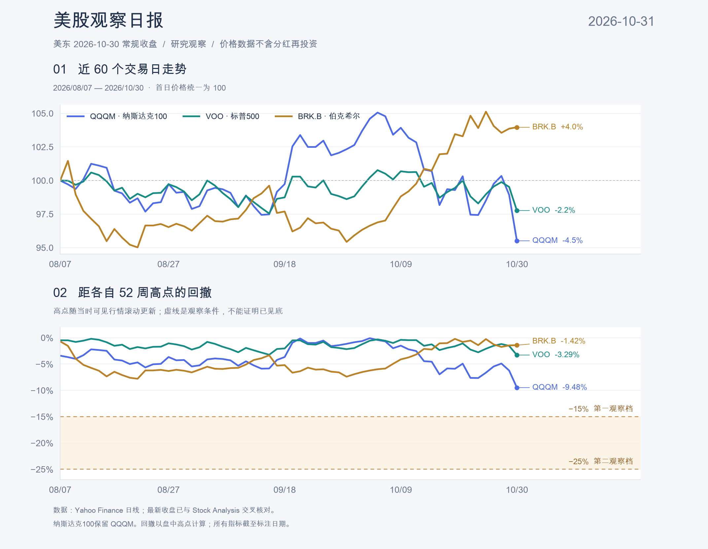
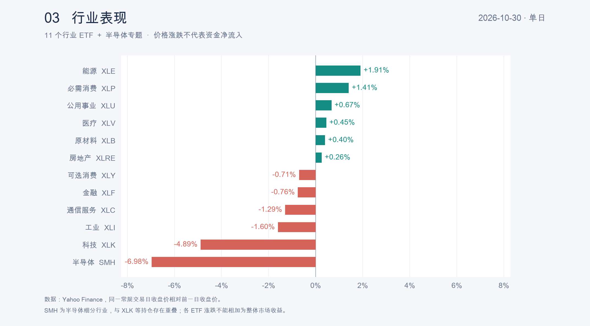

# 美股观察｜2026-10-31 北京时间

采用**美东2026-10-30（周五）常规收盘**，对应北京时间10/31 04:00。股票／ETF均为美元；指数为点。10/30正常交易，下一常规交易日为**11/2，因11/1结束夏令时，北京时间22:30开盘**。[NYSE](https://www.nyse.com/trade/hours-calendars) · [NIST](https://www.nist.gov/pml/time-and-frequency-division/popular-links/daylight-saving-time-dst)

**今日判断：已有VOO／QQQM／GOOG仓位，后续分批暂不加速；不要把半导体大跌直接当成便宜。** 标普500-1.82%，纳斯达克综合-2.86%，纳斯达克100-3.46%。QQQM回撤9.48%，尚未进入13%接近档；VOO亦未进入，今日没有已核实的新跨档提醒。BRK.B新高存在来源差异，提醒状态保留上次有效记录。

你的期限仍为3–5年、计划预算30,000美元、可接受约6,000美元暂时亏损。45%股票／55%SGOV仍是未采用草案，20%不是保证的最大损失。持仓依据为**10/30 09:37北京时间核验的本地基线**，本次只更新市场价格，未重新登录嘉信核对数量或可用资金。

**今天对你最重要的事**

1. **已经买入，重点改为控制叠加风险。** QQQM今日−3.46%，成交量约此前20日均量2.89倍；VOO−1.77%，约1.87倍。按最后有效数量计算，GOOG直接占已知股票市值约**25.6%**，VOO／QQQM还提供同公司的间接暴露，穿透权重本次未重核。它不等于总资产权重，也不能用30,000美元计划预算推断全部钱已经到账。建议下一笔先确认股票上限和固定额度，研究排序仍偏VOO、再QQQM；暂不同时叠加MAGS／VGT／半导体来追跌。反证是成长股现金兑现好于预期、迅速反弹；代价是放弃部分反弹弹性。[QQQM历史行情](https://stockanalysis.com/etf/qqqm/history/) · [VOO历史行情](https://stockanalysis.com/etf/voo/history/)
2. **AI融资风险出现新的原始证据，Google的回款模型仍需保守。** S&P于10/30 **17:01 EDT（北京10/31 05:01）**将Meta展望从稳定调为负面，**AA−评级维持**。这是收盘后的事件，不能倒推解释全天跌幅，也不是Alphabet被降评级。它提示QQQM／MAGS内的AI投入风险可能同时发生。本次又核Google已发布10-Q：TPU硬件交付与持续安装／支持服务收入确认不同，部分合同有多年回购权，云订单不应全部按永续服务利润率估值。最强反证是客户持续回款、硬件与服务单位经济性兑现；下一项看交付、实际回款及回购／担保变化，旧买价继续暂停。[S&P官方行动表](https://www.spglobal.com/ratings/en/regulatory/ratings-actions?tz=hkt) · [具体核验与限制](./macro_research.md) · [FiNews线索回查](./finews_digest.md)
3. **半导体跌幅很大，安全边际尚未因此成立。** SOXX−8.24%，SMH−6.98%，DRAM−7.23%；SOXX／SMH距各自52周盘中高点回撤28.12%／22.23%。这些标的**没有获批的15%／25%仓位规则**，不能据此自动补仓。你目前明确持有的三只证券未包含它们；已有纳指与Google敞口时，应先验证盈利和现金回报，再考虑从同一股票预算中划出额度。反证是订单与盈利继续强劲、价格调整早于经营兑现；下周AMD业绩是新增可核查条件。[SOXX历史行情](https://stockanalysis.com/etf/soxx/history/) · [SMH历史行情](https://stockanalysis.com/etf/smh/history/)

**对你当前状态的建议**

按10/30最后有效持仓数量、用10/30常规收盘估算，已知股票市值约**10,867.66美元**，较基线券商成本约**-1.67%**。这是价格更新后的参考浮盈亏，不含分红、税费或后续成交，不是账户总回报；买入日期和税批未核验。

| 实际代码 | 基线券商均价／美元 | 10/30收盘／美元 | 相对基线均价参考变化 |
|---|---|---|---|
|GOOG|281.9100|278.22|-1.31%|
|QQQM|293.3025|284.34|-3.06%|
|VOO|706.0000|694.81|-1.58%|

GOOG相对自身52周高点已回撤31.21%，相对你的基线均价仅约−1.31%，两种参照不同。GOOGL279.84仅作公司研究；真实持仓GOOG使用278.22，绝不混算股价或成本。

当前建议是维持既有观察，后续按固定时间和限定额度评估，**今天暂不因单日跌幅追加额外批次，也不恢复Google旧研究价位**。原45／55配置与定额分批没有被当成已执行。若下一步配置仍以控制回撤为先，新增主题ETF与个股共用同一股票预算；可留有短期美债防守配置，无急用资金不等于应全部持有股票。结算状态须看实际券商余额，不能仅按自然日两天推定资金已结算。[嘉信现金账户规则](https://www.schwab.com/learn/story/avoid-these-violations-when-trading-cash)

[固定在线观察台](https://nolan-market-watch.choice-calf-0415.chatgpt.site/)已按你的新要求支持一年／两年／三年同步切换收益、年化波动和最大回撤，MA50／200固定，曲线可看收盘极值及日期／价格提示。公开站点仅含行情与通用研究，本篇个性化持仓信息只保留在本地日报。

**分类观察总表**

按重点指数ETF → 机器人 → AI／半导体 → 金融科技排列；伯克希尔与SGOV另列价值、现金管理。当前共17项，每个标的只归入一个主类别。纳斯达克100保留QQQM，QQQ已从当前清单移除。

收盘及回撤采用美东 **2026-10-30** 常规时段，报价均为美元。盘前列对应 **2026-11-02**；本版盘前状态为尚未开始，上一交易日历史盘前放在[时段详情](./extended_detail.md)。盘后每行附自身北京时间，美东时间和来源见[总表数据](./watchlist_table.json)。盘前相对之前最近一次常规收盘、盘后相对同日常规收盘。

| 分类 | 标的／定位 | 10-30收盘／当日 | 11-02盘前 | 10-30盘后参考／时间 | 常规收盘距52周高点回撤 | 15% / 25%观察价 | 研究判断／下一条件 |
| --- | --- | --- | --- | --- | --- | --- | --- |
| **01 宽基与风格ETF** | **VOO** · 标普500 | 694.81（-1.77%） | 尚未开始 | [695.60（+0.11%）](https://query1.finance.yahoo.com/v8/finance/chart/VOO?range=5d&interval=1m&includePrePost=true) · 北京10/31 07:28 | 3.29% | 610.70 / 538.85 | 已有仓位，后续分批不加速；先确认股票目标与单笔额度；ETF与个股共用风险预算 |
|  | **QQQM** · 纳斯达克100 | 284.34（-3.46%） | 尚未开始 | [285.20（+0.30%）](https://query1.finance.yahoo.com/v8/finance/chart/QQQM?range=5d&interval=1m&includePrePost=true) · 北京10/31 07:26 | 9.48% | 266.99 / 235.58 | 已有仓位，回撤9.48%，未近13%档；量能放大下继续观察盈利与融资风险，不因跌幅临时扩大仓位 |
|  | **SPMO** · 标普500动量因子 | 136.27（-4.30%） | 尚未开始 | [136.62（+0.26%）](https://query1.finance.yahoo.com/v8/finance/chart/SPMO?range=5d&interval=1m&includePrePost=true) · 北京10/31 07:25 | 16.04% | 未设置 | 动量因子研究观察；前期强势行业回撤与再平衡风险，不当成全市场分散 |
|  | **MAGS** · 七巨头集中组合 | 68.48（-1.75%） | 尚未开始 | [68.68（+0.29%）](https://query1.finance.yahoo.com/v8/finance/chart/MAGS?range=5d&interval=1m&includePrePost=true) · 北京10/31 06:47 | 8.42% | 未设置 | 七巨头集中，避免重复叠加；Meta展望负面与AI现金流；未核实时穿透权重 |
| **02 机器人相关** | **RRX** · 运动控制与电机 | 157.24（-3.90%） | 尚未开始 | [157.24（-0.00%）](https://query1.finance.yahoo.com/v8/finance/chart/RRX?range=5d&interval=1m&includePrePost=true) · 北京10/31 05:50 | 36.55% | 未设置 | 价格下跌尚未形成保守安全边际；11/3财报，现金转化、调整项目和去杠杆 |
|  | **CGNX** · 机器视觉 | 56.15（-4.78%） | 尚未开始 | [58.99（+5.06%）](https://query1.finance.yahoo.com/v8/finance/chart/CGNX?range=5d&interval=1m&includePrePost=true) · 北京10/31 04:09 | 22.96% | 未设置 | 有条件研究候选；11/4盘后业绩，RealSense整合成本与稀释 |
|  | **ATS** · 自动化系统 | 18.39（-3.67%） | 尚未开始 | [18.34（-0.26%）](https://query1.finance.yahoo.com/v8/finance/chart/ATS?range=5d&interval=1m&includePrePost=true) · 北京10/31 05:10 | 48.66% | 未设置 | 高风险研究候选；订单回款与杠杆；不依据46%高点回撤认定低估 |
| **03 科技与AI／半导体** | **GOOGL** · Google／AI云 | 279.84（-1.40%） | 尚未开始 | [281.65（+0.65%）](https://query1.finance.yahoo.com/v8/finance/chart/GOOGL?range=5d&interval=1m&includePrePost=true) · 北京10/31 07:29 | 31.51% | 未设置 | 同公司研究对照，实际代码GOOG；TPU硬件／服务分开估值，旧入场档继续暂停 |
|  | **NVDA** · AI芯片与算力 | 204.64（-4.22%） | 尚未开始 | [205.19（+0.27%）](https://query1.finance.yahoo.com/v8/finance/chart/NVDA?range=5d&interval=1m&includePrePost=true) · 北京10/31 07:29 | 15.91% | 未设置 | 估值待完成；订单、实际回款与客户投入回报，避免以跌幅替代估值 |
|  | **SMH** · 半导体ETF | 522.49（-6.98%） | 尚未开始 | [525.35（+0.55%）](https://query1.finance.yahoo.com/v8/finance/chart/SMH?range=5d&interval=1m&includePrePost=true) · 北京10/31 07:26 | 22.23% | 未设置 | 回撤22.23%，仅行业研究；不套QQQM15%／25%档位；盈利与客户现金回报 |
|  | **VGT** · 美国信息技术行业ETF | 116.96（-4.32%） | 尚未开始 | [117.39（+0.37%）](https://query1.finance.yahoo.com/v8/finance/chart/VGT?range=5d&interval=1m&includePrePost=true) · 北京10/31 07:27 | 10.49% | 未设置 | 科技行业敞口研究；与QQQM／个股重叠；估值待完成 |
|  | **SOXX** · 半导体行业ETF | 471.51（-8.24%） | 尚未开始 | [474.18（+0.57%）](https://query1.finance.yahoo.com/v8/finance/chart/SOXX?range=5d&interval=1m&includePrePost=true) · 北京10/31 07:28 | 28.12% | 未设置 | 单日-8.24%，暂缓追跌；行业盈利周期与11/5拆股统一口径；无独立仓位规则 |
|  | **DRAM** · 存储芯片主题ETF | 48.01（-7.23%） | 尚未开始 | [48.34（+0.69%）](https://query1.finance.yahoo.com/v8/finance/chart/DRAM?range=5d&interval=1m&includePrePost=true) · 北京10/31 07:26 | 不足52周／缺失 | 未设置 | 存储主题，高波动短历史；仅成立以来数据；缺完整52周与MA200，估值待完成 |
| **04 医疗与生物科技** | **MRNA** · Moderna／mRNA药物与疫苗 | 221.72（-0.47%） | 尚未开始 | [221.01（-0.32%）](https://query1.finance.yahoo.com/v8/finance/chart/MRNA?range=5d&interval=1m&includePrePost=true) · 北京10/31 07:08 | 12.87% | 未设置 | 医疗生物科技，估值待完成；11/6业绩，现金消耗、融资与临床兑现；历史极端跳变不作预期 |
| **05 金融科技** | **SOFI** · 数字银行与金融平台 | 16.76（-4.83%） | 尚未开始 | [16.75（-0.06%）](https://query1.finance.yahoo.com/v8/finance/chart/SOFI?range=5d&interval=1m&includePrePost=true) · 北京10/31 07:29 | 48.79% | 未设置 | 估值待完成；Q3完整10-Q仍未见，信用风险与资本回报模型待核 |
| **06 价值与综合经营** | **BRK.B** · 伯克希尔B | 542.49（+0.10%） | 尚未开始 | [543.60（+0.20%）](https://query1.finance.yahoo.com/v8/finance/chart/BRK-B?range=5d&interval=1m&includePrePost=true) · 北京10/31 07:21 | 1.42% | 467.76 / 412.73（新高待核） | 继续研究，新高来源有差异；Yahoo550.30／第二源550.47；提醒状态暂保留最后有效高点 |
| **07 现金管理** | **SGOV** · 0–3个月美债ETF | 100.73（+0.02%） | 尚未开始 | [100.73（+0.00%）](https://query1.finance.yahoo.com/v8/finance/chart/SGOV?range=5d&interval=1m&includePrePost=true) · 北京10/31 07:27 | 0.01% | 未设置 | 短期美债研究；基线未显示持有；SEC收益率按10/28核验值3.79%留作历史，不作本次新收益报价 |

研究状态表达当前结论，不代表持仓或已批准交易；15%/25%观察价只保留QQQM、VOO、BRK.B三项。其他行的“未设置”不等于没有风险。盘后无有效报价写缺失，不用收盘填充；单源分钟价格与零量延续报价仅作参考，来源差异见[盘后核验](./extended_verification.json)。SGOV的价格回撤受派息影响，不能按股票跌幅解释。

BRK.B表中与图中暂按Yahoo新高550.30计算，第二来源为550.47；精确高点未核定，因此本日不将它写入持久提醒状态。上次有效高点549.96对应467.47／412.47，保留作历史状态，不当成已核的10/30新观察价。QQQM高点314.11与第二源314.12差一美分，阈值相差一美分，已披露而不触发重复提醒。

**Google估值结果**

GOOGL收279.84（−1.40%），GOOG收278.22（−1.45%）；公司研究与真实持仓报价分开。10/30没有在所读SEC recent列表中发现更新的经营8-K；最新Form4正文未读，不能推断减持意图。已发布Q3 10-Q及昨日资本桥继续有效，**本次没有重算新合理价**。

昨日十年模型三情景68.25／216.28／402.11美元仍是带主观增长、利润率、资本支出、营运资金与折现率的条件结果。GOOGL现价高于该基准约29.4%，下跌后仍未证明充分安全边际，不把区间结果改成买单。TPU收入确认、回购与服务经济性的本次追加核验，见[原始合同条款与推论](./macro_research.md)；财务基线与模型见[10/30资本桥](../2026-10-30/google_update/google_update.md)。下一次重点在回款和2027投入，不再用“尚缺10-Q”拖延。

**SOFI研究观察**

SOFI16.76（−4.83%），近5交易日仍+14.68%。以公司2027管理层调整EPS0.90展望作简单参照约**18.62倍**，它是未来非GAAP口径，不是已实现盈利，也没有完整计入潜在稀释。SEC recent本次重取，仍未见Q3完整10-Q；不能把已出业绩公告与完整贷款／信用附注混为一谈。保持估值待完成，继续查信用损失、资金成本、资本回报和股数。[原有资本回报检验](../2026-10-30/sofi_research.md) · [本次SEC核验](./macro_research.md)

**机器人供应链筛选**

RRX157.24（−3.90%）相较未经压力调整的165.07参考值低约4.7%，仍高于恢复25%摊销为经济成本的主观148.41情景；上述EPS／17倍乘数及恢复比例都是研究假设，不足以判定低估。11/3财报重点是现金转化、持续调整项和去杠杆。CGNX56.15、ATS18.39保留有条件候选；11/4盘后CGNX核整合支出与稀释，ATS继续核订单回款及杠杆。[昨日成本压力依据](../2026-10-30/robotics_update.md)

MRNA221.72（−0.47%）只是医疗生物科技研究对象，不能把AI医疗叙事直接等同Moderna低估。11/6核现金消耗、融资与商业化；历史日线含8/19极端跳变，对回报和年化波动影响显著，已知价格核验不等于事件原因已查清。本次没有新增“已低估”股票。

**行业观察**

11个行业ETF **6涨5跌**，SMH另列。科技与半导体的跌幅显著大于其他行业；这是行业ETF层面的价格分化，不是所有个股广度或资金净流向。

- **XLK−4.89%、SMH−6.98%**：与你的成长敞口直接相关，量能放大仍不能单独确认底部；SOXX的−8.24%也不自动代表与SMH独立分散。
- **XLE+1.91%、XLP+1.41%**：价格相对强，不据单日领涨转换成追买理由；能源仍需核商品周期和估值。
- **XLV+0.45%、XLU+0.67%**：防守方向相对稳定，但医疗行业强势不能直接推导MRNA盈利兑现。

| 行业／ETF | 当日 | 近5交易日 | 近21交易日 | 当日相对VOO（百分点） | 近21日相对VOO（百分点） |
|---|---|---|---|---|---|
|能源 XLE|+1.91%|+1.00%|+11.67%|+3.68|+12.75|
|必需消费 XLP|+1.41%|+1.31%|+11.32%|+3.17|+12.39|
|公用事业 XLU|+0.67%|+2.04%|+9.45%|+2.44|+10.52|
|医疗 XLV|+0.45%|+3.12%|+11.23%|+2.22|+12.31|
|原材料 XLB|+0.40%|+2.79%|+8.65%|+2.17|+9.73|
|房地产 XLRE|+0.26%|+1.41%|+6.12%|+2.02|+7.19|
|可选消费 XLY|-0.71%|+2.02%|+6.04%|+1.06|+7.11|
|金融 XLF|-0.76%|+1.09%|+5.71%|+1.01|+6.78|
|通信服务 XLC|-1.29%|-5.32%|-9.13%|+0.47|-8.06|
|工业 XLI|-1.60%|+1.69%|-0.74%|+0.16|+0.34|
|科技 XLK|-4.89%|-2.03%|-9.25%|-3.12|-8.18|
|半导体 SMH|-6.98%|-0.89%|-15.43%|-5.21|-14.36|

**🔎 Reddit 投资与信息差观察**

**未完成24小时扫描**：六社区RSS403，可读New／Top仍有旧缓存；不把访问失败说成“没有新讨论”。昨日Google两帖已去重。本次只保留一项72小时内旧事件的新研究核验：Oracle10/28关于未来现金流和融资的管理层展望，原帖绝对时间未核、只读正文和一条反方评论，不称社区共识。

对GOOG／QQQM更有价值的问题是：客户预付款、供应商融资与实际项目现金回报，分别改善了什么。提前收钱或延期付款并不自动证明终端盈利；反证是合同覆盖投入且持续回款兑现。[原帖与原始公司公告核对](./reddit_digest.md) · [读取范围及缺口](./reddit_sources.json)

FiNews本次读到10/30日报，更新为UTC22:10:49（北京10/31 06:10:49）；S&P的Meta展望和Okta11/4盘前替换Kenvue入标普已回查原始来源。Okta是指数维护事件，不构成VOO低估或必涨依据。其非农北京时间22:30有一小时偏差，本版采用BLS／冬令时换算的**11/6 21:30**。[聚合内容核验](./finews_digest.md)

**距观察档还有多远**

| 标的 | 当日收盘 | 高点／日期 | 回撤幅度 | 距15%差额（百分点） | 当前价至15%需变动 | 状态 |
|---|---|---|---|---|---|---|
|QQQM|284.34|314.11／2026-10-06|9.48%|5.52|-6.10%|不足13%，无新提醒|
|VOO|694.81|718.47／2026-10-06|3.29%|11.71|-12.11%|不足13%，无新提醒|
|BRK.B|542.49|550.30／2026-10-30|1.42%|13.58|-13.78%|新高差异待核，不更新提醒|

QQQM离13%接近区间还差3.52个百分点；从284.34到266.99的15%观察价需约**−6.10%**。百分点衡量回撤差额，百分比衡量当前价格到目标价的变动，不能混用。它是继续观察已有仓位的信号，不是首笔或自动加仓命令。

BRK.B10/30高点Yahoo550.30、StockAnalysis550.47，均较此前549.96高，但精确高点有差异。两个来源都为第三方且可能共用上游，未取得交易所有效历史表；图表保留Yahoo统一口径，本次**不推进BRK.B提醒状态日期或新高阈值**，防止未核数据替换最后有效记录。QQQM／VOO已完成收盘交叉核验，阶段均未变。[本次报价核验](./quote_verification.json)

**利率与未来一周事件**

财政部10/30：**2年4.56%、10年4.94%**，较前日−5／−4基点；为参考曲线，不是可成交收益。VIX统一日线19.42、+12.91%，Cboe日期摘要一致；其独立时钟模块时区不明、官方CSV尚未覆盖10/30，不称16:00同步逐笔。[财政部](https://home.treasury.gov/resource-center/data-chart-center/interest-rates/TextView?type=daily_treasury_yield_curve&field_tdr_date_value=2026) · [Cboe](https://www.cboe.com/tradable-products/vix/)

ECI已于10/30发布：民用总薪酬季调环比+0.8%，同比未季调+3.4%；没有核一致预期，不写超预期，也不把它作为继续等待的门槛。下周JOLTS11/3北京23:00、生产率11/5 21:30、非农11/6 21:30；AMD11/3美东盘后、电话会北京11/4 06:00；Moderna电话会11/6北京21:00。RRX11/3、CGNX11/4美东盘后财报／11/5北京21:30电话会沿用近期已核官方日历。本周末结束夏令时后所有美股常规开盘为北京时间22:30。[本次官方日历与缺口](./macro_research.md)

SGOV本次未重核收益率；最近核验为**10/28的30日SEC收益率3.79%**，仅历史参考，未来收入随短端利率和费用变化，不是当前可锁定收益或总回报。[发行人](https://www.ishares.com/us/products/314116/ishares-0-3-month-treasury-bond-etf)

**完整表现与趋势数据**

|标的|当日|近5交易日|近21交易日|MA50|MA200|当日量／此前20日均量|
|---|---|---|---|---|---|---|
|VOO|-1.77%|-0.54%|-1.07%|705.70|670.20|1.87倍|
|QQQM|-3.46%|-1.97%|-6.95%|298.53|279.78|2.89倍|
|GOOG|-1.45%|-12.31%|-16.93%|335.73|338.70|2.23倍|
|GOOGL|-1.40%|-12.61%|-17.27%|339.07|340.66|2.11倍|
|BRK-B|+0.10%|+0.06%|+8.39%|515.11|495.74|1.05倍|
|RRX|-3.90%|+6.30%|+0.43%|157.80|189.80|1.18倍|
|CGNX|-4.78%|+1.08%|-9.76%|59.87|57.89|0.83倍|
|ATS|-3.67%|-2.90%|+2.00%|18.81|26.63|0.93倍|
|SOFI|-4.83%|+14.68%|+5.81%|16.58|17.79|1.18倍|
|NVDA|-4.22%|-3.00%|-11.36%|221.75|204.38|1.67倍|
|SMH|-6.98%|-0.89%|-15.43%|572.62|519.50|1.96倍|
|SOXX|-8.24%|-1.40%|-18.19%|529.12|476.37|2.10倍|
|SPMO|-4.30%|-1.72%|-10.79%|147.35|137.98|1.63倍|
|MAGS|-1.75%|-2.27%|-4.14%|70.90|66.34|1.99倍|
|VGT|-4.32%|-1.85%|-7.91%|122.48|109.39|1.90倍|
|DRAM|-7.23%|+2.02%|-22.60%|55.97|不足200交易日|1.40倍|
|MRNA|-0.47%|+10.80%|+17.35%|182.49|86.58|0.46倍|
|SGOV|+0.02%|+0.07%|+0.32%|100.57|100.55|1.79倍|

| 指数 | 收盘（点） | 当日 | 近5交易日 | 近21交易日 |
|---|---|---|---|---|
|标普500|7,580.07|-1.82%|-0.57%|-1.13%|
|纳斯达克综合|25,437.00|-2.86%|-2.00%|-5.34%|
|纳斯达克100|28,384.85|-3.46%|-1.98%|-6.94%|

**口径、核验和缺口**

- 行情为本次新取的10/30完整日线，共33项（17研究标的、额外实际证券GOOG、行业与指数去重后）。18个股票／ETF常规收盘已与带日期的第二来源页面核对一致；直接HTTP403的访问失败另存，公开网页工具读到的内容与时间独立留证，未绕过登录或访问限制。来源可能共用上游，不等于官方交易所逐笔审计。
- 纳斯达克100相关统一采用QQQM，不重新引入QQQ。提醒范围仅QQQM／VOO／BRK.B；BRK本日高点缺口保留有效旧状态，其余两项可更新。QQQM高点一美分差异照常披露。
- 60个连续日收盘观察为8/7—10/30，跨59个价格间隔；逐日回撤仅用当时可见364日盘中高点，曲线未使用今天高点回填历史。价格曲线不含分红；在线一年／两年／三年累计收益等使用复权总回报代理，二者分别标清。
- MA50／200使用拆股调整Close；量比为当日量／此前20日均量，不含当天。DRAM不足52周／200交易日留空；SOXX11/5拆股后须统一序列。全市场成分股广度、指数盈利估值分母、候选完整低估模型仍有缺口。
- 时段采集于UTC23:29:30／北京时间07:29:30，所有最新分钟参考为零量；与第二来源不同报价时点的价格差异保留。采集时盘后尚未结束，不是最终收盘、不更新提醒。11/2盘前尚未开始。[盘前盘后详情](./extended_detail.md) · [时段原始来源](./extended_quotes.json) · [时段交叉核验](./extended_verification.json)
- Google／SOFI／机器人陈述注明是新事实、本次追加核验或历史条件模型；Reddit扫描覆盖失败与没有新内容分开。所有持仓数量仍沿用10/30授权基线，未自动读取嘉信或操作订单。个性化日报未发布到公开站点。
- 两张PNG已打开核对中文、日期、正负号、末值。HTML沿用现有模板并核对资源与关键数字，未重复声称手机／桌面实机验收。在线站点此前已完成独立交互验收，此结论不替代本次本地日报的浏览器检查。

[完整日线指标](./metrics.json) · [原始清单](./manifest.json) · [本次最终核验](./verification.json) · [分类表数据](./watchlist_table.json)
