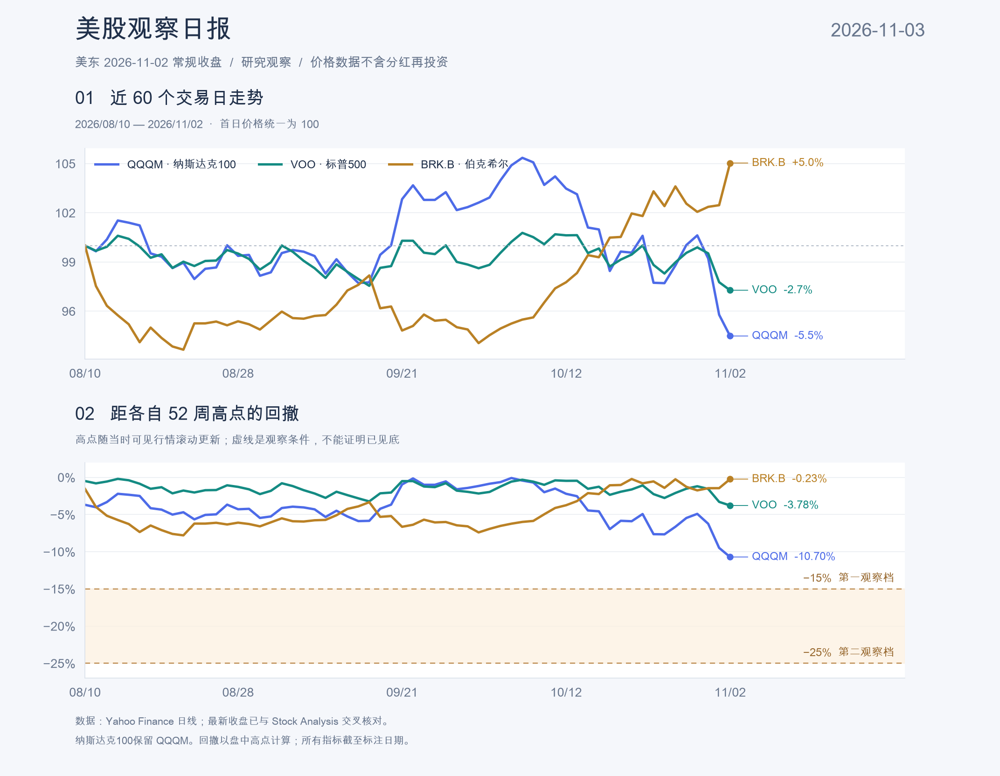
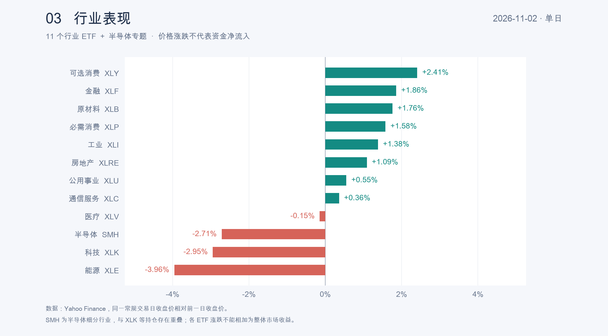

# 美股观察｜2026-11-03 北京时间

采用**美东2026-11-02（周一）常规收盘**，对应北京11/3 05:00；股票／ETF为美元，指数为点。下一常规交易日11/3，北京时间**22:30开盘**。已结束夏令时，本文按EST换算；盘后另列实际时刻，不当最终收盘。[NYSE交易日与时段](https://www.nyse.com/trade/hours-calendars)

**今日判断：已有VOO／QQQM／GOOG仓位，后续分批暂不加速，尤其暂缓叠加半导体与Google个股风险。** 标普500-0.51%，纳斯达克综合-1.07%，纳斯达克100-1.39%。QQQM距52周盘中高点回撤10.70%，尚未进入13%接近档，今天没有已核的新跨档提醒；BRK.B新高的精确数值仍待核。

**今天对你最重要的事**

1. **Google新融资要看回报和净债务，不能把借来的钱当经营改善。** 11/2新增SEC债券定价文件：**60亿欧元高级无担保债，预计11/5交割**。用途为一般公司用途，可能偿还原债；不能认定是AI专项或全额净新增杠杆，也未核实现金到账。六档固定票息年现金义务合计约**2.33亿欧元**，另有浮动档。你已有GOOG，直接占已知股票市值约25.7%，另有VOO／QQQM间接暴露，本次未重核穿透权重。因此融资消息不支持加速增加同公司敞口。最强反证是替代更高成本旧债、后续交付与现金回报覆盖新增成本；下一项核11/5交割与资金用途、TPU回款及2027投入。旧Google买价继续暂停。[SEC定价](https://www.sec.gov/Archives/edgar/data/1652044/000119312526443857/d134038dfwp.htm) · [公司研究与资本桥边界](./company_research.md)
2. **QQQM已接近200日均线，继续下跌时先控制追加速度。** 收280.49，MA200为279.91，仅高0.21%；当日量为此前20日均量1.59倍。SMH−2.71%、SOXX−3.79%、DRAM−3.52%，日跌幅或高点回撤都不能替代盈利估值。按你3–5年、尽量控制回撤的目标，维持已有观察；下一批若考虑执行，先核总股票上限与既定额度，研究顺序偏宽基VOO，暂不叠加多只科技／半导体产品。反证是成长盈利兑现、趋势快速反转；观察常规收盘与量能，不用盘后价格宣布200日线已守住或已跌破。均线是风险参照，不是保证或自动卖出线。[QQQM同日行情](https://stockanalysis.com/etf/qqqm/history/) · [SMH行情](https://stockanalysis.com/etf/smh/history/)
3. **SGOV−0.30%主要对应除息，不能读成短债突然大亏。** 官方确认11/2除息，每股收益分配**0.328581美元**，11/5支付。用前收100.73、本收100.43加应收分配估算，税前简单单日变化约**+0.0284%**，尚未包含税费与买卖价差，不是未来收益预测；仅看价格会漏掉该分配。最新可读30日SEC收益率**3.79%，截至10/30**，不冒充11/2的新收益率，不把派息率当总回报。你尚未确认持有SGOV，仍是暂存／防守候选，不是已执行55%配置。[发行人分红与SEC口径](https://www.ishares.com/us/products/314116/ishares-0-3-month-treasury-bond-etf) · [本次核验](./macro_research.md)

**对你当前状态的建议**

持仓数量沿用**10/30 09:37北京时间**授权核验的本地基线，未重新登录嘉信、未核定后续成交或已结算资金。本次只用11/2新收盘估算：已知股票市值约**10,815.56美元**，相对基线券商成本约**-2.14%**。它不是账户总回报，不含分红、税费、现金流与未确认的新交易。

| 实际代码 | 基线券商均价／美元 | 11/2收盘／美元 | 相对均价参考变化 |
|---|---|---|---|
|GOOG|281.9100|278.04|-1.37%|
|QQQM|293.3025|280.49|-4.37%|
|VOO|706.0000|691.32|-2.08%|

GOOG相对自身52周盘中高点回撤31.26%，相对你的基线均价约-1.37%，参照不同。真实GOOG使用278.04；GOOGL278.99只作公司研究，价格和成本不混算。

计划预算30,000美元、期限3–5年、暂时亏损约6,000美元的承受程度保持；20%不能保证为最大亏损，45%股票／55%SGOV仍未获采用。境外资金无急用不代表应全部持有股票，也不能由预算差额推断可用现金。**本日不给已有仓位机械止盈或自动加仓指令；后续按时间分批的金额与总股票上限仍需你明确采用。** 新主题和个股共用同一股票预算，已有Google与科技指数重叠时尤其需要约束。

[固定在线观察台](https://nolan-market-watch.choice-calf-0415.chatgpt.site/)继续提供一／二／三年联动收益、波动、最大回撤与固定MA50／200。历史已改按**已完成美股交易日**归档，周末／休市不新增重复日档；本篇为私人的北京时间日报，包含持仓参考，不上传公开站点。

**分类观察总表**

按重点指数ETF → 机器人 → AI／半导体 → 金融科技排列；伯克希尔与SGOV另列价值、现金管理。当前共17项，每个标的只归入一个主类别。纳斯达克100保留QQQM，QQQ已从当前清单移除。

收盘及回撤采用美东 **2026-11-02** 常规时段，报价均为美元。盘前列对应 **2026-11-03**；本版盘前状态为尚未开始，上一交易日历史盘前放在[时段详情](./extended_detail.md)。盘后每行附自身北京时间，美东时间和来源见[总表数据](./watchlist_table.json)。盘前相对之前最近一次常规收盘、盘后相对同日常规收盘。

| 分类 | 标的／定位 | 11-02收盘／当日 | 11-03盘前 | 11-02盘后参考／时间 | 常规收盘距52周高点回撤 | 15% / 25%观察价 | 研究判断／下一条件 |
| --- | --- | --- | --- | --- | --- | --- | --- |
| **01 宽基与风格ETF** | **VOO** · 标普500 | 691.32（-0.50%） | 尚未开始 | [692.10（+0.11%）](https://query1.finance.yahoo.com/v8/finance/chart/VOO?range=5d&interval=1m&includePrePost=true) · 北京11/03 07:29 | 3.78% | 610.70 / 538.85 | 已有持仓；后续分批不加速，优先核总股票上限；JOLTS/非农及宽基趋势，避免与主题ETF重复加大科技暴露 |
|  | **QQQM** · 纳斯达克100 | 280.49（-1.35%） | 尚未开始 | [281.45（+0.34%）](https://query1.finance.yahoo.com/v8/finance/chart/QQQM?range=5d&interval=1m&includePrePost=true) · 北京11/03 07:30 | 10.70% | 266.99 / 235.58 | 已有持仓；回撤10.70%，尚未进入13%接近档；接近MA200；关注常规收盘能否守住MA200与量能；不把盘后反弹当触发 |
|  | **SPMO** · 标普500动量因子 | 132.45（-2.80%） | 尚未开始 | [132.59（+0.11%）](https://query1.finance.yahoo.com/v8/finance/chart/SPMO?range=5d&interval=1m&includePrePost=true) · 北京11/03 07:07 | 18.39% | 未设置 | 动量因子，非另一只独立宽基；核与科技/半导体重叠及再平衡集中风险 |
|  | **MAGS** · 七巨头集中组合 | 68.19（-0.42%） | 尚未开始 | [68.00（-0.28%）](https://query1.finance.yahoo.com/v8/finance/chart/MAGS?range=5d&interval=1m&includePrePost=true) · 北京11/03 07:15 | 8.81% | 未设置 | 七巨头集中组合，非宽基；与GOOG/QQQM/VOO叠加的公司暴露 |
| **02 机器人相关** | **RRX** · 运动控制与电机 | 160.93（+2.35%） | 尚未开始 | [160.93（+0.00%）](https://query1.finance.yahoo.com/v8/finance/chart/RRX?range=5d&interval=1m&includePrePost=true) · 北京11/03 05:05 | 35.06% | 未设置 | 研究候选，估值安全边际未确认；11/3财报临近；核订单、现金转化、调整项和去杠杆 |
|  | **CGNX** · 机器视觉 | 56.41（+0.46%） | 尚未开始 | [56.70（+0.51%）](https://query1.finance.yahoo.com/v8/finance/chart/CGNX?range=5d&interval=1m&includePrePost=true) · 北京11/03 06:06 | 22.60% | 未设置 | 研究候选；11/4财报临近；核有机收入、利润与重组/并购现金支出 |
|  | **ATS** · 自动化系统 | 18.97（+3.15%） | 尚未开始 | [18.91（-0.31%）](https://query1.finance.yahoo.com/v8/finance/chart/ATS?range=5d&interval=1m&includePrePost=true) · 北京11/03 06:19 | 47.04% | 未设置 | 研究候选，日涨3.15%不构成低估；核订单兑现、营运资金、现金回款与净负债 |
| **03 科技与AI／半导体** | **GOOGL** · Google／AI云 | 278.99（-0.30%） | 尚未开始 | [280.71（+0.62%）](https://query1.finance.yahoo.com/v8/finance/chart/GOOGL?range=5d&interval=1m&includePrePost=true) · 北京11/03 07:30 | 31.72% | 未设置 | 公司研究对照；实际持仓GOOG；11/2新欧元融资待结算；核€60亿募资用途、11/5交割和新增利息，继续用FCF而非融资评估AI回报 |
|  | **NVDA** · AI芯片与算力 | 202.06（-1.26%） | 尚未开始 | [203.77（+0.85%）](https://query1.finance.yahoo.com/v8/finance/chart/NVDA?range=5d&interval=1m&includePrePost=true) · 北京11/03 07:31 | 16.97% | 未设置 | 已有ETF间接风险敞口；不因连续回撤追补；核算力客户资本开支现金回报及后续财报 |
|  | **SMH** · 半导体ETF | 508.31（-2.71%） | 尚未开始 | [513.60（+1.04%）](https://query1.finance.yahoo.com/v8/finance/chart/SMH?range=5d&interval=1m&includePrePost=true) · 北京11/03 07:29 | 24.34% | 未设置 | 半导体；距高点约24.34%，不自动买入；与SOXX高度相关，等待经营/估值而非只看跌幅 |
|  | **VGT** · 美国信息技术行业ETF | 113.83（-2.68%） | 尚未开始 | [113.87（+0.04%）](https://query1.finance.yahoo.com/v8/finance/chart/VGT?range=5d&interval=1m&includePrePost=true) · 北京11/03 07:17 | 12.88% | 未设置 | 科技行业ETF，非宽基；与纳指和半导体重复敞口 |
|  | **SOXX** · 半导体行业ETF | 453.65（-3.79%） | 尚未开始 | [459.23（+1.23%）](https://query1.finance.yahoo.com/v8/finance/chart/SOXX?range=5d&interval=1m&includePrePost=true) · 北京11/03 07:30 | 30.84% | 未设置 | 半导体连续下跌，仍非已确认低估；核盈利分母、11/5拆股统一序列，不自动套15/25仓位规则 |
|  | **DRAM** · 存储芯片主题ETF | 46.32（-3.52%） | 尚未开始 | [47.15（+1.79%）](https://query1.finance.yahoo.com/v8/finance/chart/DRAM?range=5d&interval=1m&includePrePost=true) · 北京11/03 07:31 | 不足52周／缺失 | 未设置 | 主动存储主题，历史不足一年，高波动；实际现金与互换敞口、盈利兑现；无MA200或完整52周 |
| **04 医疗与生物科技** | **MRNA** · Moderna／mRNA药物与疫苗 | 220.83（-0.40%） | 尚未开始 | [221.18（+0.16%）](https://query1.finance.yahoo.com/v8/finance/chart/MRNA?range=5d&interval=1m&includePrePost=true) · 北京11/03 07:19 | 13.22% | 未设置 | 医疗生物科技，低估结论未完成；11/6财报现金消耗和商业化，历史极端跳变原因仍需原始披露 |
| **05 金融科技** | **SOFI** · 数字银行与金融平台 | 16.60（-0.95%） | 尚未开始 | [16.68（+0.48%）](https://query1.finance.yahoo.com/v8/finance/chart/SOFI?range=5d&interval=1m&includePrePost=true) · 北京11/03 07:30 | 49.28% | 未设置 | 估值待完成；2027调整EPS仅管理层展望；待Q3完整10-Q核贷款、资金成本、信用、资本及稀释 |
| **06 价值与综合经营** | **BRK.B** · 伯克希尔B | 556.11（+2.51%） | 尚未开始 | [556.64（+0.10%）](https://query1.finance.yahoo.com/v8/finance/chart/BRK-B?range=5d&interval=1m&includePrePost=true) · 北京11/03 07:26 | 0.23% | 473.80 / 418.06 | 观察候选；新高557.41/557.59来源差异待核；新高阈值不写入提醒；查官方经营披露，不猜上涨原因 |
| **07 现金管理** | **SGOV** · 0–3个月美债ETF | 100.43（-0.30%） | 尚未开始 | [100.43（-0.00%）](https://query1.finance.yahoo.com/v8/finance/chart/SGOV?range=5d&interval=1m&includePrePost=true) · 北京11/03 07:31 | 0.31% | 未设置 | 现金管理候选；11/2除息，价格跌幅不等于总回报；核每股派息0.328581、11/5支付与30日SEC3.79%截至10/30 |

研究状态表达当前结论，不代表持仓或已批准交易；15%/25%观察价只保留QQQM、VOO、BRK.B三项。其他行的“未设置”不等于没有风险。盘后无有效报价写缺失，不用收盘填充；单源分钟价格与零量延续报价仅作参考，来源差异见[盘后核验](./extended_verification.json)。SGOV的价格回撤受派息影响，不能按股票跌幅解释。

BRK.B本次Yahoo盘中高点557.41，第二来源557.59；新观察价仅供同源图表展示、尚未核定，不写入提醒状态。最后有效状态仍为10/29、高点549.96及467.47／412.47两档。QQQM高点314.11与第二源314.12差一美分，沿用Yahoo统一口径。

**Google估值结果**

11/2GOOG278.04（−0.06%）、GOOGL278.99（−0.30%）。新债券文件是新增融资事实，未产生新的经营季度，不能把发行额当FCF。承销折价后、其他费用前募集现金约59.755075亿欧元；原文没有明确全部偿债比例，交割后净现金／净债务与用途需同时更新，不能只增现金不增债务或重复扣融资成本。

本次推进了旧模型的TPU营运资金问题：官方递延收入可包含“已收或已到期应收”，不能把全公司合同负债都当TPU实收预付款。归一化硬件现金周期算例显示，预付款与库存／回款天数足以显著改变占款；它是研究假设，不是新业绩预测或新合理股价。完整Q3 10-Q已读，不再称尚未公布。没有把旧三情景68.25／216.28／402.11美元恢复为买价，也未声称现价已低估。[新融资、票息算术与TPU情景](./company_research.md) · [原资本桥](../2026-10-30/google_update/google_update.md)

**SOFI研究观察**

SOFI16.60（−0.95%）。以2027管理层调整EPS0.90的未来展望作简单参照约**18.44倍**，不是TTM已实现GAAP盈利估值，更非完整低估结论。此次SEC recent仍未见新Q3完整10-Q，业绩8-K已于10/27发布；继续核贷款销售与留存、公允价值、逾期核销、资金成本、监管资本及稀释。银行存款是经营资金，不能套用工业公司净现金DCF。[实际读取范围](./company_research.md) · [此前资本回报检验](../2026-10-30/sofi_research.md)

**机器人供应链筛选**

RRX160.93（+2.35%）、CGNX56.41（+0.46%）、ATS18.97（+3.15%）保持研究候选。RRX **11/3美东盘前发稿、北京23:00电话会**；CGNX **11/4美东盘后发稿、11/5北京21:30电话会**。当前没有新Q3实际利润与回款，不因单日相对强势认定低估。旧RRX摊销恢复／17倍EPS情景仍只是条件模型，新增订单必须核交付、现金转化和去杠杆；ATS此次未深读新披露，明确保留估值缺口。[官方日历及研究边界](./company_research.md)

BRK.B收556.11、+2.51%，两源均显示新高，但精确盘中高点不同。所读IR／SEC目录未核到11/2新增Q3经营公告，不能把上涨归因于财报、回购或保险改善；单一公司仍需独立估值，不套用ETF首次仓位比例。

MRNA220.83（−0.40%），11/6北京21:00电话会关注现金消耗与商业化；临床、审批、商业收入和盈利分开。历史8/19极端跳变价格曾核对，原因未查清，不把高历史收益作为预期回报。本次没有新“已低估”入选股票。

**行业观察**

11行业ETF **8涨3跌**，SMH另列；这种分化只反映行业ETF价格，不等于个股全市场广度或资金净流入。

- **科技XLK−2.95%、半导体SMH−2.71%**：与你现有成长敞口最相关，QQQM只略高于MA200，继续保持追加纪律；SOXX与SMH不是两份独立分散。
- **可选消费XLY+2.41%、金融XLF+1.86%、工业XLI+1.38%**：表现比科技强，不能从单日轮动直接得出应卖科技买这些行业。
- **能源XLE−3.96%**：当日拖累较大，商品价格／供需与估值需另核，不能把全日跌幅简单归因于某条早盘新闻。

| 行业／ETF | 当日 | 近5交易日 | 近21交易日 | 当日相对VOO（百分点） | 近21日相对VOO（百分点） |
|---|---|---|---|---|---|
|可选消费 XLY|+2.41%|+3.41%|+7.38%|+2.91|+9.67|
|金融 XLF|+1.86%|+2.75%|+7.61%|+2.36|+9.90|
|原材料 XLB|+1.76%|+4.46%|+9.84%|+2.27|+12.14|
|必需消费 XLP|+1.58%|+3.26%|+12.79%|+2.08|+15.08|
|工业 XLI|+1.38%|+1.65%|-0.14%|+1.88|+2.15|
|房地产 XLRE|+1.09%|+1.96%|+6.93%|+1.59|+9.23|
|公用事业 XLU|+0.55%|+2.63%|+9.64%|+1.05|+11.93|
|通信服务 XLC|+0.36%|-3.46%|-9.12%|+0.86|-6.83|
|医疗 XLV|-0.15%|+2.97%|+11.08%|+0.36|+13.38|
|半导体 SMH|-2.71%|-6.15%|-19.39%|-2.21|-17.10|
|科技 XLK|-2.95%|-6.49%|-12.81%|-2.44|-10.51|
|能源 XLE|-3.96%|-3.43%|+7.05%|-3.45|+9.34|

**🔎 Reddit 投资与信息差观察**

本次**没有日期核验通过、可新增报道的原帖**。六社区RSS403，可读New／Top仍有旧缓存；这是过去24小时扫描的覆盖缺口，不能说“Reddit没有新讨论”，不据零条结果确认市场一致看法。没有编造多空共识、热度或“市场未定价”的机会，不推进成功扫描游标。[实际来源与读取时间](./reddit_sources.json) · [筛选说明](./reddit_digest.md)

FiNews首页本次仍是10/30、UTC22:10:49更新，未读到11/2新日报；不把旧Meta展望／Okta维护事件当今日新信息，也不拿聚合行情作独立交叉核验。[FiNews实际范围](./finews_digest.md)

**距观察档还有多远**

| 标的 | 收盘／美元 | 本次Yahoo高点／日期 | 回撤 | 15%观察价 | 25%观察价 | 距15%差额（百分点） | 当前价至15%需变动 |
|---|---|---|---|---|---|---|---|
|QQQM|280.49|314.11／2026-10-06|10.70%|266.99|235.58|4.30|-4.81%|
|VOO|691.32|718.47／2026-10-06|3.78%|610.70|538.85|11.22|-11.66%|
|BRK-B|556.11|557.41／2026-11-02|0.23%|473.80|418.06|14.77|-14.80%|

QQQM离13%接近区间差**2.30个百分点**，从当前价到15%观察价266.99需约**−4.81%**；两种百分比含义不同。VOO回撤3.78%，亦未接近。今日没有新13%／15%／23%／25%档提醒，15%和25%仍是评估条件，不是确定买点。

BRK.B本次高点Yahoo557.41、StockAnalysis557.59，较前值都更高，但精确高点再次不一致。曲线和表格沿Yahoo统一序列，**BRK.B持久提醒仍保留10/29最后有效状态**；只把本次尝试写入deferred_checks。QQQM／VOO有新有效收盘可推进至11/2。QQQM高点314.11与第二源314.12差一美分，观察价分别266.99／267.00，披露而不制造重复提醒。[当前交叉核验](./quote_verification.json)

**利率与未来一周事件**

VIX日线**21.15、+8.91%**，为统一提供方常规日线，尚未完成同步官方逐笔核定。财政部11/2参考曲线**2年4.59%、10年4.91%**，较10/30分别+3／−3基点，不是可直接成交收益率。

ISM官方10月制造业PMI **55.5**，生产59.0、新订单55.5；价格指数75.2，虽较前月下降，仍表示价格上涨。它不是CPI，也不能单凭一项调查推导已衰退或日内股价因果。本周关键是**11/3 23:00 JOLTS、11/6 21:30非农**；11/5生产率21:30。AMD11/3美东盘后、北京11/4 06:00电话会；Google债券11/5预计交割；Moderna11/6北京21:00电话会。本周无FOMC，CPI为11/10北京21:30，不错放到本周。[官方宏观日历与收益率](./macro_research.md) · [公司事件](./company_research.md)

**完整表现与趋势数据**

| 标的 | 当日 | 近5交易日 | 近21交易日 | MA50 | MA200 | 当日量／此前20日均量 |
|---|---|---|---|---|---|---|
|VOO|-0.50%|-1.72%|-2.29%|705.45|670.47|1.52倍|
|QQQM|-1.35%|-4.35%|-9.14%|298.26|279.91|1.59倍|
|GOOG|-0.06%|-11.51%|-18.31%|334.46|338.43|1.35倍|
|GOOGL|-0.30%|-11.93%|-18.78%|337.76|340.39|1.46倍|
|BRK-B|+2.51%|+1.38%|+10.64%|516.32|496.06|1.35倍|
|RRX|+2.35%|+6.94%|+0.66%|157.70|189.81|1.42倍|
|CGNX|+0.46%|+1.40%|-13.18%|59.79|57.96|0.80倍|
|ATS|+3.15%|+0.11%|+3.89%|18.79|26.57|0.94倍|
|SOFI|-0.95%|+14.80%|+5.26%|16.53|17.74|0.99倍|
|NVDA|-1.26%|-6.45%|-13.63%|221.50|204.46|1.16倍|
|SMH|-2.71%|-6.15%|-19.39%|571.57|520.06|0.91倍|
|SOXX|-3.79%|-7.76%|-22.97%|527.79|476.95|1.13倍|
|SPMO|-2.80%|-5.76%|-13.56%|147.03|138.05|2.27倍|
|MAGS|-0.42%|-3.55%|-6.06%|70.92|66.35|0.93倍|
|VGT|-2.68%|-5.90%|-11.29%|122.39|109.48|1.66倍|
|DRAM|-3.52%|-4.16%|-25.02%|55.74|不足200交易日|0.92倍|
|MRNA|-0.40%|+11.05%|+16.22%|184.00|87.49|0.43倍|
|SGOV|-0.30%|-0.24%|-0.01%|100.57|100.55|1.78倍|

| 指数 | 收盘（点） | 当日 | 近5交易日 | 近21交易日 |
|---|---|---|---|---|
|标普500|7,541.40|-0.51%|-1.76%|-2.35%|
|纳斯达克综合|25,164.36|-1.07%|-3.84%|-7.45%|
|纳斯达克100|27,989.82|-1.39%|-4.38%|-9.15%|

**口径、核验和缺口**

- 新取11/2完整日线共33项；18个股票／ETF常规收盘均与带日期的StockAnalysis历史表核对一致。它是第三方核验，可能与Yahoo共享上游，未称交易所逐笔审计。BRK精确高点保留缺口，QQQM／VOO高点日期已本次重读。
- 60个连续交易日收盘为8/10—11/2，共59个价格间隔；逐日滚动高点仅用当时可见364日盘中high，不使用今天高点回填。图为价格表现、不含分红；SGOV的当日价格与含分配近似分开。MA50／200使用拆股调整Close，量比为当天量／此前20日均量。DRAM148条历史，无MA200／完整52周；SOXX后续拆股需统一序列。
- 时段采集UTC11/2 23:31:35，即北京11/3 07:31:35、美国18:31:35EST。11/2盘后仍在进行，所有最新分钟为零量，不确认真实新成交；有17项第二来源带明确时刻参考，时刻不同的差异不隐去，不更新收盘提醒。11/3盘前尚未开始。[详细时刻与差异](./extended_detail.md) · [时段来源](./extended_verification.json)
- Google融资是新事实，TPU现金周期是基于已发布10-Q的研究算例；未重算新合理股价。SOFI完整信用资料、候选完整估值、指数盈利估值分母与穿透持仓权重仍缺；因此不把低表面PE或大回撤升级为低估。
- Reddit覆盖受限与无新增已核线索分别说明。持仓数量核验仍为10/30，不自动访问券商／执行交易。QQQ已从当前清单移除，不重新引入。两张PNG已打开核对日期、正负号与末值，HTML沿用模板做资源和关键数字检查，不重复宣称实机版式验收。

[日线完整数据](./metrics.json) · [来源清单](./manifest.json) · [最终核验](./verification.json) · [分类表](./watchlist_table.json)
